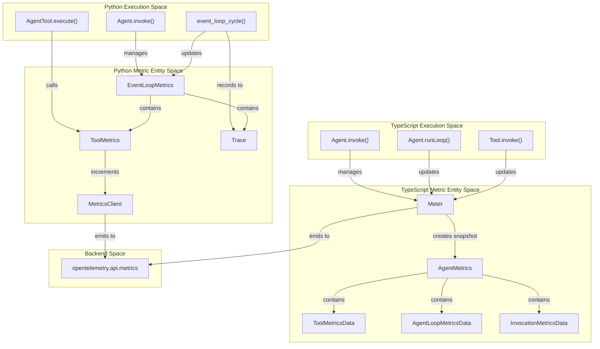
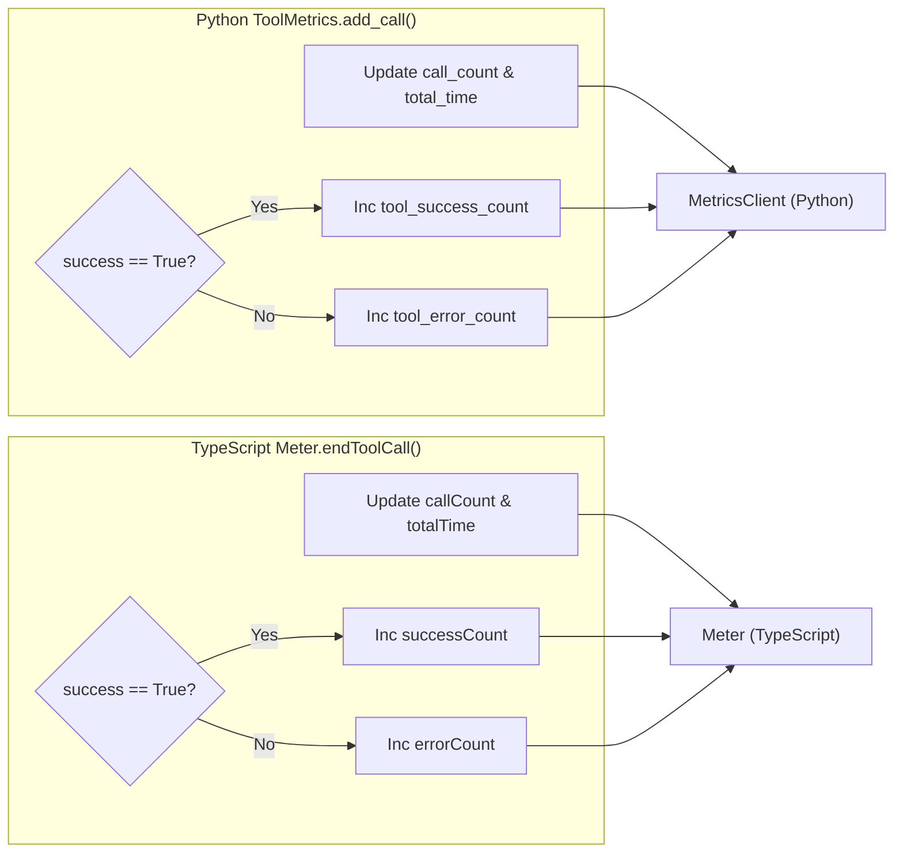

<!-- source: DeepWiki mcp.deepwiki.com · repo strands-agents/sdk-python · page 7.3 Metrics and Performance Monitoring · fetched 2026-10-26 -->

# Metrics and Performance Monitoring

<details>
<summary>Relevant source files</summary>

The following files were used as context for generating this wiki page:

- [site/src/content/docs/user-guide/concepts/multi-agent/graph.mdx](site/src/content/docs/user-guide/concepts/multi-agent/graph.mdx)
- [site/src/content/docs/user-guide/concepts/multi-agent/graph.ts](site/src/content/docs/user-guide/concepts/multi-agent/graph.ts)
- [site/src/content/docs/user-guide/concepts/multi-agent/multi-agent-patterns.mdx](site/src/content/docs/user-guide/concepts/multi-agent/multi-agent-patterns.mdx)
- [site/src/content/docs/user-guide/concepts/tools/index.mdx](site/src/content/docs/user-guide/concepts/tools/index.mdx)
- [site/src/content/docs/user-guide/concepts/tools/tools_imports.ts](site/src/content/docs/user-guide/concepts/tools/tools_imports.ts)
- [site/src/content/docs/user-guide/observability-evaluation/logs.mdx](site/src/content/docs/user-guide/observability-evaluation/logs.mdx)
- [site/src/content/docs/user-guide/observability-evaluation/metrics.mdx](site/src/content/docs/user-guide/observability-evaluation/metrics.mdx)
- [strands-ts/src/telemetry/__tests__/meter.test.ts](strands-ts/src/telemetry/__tests__/meter.test.ts)
- [strands-ts/src/telemetry/meter.ts](strands-ts/src/telemetry/meter.ts)

</details>


## Purpose and Scope

This page documents the metrics and performance monitoring capabilities of the Strands Agents SDK. It covers token usage tracking, cache metrics, latency measurements, and integration with observability backends like OpenTelemetry and AWS CloudWatch. These metrics are automatically captured during agent execution to provide visibility into cost, performance, and reliability.

The SDK implements a dual-layered approach: high-level tracing via `Trace` objects and granular metric counters/histograms via a dedicated `MetricsClient` [strands-py/src/strands/telemetry/metrics.py:210-240]().

---

## Core Metrics Architecture

The metrics system is built around several key data structures and a central client that interfaces with the OpenTelemetry Metrics API.

### Metrics Data Structures

| Class | Description | Location |
|-------|-------------|----------|
| `Trace` | Represents a single operation step with start/end times and metadata. | [strands-py/src/strands/telemetry/metrics.py:21-43]() |
| `ToolMetrics` | Tracks call counts, successes, errors, and duration for specific tools. | [strands-py/src/strands/telemetry/metrics.py:108-123]() |
| `EventLoopCycleMetric` | Aggregates token usage for a single event loop iteration. | [strands-py/src/strands/telemetry/metrics.py:156-166]() |
| `AgentInvocation` | Contains all cycles and accumulated token usage for one agent run. | [strands-py/src/strands/telemetry/metrics.py:169-181]() |
| `EventLoopMetrics` | The primary container for aggregated performance data across an agent's lifetime. | [strands-py/src/strands/telemetry/metrics.py:184-201]() |
| `AgentMetrics` (TypeScript) | Aggregates metrics across the entire agent loop execution. | [strands-ts/src/telemetry/meter.ts:166-212]() |
| `ToolMetricsData` (TypeScript) | Per-tool execution metrics. | [strands-ts/src/telemetry/meter.ts:23-44]() |
| `AgentLoopMetricsData` (TypeScript) | Per-cycle usage tracking. | [strands-ts/src/telemetry/meter.ts:49-64]() |
| `InvocationMetricsData` (TypeScript) | Per-invocation metrics tracking. | [strands-ts/src/telemetry/meter.ts:69-79]() |

### Metrics Collection Flow

The following diagram maps the relationship between runtime execution entities and the metrics collection infrastructure.

**Execution to Metric Mapping**



**Sources:**
- Python: [strands-py/src/strands/telemetry/metrics.py:21-105](), [strands-py/src/strands/telemetry/metrics.py:125-153](), [strands-py/src/strands/telemetry/metrics.py:184-201](), [strands-py/src/strands/telemetry/metrics.py:210-240]()
- TypeScript: [strands-ts/src/telemetry/meter.ts:1-11](), [strands-ts/src/telemetry/meter.ts:23-44](), [strands-ts/src/telemetry/meter.ts:49-64](), [strands-ts/src/telemetry/meter.ts:69-79](), [strands-ts/src/telemetry/meter.ts:166-212]()

---

## Token Usage and Performance Metrics

### Standard Token Metrics

Token usage is captured for every model invocation through the `Usage` type. The SDK tracks:

- **`inputTokens`**: Tokens in the input messages and system prompt.
- **`outputTokens`**: Tokens generated by the model.
- **`totalTokens`**: Sum of input and output tokens.
- **`cacheReadInputTokens`**: Tokens read from provider cache.
- **`cacheWriteInputTokens`**: Tokens written to provider cache.

These are accumulated in the `EventLoopMetrics.accumulated_usage` field in Python [strands-py/src/strands/telemetry/metrics.py:193-194]() and `AgentMetrics.accumulatedUsage` in TypeScript [strands-ts/src/telemetry/meter.ts:91-92](), providing a total cost view for the entire agent session.

### Performance Histograms

The `MetricsClient` (Python) and `Meter` (TypeScript) utilize OpenTelemetry Histograms to track timing distributions:

- **`strands.event_loop.latency`**: Total duration of the event loop.
- **`strands.tool.duration`**: Execution time for individual tool calls.
- **`strands.model.time_to_first_token`**: Latency until the first byte of a streaming response.

**Sources:**
- Python: [strands-py/src/strands/telemetry/metrics_constants.py:11-18](), [strands-py/src/strands/telemetry/metrics.py:230-240]()
- TypeScript: [strands-ts/src/telemetry/meter.ts:1-11]()

---

## Tool Execution Monitoring

Tool performance is tracked via the `ToolMetrics` class in Python and `ToolMetricsData` in TypeScript. Every time a tool is invoked, the relevant methods are triggered to update both local counters and global OpenTelemetry metrics.

**Tool Metric Logic**



**Sources:**
- Python: [strands-py/src/strands/telemetry/metrics.py:125-153]()
- TypeScript: [strands-ts/src/telemetry/meter.ts:300-320]()

---

## Metric Integration and Backends

### OpenTelemetry Integration

The `MetricsClient` (Python) and `Meter` (TypeScript) are singletons that initialize OpenTelemetry instruments. They use the `opentelemetry.metrics` API to create counters and histograms that can be exported to any OTLP-compatible backend.

| Metric Name | Type | Description |
|-------------|------|-------------|
| `strands.tool.call_count` | Counter | Total number of tool invocations. |
| `strands.tool.success_count` | Counter | Successful tool executions. |
| `strands.tool.error_count` | Counter | Failed tool executions. |
| `strands.event_loop.input.tokens` | Histogram | Distribution of input tokens per cycle. |

### Tracer and Semantic Conventions

The `Tracer` class manages OpenTelemetry spans and supports opt-in semantic conventions via the `OTEL_SEMCONV_STABILITY_OPT_IN` environment variable [strands-py/src/strands/telemetry/tracer.py:83-88]().

- **`gen_ai_latest_experimental`**: Enables the latest GenAI semantic conventions [strands-py/src/strands/telemetry/tracer.py:101]().
- **`gen_ai_tool_definitions`**: Includes tool definitions in spans [strands-py/src/strands/telemetry/tracer.py:102]().
- **`gen_ai_use_latest_invocation_tokens`**: Controls token reporting behavior [strands-py/src/strands/telemetry/tracer.py:103]().

The `Tracer` also detects if Langfuse is the OTLP endpoint to adjust behavior accordingly [strands-py/src/strands/telemetry/tracer.py:115-124]().

**Sources:**
- Python: [strands-py/src/strands/telemetry/metrics_constants.py:3-19](), [strands-py/src/strands/telemetry/metrics.py:210-240](), [strands-py/src/strands/telemetry/tracer.py:77-124]()
- TypeScript: [strands-ts/src/telemetry/meter.ts:1-11]()

---

## Programmatic Access to Metrics

### Using the Trace API (Python)

Developers can manually instrument sections of code using the `Trace` class to capture timing and metadata that will be aggregated into the agent's final report.

```python
from strands.telemetry.metrics import Trace

# Create a trace for a specific operation [strands-py/src/strands/telemetry/metrics.py:24-43]
op_trace = Trace(name="CustomCalculation", raw_name="calc_v1")
# ... perform operation ...
op_trace.end() # [strands-py/src/strands/telemetry/metrics.py:54-61]

# Traces can be nested [strands-py/src/strands/telemetry/metrics.py:63-70]
parent_trace.add_child(op_trace)
```

**Sources:** [strands-py/src/strands/telemetry/metrics.py:24-70]()

### Accessing Aggregated Results

At the end of an agent execution, the `AgentResult` provides access to the collected metrics.

**Python**
The `AgentResult` provides access to the collected `EventLoopMetrics` [site/src/content/docs/user-guide/observability-evaluation/metrics.mdx:45]().

```python
# AgentResult contains the metrics container [site/src/content/docs/user-guide/observability-evaluation/metrics.mdx:31-43]
result = agent("What is the square root of 144?")
metrics = result.metrics

# Accessing specific metrics
print(f"Total tokens: {metrics.accumulated_usage['totalTokens']}")
print(f"Execution time: {sum(metrics.cycle_durations):.2f} seconds")
print(f"Tools used: {list(metrics.tool_metrics.keys())}")

# Cache metrics (when available)
if 'cacheReadInputTokens' in metrics.accumulated_usage:
    print(f"Cache read tokens: {metrics.accumulated_usage['cacheReadInputTokens']}")
if 'cacheWriteInputTokens' in metrics.accumulated_usage:
    print(f"Cache write tokens: {metrics.accumulated_usage['cacheWriteInputTokens']}")
```

The `AgentResult` also provides convenience properties for context size analysis:
- **`context_size`**: Input tokens from the last LLM call [strands-py/src/strands/agent/agent_result.py:39-45]().
- **`projected_context_size`**: Projected tokens (input + output) for the next call [strands-py/src/strands/agent/agent_result.py:48-54]().

**TypeScript**
The `AgentResult` provides access to the `AgentMetrics` object [site/src/content/docs/user-guide/observability-evaluation/metrics.mdx:56-58]().

```typescript
// Example from site/src/content/docs/user-guide/observability-evaluation/metrics.ts:basic_metrics
import { Agent } from '@strands-agents/sdk'
import { calculator } from '@strands-agents/sdk/vended-tools/calculator'

const agent = new Agent({ tools: [calculator] })
const result = await agent.invoke('What is the square root of 144?')

// Access metrics through the AgentResult
console.log(`Total tokens: ${result.metrics?.accumulatedUsage.totalTokens}`)
console.log(`Execution time: ${result.metrics?.totalDuration} ms`)
console.log(`Tools used: ${Object.keys(result.metrics?.toolMetrics ?? {})}`)

// Cache metrics (when available)
if (result.metrics?.accumulatedUsage.cacheReadInputTokens) {
  console.log(`Cache read tokens: ${result.metrics.accumulatedUsage.cacheReadInputTokens}`)
}
if (result.metrics?.accumulatedUsage.cacheWriteInputTokens) {
  console.log(`Cache write tokens: ${result.metrics.accumulatedUsage.cacheWriteInputTokens}`)
}
```

**Sources:**
- Python: [site/src/content/docs/user-guide/observability-evaluation/metrics.mdx:31-45](), [strands-py/src/strands/agent/agent_result.py:39-54]()
- TypeScript: [site/src/content/docs/user-guide/observability-evaluation/metrics.mdx:56-58](), [strands-ts/src/telemetry/meter.ts:157-164]()

---

## Summary of Metric Constants

The following constants are used throughout the SDK to ensure consistent naming across telemetry backends:

| Constant | Value |
|----------|-------|
| `STRANDS_EVENT_LOOP_CYCLE_COUNT` | `"strands.event_loop.cycle_count"` |
| `STRANDS_TOOL_CALL_COUNT` | `"strands.tool.call_count"` |
| `STRANDS_EVENT_LOOP_LATENCY` | `"strands.event_loop.latency"` |
| `STRANDS_MODEL_TIME_TO_FIRST_TOKEN` | `"strands.model.time_to_first_token"` |

**Sources:** [strands-py/src/strands/telemetry/metrics_constants.py:1-19]()

---

