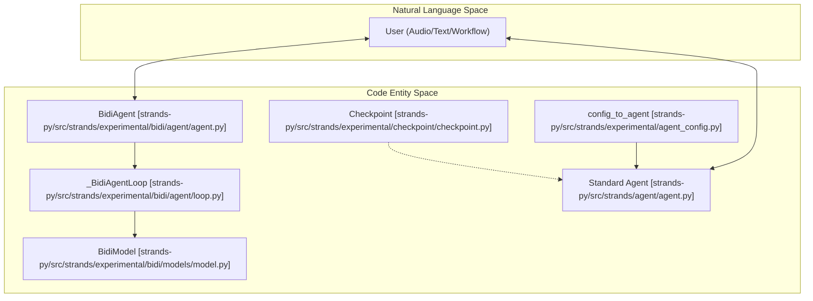
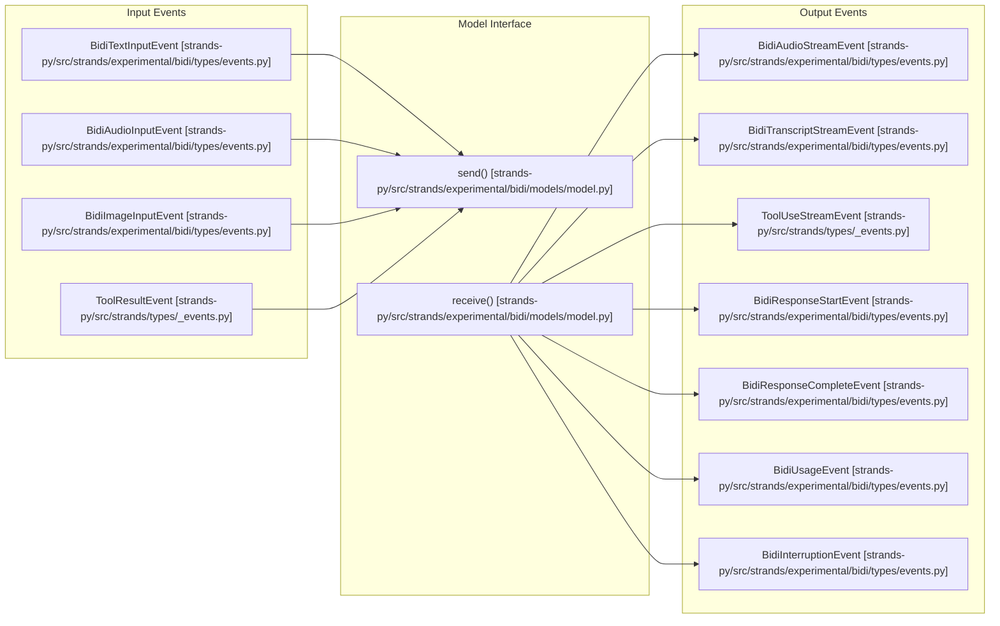

<!-- source: DeepWiki mcp.deepwiki.com · repo strands-agents/sdk-python · page 8 Experimental Features · fetched 2026-10-26 -->

# Experimental Features

Relevant source files

The following files were used as context for generating this wiki page:

- [strands-py/src/strands/experimental/bidi/_telemetry.py](strands-py/src/strands/experimental/bidi/_telemetry.py)
- [strands-py/src/strands/experimental/bidi/agent/loop.py](strands-py/src/strands/experimental/bidi/agent/loop.py)
- [strands-py/src/strands/experimental/bidi/models/gemini_live.py](strands-py/src/strands/experimental/bidi/models/gemini_live.py)
- [strands-py/src/strands/experimental/bidi/models/nova_sonic.py](strands-py/src/strands/experimental/bidi/models/nova_sonic.py)
- [strands-py/src/strands/experimental/bidi/models/openai_realtime.py](strands-py/src/strands/experimental/bidi/models/openai_realtime.py)
- [strands-py/src/strands/models/_validation.py](strands-py/src/strands/models/_validation.py)
- [strands-py/src/strands/types/_snapshot.py](strands-py/src/strands/types/_snapshot.py)
- [strands-py/tests/strands/agent/test_snapshot.py](strands-py/tests/strands/agent/test_snapshot.py)
- [strands-py/tests/strands/experimental/bidi/agent/test_agent.py](strands-py/tests/strands/experimental/bidi/agent/test_agent.py)
- [strands-py/tests/strands/experimental/bidi/agent/test_loop.py](strands-py/tests/strands/experimental/bidi/agent/test_loop.py)
- [strands-py/tests/strands/experimental/bidi/agent/test_loop_telemetry.py](strands-py/tests/strands/experimental/bidi/agent/test_loop_telemetry.py)
- [strands-py/tests/strands/experimental/bidi/models/test_gemini_live.py](strands-py/tests/strands/experimental/bidi/models/test_gemini_live.py)
- [strands-py/tests/strands/experimental/bidi/models/test_nova_sonic.py](strands-py/tests/strands/experimental/bidi/models/test_nova_sonic.py)
- [strands-py/tests/strands/experimental/bidi/models/test_openai_realtime.py](strands-py/tests/strands/experimental/bidi/models/test_openai_realtime.py)
- [strands-py/tests/strands/experimental/bidi/types/test_events.py](strands-py/tests/strands/experimental/bidi/types/test_events.py)
- [strands-py/tests/strands/models/test__validation.py](strands-py/tests/strands/models/test__validation.py)

The `strands.experimental` namespace contains subsystems that are currently in development and not yet part of the stable API. These features include **Bidirectional Streaming** for real-time voice and text, a **Checkpoint System** for durable agent execution, and **Agent Configuration Utilities**.

These features are subject to change but provide advanced capabilities for use cases requiring persistent connections, crash-resilience, or configuration-driven agent instantiation.

## Overview of Experimental Subsystems

The experimental features bridge the gap between high-level agent definitions and complex execution requirements like low-latency audio or durable long-running workflows.

### High-Level Component Interaction

The following diagram illustrates how the experimental entities relate to the core SDK components:

**Experimental System Architecture**

Sources: [strands-py/src/strands/experimental/bidi/agent/agent.py:12-12](), [strands-py/src/strands/experimental/checkpoint/checkpoint.py:46-68](), [strands-py/src/strands/experimental/agent_config.py:7-7]()

---

## Bidirectional Streaming Agent

The `BidiAgent` is the central orchestrator for real-time interactions. Unlike the standard agent, it maintains an active session via a `_BidiAgentLoop` [strands-py/src/strands/experimental/bidi/agent/loop.py:50-50]() that processes events asynchronously using a `_TaskPool` [strands-py/src/strands/experimental/bidi/agent/loop.py:66-67]().

Key features include:
*   **Persistent Connections**: Maintains a long-running session with the model provider initiated via `start()` [strands-py/src/strands/experimental/bidi/agent/loop.py:88-146]().
*   **Interruption Handling**: Automatically detects when a user starts speaking or providing new input to halt current model generation via `BidiInterruptionEvent` [strands-py/src/strands/experimental/bidi/types/events.py:35-35]().
*   **Event-Driven I/O**: Uses `BidiInput` and `BidiOutput` protocols to abstract over different communication mediums. Built-in implementations include `BidiAudioIO` and `BidiTextIO` [strands-py/src/strands/experimental/bidi/io/text.py:65-65]().
*   **Telemetry Integration**: The `_BidiAgentLoop` integrates with OpenTelemetry to provide detailed tracing for session lifecycle, connection establishment, response generation, tool execution, and connection restarts [strands-py/src/strands/experimental/bidi/agent/loop.py:109-115]().

For implementation details on the task group architecture and event handling, see **[Bidirectional Streaming Agent](#8.1)**.

Sources: [strands-py/src/strands/experimental/bidi/agent/loop.py:41-178](), [strands-py/src/strands/experimental/bidi/__init__.py:75-82](), [strands-py/src/strands/experimental/bidi/agent/loop.py:109-115]()

---

## Bidirectional Model Providers

Models in the experimental namespace implement the `BidiModel` interface [strands-py/src/strands/experimental/bidi/models/model.py:15-15](). This defines a standardized interface for sending and receiving diverse modalities (audio, text, images) over a single persistent stream.

### Supported Experimental Models
| Model Class | Provider / Protocol | Key Capabilities |
| :--- | :--- | :--- |
| `BidiNovaSonicModel` | Amazon Bedrock | Low-latency audio-to-audio, hierarchical event sequences, tool execution with content containers, 8-minute connection limits [strands-py/src/strands/experimental/bidi/models/nova_sonic.py:1-14]() |
| `BidiOpenAIRealtimeModel` | OpenAI Realtime API | WebSocket-based multimodal streaming, voice activity detection, function calling, client-side timeout management [strands-py/src/strands/experimental/bidi/models/openai_realtime.py:1-55]() |
| `BidiGeminiLiveModel` | Google Gemini Live API | Multimodal live interaction, uses official Google GenAI SDK, built-in tool integration, automatic WebSocket management [strands-py/src/strands/experimental/bidi/models/gemini_live.py:1-13]() |

**BidiModel Event Mapping**

Sources: [strands-py/src/strands/experimental/bidi/models/model.py:15-15](), [strands-py/src/strands/experimental/bidi/types/events.py:29-41](), [strands-py/src/strands/types/_events.py:1-1]()

For details on specific provider configurations and audio I/O adapters, see **[Bidirectional Model Providers](#8.2)**.

---

## Checkpoint System

The experimental `Checkpoint` system enables durable, crash-resilient agent workflows by capturing agent state at specific cycle boundaries. This is designed for integration with durability providers like Temporal [strands-py/src/strands/experimental/checkpoint/checkpoint.py:1-5]().

### Checkpoint Positions
The system supports two primary pause points within the ReAct loop:
*   `after_model`: The model call has completed, but tools have not yet been executed [strands-py/src/strands/experimental/checkpoint/checkpoint.py:8-8]().
*   `after_tools`: All tools in the current cycle have executed, and the agent is ready for the next model call [strands-py/src/strands/experimental/checkpoint/checkpoint.py:9-9]().

A `Checkpoint` contains a `snapshot` of the agent's state, a `cycle_index`, and optional `app_data` for application-level context [strands-py/src/strands/experimental/checkpoint/checkpoint.py:46-68](). It uses a `schema_version` to ensure compatibility during reconstruction via `from_dict()` [strands-py/src/strands/experimental/checkpoint/checkpoint.py:81-89](). The `Snapshot` object itself provides mechanisms to resolve which fields of the agent state to capture based on presets, includes, and excludes [strands-py/src/strands/types/_snapshot.py:96-139]().

For details on implementing durable workflows and using `checkpointResume` content blocks, see **[Checkpoint System](#8.3)**.

Sources: [strands-py/src/strands/experimental/checkpoint/checkpoint.py:1-94](), [strands-py/src/strands/types/event_loop.py:39-49](), [strands-py/src/strands/types/_snapshot.py:96-139]()

---

## Agent Configuration Utilities

The experimental namespace includes utilities for defining agents via configuration objects rather than direct code instantiation. The `config_to_agent` function allows developers to hydrate an `Agent` instance from a dictionary or configuration file [strands-py/src/strands/experimental/agent_config.py:7-7]().

Sources: [strands-py/src/strands/experimental/__init__.py:7-9]()

---

