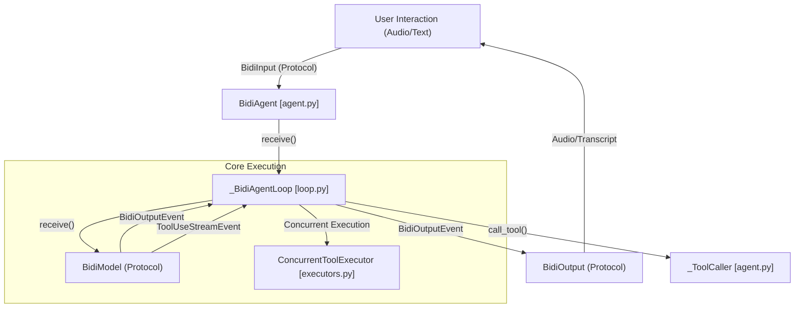
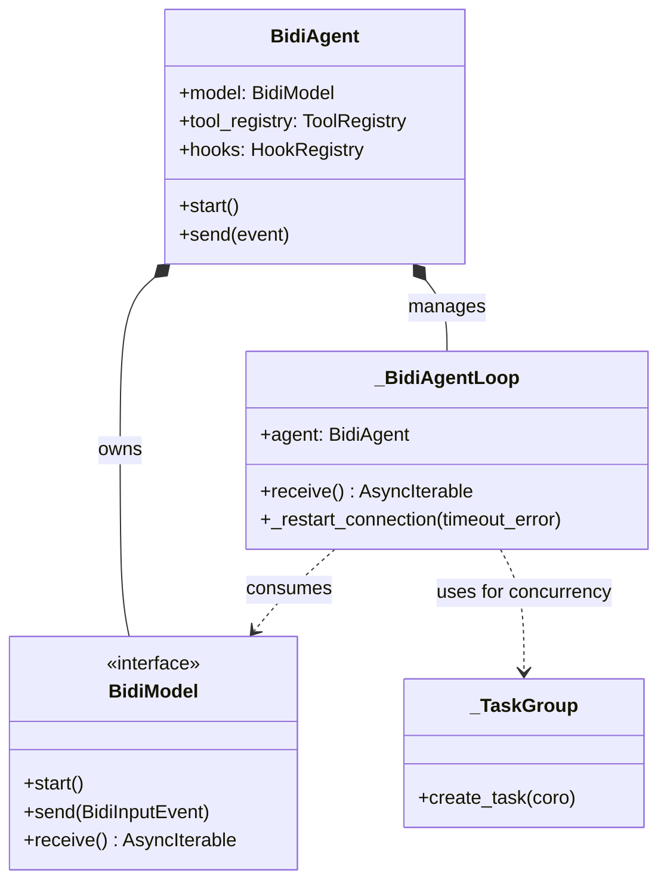

<!-- source: DeepWiki mcp.deepwiki.com · repo strands-agents/sdk-python · page 8.1 Bidirectional Streaming Agent · fetched 2026-10-26 -->

# Bidirectional Streaming Agent

<details>
<summary>Relevant source files</summary>

The following files were used as context for generating this wiki page:

- [site/src/content/docs/user-guide/concepts/bidirectional-streaming/agent.mdx](site/src/content/docs/user-guide/concepts/bidirectional-streaming/agent.mdx)
- [site/src/content/docs/user-guide/concepts/bidirectional-streaming/events.mdx](site/src/content/docs/user-guide/concepts/bidirectional-streaming/events.mdx)
- [site/src/content/docs/user-guide/concepts/bidirectional-streaming/models/nova_sonic.mdx](site/src/content/docs/user-guide/concepts/bidirectional-streaming/models/nova_sonic.mdx)
- [site/src/content/docs/user-guide/concepts/bidirectional-streaming/quickstart.mdx](site/src/content/docs/user-guide/concepts/bidirectional-streaming/quickstart.mdx)
- [site/src/content/docs/user-guide/concepts/bidirectional-streaming/session-management.mdx](site/src/content/docs/user-guide/concepts/bidirectional-streaming/session-management.mdx)
- [strands-py/src/strands/experimental/bidi/__init__.py](strands-py/src/strands/experimental/bidi/__init__.py)
- [strands-py/src/strands/experimental/bidi/_telemetry.py](strands-py/src/strands/experimental/bidi/_telemetry.py)
- [strands-py/src/strands/experimental/bidi/agent/loop.py](strands-py/src/strands/experimental/bidi/agent/loop.py)
- [strands-py/src/strands/experimental/bidi/models/gemini_live.py](strands-py/src/strands/experimental/bidi/models/gemini_live.py)
- [strands-py/src/strands/experimental/bidi/models/openai_realtime.py](strands-py/src/strands/experimental/bidi/models/openai_realtime.py)
- [strands-py/src/strands/experimental/bidi/types/events.py](strands-py/src/strands/experimental/bidi/types/events.py)
- [strands-py/src/strands/experimental/bidi/types/model.py](strands-py/src/strands/experimental/bidi/types/model.py)
- [strands-py/src/strands/types/_snapshot.py](strands-py/src/strands/types/_snapshot.py)
- [strands-py/tests/strands/agent/test_snapshot.py](strands-py/tests/strands/agent/test_snapshot.py)
- [strands-py/tests/strands/experimental/bidi/agent/test_agent.py](strands-py/tests/strands/experimental/bidi/agent/test_agent.py)
- [strands-py/tests/strands/experimental/bidi/agent/test_loop.py](strands-py/tests/strands/experimental/bidi/agent/test_loop.py)
- [strands-py/tests/strands/experimental/bidi/agent/test_loop_telemetry.py](strands-py/tests/strands/experimental/bidi/agent/test_loop_telemetry.py)
- [strands-py/tests/strands/experimental/bidi/models/test_gemini_live.py](strands-py/tests/strands/experimental/bidi/models/test_gemini_live.py)
- [strands-py/tests/strands/experimental/bidi/models/test_openai_realtime.py](strands-py/tests/strands/experimental/bidi/models/test_openai_realtime.py)
- [strands-py/tests/strands/experimental/bidi/types/test_events.py](strands-py/tests/strands/experimental/bidi/types/test_events.py)

</details>


The `BidiAgent` is an experimental component designed for real-time, persistent streaming conversations involving audio, text, and vision [strands-py/src/strands/experimental/bidi/agent/agent.py:1-14](). Unlike the standard `Agent` which follows a request-response pattern, the `BidiAgent` maintains an open connection to a model, allowing for spontaneous user interruptions, continuous audio streaming, and concurrent tool execution [strands-py/src/strands/experimental/bidi/agent/agent.py:4-12]().

## Architecture and Task Management

The `BidiAgent` architecture relies on a specialized asynchronous task group to manage concurrent operations such as listening for user input, receiving model events, and executing tools simultaneously [strands-py/src/strands/experimental/bidi/agent/agent.py:10-12]().

### Async Task Group Design
Because the agent must handle multiple streams of data at once, it utilizes a `_TaskGroup` shim (mimicking Python 3.11's `asyncio.TaskGroup`) to ensure that if any critical background task fails, all related tasks are cancelled to prevent orphaned processes or inconsistent states [strands-py/src/strands/experimental/bidi/_async/_task_group.py:12-43](). The `_TaskPool` utility is also used within the loop to track active async tasks [strands-py/src/strands/experimental/bidi/agent/loop.py:47-66]().

### Data Flow: Natural Language to Code Entities
The following diagram illustrates how external interactions (audio/text) are mapped to internal code entities and processed through the bidirectional loop.

**BidiAgent Interaction Flow**

Sources: [strands-py/src/strands/experimental/bidi/agent/agent.py:55-60](), [strands-py/src/strands/experimental/bidi/agent/loop.py:44](), [strands-py/src/strands/experimental/bidi/models/model.py:31-42](), [strands-py/src/strands/experimental/bidi/agent/agent.py:43]()

## Key Components

### BidiAgent Class
The `BidiAgent` coordinates the model, tool registry, and session state. It initializes with a `BidiModel` and a `ConcurrentToolExecutor` by default [strands-py/src/strands/experimental/bidi/agent/agent.py:102-148]().

*   **Initialization:** Sets up `ToolRegistry`, `HookRegistry`, and the internal `_BidiAgentLoop` [strands-py/src/strands/experimental/bidi/agent/agent.py:121-161]().
*   **Start/Stop:** Manages the lifecycle of the model connection. Calling `start()` establishes the persistent stream [strands-py/src/strands/experimental/bidi/agent/agent.py:147-155]().
*   **Direct Tool Calls:** Supports calling tools as methods via `agent.tool.<tool_name>(...)`, which can optionally be recorded in the conversation history [strands-py/src/strands/experimental/bidi/agent/agent.py:174-184]().

### BidiModel Protocol
The `BidiModel` defines the interface for providers like OpenAI Realtime or AWS Nova Sonic [strands-py/src/strands/experimental/bidi/models/model.py:31-40]().

| Method | Description |
| :--- | :--- |
| `start()` | Opens the WebSocket or persistent connection with system prompts and tools [strands-py/src/strands/experimental/bidi/models/model.py:44-62](). |
| `stop()` | Closes the connection and cleans up resources [strands-py/src/strands/experimental/bidi/models/model.py:65-72](). |
| `send()` | Sends `BidiInputEvent` (text, audio, image) or `ToolResultEvent` to the model [strands-py/src/strands/experimental/bidi/models/model.py:89-114](). |
| `receive()` | An async generator yielding `BidiOutputEvent` (transcripts, audio, tool calls) [strands-py/src/strands/experimental/bidi/models/model.py:74-88]().

Sources: [strands-py/src/strands/experimental/bidi/models/model.py:1-118](), [strands-py/src/strands/experimental/bidi/__init__.py:5-30]()

## Event Loop and Interruption Handling

The `_BidiAgentLoop` is the engine that drives the conversation. It handles the complex logic of merging tool results back into the stream and managing connection restarts [strands-py/src/strands/experimental/bidi/agent/loop.py:44]().

### Connection Restarts
Bidirectional models often have strict timeout limits. The loop catches `BidiModelTimeoutError`, stops the current connection, and restarts it using the provided `restart_config` [strands-py/src/strands/experimental/bidi/agent/loop.py:163-167](), [strands-py/src/strands/experimental/bidi/agent/loop.py:179-207](). This involves calling `_restart_connection` which invokes `BidiBeforeConnectionRestartEvent` and `BidiAfterConnectionRestartEvent` hooks [strands-py/src/strands/experimental/bidi/agent/loop.py:189-206]().

### Interruption Logic
When a user speaks while the agent is responding, the model emits a `BidiInterruptionEvent` [strands-py/src/strands/experimental/bidi/types/events.py:29](). The agent tracks interruption state via `_InterruptState` [strands-py/src/strands/experimental/bidi/agent/agent.py:167]().

### Graceful Shutdown
The loop supports graceful shutdown via a `stop_event_loop` flag in the `request_state` of the `invocation_state` [tests/strands/experimental/bidi/agent/test_loop.py:131-148](). When this flag is set (e.g., by a tool like `strands_tools.stop`), the loop yields a `BidiConnectionCloseEvent` with reason `user_request` and terminates the receiving generator [strands-py/src/strands/experimental/bidi/agent/loop.py:173-175]().

**Component Mapping Diagram**

Sources: [strands-py/src/strands/experimental/bidi/agent/agent.py:55-161](), [strands-py/src/strands/experimental/bidi/models/model.py:31-42](), [strands-py/src/strands/experimental/bidi/_async/_task_group.py:12-21](), [strands-py/src/strands/experimental/bidi/agent/loop.py:179]()

## Protocols: BidiInput and BidiOutput

The SDK uses structural typing (Protocols) to define how data enters and leaves the agent.

*   **BidiInput:** Responsible for yielding `BidiInputEvent` objects like `BidiAudioInputEvent` or `BidiTextInputEvent` [strands-py/src/strands/experimental/bidi/agent/agent.py:36-41]().
*   **BidiOutput:** Responsible for consuming `BidiOutputEvent` objects, such as `BidiAudioStreamEvent` (raw audio chunks) or `BidiTranscriptStreamEvent` (text deltas) [strands-py/src/strands/experimental/bidi/agent/agent.py:40-43]().

### Built-in I/O Implementations
The SDK provides `BidiTextIO` and `BidiAudioIO` (lazy-loaded) for standard interactions [strands-py/src/strands/experimental/bidi/__init__.py:70-82](). `BidiTextIO` uses `prompt_toolkit` for asynchronous CLI input [strands-py/src/strands/experimental/bidi/io/text.py:6-31]().

### Deprecated Tools
The `stop_conversation` tool is deprecated in favor of setting `request_state["stop_event_loop"] = True` [strands-py/src/strands/experimental/bidi/tools/stop_conversation.py:3-5](). The loop still supports it for backward compatibility but emits a warning [tests/strands/experimental/bidi/agent/test_loop.py:172-194]().

Sources: [strands-py/src/strands/experimental/bidi/agent/agent.py:35-43](), [strands-py/src/strands/experimental/bidi/io/text.py:65-88](), [strands-py/src/strands/experimental/bidi/tools/stop_conversation.py:13-32](), [strands-py/src/strands/experimental/bidi/__init__.py:70-83]()

## Telemetry Integration

The `BidiAgent` integrates with the OpenTelemetry system to provide detailed tracing and metrics for bidirectional sessions. This allows for monitoring the lifecycle of sessions, connections, responses, and tool executions.

### Session Spans
A `bidi_session` span is created when the `_BidiAgentLoop` starts and is closed when it stops. This span captures overall session attributes like the agent's name, model ID, available tools, and system prompt [strands-py/src/strands/experimental/bidi/_telemetry.py:14-45](). It also accumulates token usage (input, output, total, cache read) for the entire session [strands-py/src/strands/experimental/bidi/_telemetry.py:48-77](). If the session ends with an error, the span's status is set to `ERROR` [tests/strands/experimental/bidi/agent/test_loop_telemetry.py:127-145]().

### Connection Spans
Each time the agent connects to the model (initial connection or restart), a `bidi_connect` span is created. This span wraps the `model.start()` call and records the model ID [strands-py/src/strands/experimental/bidi/_telemetry.py:155-179](). Connection failures are also recorded in this span [tests/strands/experimental/bidi/agent/test_loop_telemetry.py:127-145]().

### Response Spans
Individual model responses are tracked with `bidi_response` spans. These spans start on a `BidiResponseStartEvent` and end on a `BidiResponseCompleteEvent` [strands-py/src/strands/experimental/bidi/_telemetry.py:79-95](), [tests/strands/experimental/bidi/agent/test_loop_telemetry.py:162-179](). Key attributes captured include:
*   `response_id`: Unique identifier for the response [strands-py/src/strands/experimental/bidi/_telemetry.py:91]()
*   `gen_ai.response.finish_reason`: The `stop_reason` from `BidiResponseCompleteEvent` (e.g., "complete", "interrupted", "tool_use") [strands-py/src/strands/experimental/bidi/_telemetry.py:109-111](), [tests/strands/experimental/bidi/agent/test_loop_telemetry.py:185-204]()
*   `gen_ai.server.time_to_first_audio`: The time in milliseconds from response start to the first audio chunk, if audio is emitted [strands-py/src/strands/experimental/bidi/_telemetry.py:112-114](), [tests/strands/experimental/bidi/agent/test_loop_telemetry.py:207-226]()

### Restart Spans
When a model connection is restarted (e.g., due to a timeout), a `bidi_connection_restart` span is created. This span can record the error message that triggered the restart [strands-py/src/strands/experimental/bidi/_telemetry.py:125-151]().

### Interruption Events
Any `BidiInterruptionEvent` received by the agent is recorded as an event on the active `bidi_session` span, with the reason for the interruption [strands-py/src/strands/experimental/bidi/_telemetry.py:187-194]().

**Telemetry Data Flow**
```mermaid
graph TD
    A[BidiAgent.start()] --> B{_telemetry.start_session_span}
    B --> C[Session Span (bidi_session)]
    C --> D{_telemetry.start_connection_span}
    D --> E[Connection Span (bidi_connect)]
    E --> F[Model.start()]
    F --> G{_telemetry.end_connection_span}
    G --> C
    
    H[Model.receive() yields BidiResponseStartEvent] --> I{_telemetry.start_response_span}
    I --> J[Response Span (bidi_response)]
    J --> K[Model.receive() yields BidiAudioStreamEvent]
    K --> L[Record time_to_first_audio]
    L --> J
    J --> M[Model.receive() yields BidiResponseCompleteEvent]
    M --> N{_telemetry.end_response_span}
    N --> C

    O[Model.receive() yields BidiInterruptionEvent] --> P{_telemetry.add_interruption_event}
    P --> C

    Q[BidiModelTimeoutError] --> R{_telemetry.start_restart_span}
    R --> S[Restart Span (bidi_connection_restart)]
    S --> T[Model.stop()/Model.start()]
    T --> U{_telemetry.end_restart_span}
    U --> C

    V[BidiAgent.stop()] --> W{_telemetry.end_session_span}
    W --> X[Session Span Closed]
```
Sources: [strands-py/src/strands/experimental/bidi/_telemetry.py:14-194](), [strands-py/src/strands/experimental/bidi/agent/loop.py:109-132](), [strands-py/src/strands/experimental/bidi/agent/loop.py:163-167](), [strands-py/src/strands/experimental/bidi/agent/loop.py:179-207](), [tests/strands/experimental/bidi/agent/test_loop_telemetry.py:96-226]()

---

