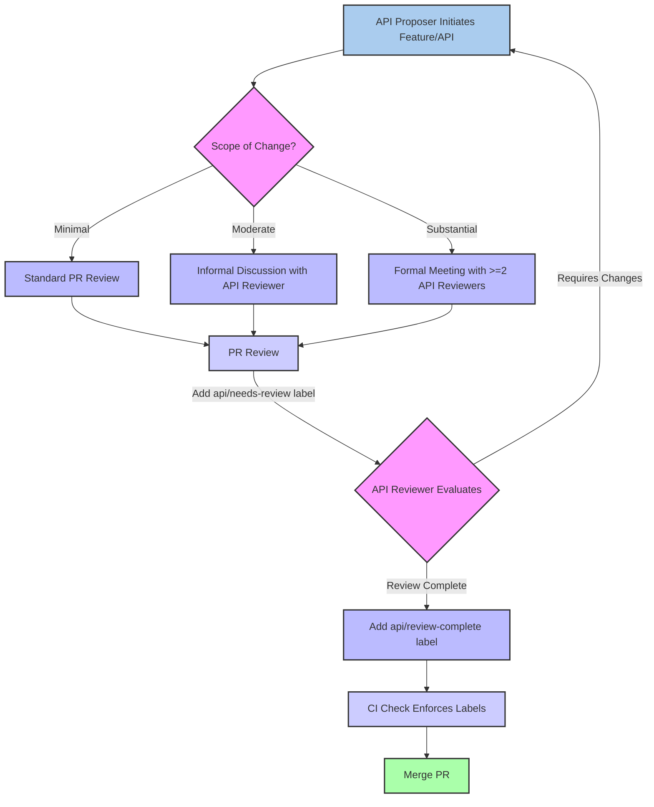

<!-- source: DeepWiki mcp.deepwiki.com · repo strands-agents/sdk-python · page 9.4 Team Governance and Design Process · fetched 2026-10-26 -->

# 9.4. Team Governance and Design Process

<details>
<summary>Relevant source files</summary>

The following files were used as context for generating this wiki page:

- [.agents/skills/README.md](.agents/skills/README.md)
- [.agents/skills/pr-create/SKILL.md](.agents/skills/pr-create/SKILL.md)
- [.agents/skills/pr-feedback/SKILL.md](.agents/skills/pr-feedback/SKILL.md)
- [.agents/skills/pr-feedback/fetch-pr-feedback.sh](.agents/skills/pr-feedback/fetch-pr-feedback.sh)
- [.agents/skills/pr-writer/SKILL.md](.agents/skills/pr-writer/SKILL.md)
- [.agents/skills/pr-writer/get-diff.sh](.agents/skills/pr-writer/get-diff.sh)
- [.agents/skills/pre-push/SKILL.md](.agents/skills/pre-push/SKILL.md)
- [.agents/skills/pre-push/run-checks.sh](.agents/skills/pre-push/run-checks.sh)
- [.github/workflows/api-review-label.yml](.github/workflows/api-review-label.yml)
- [team/AGENT_GUIDELINES.md](team/AGENT_GUIDELINES.md)
- [team/API_BAR_RAISING.md](team/API_BAR_RAISING.md)
- [team/COMPLEXITY.md](team/COMPLEXITY.md)
- [team/DECISIONS.md](team/DECISIONS.md)
- [team/README.md](team/README.md)
- [team/TENETS.md](team/TENETS.md)

</details>


This page outlines the Strands team's core development tenets, API design processes, feature lifecycle, compatibility guarantees, and how we manage cognitive complexity. These guidelines ensure consistency, quality, and maintainability across the SDK.

## Development Tenets

Our development is guided by a set of core principles that inform design decisions and help resolve trade-offs. These tenets are documented in `team/TENETS.md` and are crucial for maintaining the SDK's quality and coherence.

1.  **Simple at any scale**: The SDK aims for simplicity, ensuring that abstractions used for prototypes can scale to production workloads without added complexity [team/TENETS.md:5-7]().
2.  **Extensible by design**: We prioritize configurability, offering flexible extension points like hooks, model providers, session managers, and tools that are easy to integrate [team/TENETS.md:8-9]().
3.  **Composability**: Features are designed as interoperable building blocks, ensuring consistency and mutual complementarity [team/TENETS.md:10-11]().
4.  **The obvious path is the happy path**: Through intuitive naming, clear error messages, and thoughtful API design, we guide developers toward correct patterns and help them avoid common pitfalls [team/TENETS.md:12-13]().
5.  **We are accessible to humans and agents**: The SDK is designed to be equally understandable by both human developers and AI agents, ensuring high-quality developer experience (DX) for humans and proper usage guidance for coding assistants [team/TENETS.md:14-16]().
6.  **Embrace common standards**: We avoid reinventing widely adopted or superior existing solutions, respecting established industry practices [team/TENETS.md:17-18]().

When proposing solutions or reviewing code, these principles are referenced to guide decisions. If multiple approaches are equally valid, the one that best aligns with these tenets is chosen [team/TENETS.md:20-21]().

Sources:
- [team/TENETS.md]()

## API Bar-Raising Process

The API Bar-Raising process ensures a high-quality, consistent, and future-proof API surface for the SDK, aligning with our tenets and expectations [team/API_BAR_RAISING.md:4-5](). This process acts as a quality gate, focusing exclusively on public API design and customer-facing contracts, not internal implementation details [team/API_BAR_RAISING.md:7-7]().

### Roles

The process involves two key roles:

*   **API Proposer**: The engineer developing or proposing a new feature or API. They are responsible for documenting use cases, providing example code, and preparing review materials [team/API_BAR_RAISING.md:12-13]().
*   **API Reviewer**: A critical reviewer who evaluates the public API from a customer perspective. This role is not formal; any engineer with API development experience can serve as a reviewer. Reviewers challenge assumptions, identify gaps, and ensure alignment with SDK tenets [team/API_BAR_RAISING.md:14-16]().

### Timeline and Scope of Review

The level of review depends on the scope of the change [team/API_BAR_RAISING.md:19-19]():

*   **Minimal changes**: Standard PR review is sufficient, without explicit API reviewer designation. Examples include adding a new parameter to an infrequent method [team/API_BAR_RAISING.md:20-22]().
*   **Moderate changes**: Informal discussion with an API reviewer, followed by standard PR review. An example is adding a new class for new customer behavior [team/API_BAR_RAISING.md:23-25]().
*   **Substantial changes**: Requires an explicit meeting with at least two API reviewers, ideally during or after the design phase. This applies to new primitives or frequently used abstractions. For larger features, bar-raising should be incorporated early [team/API_BAR_RAISING.md:26-29]().

### Process Details

#### API Reviewer Responsibilities

API reviewers focus on customer usage and public API, not implementation. They are expected to be critical, challenging assumptions and ensuring alignment with SDK tenets and existing decision records [team/API_BAR_RAISING.md:31-37](). Key questions include:

*   Does it conform to SDK tenets [team/API_BAR_RAISING.md:36-36]() and decision records [team/API_BAR_RAISING.md:37-37]()?
*   If extensibility is a goal, what is customizable, and is the abstraction level appropriate [team/API_BAR_RAISING.md:38-40]()?
*   What use cases are not addressed, and why [team/API_BAR_RAISING.md:41-41]()?
*   Are default parameters/behavior the most common, and if not, why [team/API_BAR_RAISING.md:42-43]()?

Decisions made during API review that can guide future designs are documented as decision records [team/API_BAR_RAISING.md:45-45]().

#### API Proposer Responsibilities

Proposers must prepare comprehensive documentation and examples to facilitate effective bar-raising discussions. This includes expected use cases, example code snippets, complete API signatures, end-to-end usage examples, and module exports [team/API_BAR_RAISING.md:48-63](). This information should be included in the PR description for future reference [team/API_BAR_RAISING.md:64-64]().

#### Designating an API Reviewer

For standard PRs, an engineer with API development experience is designated as the API reviewer. They evaluate the proposal from a customer perspective, focusing on public API design. The `api/needs-review` label indicates a PR requires API review, and `api/review-complete` is added once the review is done. A CI check prevents merging PRs with `api/needs-review` without `api/review-complete` [team/API_BAR_RAISING.md:66-73]().

For larger features, a meeting with designated API reviewers is scheduled. Team consensus can also be used for broad alignment, especially for APIs that will be foundational for the entire team [team/API_BAR_RAISING.md:75-80]().

### API Bar-Raising Workflow


**Title: API Bar-Raising Workflow**

Sources:
- [team/API_BAR_RAISING.md]()
- [.github/workflows/api-review-label.yml]()

## Feature Lifecycle

Features in the SDK progress through an `experimental` to `stable` to `deprecated` lifecycle, managed under semantic versioning. This ensures users understand the stability and future of different API surfaces. The `FEATURE_LIFECYCLE.md` document details this process.

### Compatibility Guarantees

The team adheres to semantic versioning, but some changes are not considered breaking, especially those following the "pay for play" principle [team/DECISIONS.md:104-105](). This means small breaking changes are acceptable without a major version bump if they only affect users who explicitly adopt new functionality, leaving existing code paths unaffected [team/DECISIONS.md:109-113]().

For example, converting a `TypedDict` to `total=False` is technically breaking, but if the missing field only occurs with a new tool, users not adopting that tool are unaffected [team/DECISIONS.md:114-118](). This principle does not apply if existing code breaks without user action or if default behavior changes [team/DECISIONS.md:120-121]().

Sources:
- [team/DECISIONS.md]()
- [team/COMPATIBILITY.md]()

## Cognitive Complexity Thresholds

Every Pull Request (PR) is labeled with the cognitive complexity of its most complex function: `complexity/low` (10 or less), `complexity/medium` (11 to 25), or `complexity/high` (above 25) [team/COMPLEXITY.md:3-4](). This practice makes our "Simple at any scale" tenet measurable and helps manage review attention [team/COMPLEXITY.md:10-19]().

### How the Score Works

Cognitive complexity is calculated based on two rules [team/COMPLEXITY.md:39-40]():

1.  **Breaks in linear flow**: Each `if`, `else`, loop, `catch`/`except`, ternary, `switch`/`match`, recursion, and mixed boolean operator run adds one point [team/COMPLEXITY.md:41-44]().
2.  **Nesting multiplies cost**: Each structure also adds one point per level of nesting. An `if` at the top costs 1, while the same `if` three levels deep costs 4 [team/COMPLEXITY.md:45-47]().

The median function in the SDKs scores 1 to 2, and `complexity/low` covers about 90% of existing functions [team/COMPLEXITY.md:49-50]().

### Strategies for Managing Complexity

To keep scores low, especially when nesting is a multiplier [team/COMPLEXITY.md:64-64]():

*   **Return early**: Guard clauses (`if not valid: return`) reduce nesting levels [team/COMPLEXITY.md:66-67]().
*   **Extract nested logic**: Move complex nested logic into named helper functions. This resets the nesting penalty and lowers the score of the main function [team/COMPLEXITY.md:68-71]().
*   **Prefer lookup tables**: Use dictionaries or maps instead of `if`/`elif` or `switch` chains to avoid branches [team/COMPLEXITY.md:72-74]().
*   **Keep boolean sequences uniform**: `a and b and c` costs one point; mixing `and`/`or` costs more [team/COMPLEXITY.md:75-76]().
*   **Handle errors at the edges**: Wrap coherent blocks with a single `try` statement rather than threading error handling through nested branches [team/COMPLEXITY.md:77-79]().
*   **Await sequentially in async code**: Avoid nesting callbacks or `then` chains, which incur nesting increments [team/COMPLEXITY.md:80-81]().

### Complexity in PRs

The complexity label is advisory and does not block merges [team/COMPLEXITY.md:34-34](). Authors see the label first, as it's computed from their diff and scoped to touched functions [team/COMPLEXITY.md:29-32]().

*   **Keep changes simple**: If a feature requires restructuring, land the refactor as a separate PR before the behavior change [team/COMPLEXITY.md:89-91]().
*   **Extract rather than deepen**: When modifying an already complex function, extract the relevant piece into a helper instead of deepening the existing function [team/COMPLEXITY.md:92-94]().
*   **Thorough tests**: Test files are excluded from the `size/*` label, so generous testing does not increase the PR's complexity bucket [team/COMPLEXITY.md:97-98]().

### When High Complexity is Acceptable

Some functions, such as protocol event converters, state machines, or exhaustive format mappings, genuinely have high complexity due to their domain. In such cases, maintaining the function's shape and explaining the context in the PR description is acceptable [team/COMPLEXITY.md:102-107]().

### Checking Complexity Locally

The `npm run complexity` command (from the repository root) or `hatch run complexity` (from `strands-py/`) can be used to check complexity locally. This command lists the most complex functions touched by the diff, helping authors understand which parts drive the label [team/COMPLEXITY.md:111-115]().

Sources:
- [team/COMPLEXITY.md]()

## Designs and RFC Process

Significant features undergo a design and Request for Comments (RFC) process, documented in the `team/designs/` directory [team/README.md:17-17](). This process ensures thorough consideration, team alignment, and detailed documentation before implementation.

### Decision Records

Key design and API decisions, along with their rationale, are recorded in `team/DECISIONS.md` [team/README.md:10-10](). This record guides future decisions and ensures consistency.

Examples of recorded decisions include:

*   **Hooks as Low-Level Primitives**: Hooks are low-level extensibility primitives, and higher-level constructs should be built on top of them, providing specific interfaces and type safety [team/DECISIONS.md:10-13]().
*   **Prefer Flat Namespaces**: Public APIs should expose commonly-used functionality through flat, top-level namespaces for simplicity and discoverability [team/DECISIONS.md:51-54]().
*   **When Internal Interfaces Should Extend HookProvider**: Internal interfaces integrating with the agent lifecycle (e.g., `RetryStrategy`, `SessionManager`, `ConversationManager`) should extend `HookProvider` to maintain a uniform composition model [team/DECISIONS.md:81-84]().

### Agent Guidelines

For AI agents interacting with Strands repositories (e.g., PR reviews, issue triage), specific guidelines are established in `team/AGENT_GUIDELINES.md` [team/README.md:16-16](). These guidelines ensure agents add value, maintain conciseness, justify approvals, scope credentials, throttle autonomous activity, and have clear ownership and monitoring [team/AGENT_GUIDELINES.md:8-58]().

The `pr-writer` skill, for instance, generates PR titles and descriptions following Conventional Commits format and `team/PR.md` guidelines, capturing design decisions from conversations [team/.agents/skills/README.md:9-10](). The `pr-create` skill orchestrates the full PR creation flow, including pre-flight checks and drafting [team/.agents/skills/README.md:11-12]().

```mermaid
graph TD
    subgraph "Design & RFC Process"
        A[New Feature Proposal] --> B{Significant Impact?};
        B -- "Yes" --> C[Create RFC in team/designs/];
        C --> D[Team Review & Discussion];
        D --> E[Decision Recorded in team/DECISIONS.md];
        E --> F[API Bar-Raising Process];
        B -- "No" --> F;
        F --> G[Implementation & PR];
        G --> H[Cognitive Complexity Check];
        H --> I[Code Review & Merge];
    end

    subgraph "Agent Interaction"
        J[Agent Initiates Task (e.g., PR creation)] --> K{Skill Selection};
        K -- "PR Writing" --> L[pr-writer skill];
        L --> M[Generate PR Title & Description];
        K -- "PR Creation" --> N[pr-create skill];
        N --> O[Perform Pre-flight Checks];
        O --> P[Push Branch & Create Draft PR];
        M --> P;
        P --> Q[Human Review & Approval];
        Q --> I;
    end

    subgraph "Quality Gates"
        R[API Bar-Raising] --> F;
        S[Cognitive Complexity] --> H;
        T[Agent Guidelines] --> J;
    end

    style A fill:#ace,stroke:#333,stroke-width:2px;
    style B fill:#f9f,stroke:#333,stroke-width:2px;
    style C fill:#bbf,stroke:#333,stroke-width:2px;
    style D fill:#ccf,stroke:#333,stroke-width:2px;
    style E fill:#afa,stroke:#333,stroke-width:2px;
    style F fill:#f9f,stroke:#333,stroke-width:2px;
    style G fill:#bbf,stroke:#333,stroke-width:2px;
    style H fill:#f9f,stroke:#333,stroke-width:2px;
    style I fill:#afa,stroke:#333,stroke-width:2px;
    style J fill:#ace,stroke:#333,stroke-width:2px;
    style K fill:#f9f,stroke:#333,stroke-width:2px;
    style L fill:#bbf,stroke:#333,stroke-width:2px;
    style M fill:#ccf,stroke:#333,stroke-width:2px;
    style N fill:#bbf,stroke:#333,stroke-width:2px;
    style O fill:#ccf,stroke:#333,stroke-width:2px;
    style P fill:#bbf,stroke:#333,stroke-width:2px;
    style Q fill:#f9f,stroke:#333,stroke-width:2px;
    style R fill:#afa,stroke:#333,stroke-width:2px;
    style S fill:#afa,stroke:#333,stroke-width:2px;
    style T fill:#afa,stroke:#333,stroke-width:2px;
```
**Title: Overall Governance and Design Process**

Sources:
- [team/README.md]()
- [team/DECISIONS.md]()
- [team/AGENT_GUIDELINES.md]()
- [.agents/skills/README.md]()
- [.agents/skills/pr-writer/SKILL.md]()
- [.agents/skills/pr-create/SKILL.md]()

---

