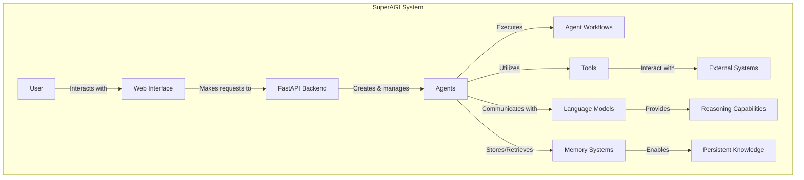
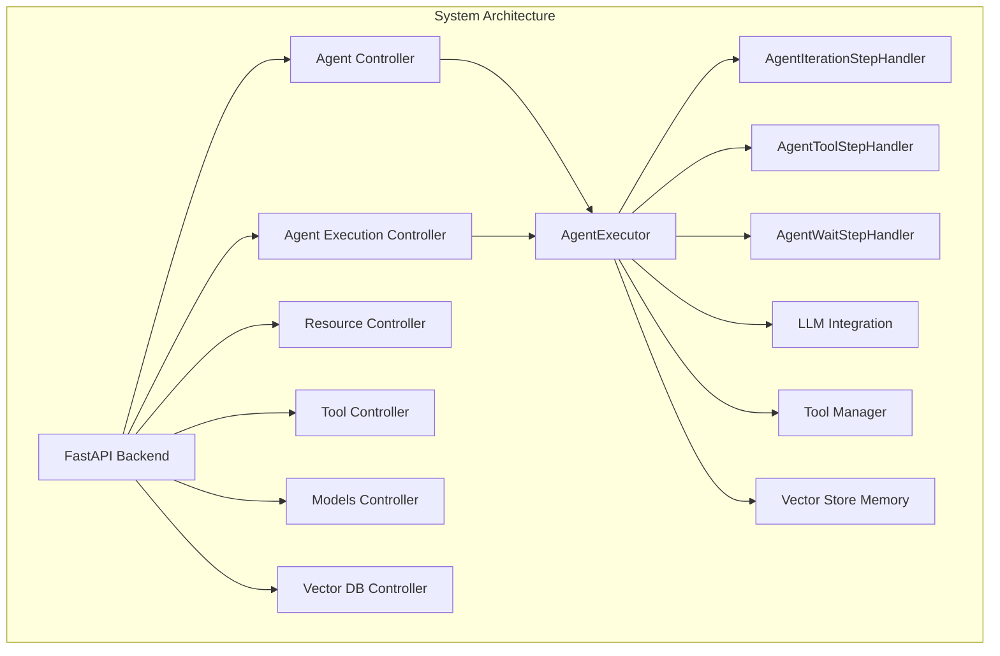
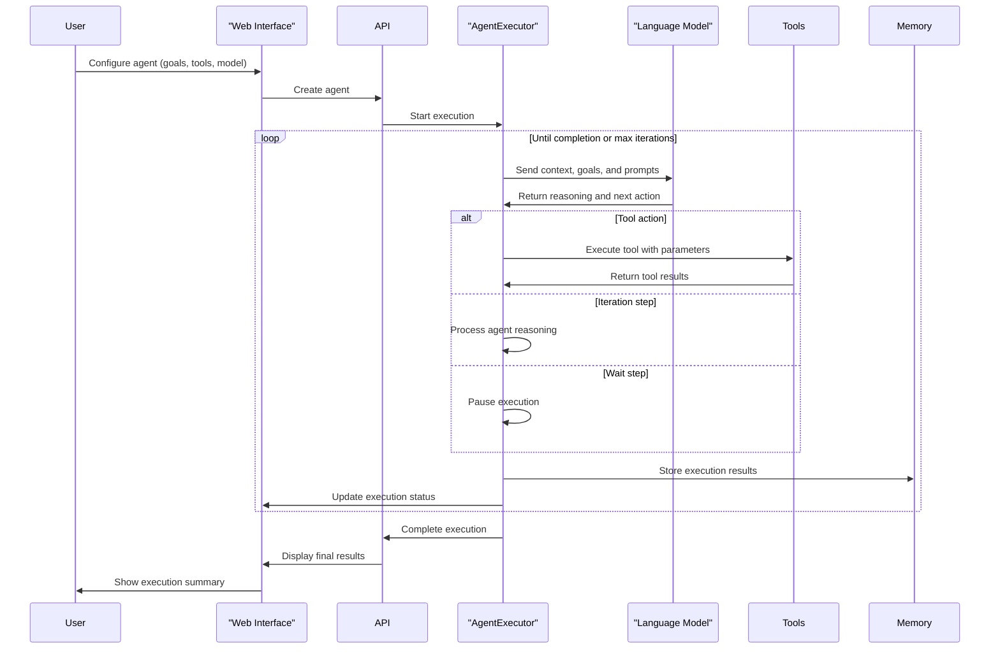
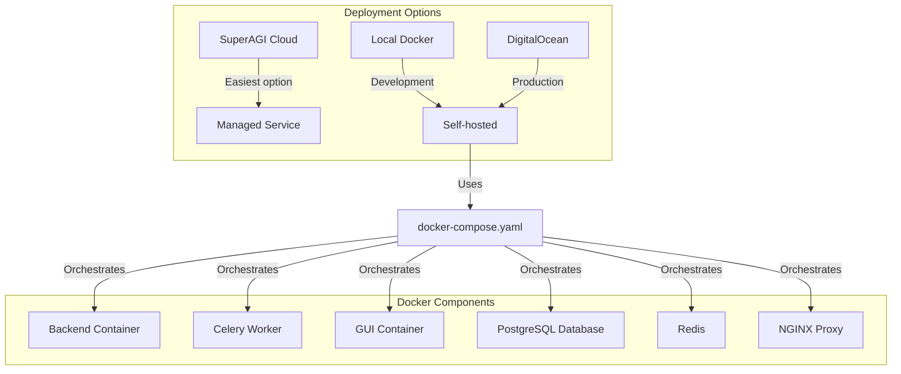
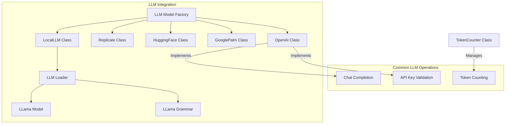
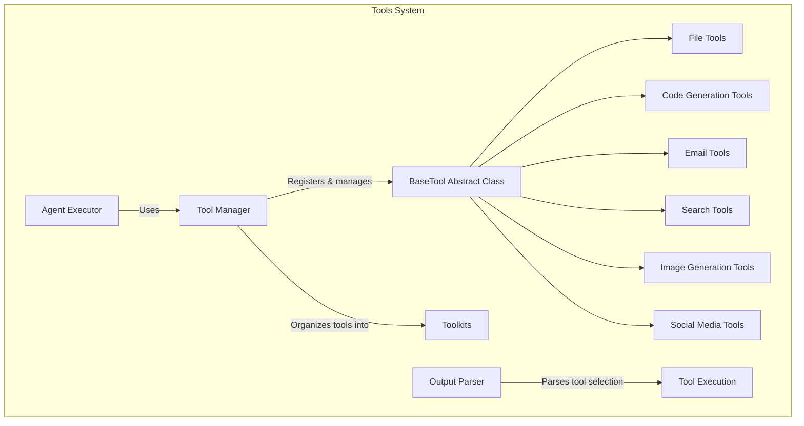
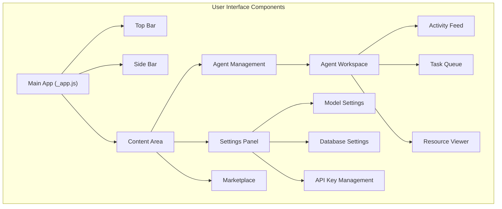

<!-- source: DeepWiki mcp.deepwiki.com · repo TransformerOptimus/SuperAGI · page 1 Overview · fetched 2026-10-26 -->

# Overview

Relevant source files

The following files were used as context for generating this wiki page:

- [Dockerfile-gpu](Dockerfile-gpu)
- [README.MD](README.MD)
- [config_template.yaml](config_template.yaml)
- [docker-compose-gpu.yml](docker-compose-gpu.yml)
- [gui/app/favicon.ico](gui/app/favicon.ico)
- [gui/pages/Content/Agents/TaskQueue.js](gui/pages/Content/Agents/TaskQueue.js)
- [gui/pages/Dashboard/Dashboard.module.css](gui/pages/Dashboard/Dashboard.module.css)
- [gui/pages/Dashboard/Settings/Settings.js](gui/pages/Dashboard/Settings/Settings.js)
- [gui/pages/Dashboard/TopBar.js](gui/pages/Dashboard/TopBar.js)
- [gui/pages/_app.js](gui/pages/_app.js)
- [gui/pages/api/apiConfig.js](gui/pages/api/apiConfig.js)
- [main.py](main.py)
- [requirements.txt](requirements.txt)
- [superagi/agent/agent_prompt_builder.py](superagi/agent/agent_prompt_builder.py)
- [superagi/agent/output_parser.py](superagi/agent/output_parser.py)
- [superagi/helper/json_cleaner.py](superagi/helper/json_cleaner.py)
- [superagi/helper/llm_loader.py](superagi/helper/llm_loader.py)
- [superagi/helper/token_counter.py](superagi/helper/token_counter.py)
- [superagi/jobs/agent_executor.py](superagi/jobs/agent_executor.py)
- [superagi/llms/llm_model_factory.py](superagi/llms/llm_model_factory.py)
- [superagi/llms/local_llm.py](superagi/llms/local_llm.py)
- [superagi/types/model_source_types.py](superagi/types/model_source_types.py)
- [tests/unit_tests/tools/duck_duck_go/test_duckduckgo_results.py](tests/unit_tests/tools/duck_duck_go/test_duckduckgo_results.py)

SuperAGI is an open-source framework for building, managing, and running autonomous AI agents. This system enables developers to create, configure, and deploy AI agents that can perform a variety of tasks using different tools and language models.

For detailed information about specific components, please refer to the [System Architecture](#1.1) page and the [Agent System](#2) page.

## What is SuperAGI?

SuperAGI provides a comprehensive platform for creating autonomous agents that can:

- Perform complex tasks through iterative reasoning
- Use various tools to interact with external systems
- Leverage different language models (LLMs) as their cognitive engine
- Maintain persistent memory during execution
- Follow customizable workflows to achieve goals

The framework is designed to be extensible, allowing developers to add new capabilities through tools and to customize agent behavior through templates and workflows.

Sources: [README.MD:78-94](), [main.py:10-45]()

## Core Components

The SuperAGI system consists of the following core components:

| Component | Description | Key Functionality |
|-----------|-------------|-------------------|
| Agent System | The core execution engine | Creates, configures, and executes agents |
| Workflow System | Controls agent execution flow | Defines steps and logic for agent operation |
| Tools System | Expands agent capabilities | Allows agents to perform specific tasks |
| Resource Management | Handles files and data | Manages agent inputs and outputs |
| LLM Integration | Powers agent reasoning | Connects to various language model providers |
| Vector Store | Enables knowledge retrieval | Stores embeddings for semantic search |
| Web Interface | User interaction layer | Provides controls and monitoring for agents |

Sources: [superagi/jobs/agent_executor.py:37-157](), [main.py:109-137]()

## Agent Execution Flow

When an agent runs, it follows this general execution flow:

Sources: [superagi/jobs/agent_executor.py:39-104](), [superagi/agent/agent_iteration_step_handler.py]()

## Configuration and Setup

SuperAGI can be deployed in multiple ways:

1. **SuperAGI Cloud**: Hosted service at app.superagi.com
2. **Local Installation**: Using Docker and docker-compose
3. **DigitalOcean Deployment**: One-click deployment option

The system configuration is managed through a `config.yaml` file which defines:

- LLM provider credentials
- Database connections
- Storage settings
- Tool configurations
- Authentication settings

Sources: [README.MD:100-115](), [config_template.yaml:1-126](), [docker-compose-gpu.yml:1-96]()

## LLM Integration

SuperAGI supports multiple language model providers:

| Provider | Models | Integration |
|----------|--------|------------|
| OpenAI | GPT-3.5, GPT-4 | API-based |
| Google | PaLM | API-based |
| Hugging Face | Various models | API-based |
| Replicate | Various models | API-based |
| Local LLM | Custom, open models | Local deployment |

The system uses a factory pattern to instantiate appropriate LLM client classes:

Sources: [superagi/llms/llm_model_factory.py:1-55](), [superagi/helper/llm_loader.py:1-38](), [superagi/types/model_source_types.py:1-33](), [superagi/helper/token_counter.py:1-99]()

## Tools System

The tools system extends agent capabilities by providing interfaces to external services and functionalities:

Tools are dynamically loaded and made available to agents based on configuration. Each tool provides:

- Name and description for agent understanding
- JSON schema for required arguments
- Execution logic to perform actions
- Result formatting for agent consumption

Sources: [superagi/agent/output_parser.py:1-70](), [superagi/agent/agent_prompt_builder.py:1-137]()

## User Interface

The SuperAGI user interface provides a comprehensive dashboard for managing agents and monitoring their execution:

The interface provides functionality for:

- Creating and configuring agents
- Monitoring agent execution in real-time
- Managing resources and tools
- Configuring system settings
- Installing templates from marketplace

Sources: [gui/pages/_app.js:31-314](), [gui/pages/Dashboard/TopBar.js:1-116](), [gui/pages/Dashboard/Settings/Settings.js:1-57](), [gui/pages/Dashboard/Dashboard.module.css:1-126](), [gui/pages/Content/Agents/TaskQueue.js:1-69]()

## Security and Authentication

SuperAGI implements security through:

- JWT-based authentication
- API key management
- GitHub OAuth integration
- Role-based permissions
- Environment configuration options

The system supports different permission modes for agent execution, allowing for controlled autonomous operation.

Sources: [main.py:141-386](), [gui/pages/api/apiConfig.js:1-51]()

## System Requirements and Dependencies

SuperAGI requires:

- Python 3.10+
- PostgreSQL
- Redis
- Node.js (for frontend)
- Docker (recommended)
- Optional: NVIDIA GPU for local LLM support

The system has many Python dependencies including:

- FastAPI for API server
- SQLAlchemy for database ORM
- Celery for task queue
- Various LLM client libraries
- Vector database clients

Sources: [requirements.txt:1-161]()

---

