<!-- source: DeepWiki mcp.deepwiki.com · repo TransformerOptimus/SuperAGI · page 2 Agent System · fetched 2026-10-26 -->

# Agent System

Relevant source files

The following files were used as context for generating this wiki page:

- [main.py](main.py)
- [superagi/agent/agent_prompt_builder.py](superagi/agent/agent_prompt_builder.py)
- [superagi/agent/output_parser.py](superagi/agent/output_parser.py)
- [superagi/controllers/agent.py](superagi/controllers/agent.py)
- [superagi/controllers/agent_execution.py](superagi/controllers/agent_execution.py)
- [superagi/controllers/agent_execution_feed.py](superagi/controllers/agent_execution_feed.py)
- [superagi/controllers/agent_execution_permission.py](superagi/controllers/agent_execution_permission.py)
- [superagi/controllers/agent_template.py](superagi/controllers/agent_template.py)
- [superagi/controllers/budget.py](superagi/controllers/budget.py)
- [superagi/controllers/config.py](superagi/controllers/config.py)
- [superagi/controllers/organisation.py](superagi/controllers/organisation.py)
- [superagi/controllers/project.py](superagi/controllers/project.py)
- [superagi/controllers/user.py](superagi/controllers/user.py)
- [superagi/helper/json_cleaner.py](superagi/helper/json_cleaner.py)
- [superagi/helper/token_counter.py](superagi/helper/token_counter.py)
- [superagi/jobs/agent_executor.py](superagi/jobs/agent_executor.py)
- [superagi/models/agent.py](superagi/models/agent.py)
- [superagi/models/agent_execution.py](superagi/models/agent_execution.py)
- [superagi/models/agent_execution_feed.py](superagi/models/agent_execution_feed.py)
- [superagi/models/agent_template.py](superagi/models/agent_template.py)
- [tests/unit_tests/controllers/test_agent_template.py](tests/unit_tests/controllers/test_agent_template.py)

The Agent System is the core component of SuperAGI that manages the creation, execution, and monitoring of AI agents. This document explains the architecture and components of the Agent System, how agents are defined, configured, executed, and how they interact with other parts of the platform.

## System Purpose and Scope

The Agent System enables users to create and run autonomous AI agents with specific goals, instructions, and constraints. It handles the agent lifecycle from creation through execution to completion, providing mechanisms for monitoring and controlling agent behavior. This document covers:

- The architecture of the Agent System
- Agent creation and configuration 
- Agent execution workflow
- Agent templates
- Agent scheduling and monitoring

For information about specific agent workflows, see [Agent Execution](#2.2). For details about tools that agents can use, see [Tools System](#4).

## Agent System Architecture

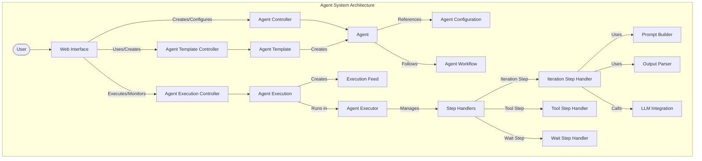

Sources:
- [superagi/jobs/agent_executor.py:37-157](superagi/jobs/agent_executor.py)
- [superagi/models/agent.py:20-302](superagi/models/agent.py)
- [superagi/controllers/agent.py:39-419](superagi/controllers/agent.py)
- [superagi/controllers/agent_execution.py:32-229](superagi/controllers/agent_execution.py)
- [superagi/controllers/agent_template.py:27-542](superagi/controllers/agent_template.py)

## Core Components

### Agent

The `Agent` entity is the central component of the Agent System. It represents an autonomous AI agent configured with specific goals, instructions, constraints, and tools.

Key properties of an Agent:
- **name**: The name of the agent
- **description**: A description of the agent's purpose
- **project_id**: The project the agent belongs to
- **agent_workflow_id**: The workflow the agent follows during execution
- **configurations**: Goals, instructions, constraints, tools, etc.

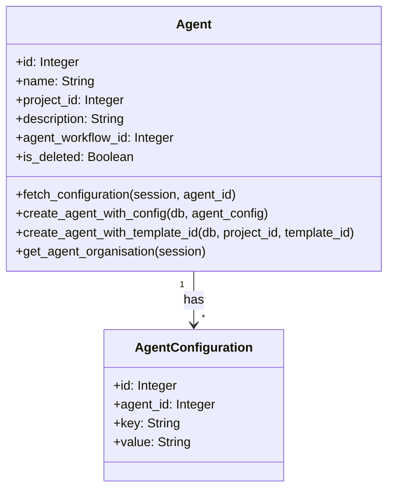

Sources:
- [superagi/models/agent.py:20-302](superagi/models/agent.py)

### Agent Execution

The `AgentExecution` entity represents a single run of an agent. It tracks the execution state, progress, and generates feeds that record the agent's activities.

Key properties of an AgentExecution:
- **status**: The current status (CREATED, RUNNING, PAUSED, COMPLETED, TERMINATED, etc.)
- **agent_id**: The agent being executed
- **current_agent_step_id**: The current workflow step being executed
- **last_execution_time**: The timestamp of the last execution step
- **num_of_calls**: Number of LLM calls made
- **num_of_tokens**: Number of tokens consumed

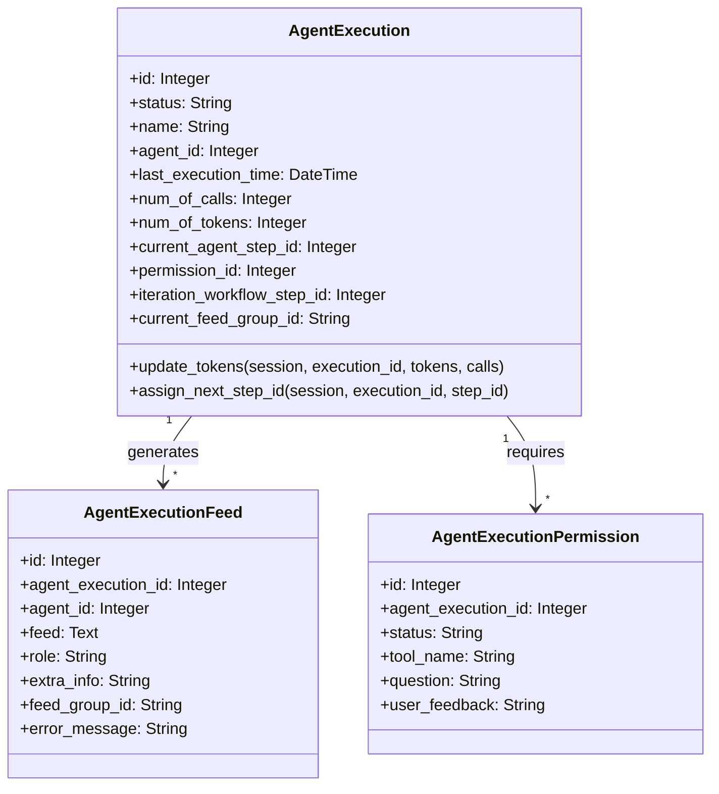

Sources:
- [superagi/models/agent_execution.py:11-214](superagi/models/agent_execution.py)
- [superagi/models/agent_execution_feed.py:8-70](superagi/models/agent_execution_feed.py)
- [superagi/controllers/agent_execution_feed.py:32-244](superagi/controllers/agent_execution_feed.py)
- [superagi/controllers/agent_execution_permission.py:20-159](superagi/controllers/agent_execution_permission.py)

### Agent Executor

The `AgentExecutor` class is responsible for executing agent workflow steps. It manages the execution flow, handles step transitions, and processes different types of steps (iteration, tool, wait).

Key functionalities:
- Executing the next step in an agent's workflow
- Managing agent's maximum iteration limits
- Handling paused executions and waiting workflows

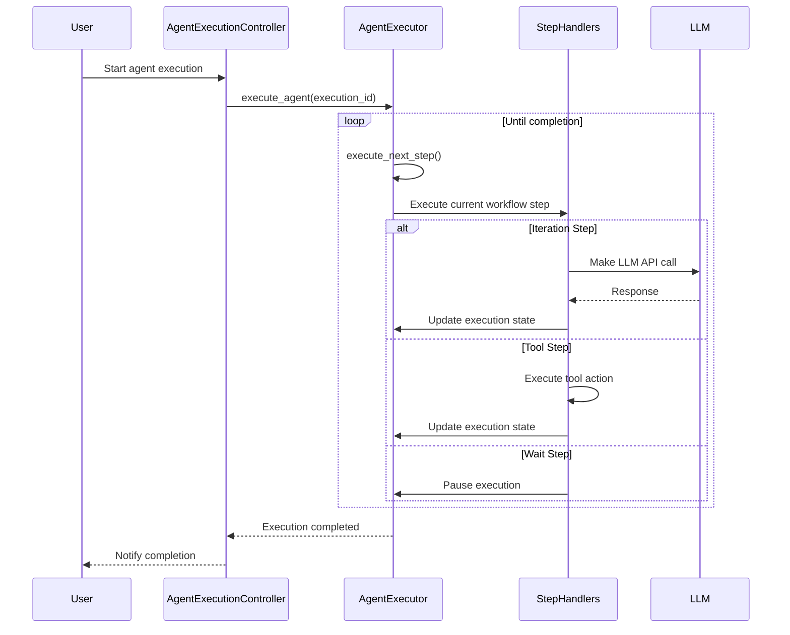

Sources:
- [superagi/jobs/agent_executor.py:37-157](superagi/jobs/agent_executor.py)
- [main.py:194-247](main.py)

### Agent Templates

The `AgentTemplate` entity provides pre-configured agent settings that can be used to create new agents quickly. Templates can be local or from the marketplace.

Key functionalities:
- Creating templates from existing agents
- Importing templates from the marketplace
- Using templates to create new agents with predefined configurations

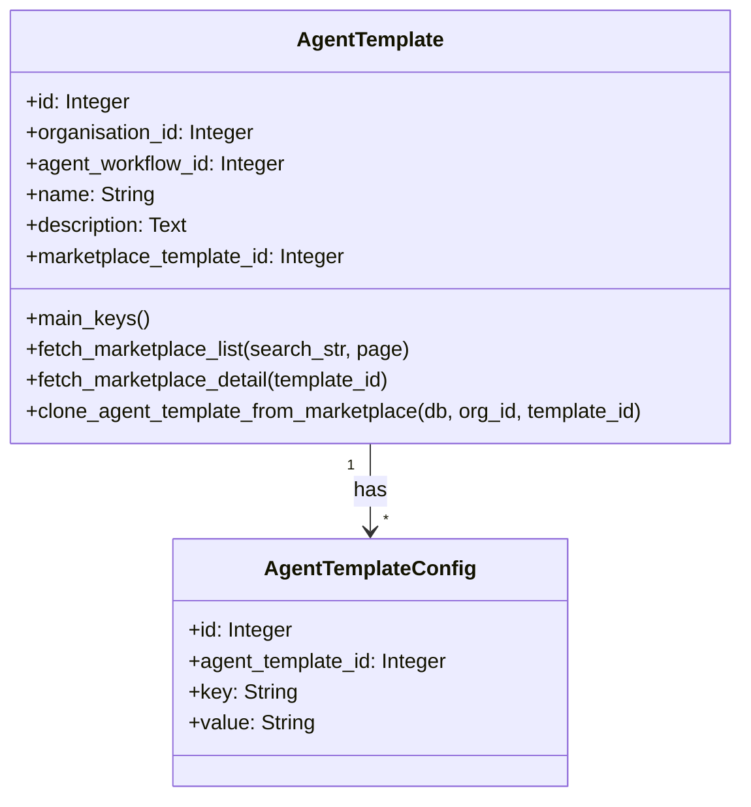

Sources:
- [superagi/models/agent_template.py:16-226](superagi/models/agent_template.py)
- [superagi/controllers/agent_template.py:27-542](superagi/controllers/agent_template.py)

## Agent Lifecycle

The agent lifecycle in SuperAGI consists of three main phases: creation, execution, and monitoring.

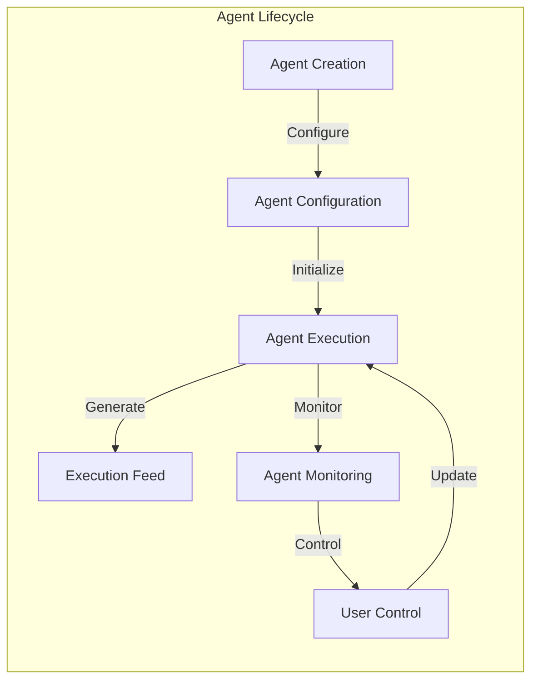

Sources:
- [superagi/controllers/agent.py:60-164](superagi/controllers/agent.py)
- [superagi/controllers/agent_execution.py:65-151](superagi/controllers/agent_execution.py)
- [superagi/controllers/agent_execution_feed.py:152-218](superagi/controllers/agent_execution_feed.py)

### Agent Creation and Configuration

Agents are created with specific configurations that define their behavior and capabilities. These include:

1. **Basic Information**:
   - Name and description
   - Project assignment

2. **Agent Behavior Configuration**:
   - Goals (what the agent aims to achieve)
   - Instructions (guidance for the agent)
   - Constraints (limitations on agent actions)
   - Maximum iterations limit
   - Permission type (God Mode/Restricted Mode)

3. **Technical Configuration**:
   - Agent workflow (execution pattern)
   - Tools and toolkits (capabilities)
   - LLM model configuration
   - Vector database configuration

Agents can be created:
- From scratch with complete configuration
- Using agent templates (predefined configurations)
- By cloning existing agents

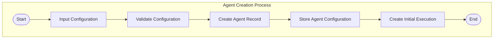

Sources:
- [superagi/controllers/agent.py:60-164](superagi/controllers/agent.py)
- [superagi/models/agent.py:120-182](superagi/models/agent.py)

### Agent Execution

Agent execution follows a defined workflow that consists of steps and transitions. The main step types are:

1. **Iteration Steps**: The core reasoning steps where the agent:
   - Receives input (goals, context, memory)
   - Processes it through an LLM
   - Decides on the next action

2. **Tool Steps**: Steps where the agent:
   - Executes a specific tool
   - Processes the tool's output
   - Updates its understanding

3. **Wait Steps**: Steps where the agent:
   - Pauses execution for a specified time
   - Waits for user input or permission
   - Schedules future actions

The execution process is managed by the `AgentExecutor` which:
- Initializes the execution with the starting workflow step
- Processes each step based on its type
- Manages transitions between steps
- Tracks execution state and progress
- Handles completion, termination, and errors

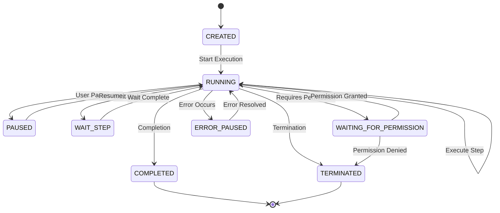

Sources:
- [superagi/jobs/agent_executor.py:37-157](superagi/jobs/agent_executor.py)
- [superagi/controllers/agent_execution.py:65-151](superagi/controllers/agent_execution.py)

### Agent Monitoring and Control

Agents provide multiple monitoring and control mechanisms:

1. **Execution Feed**: A detailed record of the agent's thoughts, actions, and results
2. **Status Tracking**: Real-time execution status (RUNNING, PAUSED, etc.)
3. **Performance Metrics**: Token usage, number of API calls, execution time
4. **Permission System**: User approval workflow for restricted operations
5. **Control Actions**: Pause, resume, terminate execution

The user interface provides a dashboard for:
- Viewing the agent's execution feed in real-time
- Responding to permission requests
- Tracking execution metrics
- Controlling the agent's execution

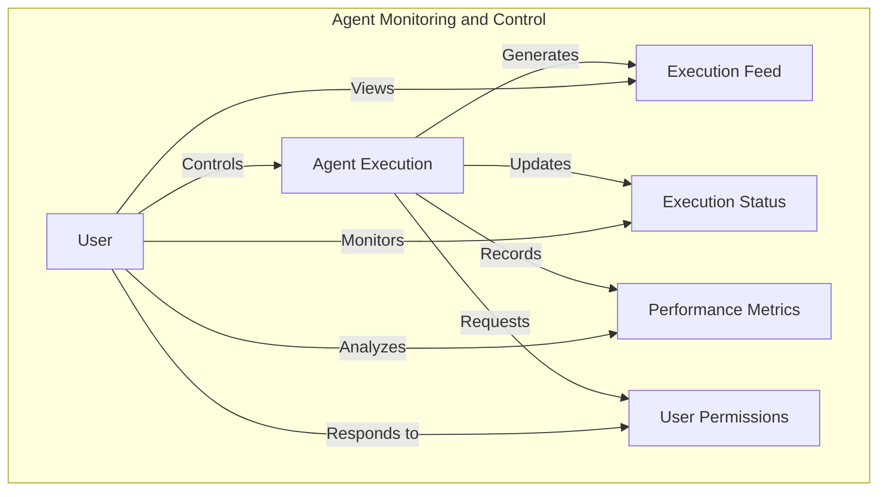

Sources:
- [superagi/controllers/agent_execution_feed.py:152-218](superagi/controllers/agent_execution_feed.py)
- [superagi/controllers/agent_execution_permission.py:125-159](superagi/controllers/agent_execution_permission.py)

## Agent Prompt Building and Output Parsing

### Prompt Building

The `AgentPromptBuilder` constructs prompts for the LLM based on the agent's configuration and current context. Key components include:

1. **Goal Integration**: Incorporating the agent's goals
2. **Instruction Integration**: Adding user instructions
3. **Constraint Integration**: Adding constraints on the agent's behavior
4. **Tool Description**: Describing available tools and their parameters
5. **Context Management**: Including relevant context from memory and previous steps
6. **Task Management**: Managing task-based workflows

The prompt builder uses templating to inject these components into a base prompt structure.

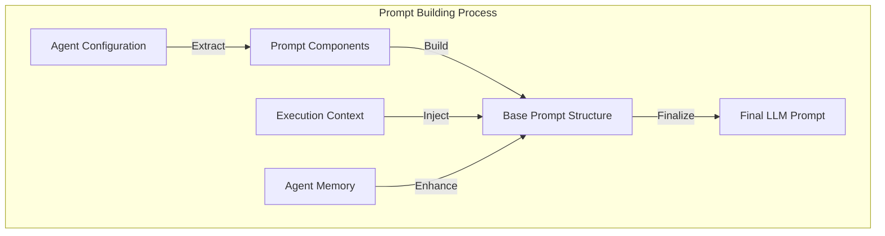

Sources:
- [superagi/agent/agent_prompt_builder.py:12-136](superagi/agent/agent_prompt_builder.py)

### Output Parsing

The `OutputParser` processes the LLM's response to extract structured actions. Key functionalities:

1. **JSON Extraction**: Extracting JSON data from the LLM response
2. **Action Parsing**: Identifying the tool name and arguments
3. **Error Handling**: Managing malformed outputs
4. **Response Cleaning**: Removing extraneous formatting

The parsed output is then used to determine the next action the agent should take.

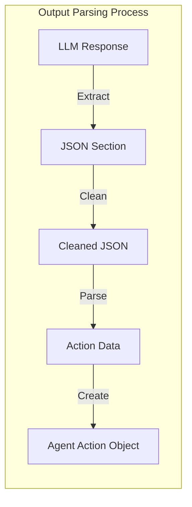

Sources:
- [superagi/agent/output_parser.py:11-70](superagi/agent/output_parser.py)
- [superagi/helper/json_cleaner.py:8-107](superagi/helper/json_cleaner.py)

## Agent Scheduling

SuperAGI supports scheduling agents to run at specified times and intervals. Key scheduling features include:

1. **One-time Scheduling**: Running an agent at a specific date and time
2. **Recurring Execution**: Scheduling periodic runs with a defined interval
3. **Expiration Conditions**: Setting conditions for ending scheduling (date or number of runs)
4. **Schedule Management**: Viewing, editing, and stopping schedules

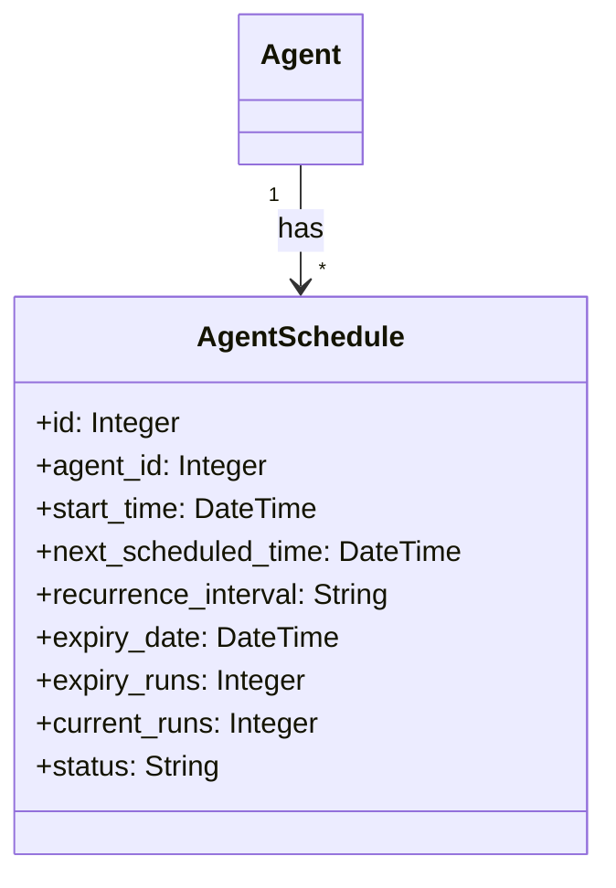

Sources:
- [superagi/controllers/agent.py:167-234](superagi/controllers/agent.py)
- [superagi/controllers/agent_execution.py:234-293](superagi/controllers/agent_execution.py)

## Integration with Other Systems

The Agent System integrates with various other components of SuperAGI:

1. **Tools System**: Agents use tools to interact with external systems and perform actions
2. **Resource Management**: Agents can access and manipulate resources (files, data)
3. **Vector Database**: Agents use vector databases for knowledge storage and retrieval
4. **LLM Integration**: Agents leverage various LLM providers for reasoning

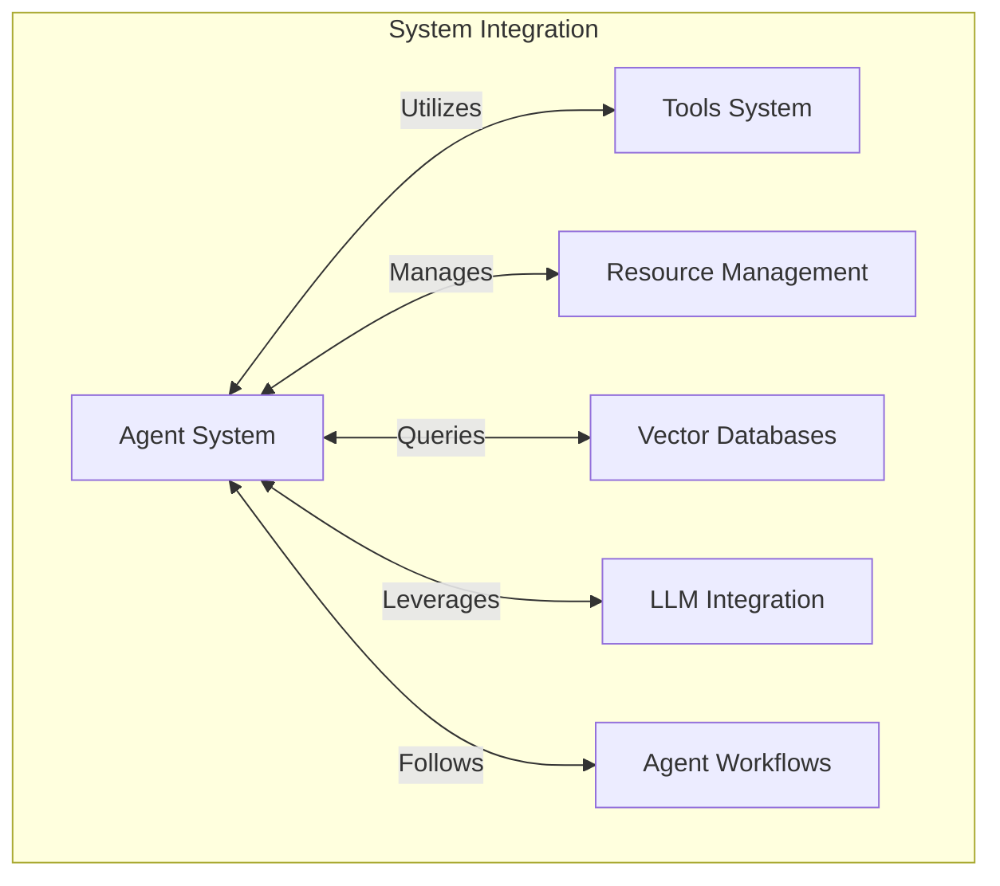

Sources:
- [superagi/jobs/agent_executor.py:37-157](superagi/jobs/agent_executor.py)
- [main.py:108-138](main.py)

## Agent API Endpoints

The Agent System exposes several API endpoints for agent management:

| Endpoint | Method | Description |
|----------|--------|-------------|
| `/agents/create` | POST | Create a new agent with configuration |
| `/agents/schedule` | POST | Create and schedule an agent |
| `/agents/stop/schedule` | POST | Stop a scheduled agent |
| `/agents/edit/schedule` | PUT | Edit a scheduled agent |
| `/agents/get/project/{project_id}` | GET | Get all agents for a project |
| `/agents/delete/{agent_id}` | PUT | Delete (soft) an agent |
| `/agentexecutions/add` | POST | Create a new agent execution |
| `/agentexecutions/add_run` | POST | Create a new agent run with configuration |
| `/agentexecutions/get/{agent_execution_id}` | GET | Get an agent execution by ID |
| `/agentexecutions/get/agent/{agent_id}` | GET | Get executions for an agent |
| `/agentexecutionfeeds/get/execution/{agent_execution_id}` | GET | Get execution feeds |
| `/agent_templates/list` | GET | List available agent templates |
| `/agent_templates/get/{agent_template_id}` | GET | Get a specific agent template |

Sources:
- [superagi/controllers/agent.py:39-419](superagi/controllers/agent.py)
- [superagi/controllers/agent_execution.py:32-229](superagi/controllers/agent_execution.py)
- [superagi/controllers/agent_execution_feed.py:32-244](superagi/controllers/agent_execution_feed.py)
- [superagi/controllers/agent_template.py:27-542](superagi/controllers/agent_template.py)

## Conclusion

The Agent System is the core of SuperAGI, providing a flexible framework for creating, configuring, and running autonomous AI agents. It integrates with other system components to provide a comprehensive agent platform with powerful capabilities for reasoning, tool usage, and autonomous operation.

---

