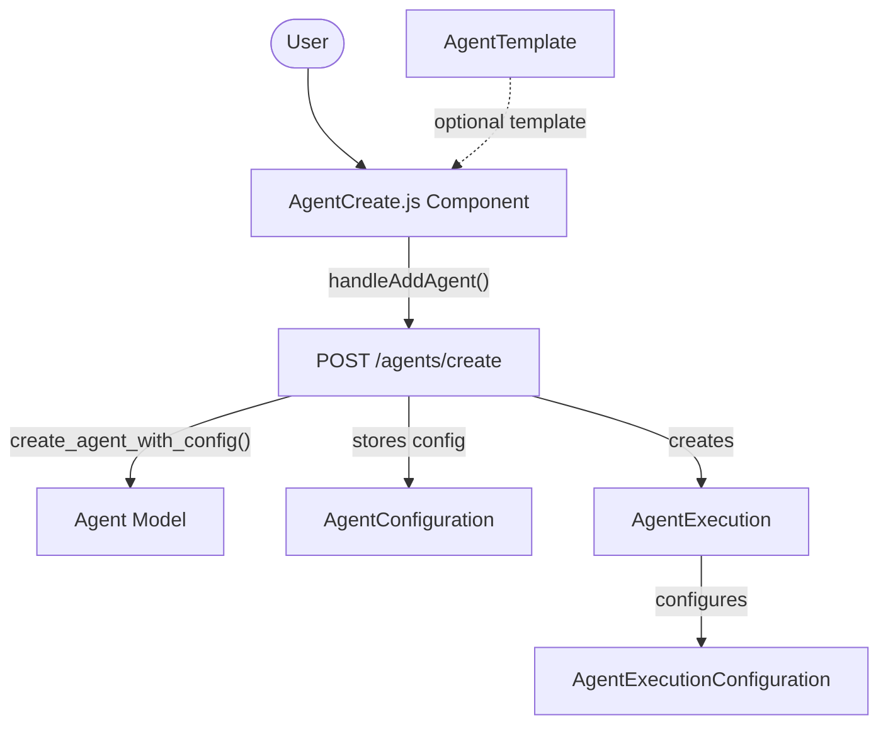
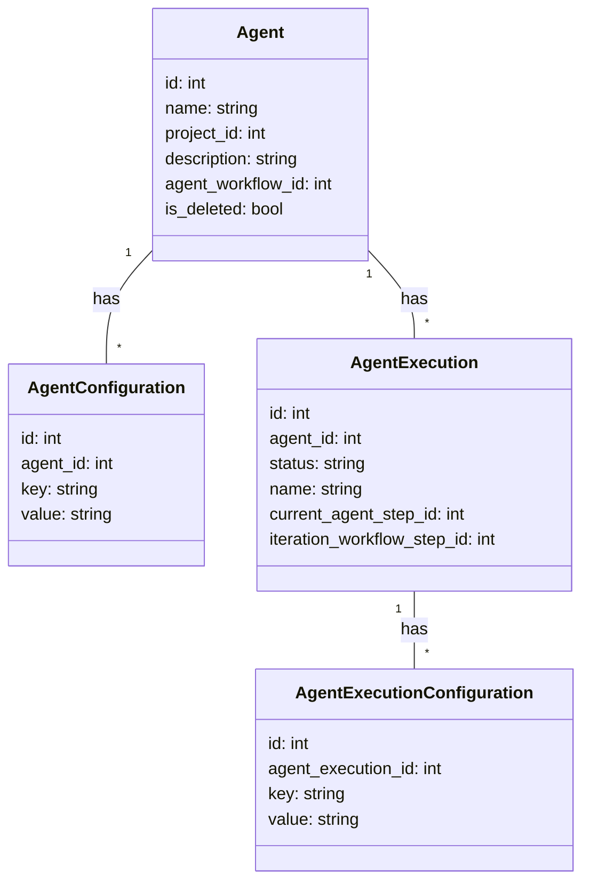
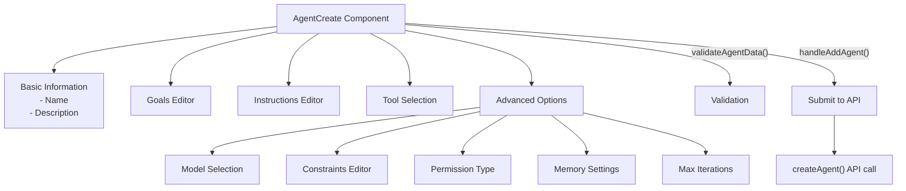
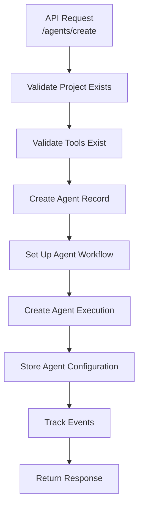
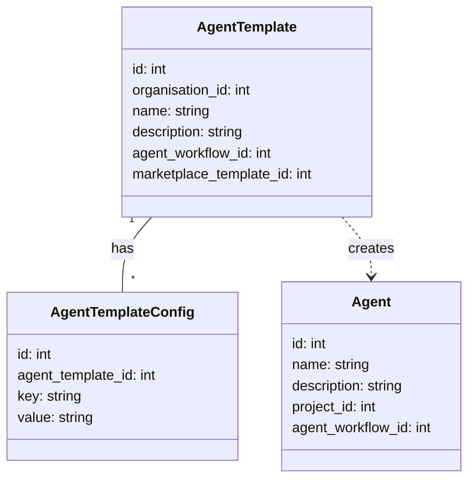
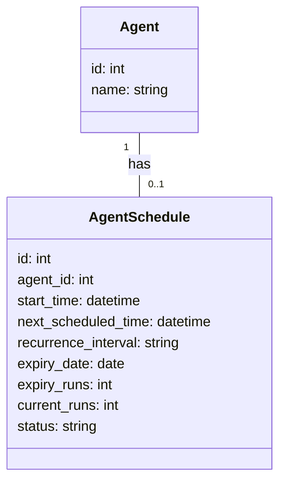

<!-- source: DeepWiki mcp.deepwiki.com · repo TransformerOptimus/SuperAGI · page 2.1 Agent Creation and Configuration · fetched 2026-10-26 -->

# Agent Creation and Configuration

<details>
<summary>Relevant source files</summary>

The following files were used as context for generating this wiki page:

- [gui/pages/Content/Agents/ActivityFeed.js](gui/pages/Content/Agents/ActivityFeed.js)
- [gui/pages/Content/Agents/AgentCreate.js](gui/pages/Content/Agents/AgentCreate.js)
- [gui/pages/Content/Agents/AgentSchedule.js](gui/pages/Content/Agents/AgentSchedule.js)
- [gui/pages/Content/Agents/AgentWorkspace.js](gui/pages/Content/Agents/AgentWorkspace.js)
- [gui/pages/Content/Agents/Agents.js](gui/pages/Content/Agents/Agents.js)
- [gui/pages/Content/Agents/Agents.module.css](gui/pages/Content/Agents/Agents.module.css)
- [gui/pages/Content/Agents/Details.js](gui/pages/Content/Agents/Details.js)
- [gui/pages/Content/Agents/ResourceList.js](gui/pages/Content/Agents/ResourceList.js)
- [gui/pages/Content/Agents/ResourceManager.js](gui/pages/Content/Agents/ResourceManager.js)
- [gui/pages/Dashboard/Content.js](gui/pages/Dashboard/Content.js)
- [gui/pages/_app.css](gui/pages/_app.css)
- [gui/pages/api/DashboardService.js](gui/pages/api/DashboardService.js)
- [gui/utils/utils.js](gui/utils/utils.js)
- [superagi/controllers/agent.py](superagi/controllers/agent.py)
- [superagi/controllers/agent_template.py](superagi/controllers/agent_template.py)
- [superagi/models/agent.py](superagi/models/agent.py)
- [superagi/models/agent_execution.py](superagi/models/agent_execution.py)
- [superagi/models/agent_execution_feed.py](superagi/models/agent_execution_feed.py)
- [superagi/models/agent_template.py](superagi/models/agent_template.py)
- [tests/unit_tests/controllers/test_agent_template.py](tests/unit_tests/controllers/test_agent_template.py)

</details>


This document provides a technical overview of how agents are created and configured in SuperAGI. It covers the UI components, API endpoints, data models, and configuration options available when creating agents. For information about running agents after they've been created, see [Agent Execution](#2.2).

## Overview of Agent Creation Architecture

The agent creation process in SuperAGI involves both frontend and backend components that work together to create, configure, and store agent definitions.



Sources:
- [gui/pages/Content/Agents/AgentCreate.js:497-541](gui/pages/Content/Agents/AgentCreate.js:497-541)
- [superagi/controllers/agent.py:60-163](superagi/controllers/agent.py:60-163)

## Data Models

Agent configurations are stored using several related database models that maintain different aspects of the agent's definition:



Sources:
- [superagi/models/agent.py:20-41](superagi/models/agent.py:20-41)
- [superagi/models/agent_execution.py:11-41](superagi/models/agent_execution.py:11-41)

## Agent Configuration Parameters

Agents in SuperAGI can be configured with the following parameters:

| Parameter | Type | Description | Default |
|-----------|------|-------------|---------|
| name | string | Name of the agent | *Required* |
| description | string | Description of the agent | *Required* |
| project_id | int | Project the agent belongs to | *Required* |
| goal | string[] | List of goals for the agent | *Required* |
| instruction | string[] | Additional instructions | `[]` |
| agent_workflow | string | Workflow type (e.g., "Goal Based Workflow") | *Required* |
| constraints | string[] | Limitations on agent behavior | System defaults |
| tools | int[] | Tool IDs the agent can use | *Required* |
| exit | string | Exit criterion | "No exit criterion" |
| iteration_interval | int | Time between iterations (ms) | 500 |
| model | string | LLM model (e.g., "gpt-4") | *Required* |
| permission_type | string | "God Mode" or "RESTRICTED" | "God Mode" |
| LTM_DB | string | Long-term memory database | "Pinecone" |
| max_iterations | int | Maximum iterations allowed | 25 |
| knowledge | int | Knowledge base ID (optional) | null |

Sources:
- [gui/pages/Content/Agents/AgentCreate.js:549-569](gui/pages/Content/Agents/AgentCreate.js:549-569)
- [superagi/controllers/agent.py:60-96](superagi/controllers/agent.py:60-96)

## Frontend Implementation

The agent creation UI is implemented in the `AgentCreate.js` React component. This component provides an interface for configuring all agent parameters and submitting them to the backend.



Key features of the agent creation UI:

1. Form fields for all configurable parameters
2. Validation of required fields
3. Pre-filled values for optional parameters 
4. Support for creating agents from templates
5. File upload for agent resources

Sources:
- [gui/pages/Content/Agents/AgentCreate.js:38-96](gui/pages/Content/Agents/AgentCreate.js:38-96)
- [gui/pages/Content/Agents/AgentCreate.js:454-493](gui/pages/Content/Agents/AgentCreate.js:454-493)

### Agent Creation Flow in UI

When creating an agent through the UI, the following steps occur:

1. User fills out the agent configuration form
2. User clicks "Create" button, triggering `handleAddAgent()`
3. Form data is validated with `validateAgentData()`
4. If valid, agent data is prepared with `setAgentData()`
5. API call is made to `createAgent()` endpoint
6. On success, any resources are uploaded and the agent is executed

Sources:
- [gui/pages/Content/Agents/AgentCreate.js:495-606](gui/pages/Content/Agents/AgentCreate.js:495-606)

## Backend Implementation

### Agent Creation API Endpoint

The primary endpoint for agent creation is:

```
POST /agents/create
```

Implemented in `create_agent_with_config()` in `superagi/controllers/agent.py`, this endpoint:

1. Validates the agent configuration
2. Creates an `Agent` record in the database
3. Sets up the agent workflow
4. Creates an initial `AgentExecution` with "CREATED" status
5. Stores all configuration parameters
6. Returns the agent ID, execution ID, and other metadata

Sources:
- [superagi/controllers/agent.py:60-163](superagi/controllers/agent.py:60-163)

### Agent Creation Process Flow

The backend process for creating an agent involves:



Sources:
- [superagi/controllers/agent.py:60-163](superagi/controllers/agent.py:60-163)

### Data Storage Process

When an agent is created, the configuration is stored across multiple models:

1. Basic information (name, description) in the `Agent` model
2. Configuration parameters as key-value pairs in `AgentConfiguration`
3. Execution information in `AgentExecution`
4. Execution-specific configuration in `AgentExecutionConfiguration`

This flexible approach allows for storing diverse configuration types and supports both agent templates and direct agent creation.

Sources:
- [superagi/models/agent.py:54-155](superagi/models/agent.py:54-155)

## Agent Templates

Agent templates provide reusable configurations for creating new agents. Templates can be:

1. Local - Created by users within their organization
2. Marketplace - Downloaded from the SuperAGI marketplace



Working with templates involves:

1. Selecting a template when creating a new agent
2. The template's configuration is loaded into the agent creation form
3. Users can modify the configuration if needed
4. When submitted, a new agent is created with the template's configuration

Users can also save existing agents as templates using the "Save as Template" feature in the agent workspace.

Sources:
- [superagi/models/agent_template.py:16-37](superagi/models/agent_template.py:16-37)
- [gui/pages/Content/Agents/AgentCreate.js:187-201](gui/pages/Content/Agents/AgentCreate.js:187-201)
- [gui/pages/Content/Agents/AgentWorkspace.js:315-323](gui/pages/Content/Agents/AgentWorkspace.js:315-323)

## Agent Scheduling

Agents can be scheduled to run at specified times with optional recurrence. The scheduling feature enables:

1. Running agents at a future time
2. Setting up recurring agent runs at defined intervals
3. Configuring expiry conditions (date or number of runs)



Sources:
- [gui/pages/Content/Agents/AgentSchedule.js:12-73](gui/pages/Content/Agents/AgentSchedule.js:12-73)
- [superagi/controllers/agent.py:167-234](superagi/controllers/agent.py:167-234)

## Agent Permissions

SuperAGI supports two permission types for agents:

1. **God Mode**: The agent operates autonomously without requiring permission for tool execution
2. **RESTRICTED**: The agent must request permission before using any tool

The permission type is configured during agent creation and affects the agent's behavior during execution.

Sources:
- [gui/pages/Content/Agents/AgentCreate.js:97-101](gui/pages/Content/Agents/AgentCreate.js:97-101)
- [gui/pages/Content/Agents/AgentWorkspace.js:480-486](gui/pages/Content/Agents/AgentWorkspace.js:480-486)

## Agent Resources

Agents can have resources (files) associated with them. These are managed in two categories:

1. **Input resources**: Files uploaded by users that the agent can access
2. **Output resources**: Files generated by the agent during execution

Resources are managed through the ResourceManager component in the agent workspace, which allows:
- Uploading new files
- Viewing existing resources
- Downloading resources

Sources:
- [gui/pages/Content/Agents/ResourceManager.js:10-117](gui/pages/Content/Agents/ResourceManager.js:10-117)
- [gui/pages/Content/Agents/ResourceList.js:6-82](gui/pages/Content/Agents/ResourceList.js:6-82)

## Creating Agents Programmatically

For developers wanting to create agents programmatically, the process involves:

1. Prepare the agent configuration as a JSON object
2. Send a POST request to the `/agents/create` endpoint
3. Include all required parameters (name, description, goals, tools, model, etc.)
4. Process the response to get the agent ID and execution ID

Example agent configuration structure:

```json
{
  "name": "My Agent",
  "project_id": 1,
  "description": "Agent description",
  "goal": ["Achieve goal 1", "Achieve goal 2"],
  "instruction": ["Optional instruction"],
  "agent_workflow": "Goal Based Workflow",
  "constraints": ["System defined constraint", "Custom constraint"],
  "tools": [1, 2, 3],
  "model": "gpt-4",
  "permission_type": "God Mode",
  "LTM_DB": "Pinecone",
  "max_iterations": 25
}
```

Sources:
- [superagi/controllers/agent.py:60-163](superagi/controllers/agent.py:60-163)

## Conclusion

The agent creation and configuration system in SuperAGI provides a flexible, robust framework for defining autonomous agents with specific capabilities and constraints. Through the UI or API, users can configure agents with precise goals, tools, and execution parameters to accomplish a wide variety of tasks.

---

