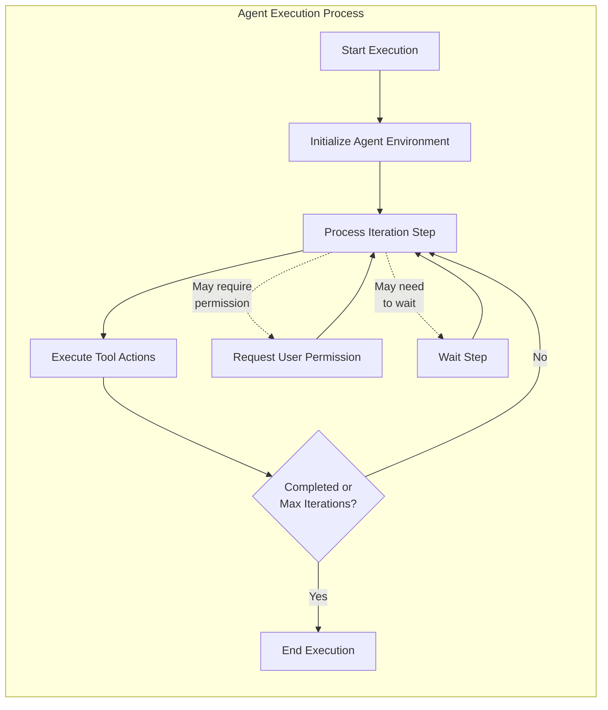
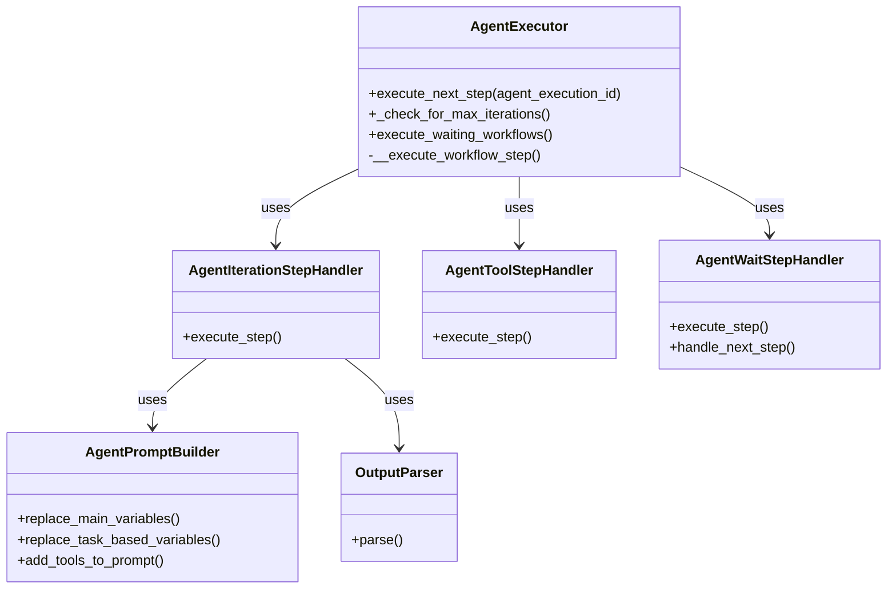
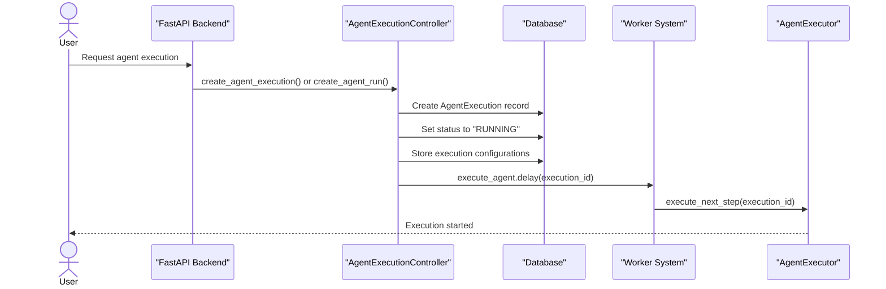
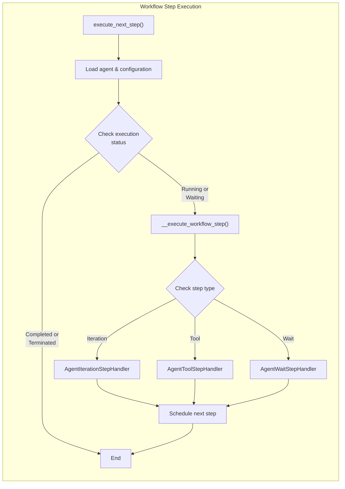
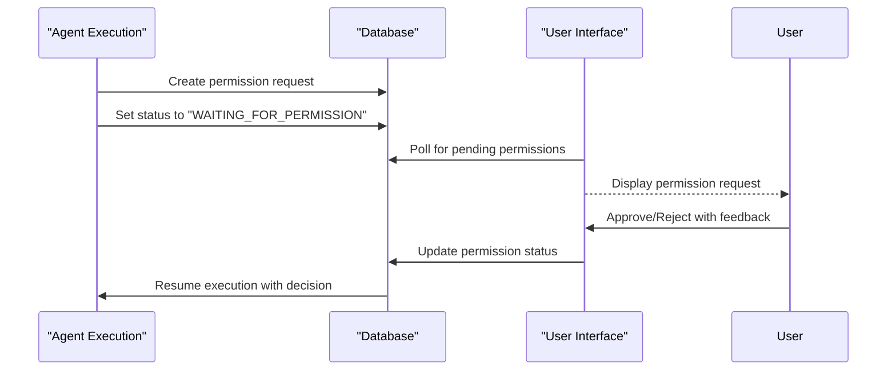
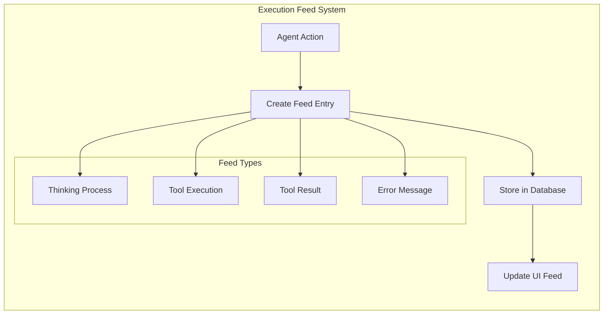
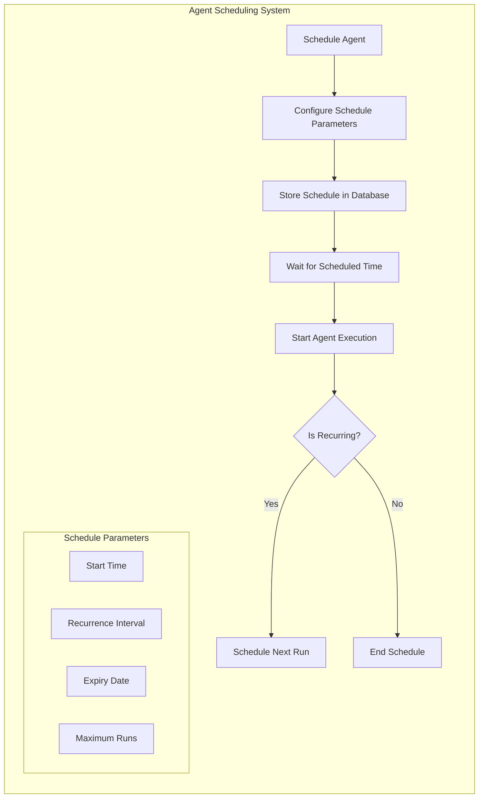

<!-- source: DeepWiki mcp.deepwiki.com · repo TransformerOptimus/SuperAGI · page 2.2 Agent Execution · fetched 2026-10-26 -->

# Agent Execution

Relevant source files

The following files were used as context for generating this wiki page:

- [main.py](main.py)
- [superagi/agent/agent_prompt_builder.py](superagi/agent/agent_prompt_builder.py)
- [superagi/agent/output_parser.py](superagi/agent/output_parser.py)
- [superagi/controllers/agent_execution.py](superagi/controllers/agent_execution.py)
- [superagi/controllers/agent_execution_feed.py](superagi/controllers/agent_execution_feed.py)
- [superagi/controllers/agent_execution_permission.py](superagi/controllers/agent_execution_permission.py)
- [superagi/controllers/budget.py](superagi/controllers/budget.py)
- [superagi/controllers/config.py](superagi/controllers/config.py)
- [superagi/controllers/organisation.py](superagi/controllers/organisation.py)
- [superagi/controllers/project.py](superagi/controllers/project.py)
- [superagi/controllers/user.py](superagi/controllers/user.py)
- [superagi/helper/json_cleaner.py](superagi/helper/json_cleaner.py)
- [superagi/helper/token_counter.py](superagi/helper/token_counter.py)
- [superagi/jobs/agent_executor.py](superagi/jobs/agent_executor.py)

This document explains the agent execution process in SuperAGI - how agents run, process tasks, use tools, and generate outputs. The execution system is responsible for running agents after they've been created and configured (for info about agent creation and configuration, see [Agent Creation and Configuration](#2.1)).

## Agent Execution Overview

The agent execution system is the core engine that powers the autonomous operation of agents in SuperAGI. It handles the entire lifecycle of an agent's runtime, from initialization to completion, managing the agent's thinking process, tool usage, and interaction with users.

Sources:
- [superagi/jobs/agent_executor.py:37-157]()
- [superagi/controllers/agent_execution.py:65-149]()

## Key Components of Agent Execution

Sources:
- [superagi/jobs/agent_executor.py:37-157]()
- [superagi/agent/agent_prompt_builder.py:12-136]()
- [superagi/agent/output_parser.py:21-70]()

## Agent Execution Lifecycle

The execution lifecycle begins when an agent is created and configured in the SuperAGI system.

### 1. Initializing Agent Execution

When a new agent execution is requested, the system:

1. Creates an `AgentExecution` record
2. Sets initial status to "CREATED" then "RUNNING"
3. Configures the execution with the agent's parameters
4. Schedules the execution with the worker system

Sources:
- [superagi/controllers/agent_execution.py:65-149]()
- [superagi/controllers/agent_execution.py:152-231]()
- [main.py:148-149]()

### 2. Workflow Step Execution

The `AgentExecutor` processes execution in distinct workflow steps:

- **Iteration Step**: Handles the agent's reasoning and task planning
- **Tool Step**: Executes specific tools based on the agent's decisions
- **Wait Step**: Manages waiting periods for user approval or scheduled delays

Sources:
- [superagi/jobs/agent_executor.py:39-102]()
- [superagi/jobs/agent_executor.py:105-127]()

### 3. Iteration Step Processing

During an iteration step, the agent:

1. Builds a prompt based on goals, instructions, constraints, and tools
2. Sends the prompt to the configured LLM
3. Parses the LLM response to determine the next action
4. Updates the agent's state and execution feed

Sources:
- [superagi/agent/agent_prompt_builder.py:66-94]()
- [superagi/agent/output_parser.py:21-70]()

### 4. Tool Execution

When executing a tool, the system:

1. Validates the tool action
2. Checks permissions if restricted mode is enabled
3. Executes the selected tool with provided arguments
4. Captures and stores the tool's output
5. Updates the agent's execution feed with results

Sources:
- [superagi/jobs/agent_executor.py:108-114]()

## Agent Execution Status Management

Agent executions progress through various statuses throughout their lifecycle:

| Status | Description |
|--------|-------------|
| CREATED | Initial status when execution is first created |
| RUNNING | Actively processing tasks and executing steps |
| PAUSED | Execution manually paused by user |
| COMPLETED | All tasks successfully completed |
| TERMINATED | Execution prematurely ended |
| WAITING_FOR_PERMISSION | Waiting for user approval to proceed |
| WAIT_STEP | In a scheduled waiting period |
| ERROR_PAUSED | Paused due to an error |
| ITERATION_LIMIT_EXCEEDED | Stopped after reaching maximum iterations |

Sources:
- [superagi/controllers/agent_execution.py:340-347]()
- [superagi/jobs/agent_executor.py:47-56]()
- [superagi/jobs/agent_executor.py:143-157]()

## Permission System

The permission system allows agents to request user approval before executing certain actions:

Sources:
- [superagi/controllers/agent_execution_permission.py:124-158]()
- [superagi/controllers/agent_execution_feed.py:188-204]()

## Execution Feed System

The execution feed system captures and stores the agent's thinking process, actions, and results:

Sources:
- [superagi/controllers/agent_execution_feed.py:58-85]()
- [superagi/controllers/agent_execution_feed.py:151-218]()

## Token Usage Tracking

The system tracks token usage to monitor LLM consumption and enforce iteration limits:

1. Each agent interaction with the LLM increments the token count
2. The `TokenCounter` utility measures token usage accurately
3. When max iterations are reached, the agent execution is stopped

Sources:
- [superagi/helper/token_counter.py:37-98]()
- [superagi/jobs/agent_executor.py:143-157]()

## Scheduled and Recurring Executions

SuperAGI supports scheduling agents to run at specific times or on recurring intervals:

Sources:
- [superagi/controllers/agent_execution.py:234-293]()

## Execution Wait Steps

The agent can enter wait periods either by design or when waiting for external input:

1. **Scheduled Waits**: Time-based pauses configured in the workflow
2. **Permission Waits**: Waiting for user approval to continue
3. **Resuming from Waits**: Automatic or manual resumption of execution

The system periodically checks waiting executions to resume them when appropriate.

Sources:
- [superagi/jobs/agent_executor.py:159-186]()

## Integration with External Systems

Agent execution integrates with several other system components:

1. **LLM Integration**: Connects to various language models for agent reasoning
2. **Vector Stores**: Accesses knowledge stored in vector databases for context
3. **Event Tracking**: Records execution events for monitoring and analytics
4. **Resource Management**: Manages files and resources used during execution

Sources:
- [superagi/jobs/agent_executor.py:62-81]()
- [superagi/controllers/agent_execution.py:130-146]()

## Conclusion

The agent execution system is the heart of SuperAGI, orchestrating the complex process of agent operation from start to finish. It manages the interaction between the agent's reasoning process, tool usage, and user feedback, enabling autonomous operation while maintaining safety and control through various monitoring and permission mechanisms.

---

