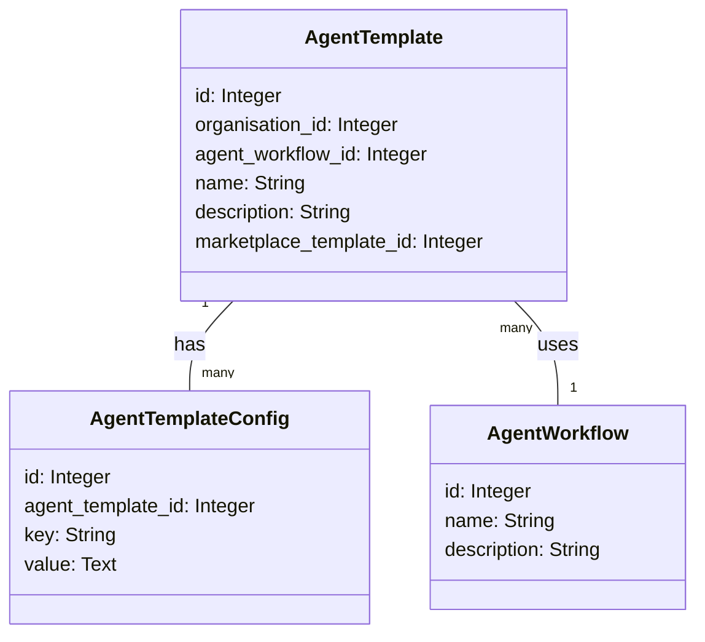
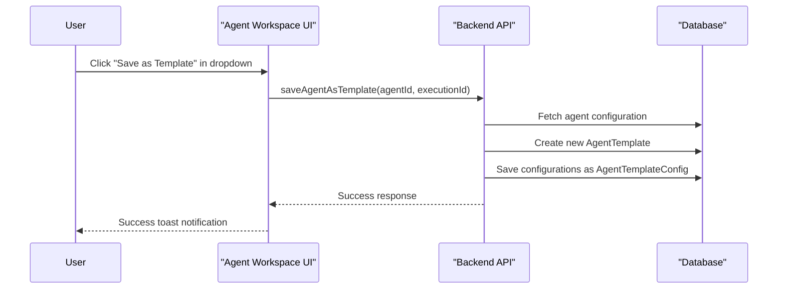
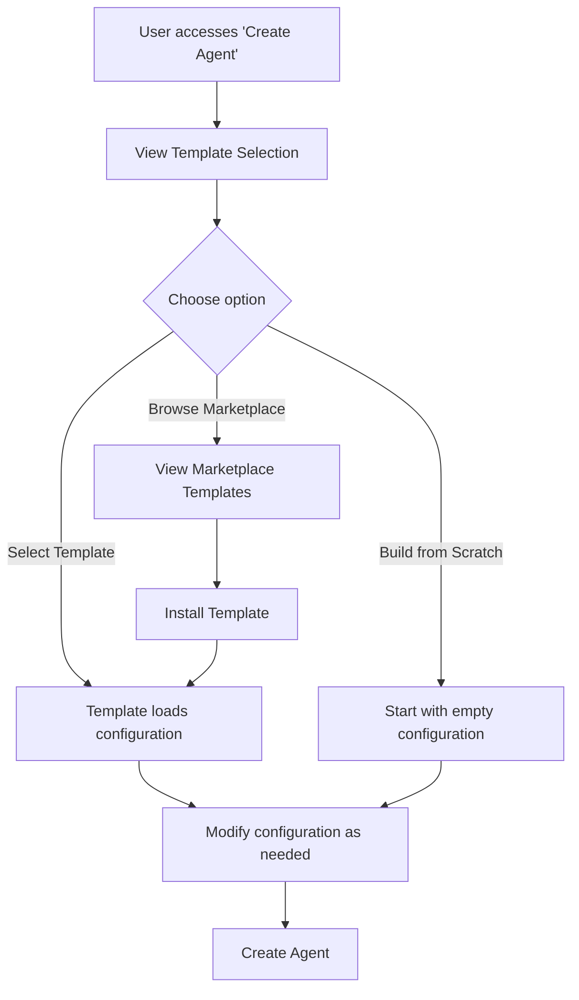
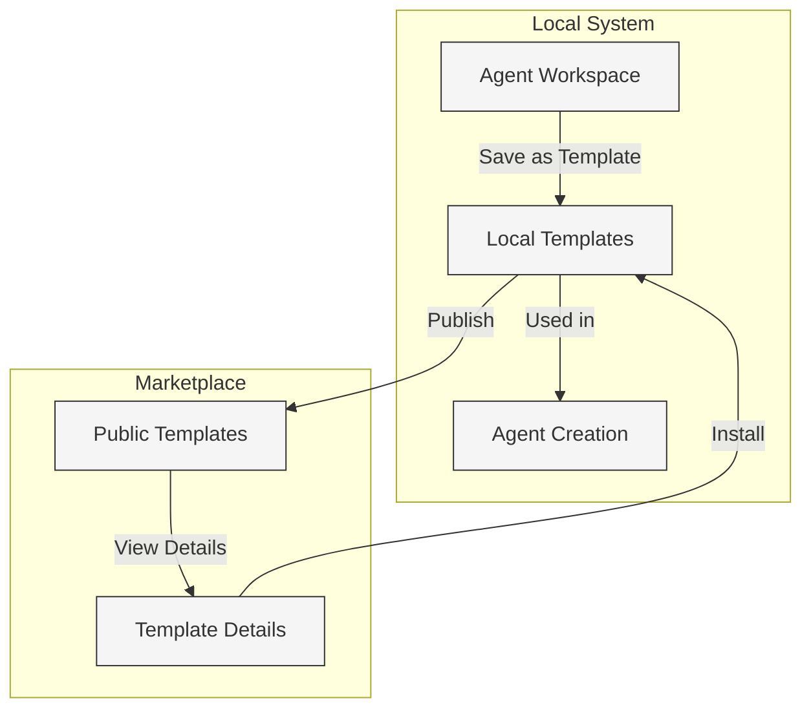
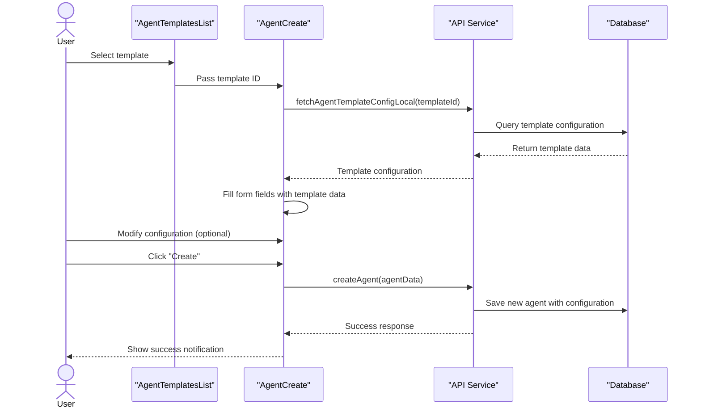

<!-- source: DeepWiki mcp.deepwiki.com · repo TransformerOptimus/SuperAGI · page 2.3 Agent Templates · fetched 2026-10-26 -->

# Agent Templates

<details>
<summary>Relevant source files</summary>

The following files were used as context for generating this wiki page:

- [gui/pages/Content/Agents/ActivityFeed.js](gui/pages/Content/Agents/ActivityFeed.js)
- [gui/pages/Content/Agents/AgentCreate.js](gui/pages/Content/Agents/AgentCreate.js)
- [gui/pages/Content/Agents/AgentSchedule.js](gui/pages/Content/Agents/AgentSchedule.js)
- [gui/pages/Content/Agents/AgentTemplatesList.js](gui/pages/Content/Agents/AgentTemplatesList.js)
- [gui/pages/Content/Agents/AgentWorkspace.js](gui/pages/Content/Agents/AgentWorkspace.js)
- [gui/pages/Content/Agents/Agents.js](gui/pages/Content/Agents/Agents.js)
- [gui/pages/Content/Agents/Agents.module.css](gui/pages/Content/Agents/Agents.module.css)
- [gui/pages/Content/Agents/Details.js](gui/pages/Content/Agents/Details.js)
- [gui/pages/Content/Agents/ResourceList.js](gui/pages/Content/Agents/ResourceList.js)
- [gui/pages/Content/Agents/ResourceManager.js](gui/pages/Content/Agents/ResourceManager.js)
- [gui/pages/Content/Marketplace/AgentTemplate.js](gui/pages/Content/Marketplace/AgentTemplate.js)
- [gui/pages/Content/Marketplace/Market.js](gui/pages/Content/Marketplace/Market.js)
- [gui/pages/Content/Marketplace/Market.module.css](gui/pages/Content/Marketplace/Market.module.css)
- [gui/pages/Content/Marketplace/MarketAgent.js](gui/pages/Content/Marketplace/MarketAgent.js)
- [gui/pages/Content/Marketplace/MarketTools.js](gui/pages/Content/Marketplace/MarketTools.js)
- [gui/pages/Content/Marketplace/MarketplacePublic.js](gui/pages/Content/Marketplace/MarketplacePublic.js)
- [gui/pages/Dashboard/Content.js](gui/pages/Dashboard/Content.js)
- [gui/pages/_app.css](gui/pages/_app.css)
- [gui/pages/api/DashboardService.js](gui/pages/api/DashboardService.js)
- [gui/public/images/tick.svg](gui/public/images/tick.svg)
- [gui/utils/utils.js](gui/utils/utils.js)
- [superagi/controllers/agent.py](superagi/controllers/agent.py)
- [superagi/controllers/agent_template.py](superagi/controllers/agent_template.py)
- [superagi/models/agent.py](superagi/models/agent.py)
- [superagi/models/agent_execution.py](superagi/models/agent_execution.py)
- [superagi/models/agent_execution_feed.py](superagi/models/agent_execution_feed.py)
- [superagi/models/agent_template.py](superagi/models/agent_template.py)
- [tests/unit_tests/controllers/test_agent_template.py](tests/unit_tests/controllers/test_agent_template.py)

</details>


Agent Templates in SuperAGI provide a mechanism to save, reuse, and share agent configurations. They allow users to quickly create new agents based on predefined configurations, reducing repetitive setup work and enabling the sharing of effective agent designs across the platform.

For information about creating agents from scratch, see [Agent Creation and Configuration](#2.1). For details about how agents execute after creation, see [Agent Execution](#2.2).

## Purpose and Function

Agent Templates serve as blueprints for creating new agents with predefined configurations. These templates store all essential configuration parameters including:

- Goals and instructions
- Constraints
- Selected tools
- Model settings
- Workflow type
- Maximum iterations
- Permission types
- Memory settings

Templates can be created by saving existing agent configurations, installed from the marketplace, or built from scratch. Once a template is available, users can select it when creating a new agent to automatically populate configuration fields, which can then be customized as needed.

Sources:
- [superagi/models/agent_template.py:16-35]()
- [gui/pages/Content/Agents/AgentCreate.js:187-195]()

## Template Data Structure

An Agent Template consists of two main components: the template metadata and the template configuration data.



**Template Metadata** (AgentTemplate):
- Basic information including name, description
- Organizational ownership
- Associated agent workflow type
- Marketplace reference (if installed from marketplace)

**Template Configuration** (AgentTemplateConfig):
- Stored as key-value pairs
- Contains all agent settings and parameters
- Includes goals, constraints, tools, model settings, etc.

Sources:
- [superagi/models/agent_template.py:16-35]()
- [superagi/models/agent_template_config.py]()
- [superagi/controllers/agent_template.py:27-50]()

## Creating and Managing Templates

### Saving an Agent as a Template

Users can save an existing agent's configuration as a template for future use:



An agent's current configuration can be saved as a template from the agent workspace by clicking on the dropdown menu and selecting "Save as Template". This creates a new template that captures all the agent's current settings.

Sources:
- [gui/pages/Content/Agents/AgentWorkspace.js:314-323]()
- [superagi/controllers/agent_template.py:262-293]()

### Editing Templates

Templates can be modified after creation. When a user creates an agent from a template and has the "Edit Template" option available, they can make changes to the template settings and update the stored template.

Sources:
- [gui/pages/Content/Agents/AgentCreate.js:686-724]()
- [superagi/controllers/agent_template.py:347-400]()

## Template Selection and Usage

### Template Selection Interface

When creating a new agent, users are presented with a template selection interface that displays available templates:



The template selection interface shows local templates that the user has created or installed. Each template displays its name and description to help users make an appropriate selection.

Sources:
- [gui/pages/Content/Agents/AgentTemplatesList.js:18-58]()
- [gui/pages/Dashboard/Content.js:463-466]()

### Creating an Agent from a Template

When a template is selected, its configuration is loaded into the agent creation form:

1. Template data is fetched from the backend API
2. Form fields are automatically populated with template values
3. Users can modify any settings as needed
4. Upon submission, a new agent is created with the current configuration

The template itself remains unchanged unless explicitly edited and updated.

Sources:
- [gui/pages/Content/Agents/AgentCreate.js:187-206]()
- [gui/pages/Content/Agents/AgentCreate.js:274-291]()

## Marketplace Integration

SuperAGI includes a marketplace where users can discover, install, and publish agent templates.



### Installing Templates from Marketplace

Users can browse the marketplace to discover templates created by others:

1. Access the marketplace tab
2. Browse agent templates
3. View template details 
4. Install templates of interest
5. Installed templates appear in the local templates list

Sources:
- [gui/pages/Content/Marketplace/Market.js:15-92]()
- [gui/pages/Content/Marketplace/MarketAgent.js:8-53]()
- [gui/pages/Content/Marketplace/AgentTemplate.js:62-87]()

### Publishing Templates to Marketplace

Users can share their agent templates with the community by publishing them to the marketplace:

1. Save an agent as a template or edit an existing template
2. Click "Publish to marketplace" option
3. The template is submitted for review
4. Once approved, it becomes available in the marketplace for others to install

Sources:
- [gui/pages/Content/Agents/AgentWorkspace.js:67-83]()
- [gui/pages/Content/Agents/AgentCreate.js:886-894]()

## Implementation Details

### Database Models

Agent Templates are primarily implemented through two database models:

1. **AgentTemplate** - Stores the template metadata
   ```python
   class AgentTemplate(DBBaseModel):
       id = Column(Integer, primary_key=True)
       organisation_id = Column(Integer)
       agent_workflow_id = Column(Integer)
       name = Column(String)
       description = Column(String)
       marketplace_template_id = Column(Integer)
   ```

2. **AgentTemplateConfig** - Stores the template configuration settings as key-value pairs
   ```python
   class AgentTemplateConfig(DBBaseModel):
       id = Column(Integer, primary_key=True)
       agent_template_id = Column(Integer)
       key = Column(String)
       value = Column(Text)
   ```

Sources:
- [superagi/models/agent_template.py:16-35]()
- [superagi/models/agent_template_config.py]()

### Frontend Components

The user interface for agent templates is implemented through several key components:

1. **AgentTemplatesList** - Displays available templates for selection
2. **AgentCreate** - Handles template loading and agent creation
3. **MarketAgent** - Shows marketplace templates
4. **AgentTemplate** - Displays template details

Sources:
- [gui/pages/Content/Agents/AgentTemplatesList.js]()
- [gui/pages/Content/Agents/AgentCreate.js]()
- [gui/pages/Content/Marketplace/MarketAgent.js]()
- [gui/pages/Content/Marketplace/AgentTemplate.js]()

### API Endpoints

The backend API provides several endpoints for managing agent templates:

1. **/agent_templates/list** - Lists available templates
2. **/agent_templates/get/{id}** - Gets template details
3. **/agent_templates/agent_config** - Gets template configuration
4. **/agent_templates/save_agent_as_template** - Saves an agent as a template
5. **/agent_templates/update_agent_template/{id}** - Updates a template
6. **/agent_templates/download** - Installs a template from marketplace
7. **/agent_templates/publish_template** - Publishes a template to marketplace

Sources:
- [superagi/controllers/agent_template.py]()
- [gui/pages/api/DashboardService.js:103-137]()

## Template Usage Flow

The complete flow from template selection to agent creation is visualized below:



This sequence represents how a user interacts with the system to select a template and create a new agent based on that template.

Sources:
- [gui/pages/Content/Agents/AgentTemplatesList.js:53-58]()
- [gui/pages/Content/Agents/AgentCreate.js:187-206]()
- [gui/pages/Content/Agents/AgentCreate.js:495-543]()
- [superagi/controllers/agent.py:60-163]()

---

