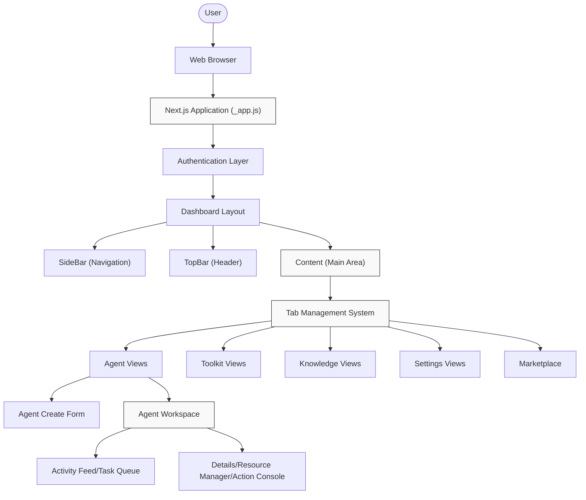
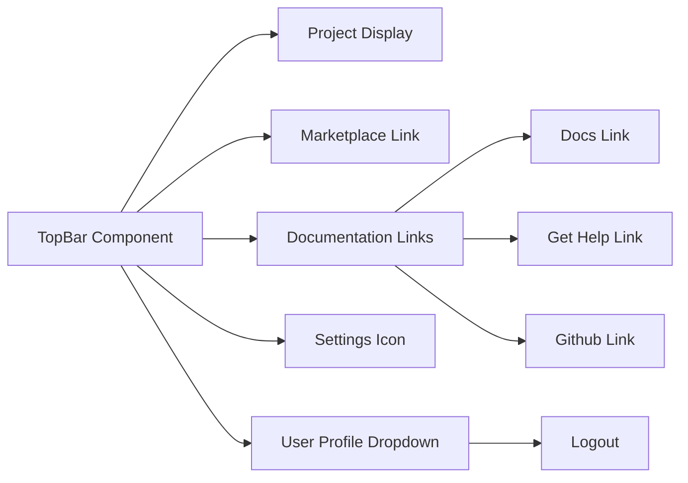
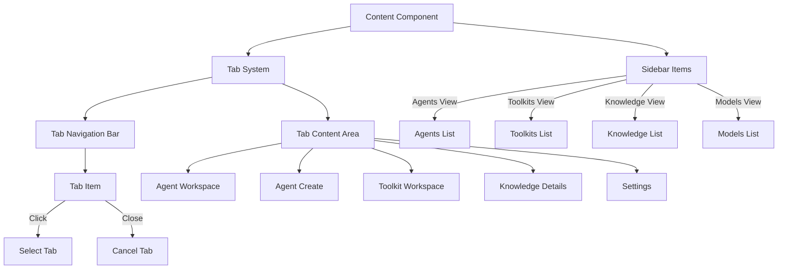
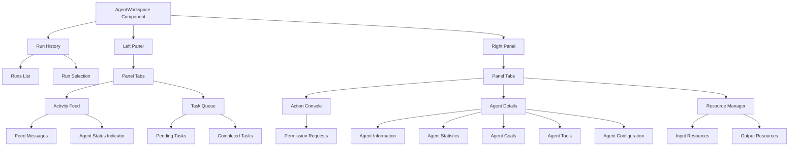
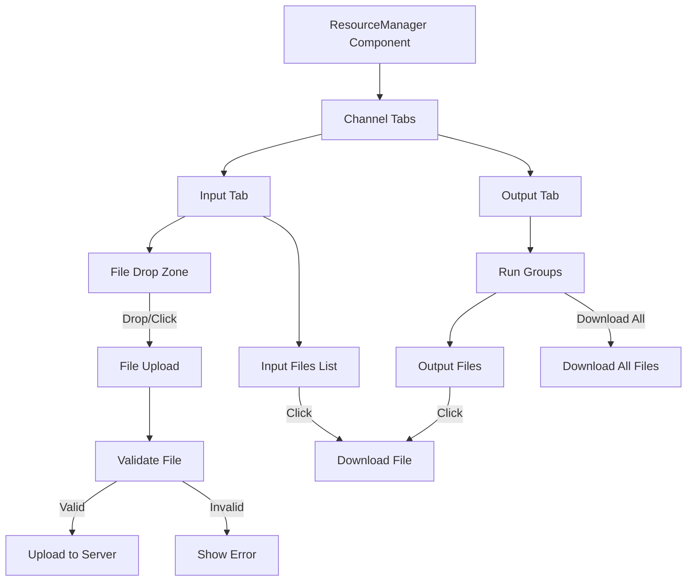
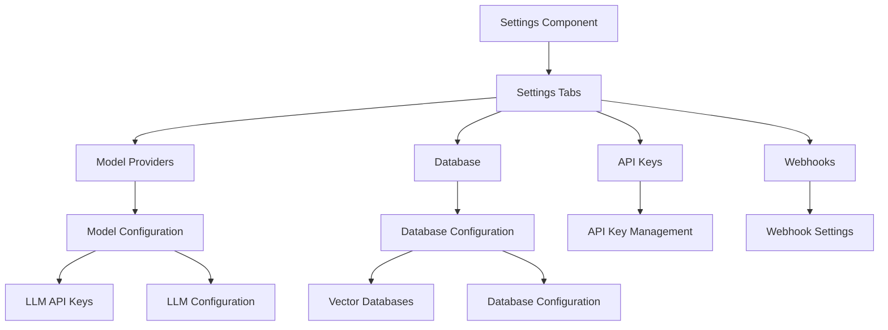
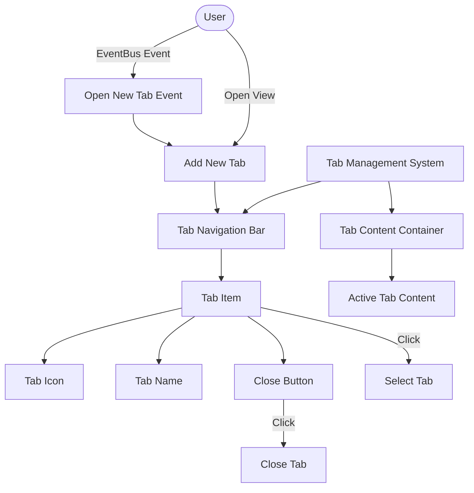
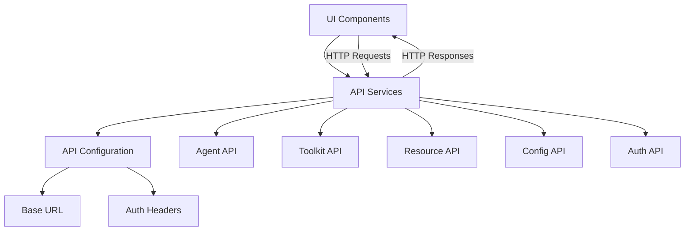

<!-- source: DeepWiki mcp.deepwiki.com · repo TransformerOptimus/SuperAGI · page 3 User Interface · fetched 2026-10-26 -->

# User Interface

<details>
<summary>Relevant source files</summary>

The following files were used as context for generating this wiki page:

- [gui/app/favicon.ico](gui/app/favicon.ico)
- [gui/pages/Content/Agents/ActivityFeed.js](gui/pages/Content/Agents/ActivityFeed.js)
- [gui/pages/Content/Agents/AgentCreate.js](gui/pages/Content/Agents/AgentCreate.js)
- [gui/pages/Content/Agents/AgentSchedule.js](gui/pages/Content/Agents/AgentSchedule.js)
- [gui/pages/Content/Agents/AgentWorkspace.js](gui/pages/Content/Agents/AgentWorkspace.js)
- [gui/pages/Content/Agents/Agents.js](gui/pages/Content/Agents/Agents.js)
- [gui/pages/Content/Agents/Agents.module.css](gui/pages/Content/Agents/Agents.module.css)
- [gui/pages/Content/Agents/Details.js](gui/pages/Content/Agents/Details.js)
- [gui/pages/Content/Agents/ResourceList.js](gui/pages/Content/Agents/ResourceList.js)
- [gui/pages/Content/Agents/ResourceManager.js](gui/pages/Content/Agents/ResourceManager.js)
- [gui/pages/Content/Agents/TaskQueue.js](gui/pages/Content/Agents/TaskQueue.js)
- [gui/pages/Dashboard/Content.js](gui/pages/Dashboard/Content.js)
- [gui/pages/Dashboard/Dashboard.module.css](gui/pages/Dashboard/Dashboard.module.css)
- [gui/pages/Dashboard/Settings/Settings.js](gui/pages/Dashboard/Settings/Settings.js)
- [gui/pages/Dashboard/TopBar.js](gui/pages/Dashboard/TopBar.js)
- [gui/pages/_app.css](gui/pages/_app.css)
- [gui/pages/_app.js](gui/pages/_app.js)
- [gui/pages/api/DashboardService.js](gui/pages/api/DashboardService.js)
- [gui/pages/api/apiConfig.js](gui/pages/api/apiConfig.js)
- [gui/utils/utils.js](gui/utils/utils.js)

</details>


This document provides a comprehensive overview of the SuperAGI user interface architecture, components, and user interaction patterns. The UI enables users to create, manage, and monitor autonomous agents, handle resources, and configure system settings.

For information about specific agent functionality, refer to the [Agent System](#2) documentation, and for tool integrations, see the [Tools System](#4).

## User Interface Architecture

The SuperAGI UI is built as a Next.js web application with a modular component structure organized in a dashboard layout:



Sources:
- `gui/pages/_app.js`
- `gui/pages/Dashboard/Content.js`
- `gui/pages/Dashboard/TopBar.js`
- `gui/pages/Content/Agents/AgentWorkspace.js`

## Layout Components

### Application Entry Point

The application entry point (`_app.js`) handles:
- Authentication status management
- Environment detection (DEV/PROD)
- Application layout rendering
- Global event listeners

It renders either the sign-in screen or the main dashboard layout depending on authentication status:

```javascript
// Simplified structure from _app.js
{applicationState === 'AUTHENTICATED' ? (
  <div className="projectStyle">
    <div className="sideBarStyle">
      <SideBar onSelectEvent={handleSelectionEvent} env={env}/>
    </div>
    <div className="workSpaceStyle">
      <div className="topBarStyle">
        <TopBar selectedProject={selectedProject} organisationId={organisationId} userName={userName} env={env}/>
      </div>
      <div className="contentStyle">
        <Content env={env} organisationId={organisationId} selectedView={selectedView}
                 selectedProjectId={selectedProject?.id || ''}/>
      </div>
    </div>
  </div>
) : (
  <div className="signInStyle">
    {/* Sign-in screen */}
  </div>
)}
```

Sources:
- `gui/pages/_app.js:270-314`

### Top Bar Component

The TopBar provides:
- Project selection display
- Marketplace access
- Documentation links
- Settings access
- User profile menu



Sources:
- `gui/pages/Dashboard/TopBar.js:10-115`

### Content Management

The Content component is the core UI renderer that:
- Manages the tab system
- Renders the appropriate view based on selected navigation item
- Handles tab creation, selection, and closure



Sources:
- `gui/pages/Dashboard/Content.js:37-503`

## Agent Interface

### Agent Creation

The Agent Create form allows users to define new agents with various configurations:

```mermaid
graph TD
    AgentCreate["AgentCreate Component"]
    AgentCreate --> BasicSettings["Basic Settings"]
    AgentCreate --> GoalsSection["Goals Configuration"]
    AgentCreate --> InstructionsSection["Instructions Configuration"]
    AgentCreate --> ModelSelection["Model Selection"]
    AgentCreate --> ToolsSection["Tools Selection"]
    AgentCreate --> AdvancedOptions["Advanced Options"]
    
    BasicSettings --> AgentName["Agent Name Input"]
    BasicSettings --> AgentDescription["Agent Description Input"]
    
    GoalsSection --> GoalsList["Goals List"]
    GoalsSection --> AddGoalButton["Add Goal Button"]
    
    InstructionsSection --> InstructionsList["Instructions List"]
    InstructionsSection --> AddInstructionButton["Add Instruction Button"]
    
    ModelSelection --> ModelDropdown["Model Dropdown"]
    ModelSelection --> BrowseModelsLink["Browse Models Link"]
    
    ToolsSection --> ToolkitsList["Toolkits List"]
    ToolsSection --> SelectedTools["Selected Tools"]
    
    AdvancedOptions --> ConstraintsSection["Constraints"]
    AdvancedOptions --> MemorySettings["Memory Settings"]
    AdvancedOptions --> PermissionSettings["Permission Settings"]
    AdvancedOptions --> IterationSettings["Iteration Settings"]
    AdvancedOptions --> ResourcesSection["Resources Upload"]
    
    AgentCreate -- "Submit" --> ValidateForm["Validate Form"]
    ValidateForm -- "Valid" --> CreateAgent["Create Agent API Call"]
    ValidateForm -- "Invalid" --> ShowErrors["Show Error Messages"]
    
    CreateAgent --> UploadResources["Upload Resources"]
    CreateAgent --> RunExecution["Run Execution"]
```



The form has extensive validation logic ensuring all required fields are completed and compatible settings are selected before an agent can be created:

```javascript
const validateAgentData = (isNewAgent) => {
  if (isNewAgent && !hasAPIkey) {
    toast.error("Your API key is empty!", {autoClose: 1800});
    openNewTab(-3, "Settings", "Settings", false);
    return false;
  }

  if (agentName?.replace(/\s/g, '') === '') {
    toast.error("Agent name can't be blank", {autoClose: 1800});
    return false;
  }

  // Additional validation checks...
  
  return true;
}
```

Sources:
- `gui/pages/Content/Agents/AgentCreate.js:23-896`
- `gui/pages/Content/Agents/AgentCreate.js:454-493`

### Agent Workspace

The Agent Workspace is the primary interface for interacting with created agents, divided into three main sections:

1. Run History (collapsible sidebar)
2. Left Panel (Activity Feed or Task Queue)
3. Right Panel (Details, Action Console, or Resource Manager)



The workspace has a consistent top navigation with controls for:
- Viewing run history
- Switching between Activity Feed and Task Queue
- Creating new runs
- Performing actions like pause/resume, saving as template, and deleting

Sources:
- `gui/pages/Content/Agents/AgentWorkspace.js:28-637`

#### Activity Feed

The Activity Feed displays the agent's actions, thoughts, and status in real-time:

```javascript
// ActivityFeed displays agent messages and status updates
{feeds && feeds.map((f, index) => (
  <div key={index} className={styles.history_box} style={{background: '#272335', padding: '20px', cursor: 'default'}}>
    <div style={{display: 'flex'}}>
      {f.role === 'user' && <div className={styles.feed_icon}>💁</div>}
      {f.role === 'system' && <div className={styles.feed_icon}>🛠️ </div>}
      {f.role === 'assistant' && <div className={styles.feed_icon}>💡</div>}
      <div className={styles.feed_title}>{f?.feed || ''}</div>
    </div>
    <div className={styles.more_details_wrapper}>
      {f.time_difference && <div className={styles.more_details}>
        <div style={{display: 'flex', alignItems: 'center'}}>
          <div>
            <Image width={12} height={12} src="/images/schedule.svg" alt="schedule-icon"/>
          </div>
          <div className={styles.history_info}>
            {formatTimeDifference(f.time_difference)}
          </div>
        </div>
      </div>}
    </div>
  </div>
))}
```

Sources:
- `gui/pages/Content/Agents/ActivityFeed.js:9-207`

#### Task Queue

For task-based agent workflows, the Task Queue displays pending and completed tasks:

```javascript
{tasks.pending.map((task, index) => (
  <div key={index} className={styles.history_box}
       style={{background: '#272335', padding: '20px', cursor: 'default'}}>
    <div style={{display: 'flex'}}>
      <div>
        <Image width={14} height={14} style={{mixBlendMode: 'exclusion'}} src="/images/loading.gif"
               alt="loading-icon"/>
      </div>
      <div className={styles.feed_title}>
        {task.name}
      </div>
    </div>
  </div>
))}
```

Sources:
- `gui/pages/Content/Agents/TaskQueue.js:7-70`

#### Action Console

The Action Console appears when an agent requires permission to perform certain actions. It allows users to approve or deny agent requests.

Sources:
- `gui/pages/Content/Agents/AgentWorkspace.js:519-523`

#### Agent Details

The Agent Details panel displays comprehensive information about the agent:

- Name and description
- Statistics (runs, calls, tokens)
- Goals list
- Instructions list
- Assigned tools
- Constraints
- Schedule information (if applicable)

```javascript
<div className={styles.agent_info_box}>
  <div><Image width={15} height={15} src="/images/flag.svg" alt="goals-icon"/></div>
  <div style={info_text}>{agentDetails?.goal?.length || 0} Goals</div>
</div>
{agentDetails?.goal && agentDetails?.goal?.length > 0 && <div>
  <div ref={goalBoxRef} className={styles.large_text_box} style={!showGoals ? {overflow: 'hidden', display: '-webkit-box'} : {}}>
    {agentDetails?.goal?.map((goal, index) => (<div key={index} style={{marginTop: '0'}}>
      <div>{index + 1}. {goal || ''}</div>
      {index !== agentDetails?.goal?.length - 1 && <br/>}
    </div>))}
  </div>
  {isOverflowing[0] && <div className={styles.show_more_button} onClick={() => setShowGoals(!showGoals)}>
    {showGoals ? 'Show Less' : 'Show More'}
  </div>}
</div>}
```

Sources:
- `gui/pages/Content/Agents/Details.js:7-260`

## Resource Management

The Resource Manager provides an interface for handling files used by agents:



The Resource Manager allows:
- Uploading input files via drag-and-drop or file picker
- File size validation (max 5MB)
- Viewing files organized by agent runs
- Downloading individual files or all files from a run

```javascript
// Resource manager with file upload functionality
<div className={`file-drop-area ${isDragging ? 'dragging' : ''}`} onDragEnter={handleDragEnter}
     onDragLeave={handleDragLeave} onDragOver={handleDragOver} onDrop={handleDrop}
     onClick={handleDropAreaClick}>
  <p className="text_14 text_align_center">+ Choose or drop a file here</p>
  <p className="text_12 text_align_center">Supported file formats are txt, pdf,
    docx, epub, csv, pptx only</p>
  <input type="file" ref={fileInputRef} style={{display: 'none'}} onChange={handleFileInputChange}/>
</div>
```

Sources:
- `gui/pages/Content/Agents/ResourceManager.js:10-116`
- `gui/pages/Content/Agents/ResourceList.js:6-75`

## Settings Interface

The Settings interface is organized into tabs for different configuration areas:



The settings interface provides a centralized location for configuring:
- Model providers and API keys
- Vector databases
- API keys for external access
- Webhook configurations

```javascript
<button onClick={() => switchTab('model')} className={activeTab === 'model' ? 'tab_button_selected' : 'tab_button'}>
  <Image width={14} height={14} src="/images/model_light.svg" alt="model-icon"/>
  <span>Model Providers</span>
</button>
<button onClick={() => switchTab('database')} className={activeTab === 'database' ? 'tab_button_selected' : 'tab_button'}>
  <Image width={14} height={14} src="/images/database.svg" alt="database-icon"/>
  <span>Database</span>
</button>
<button onClick={() => switchTab('apikeys')} className={activeTab === 'apikeys' ? 'tab_button_selected' : 'tab_button'}>
  <Image width={14} height={14} src="/images/key_white.svg" alt="api-key-icon"/>
  <span>API Keys</span>
</button>
<button onClick={() => switchTab('webhooks')} className={activeTab === 'webhooks' ? 'tab_button_selected' : 'tab_button'}>
  <Image className={styles.settings_tab_img} width={14} height={14} src="/images/webhook_icon.svg"
         alt="database-icon"/>&nbsp;Webhooks
</button>
```

Sources:
- `gui/pages/Dashboard/Settings/Settings.js:10-57`

## Tab Management System

The tab management system is a core component of the UI that allows users to work with multiple views simultaneously:



The tab system is implemented in `Content.js` and allows:
- Opening multiple views simultaneously
- Selecting between open tabs
- Closing tabs when no longer needed
- Persisting tab state during navigation

```javascript
// Tab selection and rendering code
{tabs.map((tab, index) => (
  <div data-tab-id={index} key={index}
       className={`${styles.tab_box} ${selectedTab === index ? styles.tab_box_selected : ''}`}
       onClick={() => {
         selectTab(tab, index)
       }}>
    <div style={{display: 'flex', order: '0', overflowX: 'hidden'}}>
      {/* Tab icon based on contentType */}
      <div style={{marginLeft: '8px'}}><span className={styles.tab_text}>{tab.name}</span></div>
    </div>
    <div onClick={(e) => {
      e.stopPropagation();
      cancelTab(index, tab.contentType, tab.internalId || 0)
    }} className={styles.tab_active} style={{order: '1'}}><Image width={13} height={13}
                                                               src="/images/close.svg"
                                                               alt="close-icon"/></div>
  </div>
))}
```

Sources:
- `gui/pages/Dashboard/Content.js:192-429`

## UI State Management

The UI uses multiple state management approaches:

1. **Local Component State**: React's `useState` and `useEffect` hooks for component-specific state
2. **EventBus**: A custom pub/sub system for cross-component communication
3. **LocalStorage**: For persisting state between page reloads
4. **Prop Drilling**: For parent-child component communication

The EventBus allows components to communicate without direct parent-child relationships:

```javascript
// EventBus usage example
useEffect(() => {
  const openNewTab = (eventData) => {
    addTab(eventData.element);
  };

  const removeTab = (eventData) => {
    const element = eventData.element;
    const tabIndex = tabs.findIndex(
      (tab) => tab.id === element.id &&
        tab.name === element.name &&
        tab.contentType === element.contentType &&
        tab.internalId === element.internalId
    );
    cancelTab(tabIndex, element.contentType, element.internalId);
  };

  EventBus.on('openNewTab', openNewTab);
  EventBus.on('removeTab', removeTab);

  return () => {
    EventBus.off('openNewTab', openNewTab);
    EventBus.off('removeTab', removeTab);
  };
});
```

The utility functions in `utils.js` provide helper methods for UI components, including:
- Local storage management
- Date and time formatting
- File handling
- Event tracking

Sources:
- `gui/utils/utils.js:10-565`
- `gui/pages/Dashboard/Content.js:254-290`

## API Communication

The UI communicates with the backend using a centralized API service in `DashboardService.js`:



The API service includes functions for:
- Agent management (creation, execution, configuration)
- Tool management
- Resource handling
- Settings and configuration
- Authentication

Each API call returns a Promise that components can handle with `.then()` and `.catch()` for success and error cases.

Sources:
- `gui/pages/api/DashboardService.js:1-406`
- `gui/pages/api/apiConfig.js:1-51`

## UI Styling System

The UI uses a combination of:
- Module-scoped CSS (e.g., `Agents.module.css`)
- Global CSS (e.g., `_app.css`)
- Inline styles for component-specific styling

The styling system defines:
- Layout structure
- Component styling
- Form elements
- Common UI patterns (modals, dropdowns, etc.)
- Animation effects

The CSS includes carefully designed components like:
- Buttons (primary, secondary)
- Form inputs
- Dropdowns
- Modals
- Tabs
- Cards

Sources:
- `gui/pages/_app.css:1-791`
- `gui/pages/Content/Agents/Agents.module.css:1-387`
- `gui/pages/Dashboard/Dashboard.module.css:1-126`

## Conclusion

The SuperAGI User Interface provides a comprehensive set of components for interacting with autonomous agents. The modular architecture allows for extensibility while maintaining a consistent user experience. The tab-based interface enables users to work with multiple views simultaneously, and the comprehensive agent workspace provides tools for monitoring and interacting with agents during execution.

Sources:
- All files reviewed in this document

---

