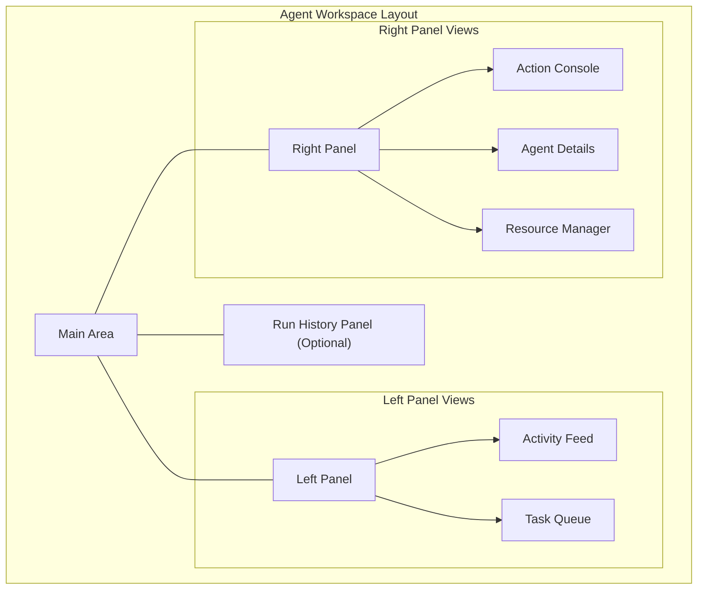
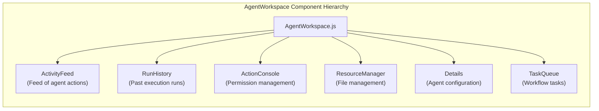
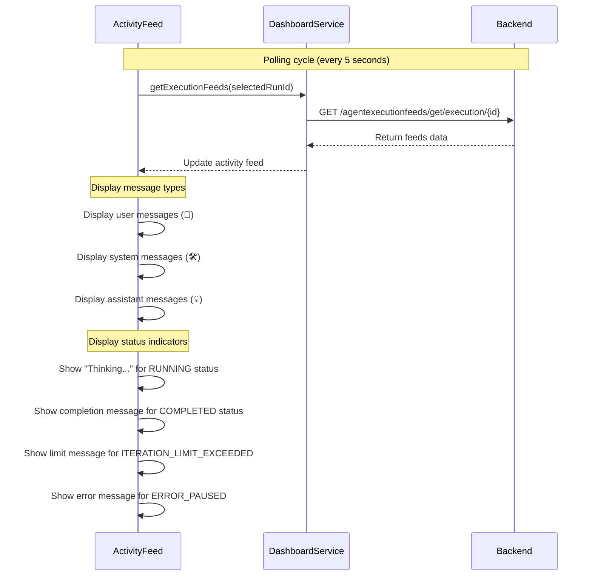
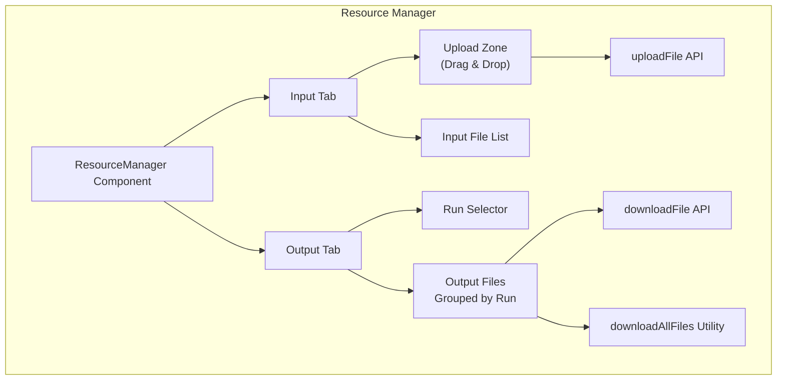
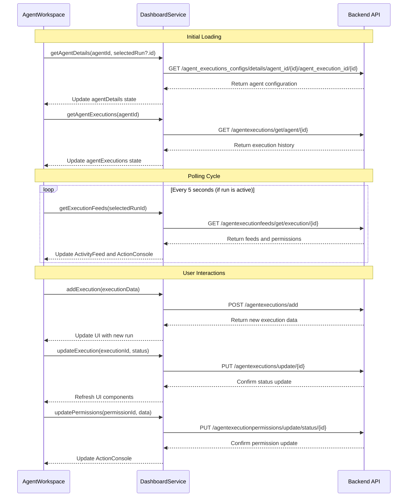

<!-- source: DeepWiki mcp.deepwiki.com · repo TransformerOptimus/SuperAGI · page 3.1 Agent Workspace · fetched 2026-10-26 -->

# Agent Workspace

Relevant source files

The following files were used as context for generating this wiki page:

- [.gitignore](.gitignore)
- [Dockerfile](Dockerfile)
- [entrypoint.sh](entrypoint.sh)
- [gui/pages/Content/Agents/ActionConsole.js](gui/pages/Content/Agents/ActionConsole.js)
- [gui/pages/Content/Agents/ActivityFeed.js](gui/pages/Content/Agents/ActivityFeed.js)
- [gui/pages/Content/Agents/AgentCreate.js](gui/pages/Content/Agents/AgentCreate.js)
- [gui/pages/Content/Agents/AgentSchedule.js](gui/pages/Content/Agents/AgentSchedule.js)
- [gui/pages/Content/Agents/AgentWorkspace.js](gui/pages/Content/Agents/AgentWorkspace.js)
- [gui/pages/Content/Agents/Agents.js](gui/pages/Content/Agents/Agents.js)
- [gui/pages/Content/Agents/Agents.module.css](gui/pages/Content/Agents/Agents.module.css)
- [gui/pages/Content/Agents/Details.js](gui/pages/Content/Agents/Details.js)
- [gui/pages/Content/Agents/ResourceList.js](gui/pages/Content/Agents/ResourceList.js)
- [gui/pages/Content/Agents/ResourceManager.js](gui/pages/Content/Agents/ResourceManager.js)
- [gui/pages/Content/Agents/RunHistory.js](gui/pages/Content/Agents/RunHistory.js)
- [gui/pages/Dashboard/Content.js](gui/pages/Dashboard/Content.js)
- [gui/pages/_app.css](gui/pages/_app.css)
- [gui/pages/api/DashboardService.js](gui/pages/api/DashboardService.js)
- [gui/utils/utils.js](gui/utils/utils.js)
- [wait-for-it.sh](wait-for-it.sh)

The Agent Workspace is the primary interface in SuperAGI for monitoring and managing agent executions after they've been created. It provides a comprehensive dashboard where users can track agent activities, control executions, manage resources, and handle permission requests in real-time.

For information about creating new agents, see [Agent Creation and Configuration](#2.1).

## Overview

The Agent Workspace serves as the central monitoring and control panel for each agent in SuperAGI. It displays real-time execution data, allows control over agent runs, provides access to agent resources, and presents detailed information about the agent's configuration and performance.

Sources: [gui/pages/Content/Agents/AgentWorkspace.js:28-637]()

## Key Components

### Layout and Navigation

The workspace is divided into three main panels:

1. **Left Panel**: Displays either Activity Feed or Task Queue
2. **Right Panel**: Shows either Action Console, Details, or Resource Manager
3. **Run History Panel**: Optional side panel showing execution history

Each panel has tab controls allowing users to switch between different views. The workspace also includes a top toolbar with run controls and a dropdown menu for additional actions.

Sources: [gui/pages/Content/Agents/AgentWorkspace.js:348-533](), [gui/pages/Dashboard/Content.js:434-467]()

### Top Controls

The top section of the workspace contains:

- Run history toggle
- Current run name and status
- Panel navigation tabs
- "New Run" button 
- Actions dropdown menu (pause/resume run, save as template, publish to marketplace, edit/delete agent, schedule management)

Sources: [gui/pages/Content/Agents/AgentWorkspace.js:348-466]()

### Left Panel Components

#### Activity Feed

The Activity Feed displays a chronological log of agent activities, including:

- System messages
- Agent thoughts and reasoning
- Tool usage and results
- Wait states
- Completion or error messages

Sources: [gui/pages/Content/Agents/ActivityFeed.js:1-207](), [gui/pages/Content/Agents/AgentWorkspace.js:469-474]()

#### Task Queue

For agents using task-based workflows (Dynamic Task Workflow or Fixed Task Workflow), the Task Queue displays:

- Pending tasks
- Completed tasks
- Failed tasks
- Current task status

Sources: [gui/pages/Content/Agents/AgentWorkspace.js:379-385](), [gui/pages/Content/Agents/AgentWorkspace.js:474]()

### Right Panel Components

#### Action Console

The Action Console manages permission requests from the agent:

- Shows pending tool permission requests
- Allows approving or denying requests
- Provides feedback options when denying permissions
- Displays history of previous permission decisions

Sources: [gui/pages/Content/Agents/ActionConsole.js:1-169](), [gui/pages/Content/Agents/AgentWorkspace.js:520-523]()

#### Details

The Details panel shows comprehensive information about the agent:

- Name and description
- Execution statistics (runs, calls, tokens consumed)
- Goals and instructions
- Tools assigned to the agent
- Constraints
- Workflow type
- Model information
- Permission type
- Max iterations
- Scheduling information (if applicable)

Sources: [gui/pages/Content/Agents/Details.js:1-224](), [gui/pages/Content/Agents/AgentWorkspace.js:526-529]()

#### Resource Manager

The Resource Manager provides access to files associated with the agent:

- Input files (uploaded by users)
- Output files (generated by the agent)
- File uploading through drag-and-drop
- File downloading capabilities
- Batch download options organized by run

Sources: [gui/pages/Content/Agents/ResourceManager.js:1-117](), [gui/pages/Content/Agents/ResourceList.js:1-75](), [gui/pages/Content/Agents/AgentWorkspace.js:531]()

### Run History Panel

The Run History panel displays all executions of the current agent:

- Run names
- Status indicators (running, paused, completed, etc.)
- Statistics for each run (number of calls)
- Timestamp information
- Selection interface to switch between runs

Sources: [gui/pages/Content/Agents/RunHistory.js:1-60](), [gui/pages/Content/Agents/AgentWorkspace.js:351-352]()

## User Interactions

### Creating New Runs

Users can create new runs of an agent by:
1. Clicking the "New Run" button
2. Providing a name for the run
3. Optionally modifying goals and instructions
4. Confirming to start the execution

Sources: [gui/pages/Content/Agents/AgentWorkspace.js:389-390](), [gui/pages/Content/Agents/AgentWorkspace.js:535-595]()

### Managing Run Status

The workspace provides controls to manage execution status:

| Action | UI Location | Description |
|--------|-------------|-------------|
| Pause | Dropdown menu | Pauses a running execution |
| Resume | Dropdown menu | Resumes a paused execution |
| Delete | Dropdown menu | Removes a run from history |
| View Run History | Button or panel | Shows/hides run history panel |
| Create New Run | Button | Creates a new execution |

Sources: [gui/pages/Content/Agents/AgentWorkspace.js:393-437](), [gui/pages/Content/Agents/AgentWorkspace.js:216-234]()

### Handling Permissions

For agents running in restricted mode, the Action Console:
1. Displays tool permission requests in real-time
2. Allows users to approve or deny requests
3. Provides a feedback field when denying permissions
4. Updates pending permission notification count

Sources: [gui/pages/Content/Agents/ActionConsole.js:101-168](), [gui/pages/Content/Agents/AgentWorkspace.js:480-486]()

### Resource Management

Users can manage agent resources through the Resource Manager:
- Upload new input files via drag-and-drop
- Download individual files by clicking on them
- Download all files from a run with the download button
- Switch between input and output resources

Sources: [gui/pages/Content/Agents/ResourceManager.js:10-116](), [gui/pages/Content/Agents/ResourceList.js:6-74]()

### Agent Scheduling

The workspace provides scheduling capabilities:

1. Schedule Run - Configure a specific start time for the agent
2. Edit Schedule - Modify existing schedule parameters
3. Stop Schedule - Cancel a scheduled agent run

Scheduling options include:
- Setting a specific start time
- Configuring recurring runs with intervals
- Setting expiration conditions (by date or number of runs)

Sources: [gui/pages/Content/Agents/AgentWorkspace.js:424-443](), [gui/pages/Content/Agents/AgentSchedule.js:12-368]()

## Technical Implementation

The Agent Workspace is implemented as a React component in [gui/pages/Content/Agents/AgentWorkspace.js]() that manages state and coordinates several sub-components.

### Data Flow

Sources: [gui/pages/Content/Agents/AgentWorkspace.js:265-275](), [gui/pages/Content/Agents/AgentWorkspace.js:288-299](), [gui/pages/api/DashboardService.js:31-41]()

### State Management

The AgentWorkspace component manages several pieces of state:

- **Panel selection**: `leftPanel` and `rightPanel` states control which views are displayed
- **Run selection**: `selectedRun` state tracks the current execution being viewed
- **Agent data**: `agentDetails` and `agentExecutions` store agent configuration and history
- **UI toggles**: States for modals, dropdowns, and panel visibility

Sources: [gui/pages/Content/Agents/AgentWorkspace.js:29-54](), [gui/pages/Content/Agents/AgentWorkspace.js:237-246]()

### Event Communication

The component uses the EventBus pattern to communicate between components:

- `reFetchAgents` - Triggers agent list refresh
- `updateRunStatus` - Updates run status across components
- `resetRunStatus` - Resets run status display
- `refreshDate` - Updates scheduling information 
- `removeTab` - Closes workspace tabs

Sources: [gui/pages/Content/Agents/AgentWorkspace.js:326-345](), [gui/utils/utils.js:227-238]()

## Use Cases

### Monitoring Agent Progress

1. Open the Agent Workspace
2. View the Activity Feed to see real-time agent actions
3. Check the Details panel for execution statistics
4. For workflow-based agents, use the Task Queue to monitor task status

### Managing Permissions

1. When a permission request appears, check the Action Console
2. Review the tool permission request
3. Approve or deny the request
4. Optionally provide feedback for denied requests

### Working with Resources

1. Navigate to the Resource Manager
2. Upload input files using drag-and-drop
3. Switch to the Output tab to view files generated by the agent
4. Download individual files or entire run artifacts

### Scheduling Agent Runs

1. Open the dropdown menu and select "Schedule Run"
2. Set the start time for the agent
3. Configure recurring parameters if needed
4. Set expiration conditions
5. Confirm to create the schedule

Sources: [gui/pages/Content/Agents/AgentWorkspace.js:393-437](), [gui/pages/Content/Agents/AgentSchedule.js:140-184]()

## Conclusion

The Agent Workspace is the primary interface for monitoring and controlling agents after they've been created. It provides a comprehensive set of tools for tracking agent progress, managing resources, handling permissions, and scheduling runs. The interface is designed to support both real-time monitoring and historical analysis of agent executions.

---

