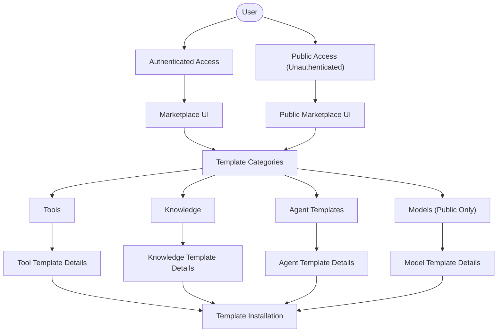
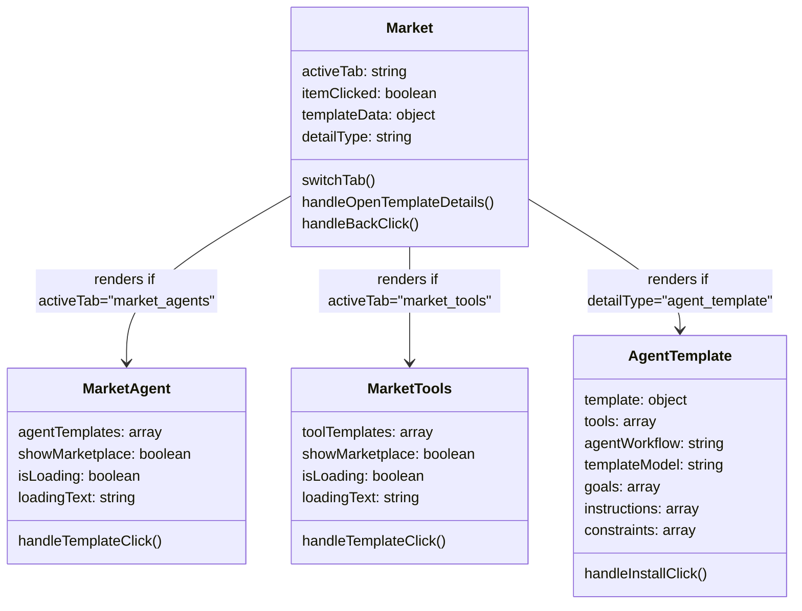
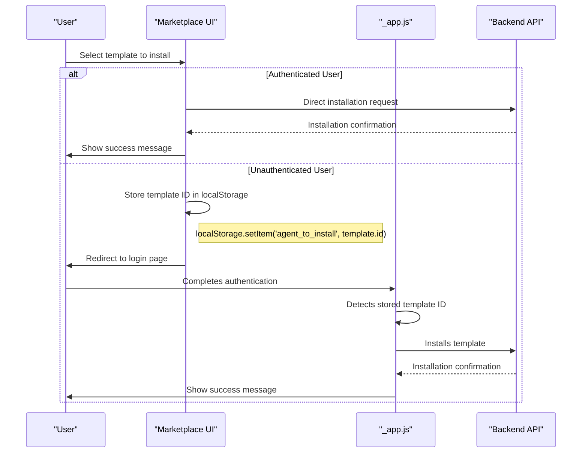

<!-- source: DeepWiki mcp.deepwiki.com · repo TransformerOptimus/SuperAGI · page 3.2 Marketplace · fetched 2026-10-26 -->

# Marketplace

Relevant source files

The following files were used as context for generating this wiki page:

- [gui/app/favicon.ico](gui/app/favicon.ico)
- [gui/pages/Content/Agents/AgentTemplatesList.js](gui/pages/Content/Agents/AgentTemplatesList.js)
- [gui/pages/Content/Agents/TaskQueue.js](gui/pages/Content/Agents/TaskQueue.js)
- [gui/pages/Content/Marketplace/AgentTemplate.js](gui/pages/Content/Marketplace/AgentTemplate.js)
- [gui/pages/Content/Marketplace/Market.js](gui/pages/Content/Marketplace/Market.js)
- [gui/pages/Content/Marketplace/Market.module.css](gui/pages/Content/Marketplace/Market.module.css)
- [gui/pages/Content/Marketplace/MarketAgent.js](gui/pages/Content/Marketplace/MarketAgent.js)
- [gui/pages/Content/Marketplace/MarketTools.js](gui/pages/Content/Marketplace/MarketTools.js)
- [gui/pages/Content/Marketplace/MarketplacePublic.js](gui/pages/Content/Marketplace/MarketplacePublic.js)
- [gui/pages/Dashboard/Dashboard.module.css](gui/pages/Dashboard/Dashboard.module.css)
- [gui/pages/Dashboard/Settings/Settings.js](gui/pages/Dashboard/Settings/Settings.js)
- [gui/pages/Dashboard/TopBar.js](gui/pages/Dashboard/TopBar.js)
- [gui/pages/_app.js](gui/pages/_app.js)
- [gui/pages/api/apiConfig.js](gui/pages/api/apiConfig.js)
- [gui/public/images/tick.svg](gui/public/images/tick.svg)

The Marketplace is a central hub within SuperAGI where users can discover, browse, and install various components that extend the system's capabilities. This includes agent templates, toolkits, and knowledge templates. The Marketplace serves as both a distribution platform for pre-built components and a community resource for sharing configurations.

For information about creating agent templates, see [Agent Templates](#2.3).

## 1. Marketplace Overview

The SuperAGI Marketplace provides a collection of ready-to-use components that can be directly installed into your SuperAGI instance. It's accessible both within the application for authenticated users and through a public interface for unauthenticated users.

Sources:
- [gui/pages/Content/Marketplace/Market.js:1-119]()
- [gui/pages/Content/Marketplace/MarketplacePublic.js:1-39]()

## 2. Accessing the Marketplace

The Marketplace can be accessed in two ways:

1. **From the Dashboard**: Authenticated users can access the Marketplace directly from the top navigation bar in the SuperAGI interface.
2. **Public URL**: Unauthenticated users can access a public version of the Marketplace that allows browsing but requires sign-in for installation.

### 2.1 Dashboard Access

In the top navigation bar of the SuperAGI dashboard, there's a "Marketplace" link that opens the Marketplace interface. This is implemented in the TopBar component.

Sources:
- [gui/pages/Dashboard/TopBar.js:75-78]()

### 2.2 Public Marketplace

The public Marketplace is a standalone interface that can be accessed without authentication. It includes a sign-up/sign-in button, allowing users to authenticate if they want to install templates.

Sources:
- [gui/pages/Content/Marketplace/MarketplacePublic.js:1-39]()
- [gui/pages/_app.js:25-40]()

## 3. Marketplace Components

The Marketplace is organized into different categories of templates that users can browse and install.

### 3.1 Template Categories

The Marketplace offers the following template categories:

| Category | Description | Component |
|----------|-------------|-----------|
| Tools | Toolkits that extend agent capabilities | MarketTools |
| Knowledge | Knowledge templates for information retrieval | MarketKnowledge |
| Agent Templates | Pre-configured agent templates | MarketAgent |
| Models (Public only) | Model configurations | MarketModels |

Sources:
- [gui/pages/Content/Marketplace/Market.js:53-58]()
- [gui/pages/Content/Marketplace/MarketTools.js:1-73]()
- [gui/pages/Content/Marketplace/MarketAgent.js:1-72]()

### 3.2 Template Display and Management

The Marketplace UI is managed by the Market component, which handles tab switching, template selection, and detail views.

Sources:
- [gui/pages/Content/Marketplace/Market.js:1-119]()
- [gui/pages/Content/Marketplace/AgentTemplate.js:1-219]()

## 4. Template Details and Installation

When a user selects a template from any category, they can view its details and choose to install it.

### 4.1 Agent Template Details

For agent templates, the details view includes:
- Template name and description
- Required tools
- Agent workflow
- Model used
- Goals
- Instructions (if any)
- Constraints

Sources:
- [gui/pages/Content/Marketplace/AgentTemplate.js:94-214]()

### 4.2 Installation Process

The installation process differs based on whether the user is authenticated:

The installation process is handled by different components depending on the context:

1. **Direct Installation**: For authenticated users, installation is handled directly by the template detail components.
2. **Deferred Installation**: For unauthenticated users, the template ID is stored in localStorage and installation occurs after authentication.

Sources:
- [gui/pages/Content/Marketplace/AgentTemplate.js:61-87]()
- [gui/pages/_app.js:65-104]()

## 5. Technical Implementation

### 5.1 Data Flow and State Management

The Marketplace uses a combination of React state and localStorage to manage user interactions:

- **Active Tab**: The selected tab is stored in localStorage as `marketplace_tab`
- **Template Selection**: When a template is selected, its data and the detail type are stored in state and localStorage
- **Installation State**: For deferred installations, template IDs are stored in localStorage (e.g., `agent_to_install`, `toolkit_to_install`)

Sources:
- [gui/pages/Content/Marketplace/Market.js:21-46]()
- [gui/pages/_app.js:65-104]()

### 5.2 Event-Based Communication

The Marketplace components use an event-driven approach for communication:

- **EventBus**: A custom event bus facilitates communication between components
- **Events**: Key events include `openTemplateDetails` and `goToMarketplace`

Sources:
- [gui/pages/Content/Marketplace/Market.js:39-46]()
- [gui/pages/Content/Marketplace/MarketAgent.js:41-45]()

### 5.3 API Integration

The Marketplace fetches data from different endpoints based on whether it's being accessed publicly or within the authenticated application:

- **Authenticated**: Uses API endpoints like `/api/agent_templates/list`
- **Public**: Uses public endpoints like `https://app.superagi.com/api/agent_templates/marketplace/list`

Sources:
- [gui/pages/Content/Marketplace/MarketAgent.js:15-38]()
- [gui/pages/Content/Marketplace/MarketTools.js:15-40]()

## 6. Integration with Other SuperAGI Components

The Marketplace is integrated with other parts of the SuperAGI system, particularly:

### 6.1 Agent Creation Flow

When creating a new agent, users can choose to use a template from the local templates or go to the Marketplace to find more templates.

Sources:
- [gui/pages/Content/Agents/AgentTemplatesList.js:90-106]()

### 6.2 Dashboard Navigation

The Marketplace can be accessed from the top navigation bar of the SuperAGI dashboard.

Sources:
- [gui/pages/Dashboard/TopBar.js:75-78]()

## 7. Marketplace Styling and UI

The Marketplace has a consistent styling defined in CSS modules, with specific styles for different elements like template cards, detail views, and tabs.

Sources:
- [gui/pages/Content/Marketplace/Market.module.css:1-552]()

## 8. Cross-Platform Integration

When a user attempts to install a template from the public Marketplace, the system handles redirects and authentication appropriately based on the environment:

- **Production**: Redirects to app.superagi.com
- **Development**: Redirects to the local instance

Sources:
- [gui/pages/Content/Marketplace/AgentTemplate.js:61-70]()
- [gui/pages/Content/Marketplace/MarketplacePublic.js:7-14]()

---

