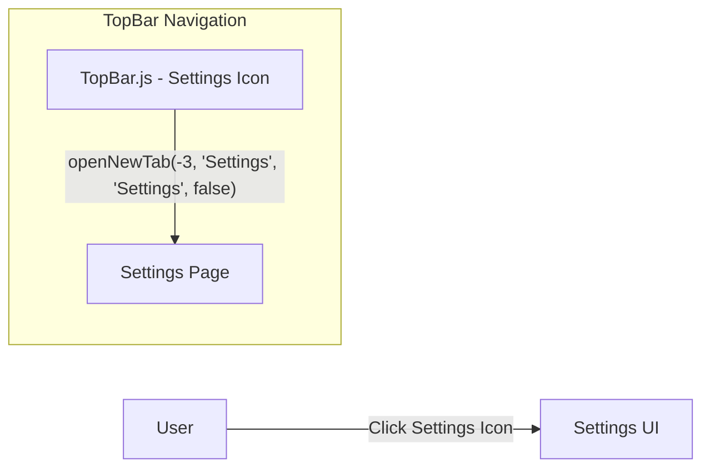
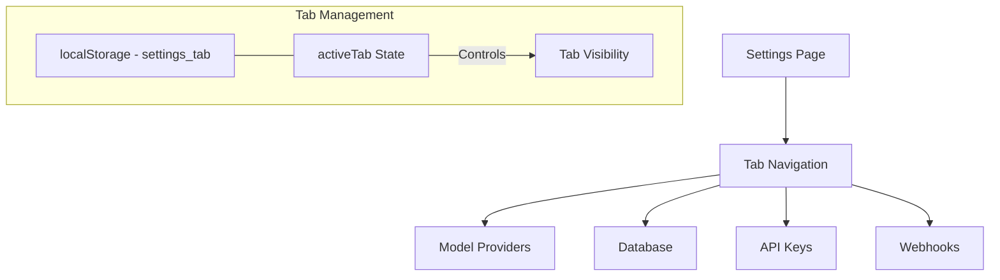
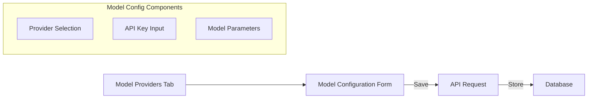
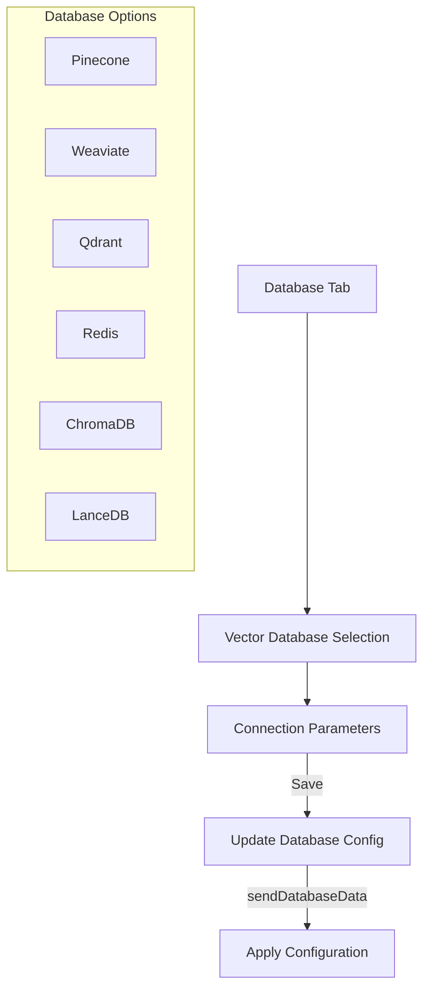
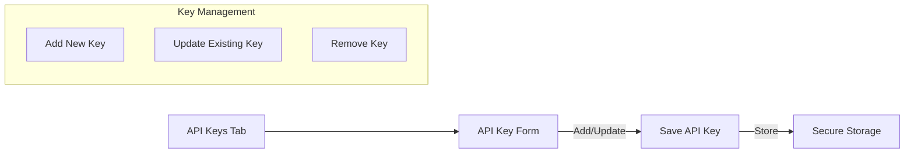
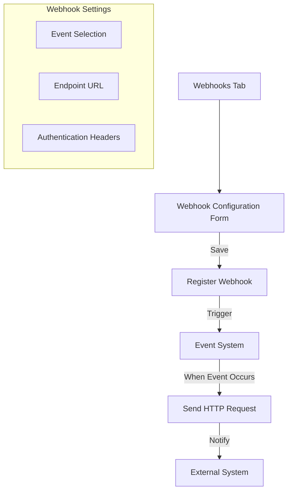
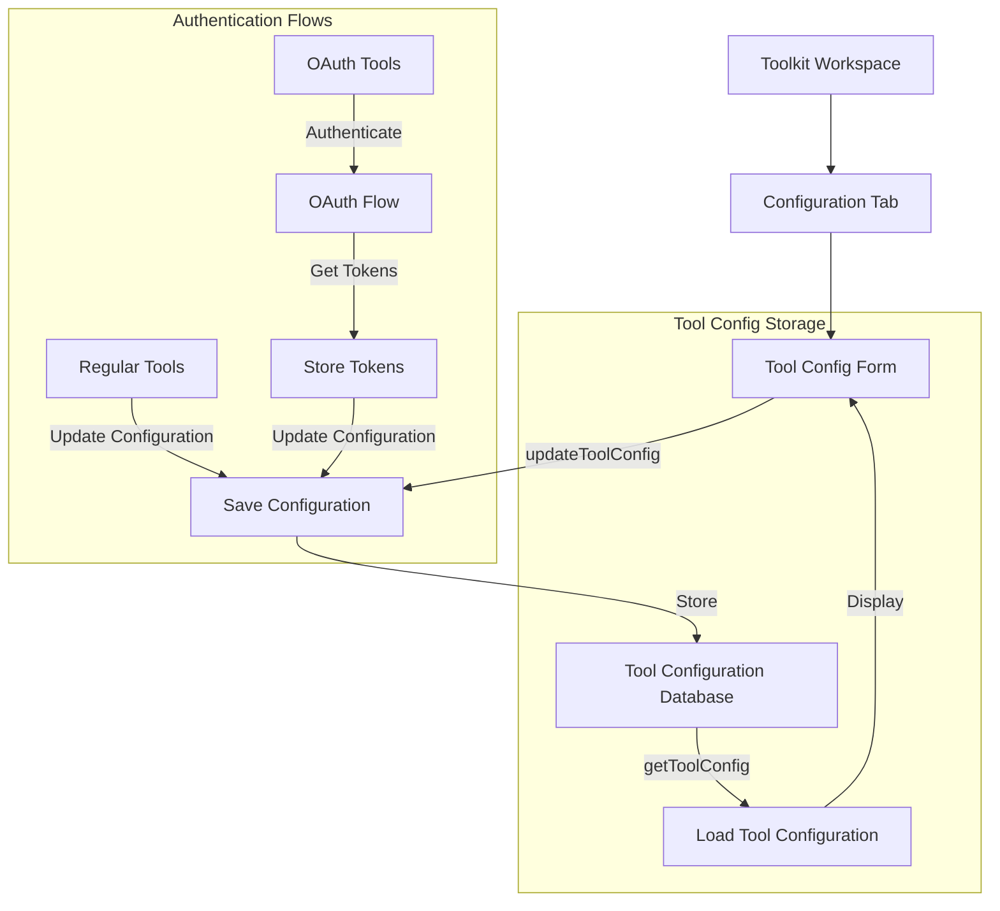
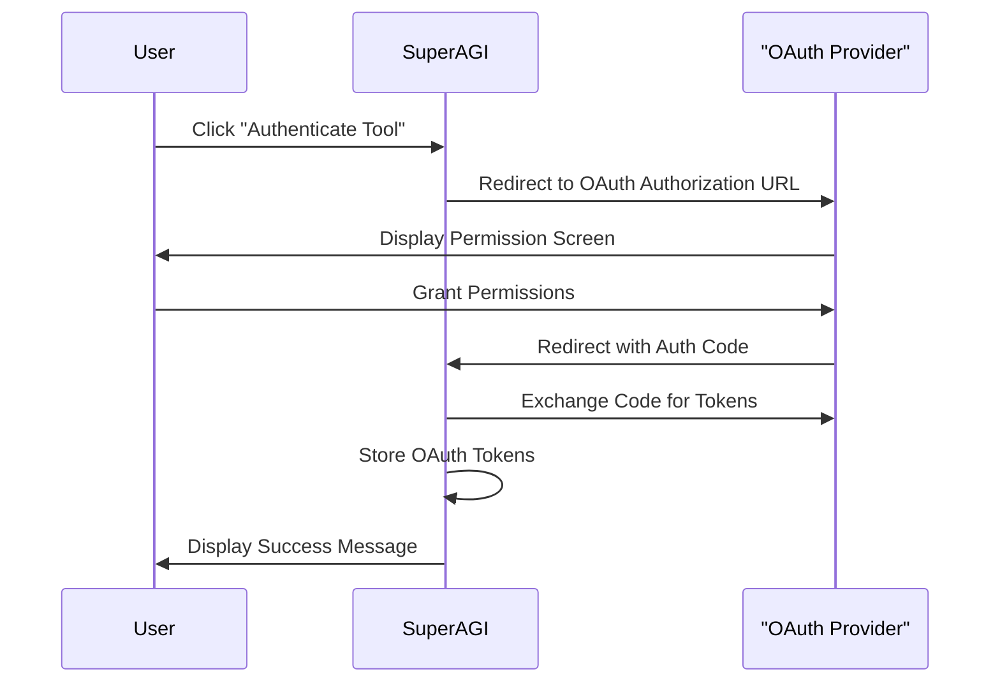
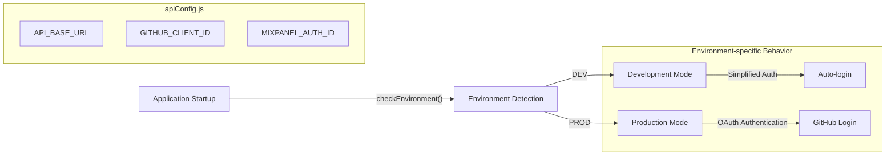
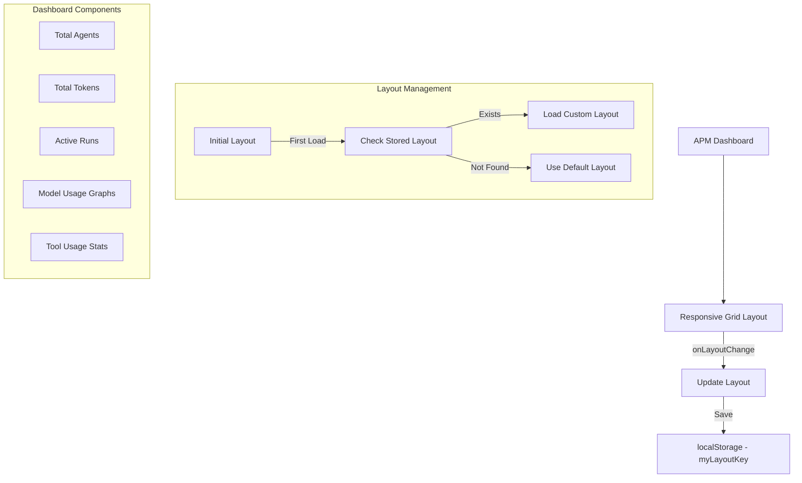

<!-- source: DeepWiki mcp.deepwiki.com · repo TransformerOptimus/SuperAGI · page 3.3 Settings and Configuration UI · fetched 2026-10-26 -->

# Settings and Configuration UI

Relevant source files

The following files were used as context for generating this wiki page:

- [gui/app/favicon.ico](gui/app/favicon.ico)
- [gui/pages/Content/APM/ApmDashboard.js](gui/pages/Content/APM/ApmDashboard.js)
- [gui/pages/Content/Agents/TaskQueue.js](gui/pages/Content/Agents/TaskQueue.js)
- [gui/pages/Content/Marketplace/MarketKnowledge.js](gui/pages/Content/Marketplace/MarketKnowledge.js)
- [gui/pages/Content/Toolkits/ToolkitWorkspace.js](gui/pages/Content/Toolkits/ToolkitWorkspace.js)
- [gui/pages/Content/Toolkits/Toolkits.js](gui/pages/Content/Toolkits/Toolkits.js)
- [gui/pages/Dashboard/Dashboard.module.css](gui/pages/Dashboard/Dashboard.module.css)
- [gui/pages/Dashboard/Settings/Settings.js](gui/pages/Dashboard/Settings/Settings.js)
- [gui/pages/Dashboard/TopBar.js](gui/pages/Dashboard/TopBar.js)
- [gui/pages/_app.js](gui/pages/_app.js)
- [gui/pages/api/apiConfig.js](gui/pages/api/apiConfig.js)
- [superagi/controllers/google_oauth.py](superagi/controllers/google_oauth.py)

The Settings and Configuration UI in SuperAGI provides a centralized interface for managing various system configurations, including model providers, databases, API keys, and webhooks. This page documents the structure and functionality of the settings interface, how to access it, and how to configure different components of the system.

For information about tool-specific settings, see [Tools System](#4). For deployment configuration options, see [Configuration Options](#7.2).

## Accessing the Settings UI

Users can access the Settings UI by clicking the settings icon in the top right corner of the SuperAGI interface. This icon is rendered as a gear/cog and is displayed in the TopBar component of the application.

Sources: [gui/pages/Dashboard/TopBar.js:98-98]()

## Settings UI Structure

The Settings UI is organized into four main tabs that provide access to different configuration areas of SuperAGI. The active tab is persisted in localStorage, allowing users to return to their last-used tab when revisiting the Settings page.

Each tab offers specific configuration options:

| Tab | Purpose | Component |
|-----|---------|-----------|
| Model Providers | Configure LLM providers | Model.js |
| Database | Configure vector databases | Database.js |
| API Keys | Manage API keys for external services | ApiKeys.js |
| Webhooks | Set up event notifications | Webhooks.js |

Sources: [gui/pages/Dashboard/Settings/Settings.js:11-56]()

## Model Providers Configuration

The Model Providers tab allows users to configure various language model providers that SuperAGI can use for agent operations. This includes OpenAI models, Google Palm, and other supported LLM providers.

In this tab, users can:
- Select which model provider to use as default
- Enter API keys for different providers
- Configure model-specific parameters
- Test the connection to the model provider

Sources: [gui/pages/Dashboard/Settings/Settings.js:49-49]()

## Database Configuration

The Database tab provides interfaces for configuring the vector databases used by SuperAGI for storing embeddings and knowledge. This is important for tools that require semantic search capabilities.

Users can configure:
- Which vector database to use
- Connection parameters (API keys, endpoints)
- Database-specific settings

Sources: [gui/pages/Dashboard/Settings/Settings.js:50-50]()

## API Keys Management

The API Keys tab allows users to manage API keys for various external services integrated with SuperAGI. These keys are stored securely and used by the system to authenticate with third-party services.

The system manages API keys for various services, including:
- OpenAI
- Google services
- Other third-party integrations

Sources: [gui/pages/Dashboard/Settings/Settings.js:51-51](), [gui/pages/api/apiConfig.js:1-51]()

## Webhooks Configuration

The Webhooks tab allows users to configure webhook notifications for various events that occur within the SuperAGI system, enabling integration with external systems.

Users can:
- Configure webhook endpoints for different event types
- Set authentication headers for secure webhook delivery
- Enable/disable specific webhooks

Sources: [gui/pages/Dashboard/Settings/Settings.js:52-52]()

## Tool-specific Configuration

While the main Settings UI handles system-wide configurations, individual tools and toolkits have their own configuration interfaces. These tool-specific settings are managed through the Toolkit Workspace UI.

### Toolkit Configuration Flow

The system supports different types of tool configurations:
1. Simple configuration with API keys and parameters
2. OAuth-based authentication for services like Google Calendar and Twitter

Sources: [gui/pages/Content/Toolkits/ToolkitWorkspace.js:14-232](), [superagi/controllers/google_oauth.py:1-93]()

### OAuth Authentication Process

For tools requiring OAuth authentication (such as Google Calendar or Twitter), SuperAGI provides a specialized authentication flow:

For example, with Google Calendar:
1. User enters client ID and client secret
2. User clicks "Authenticate Tool"
3. System redirects to Google OAuth page
4. After authorization, tokens are stored for future API calls

Sources: [gui/pages/Content/Toolkits/ToolkitWorkspace.js:32-46](), [superagi/controllers/google_oauth.py:24-65]()

## Environment Configuration

SuperAGI supports different environment configurations (Development/Production), which affect various aspects of the system's behavior. The environment is determined via the `checkEnvironment` API call.

Key environment-dependent behaviors include:
- Authentication flow (GitHub OAuth for Production)
- API endpoints (local vs. remote)
- Analytics tracking

Sources: [gui/pages/_app.js:110-171](), [gui/pages/api/apiConfig.js:1-51]()

## Settings Persistence

SuperAGI stores settings in several different ways, depending on the type of setting:

1. **System Settings**: Stored in the backend database (accessed via API calls)
2. **UI State**: Stored in localStorage for persistence between sessions
3. **Authentication Tokens**: Stored in cookies for secure access

| Setting Type | Storage Method | Scope | Example |
|--------------|----------------|-------|---------|
| System Config | Database | Global | Model providers, Vector DB config |
| Tool Config | Database | Per toolkit | API keys, OAuth tokens |
| UI Preferences | localStorage | Per user/browser | Active tab, layout preferences |
| Auth Tokens | Cookies | Per user | Access tokens |

The following localStorage keys are actively used by the settings components:

- `settings_tab` - Stores the active tab in Settings UI
- `toolkit_tab_[id]` - Stores the active tab for a specific toolkit
- `api_configs_[id]` - Temporarily stores toolkit API configurations

Sources: [gui/pages/Dashboard/Settings/Settings.js:14-22](), [gui/pages/Content/Toolkits/ToolkitWorkspace.js:57-59](), [gui/pages/_app.js:234-268]()

## APM Dashboard Configuration

The Agent Performance Monitoring (APM) dashboard has its own configuration UI that allows users to customize the layout of metrics and visualizations. This layout configuration is stored in localStorage.

Users can:
- Resize and rearrange dashboard components
- Reset to the default layout
- Persist custom layouts between sessions

Sources: [gui/pages/Content/APM/ApmDashboard.js:31-46](), [gui/pages/Content/APM/ApmDashboard.js:54-64]()

## Conclusion

The Settings and Configuration UI in SuperAGI provides a comprehensive set of interfaces for configuring all aspects of the system. From model providers to databases, API keys, and webhooks, users can customize the system to meet their specific requirements. Tool-specific configurations, especially those requiring OAuth authentication, are handled through dedicated interfaces in the Toolkit Workspace.

Understanding these configuration options is essential for effectively deploying and using SuperAGI in various environments and use cases.

---

