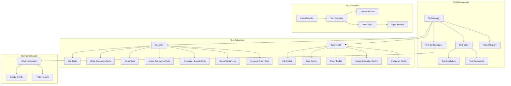
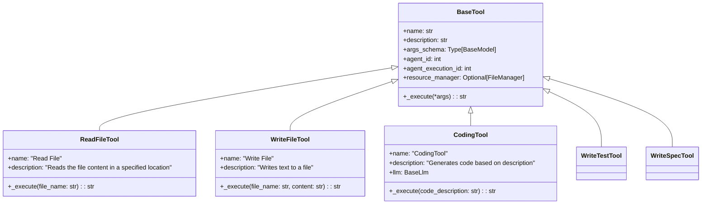
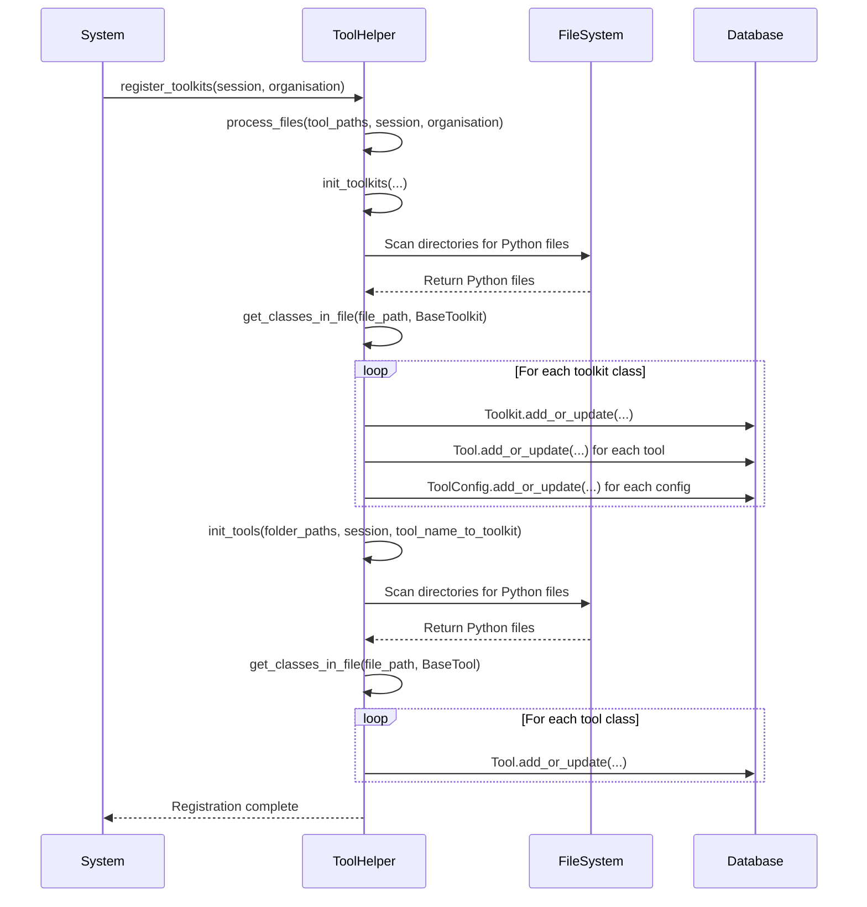
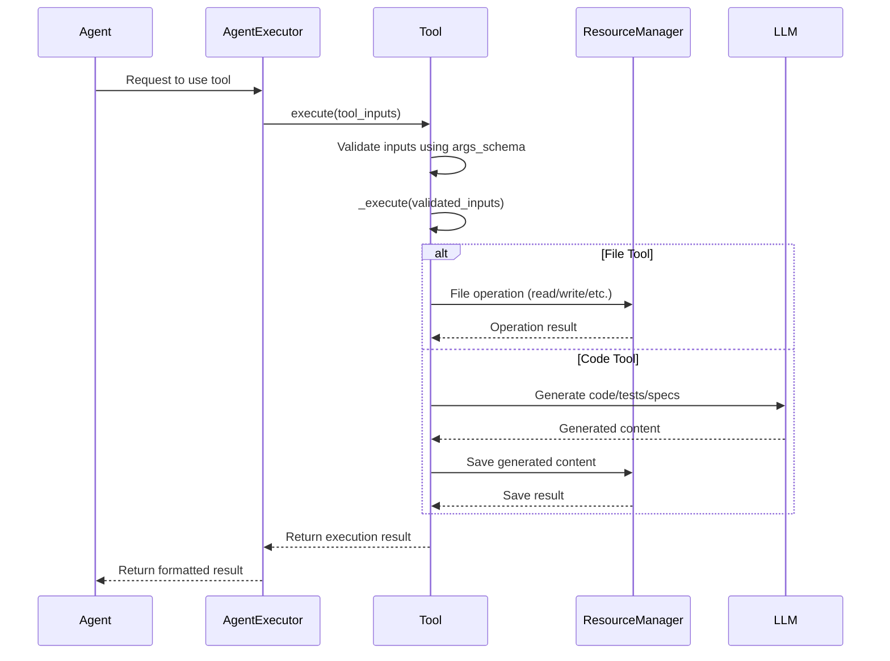

<!-- source: DeepWiki mcp.deepwiki.com · repo TransformerOptimus/SuperAGI · page 4 Tools System · fetched 2026-10-26 -->

# Tools System

<details>
<summary>Relevant source files</summary>

The following files were used as context for generating this wiki page:

- [superagi/helper/tool_helper.py](superagi/helper/tool_helper.py)
- [superagi/lib/logger.py](superagi/lib/logger.py)
- [superagi/models/tool_config.py](superagi/models/tool_config.py)
- [superagi/tools/code/prompts/generate_logic.txt](superagi/tools/code/prompts/generate_logic.txt)
- [superagi/tools/code/write_code.py](superagi/tools/code/write_code.py)
- [superagi/tools/code/write_spec.py](superagi/tools/code/write_spec.py)
- [superagi/tools/code/write_test.py](superagi/tools/code/write_test.py)
- [superagi/tools/file/append_file.py](superagi/tools/file/append_file.py)
- [superagi/tools/file/delete_file.py](superagi/tools/file/delete_file.py)
- [superagi/tools/file/list_files.py](superagi/tools/file/list_files.py)
- [superagi/tools/file/read_file.py](superagi/tools/file/read_file.py)
- [superagi/tools/file/write_file.py](superagi/tools/file/write_file.py)
- [test.py](test.py)
- [tests/unit_tests/helper/test_tool_helper.py](tests/unit_tests/helper/test_tool_helper.py)
- [tests/unit_tests/test_tool_manager.py](tests/unit_tests/test_tool_manager.py)
- [tools.json](tools.json)

</details>


The Tools System in SuperAGI provides agents with capabilities to interact with external systems and perform specific tasks. This system is a foundational component that enables agents to manipulate files, generate code, send emails, create images, and interact with various external services.

For information about specific tool implementations, please see the related pages on [File Tools](#4.1), [Code Generation Tools](#4.2), and other tool categories.

## Architecture Overview

The Tools System organizes functionality into individual tools and toolkits (collections of related tools). The system handles tool registration, configuration, discovery, and execution.




Sources:
- [superagi/helper/tool_helper.py]()
- [superagi/tools/file/read_file.py]()
- [superagi/tools/file/write_file.py]()

## Core Components

### BaseTool

All tools in SuperAGI inherit from the `BaseTool` abstract class, which provides the common structure and functionality:

- **name**: A string identifier for the tool
- **description**: A description of what the tool does
- **args_schema**: A Pydantic model that defines the input arguments
- **_execute method**: The implementation of the tool's functionality

Example tool structures:




Sources:
- [superagi/tools/file/read_file.py:27-42]()
- [superagi/tools/file/write_file.py:19-34]()
- [superagi/tools/code/write_code.py:26-52]()

### BaseToolkit

Toolkits are collections of related tools. Each toolkit:

- Has a name and description
- Provides a list of tools it contains
- Defines required environment keys or configuration parameters

### Tool Configuration

Tools can require configuration parameters, which are stored in the database using the `ToolConfig` model:

```
id              - Primary key
key             - Configuration parameter name
value           - Parameter value
toolkit_id      - Associated toolkit ID
key_type        - Data type (STRING, INT, BOOLEAN, etc.)
is_secret       - Whether the value should be treated as sensitive
is_required     - Whether the parameter is mandatory
```

Sources:
- [superagi/models/tool_config.py:10-46]()

## Tool Registration Process

The tool registration process discovers and loads tools during system startup:




The registration process involves:

1. Scanning tool directories (`superagi/tools`, `superagi/tools/external_tools`, etc.)
2. Loading Python modules and finding classes that inherit from `BaseTool` and `BaseToolkit`
3. Registering toolkits, tools, and their configurations in the database

Sources:
- [superagi/helper/tool_helper.py:121-237]()
- [superagi/helper/tool_helper.py:259-271]()

## Tool Execution Flow

When an agent uses a tool, the following sequence occurs:




For example, the `WriteFileTool._execute` method:

```python
def _execute(self, file_name: str, content: str):
    """
    Execute the write file tool.
    
    Args:
        file_name : The name of the file to write.
        content : The text to write to the file.
        
    Returns:
        success message if message is file written successfully 
        or failure message if writing file fails.
    """
    return self.resource_manager.write_file(file_name, content)
```

Sources:
- [superagi/tools/file/write_file.py:39-50]()
- [superagi/tools/file/read_file.py:43-101]()
- [superagi/tools/code/write_code.py:57-119]()

## File Tools

File tools handle basic file operations. The core file tools include:

| Tool | Description | Key Methods |
|------|-------------|------------|
| ReadFileTool | Reads content from a file | `_execute(file_name)` |
| WriteFileTool | Writes content to a file | `_execute(file_name, content)` |
| AppendFileTool | Appends content to an existing file | `_execute(file_name, content)` |
| DeleteFileTool | Deletes a file | `_execute(file_name)` |
| ListFileTool | Lists files in a directory | `_execute()` |

Sources:
- [superagi/tools/file/read_file.py]()
- [superagi/tools/file/write_file.py]()
- [superagi/tools/file/append_file.py]()
- [superagi/tools/file/delete_file.py]()
- [superagi/tools/file/list_files.py]()

## Code Generation Tools

Code generation tools help agents create code, specifications, and tests:

| Tool | Description | Key Methods |
|------|-------------|------------|
| CodingTool | Generates code based on a description | `_execute(code_description)` |
| WriteSpecTool | Generates software specifications | `_execute(task_description, spec_file_name)` |
| WriteTestTool | Generates unit tests | `_execute(test_description, test_file_name)` |

Sources:
- [superagi/tools/code/write_code.py]()
- [superagi/tools/code/write_spec.py]()
- [superagi/tools/code/write_test.py]()

## External Tools Integration

SuperAGI supports loading tools from external GitHub repositories:

1. External tool repositories are tracked in `tools.json`:
   ```json
   {
     "tools": {
       "repo-name": "https://github.com/owner/repo"
     }
   }
   ```

2. Tools are downloaded and extracted during system startup:
   ```python
   def download_tool(tool_url, target_folder):
       parsed_url = parse_github_url(tool_url)
       parts = parsed_url.split("/")
       owner, repo, branch = parts[0], parts[1], parts[2]
       archive_url = f"https://api.github.com/repos/{owner}/{repo}/zipball/{branch}"
       # Download and extract repository...
   ```

3. New tools can be added programmatically:
   ```python
   def add_tool_to_json(repo_link):
       # Read tools.json
       # Add new repository link
       # Write updated JSON back
   ```

Sources:
- [tools.json]()
- [superagi/helper/tool_helper.py:20-68]()
- [superagi/helper/tool_helper.py:280-294]()

## Creating Custom Tools

To create a new tool:

1. Create a new Python file in an appropriate directory
2. Define a Pydantic model for the tool's input arguments
3. Create a class that inherits from `BaseTool`
4. Implement the `_execute` method

Example template:

```python
from typing import Type
from pydantic import BaseModel, Field
from superagi.tools.base_tool import BaseTool

class YourToolInput(BaseModel):
    param1: str = Field(..., description="Parameter description")
    param2: int = Field(..., description="Parameter description")

class YourTool(BaseTool):
    name: str = "Your Tool Name"
    description: str = "Description of what your tool does"
    args_schema: Type[BaseModel] = YourToolInput
    
    def _execute(self, param1: str, param2: int):
        # Implement tool functionality
        return "Result of tool execution"
```

## Tool Authentication

For tools that need to access external services, SuperAGI provides an authentication system through tool configurations:

1. Define required configuration keys in the toolkit:
   ```python
   def get_env_keys(self):
       return [
           ToolConfiguration(key="API_KEY", key_type=ToolConfigKeyType.STRING, is_required=True, is_secret=True),
           ToolConfiguration(key="API_BASE", key_type=ToolConfigKeyType.STRING, is_required=False)
       ]
   ```

2. Access these configurations in tool execution:
   ```python
   api_key = self.get_tool_config("API_KEY")
   api_base = self.get_tool_config("API_BASE")
   ```

Sources:
- [superagi/helper/tool_helper.py:217-228]()
- [superagi/models/tool_config.py:65-102]()

## Conclusion

The Tools System is a crucial component of SuperAGI that enables agents to interact with external systems and perform a wide range of tasks. By understanding this architecture and following the patterns established, you can extend agent capabilities by creating new tools or integrating external tool repositories.

---

