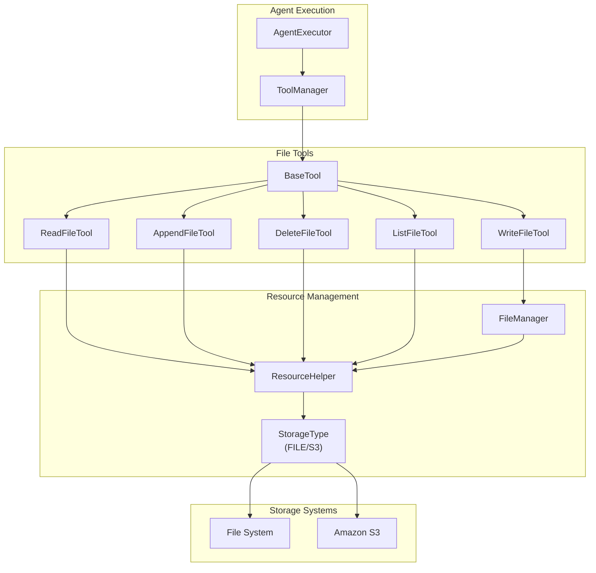
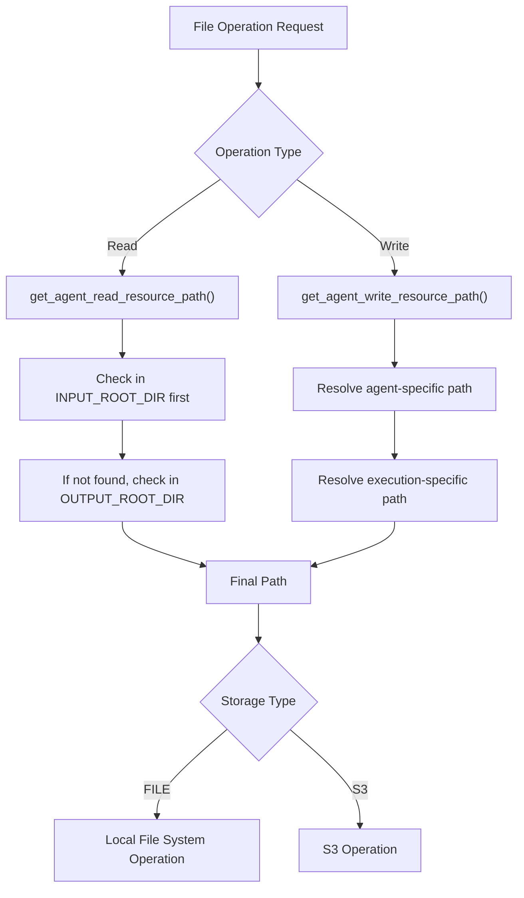
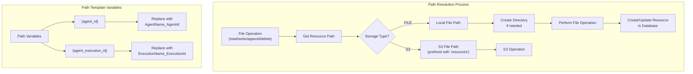
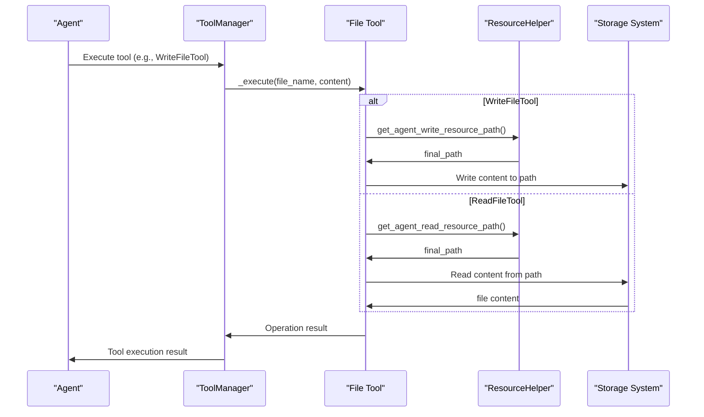

<!-- source: DeepWiki mcp.deepwiki.com · repo TransformerOptimus/SuperAGI · page 4.1 File Tools · fetched 2026-10-26 -->

# File Tools

Relevant source files

The following files were used as context for generating this wiki page:

- [superagi/helper/resource_helper.py](superagi/helper/resource_helper.py)
- [superagi/resource_manager/file_manager.py](superagi/resource_manager/file_manager.py)
- [superagi/tools/file/append_file.py](superagi/tools/file/append_file.py)
- [superagi/tools/file/delete_file.py](superagi/tools/file/delete_file.py)
- [superagi/tools/file/list_files.py](superagi/tools/file/list_files.py)
- [superagi/tools/file/read_file.py](superagi/tools/file/read_file.py)
- [superagi/tools/file/write_file.py](superagi/tools/file/write_file.py)
- [superagi/types/storage_types.py](superagi/types/storage_types.py)
- [test.py](test.py)
- [tests/unit_tests/helper/test_resource_helper.py](tests/unit_tests/helper/test_resource_helper.py)

This page documents the file manipulation tools in SuperAGI that allow agents to read, write, append to, delete, and list files. These tools enable agents to interact with the file system, making it possible for them to persist information, process data, and utilize external files as part of their operations.

For information about how these tools are used with the overall tool system, see [Tools System](#4).

## File Tools Architecture

The File Tools in SuperAGI are built on a layered architecture that provides flexibility in file storage locations and consistent interfaces for file operations.

### Architecture Overview

Sources:
- [superagi/tools/file/read_file.py:11-37]()
- [superagi/tools/file/write_file.py:9-34]()
- [superagi/tools/file/append_file.py:14-36]()
- [superagi/tools/file/delete_file.py:14-34]()
- [superagi/tools/file/list_files.py:16-31]()
- [superagi/resource_manager/file_manager.py:11-17]()
- [superagi/types/storage_types.py:4-15]()

### File Path Resolution

A key component of the file tools is the path resolution system. The `ResourceHelper` class provides methods to determine appropriate file paths based on agent context, ensuring proper organization of files and resources.

Sources:
- [superagi/helper/resource_helper.py:84-182]()
- [superagi/resource_manager/file_manager.py:88-93]()

## Available File Tools

SuperAGI provides five primary file manipulation tools:

### 1. ReadFileTool

The ReadFileTool allows agents to read the contents of a file. It supports various file types including text files, CSV files, and even more complex formats like EPUB.

**Key Features:**
- Reads text files and returns content as string
- Supports EPUB parsing using ebooklib and BeautifulSoup
- Handles CSV file encoding corrections automatically
- Compatible with both local file system and S3 storage

Sources:
- [superagi/tools/file/read_file.py:27-101]()

### 2. WriteFileTool

The WriteFileTool enables agents to create new files or overwrite existing ones with specified content.

**Key Features:**
- Creates text files with specified content
- Creates parent directories if they don't exist
- Works with both local file system and S3 storage
- Updates resource metadata in the database

Sources:
- [superagi/tools/file/write_file.py:19-50]()
- [superagi/resource_manager/file_manager.py:48-66]()

### 3. AppendFileTool

The AppendFileTool allows agents to add content to existing files without overwriting their current contents.

**Key Features:**
- Appends text to existing files
- Creates the file if it doesn't exist
- Special handling for S3 storage (read-modify-write)
- Compatible with both storage types

Sources:
- [superagi/tools/file/append_file.py:21-81]()

### 4. DeleteFileTool

The DeleteFileTool provides functionality to remove files.

**Key Features:**
- Deletes specified files
- Works with both local file system and S3 storage
- Returns success/error messages

Sources:
- [superagi/tools/file/delete_file.py:20-64]()

### 5. ListFileTool

The ListFileTool allows agents to discover files in the resource directories.

**Key Features:**
- Lists files in input directories
- Recursively searches directories
- Filters out hidden files and system directories
- Supports both local and S3 storage types

Sources:
- [superagi/tools/file/list_files.py:18-69]()

## Resource Management

The resource management system is a critical component that supports file tools. It consists of two main classes: `ResourceHelper` and `FileManager`.

### ResourceHelper

The `ResourceHelper` class provides utility methods for managing file paths and resources. It handles the complexity of determining file paths based on agent context and storage configuration.

**Key Methods:**
- `make_written_file_resource`: Creates Resource objects for written files
- `get_agent_write_resource_path`: Gets the path for writing files
- `get_agent_read_resource_path`: Gets the path for reading files
- `get_formatted_agent_level_path`: Formats path with agent information
- `get_formatted_agent_execution_level_path`: Formats path with execution information

### FileManager

The `FileManager` class provides a higher-level interface for file operations, with methods for reading, writing, and managing files.

**Key Methods:**
- `write_file`: Writes text content to a file
- `write_binary_file`: Writes binary data to a file
- `write_csv_file`: Writes CSV data to a file
- `read_file`: Reads content from a file
- `get_files`: Lists all files in agent's resource directory

### Storage Types

SuperAGI supports two storage types for files:

| Storage Type | Configuration Value | Description |
|--------------|---------------------|-------------|
| FILE         | "FILE"              | Local file system storage |
| S3           | "S3"                | Amazon S3 cloud storage   |

Storage type is configured using the `STORAGE_TYPE` environment variable. The system automatically routes file operations to the appropriate storage backend based on this setting.

Sources:
- [superagi/helper/resource_helper.py:12-182]()
- [superagi/resource_manager/file_manager.py:11-124]()
- [superagi/types/storage_types.py:4-15]()

## File Resource Path Management

The file path resolution system in SuperAGI is designed to organize resources by agent and execution context.

Sources:
- [superagi/helper/resource_helper.py:82-182]()
- [superagi/resource_manager/file_manager.py:16-35]()

## File Tools Integration with Agents

File tools are integrated into the agent system, allowing agents to interact with files during their execution cycle.

Sources:
- [superagi/tools/file/read_file.py:42-100]()
- [superagi/tools/file/write_file.py:39-50]()
- [superagi/tools/file/append_file.py:38-81]()
- [superagi/resource_manager/file_manager.py:48-66]()

## Example Usage

Below is a table showing how agents typically use the file tools:

| Operation | Tool | Example Usage |
|-----------|------|---------------|
| Store information | WriteFileTool | Store research findings, save code, record observations |
| Retrieve information | ReadFileTool | Access previous data, read inputs, analyze code files |
| Update logs | AppendFileTool | Add to logs, update records, append new findings |
| Clean up resources | DeleteFileTool | Remove temporary files, delete outdated information |
| Discover resources | ListFileTool | Find available resources, check existing files |

The file tools provide persistent storage capabilities to SuperAGI agents, allowing them to maintain state, share information between iterations, and work with external data sources.

---

