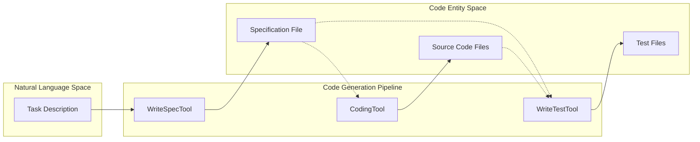
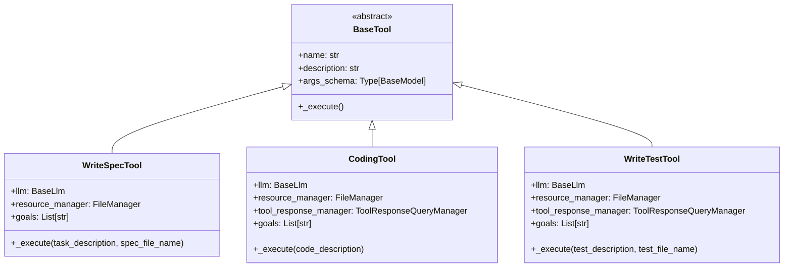
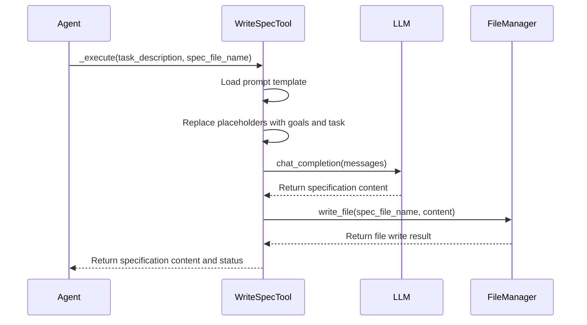
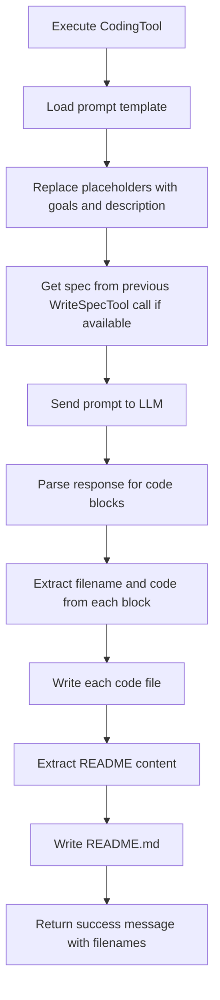
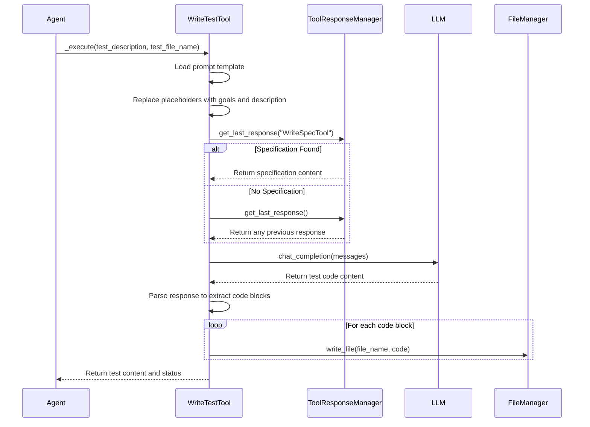

<!-- source: DeepWiki mcp.deepwiki.com · repo TransformerOptimus/SuperAGI · page 4.2 Code Generation Tools · fetched 2026-10-26 -->

# Code Generation Tools

<details>
<summary>Relevant source files</summary>

The following files were used as context for generating this wiki page:

- [superagi/lib/logger.py](superagi/lib/logger.py)
- [superagi/tools/code/prompts/generate_logic.txt](superagi/tools/code/prompts/generate_logic.txt)
- [superagi/tools/code/write_code.py](superagi/tools/code/write_code.py)
- [superagi/tools/code/write_spec.py](superagi/tools/code/write_spec.py)
- [superagi/tools/code/write_test.py](superagi/tools/code/write_test.py)

</details>


This document details the Code Generation Tools in SuperAGI, which provide agents with the capability to create specifications, write code, and generate tests. These tools leverage large language models (LLMs) to transform natural language descriptions into functioning software components.

For information about other tool types available in SuperAGI, see [Tools System](#4).

## Overview

The Code Generation Tools consist of three core components that work together to support a complete software development workflow:

1. **Write Specification Tool**: Creates detailed specifications based on task descriptions
2. **Coding Tool**: Generates code that fulfills the specifications
3. **Write Test Tool**: Creates unit tests for the generated code

These tools are designed to be used sequentially, mirroring a test-driven development approach, but can also be used independently.

Sources:
- [superagi/tools/code/write_spec.py:29-41](superagi/tools/code/write_spec.py:29-41)
- [superagi/tools/code/write_code.py:26-38](superagi/tools/code/write_code.py:26-38)
- [superagi/tools/code/write_test.py:30-42](superagi/tools/code/write_test.py:30-42)

## Code Generation Workflow

The Code Generation Tools follow a structured workflow that enables agents to progressively refine their output from specification to implementation to testing.



The dashed lines represent optional but recommended data flows that enhance the quality of the generated code and tests.

Sources:
- [superagi/tools/code/write_spec.py:55-85](superagi/tools/code/write_spec.py:55-85)
- [superagi/tools/code/write_code.py:57-119](superagi/tools/code/write_code.py:57-119)
- [superagi/tools/code/write_test.py:60-120](superagi/tools/code/write_test.py:60-120)

## Tool Architecture

All code generation tools share a common architecture pattern, integrating with the LLM system and resource management components of SuperAGI.



All Code Generation Tools inherit from the `BaseTool` class and utilize:
- An LLM for generating content
- A `FileManager` for managing file resources
- A `ToolResponseQueryManager` (for `CodingTool` and `WriteTestTool`) to access outputs from previous tools

Sources:
- [superagi/tools/code/write_spec.py:29-53](superagi/tools/code/write_spec.py:29-53)
- [superagi/tools/code/write_code.py:26-55](superagi/tools/code/write_code.py:26-55)
- [superagi/tools/code/write_test.py:30-58](superagi/tools/code/write_test.py:30-58)

## Write Specification Tool

The Write Specification Tool (`WriteSpecTool`) generates detailed specifications for software components based on a high-level task description.

### Input Parameters

| Parameter | Type | Description |
|-----------|------|-------------|
| `task_description` | string | Description of the task to be implemented |
| `spec_file_name` | string | Name of the file where the specification will be saved |

### Execution Flow



The tool loads a prompt template, replaces placeholders with the agent's goals and task description, sends the prompt to the LLM, and saves the resulting specification to a file.

Sources:
- [superagi/tools/code/write_spec.py:55-85](superagi/tools/code/write_spec.py:55-85)

## Coding Tool

The Coding Tool (`CodingTool`) generates code based on a description and any previously created specification.

### Input Parameters

| Parameter | Type | Description |
|-----------|------|-------------|
| `code_description` | string | Description of the coding task |

### Execution Flow



The Coding Tool:
1. Constructs a prompt using the task description and agent goals
2. Retrieves and incorporates previous specification output if available
3. Sends the prompt to the LLM
4. Parses the response to extract code blocks with filenames
5. Saves each code block as a separate file
6. Extracts and saves README content
7. Returns a success message with the list of generated files

Sources:
- [superagi/tools/code/write_code.py:57-119](superagi/tools/code/write_code.py:57-119)

### Code Parsing

The tool uses regular expressions to extract code blocks and filenames from the LLM's output:

```
regex = r"(\S+?)\n```\S*\n(.+?)```"
```

This pattern captures:
1. A filename (any non-whitespace characters)
2. A code block delimited by triple backticks

Sources:
- [superagi/tools/code/write_code.py:87-96](superagi/tools/code/write_code.py:87-96)

## Write Test Tool

The Write Test Tool (`WriteTestTool`) generates unit tests based on a test description and previous specifications or code.

### Input Parameters

| Parameter | Type | Description |
|-----------|------|-------------|
| `test_description` | string | Description of the testing task |
| `test_file_name` | string | Name of the file where tests will be saved |

### Execution Flow



The Write Test Tool:
1. Constructs a prompt using the test description and agent goals
2. Attempts to retrieve previous specification or any other relevant output
3. Sends the prompt to the LLM
4. Parses the response to extract test code and filenames
5. Saves each test file
6. Returns a success message with the generated test content

Sources:
- [superagi/tools/code/write_test.py:60-120](superagi/tools/code/write_test.py:60-120)

## Integration with Agent System

The Code Generation Tools integrate with the SuperAGI agent system through the tool manager and can be used in agent workflows.

### Tool Installation and Registration

Each tool is registered with SuperAGI's tool system, making it available for agents to use. The tools can be included individually or as part of a Code Toolkit.

### Token Management

All Code Generation Tools implement token management to ensure that LLM requests stay within token limits:

```
organisation = Agent.find_org_by_agent_id(self.toolkit_config.session, agent_id=self.agent_id)
total_tokens = TokenCounter.count_message_tokens(messages, self.llm.get_model())
token_limit = TokenCounter(session=self.toolkit_config.session, organisation_id=organisation.id).token_limit(self.llm.get_model())

result = self.llm.chat_completion(messages, max_tokens=(token_limit - total_tokens - 100))
```

This ensures that prompts don't exceed the LLM's token limits, allowing for complex code generation within constraints.

Sources:
- [superagi/tools/code/write_spec.py:71-75](superagi/tools/code/write_spec.py:71-75)
- [superagi/tools/code/write_code.py:77-81](superagi/tools/code/write_code.py:77-81)
- [superagi/tools/code/write_test.py:89-92](superagi/tools/code/write_test.py:89-92)

### Error Handling

The tools implement error handling for LLM API errors:

```
if 'error' in result and result['message'] is not None:
    ErrorHandler.handle_openai_errors(self.toolkit_config.session, self.agent_id, self.agent_execution_id, result['message'])
```

This ensures that errors from the LLM provider are properly logged and handled.

Sources:
- [superagi/tools/code/write_spec.py:77-78](superagi/tools/code/write_spec.py:77-78)
- [superagi/tools/code/write_code.py:83-84](superagi/tools/code/write_code.py:83-84)
- [superagi/tools/code/write_test.py:94-95](superagi/tools/code/write_test.py:94-95)

## Best Practices for Code Generation

The Code Generation Tools include built-in best practices for generated code, especially in the Coding Tool. These include:

- Placing distinct classes in separate files
- Creating appropriate run scripts as entry points
- Generating suitable dependency files (requirements.txt for Python, package.json for Node.js)
- Including function purpose comments
- Commenting complex logic
- Adhering to language-specific best practices

For Python projects, the preferred testing framework is pytest, and the tools encourage the use of dataclasses.

Sources:
- [superagi/tools/code/prompts/generate_logic.txt:1-11](superagi/tools/code/prompts/generate_logic.txt:1-11)

## Summary

The Code Generation Tools in SuperAGI provide a comprehensive solution for automated software development, enabling agents to:

1. Generate detailed specifications from task descriptions
2. Create code implementations based on those specifications
3. Develop unit tests to verify code functionality

These tools can be used independently or in sequence, supporting a complete development workflow that mirrors best practices in software engineering.

---

