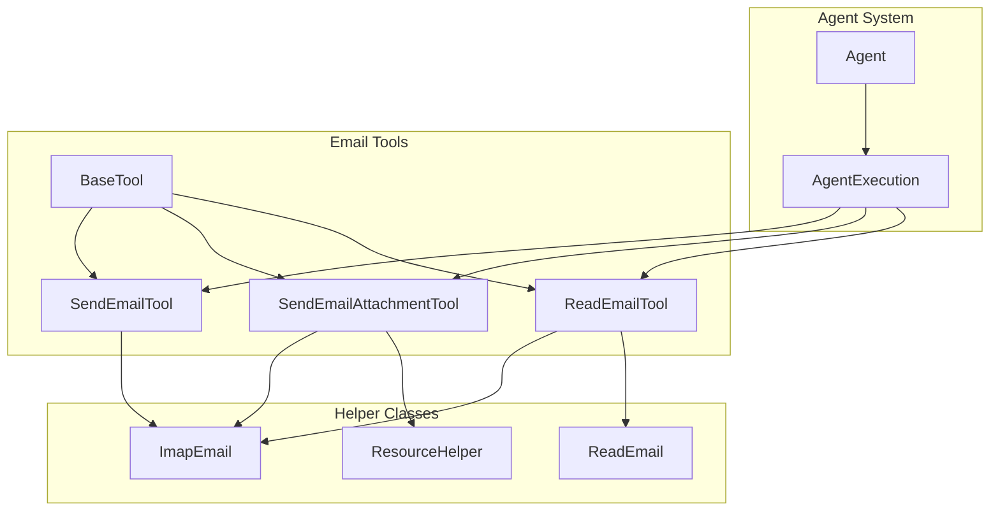
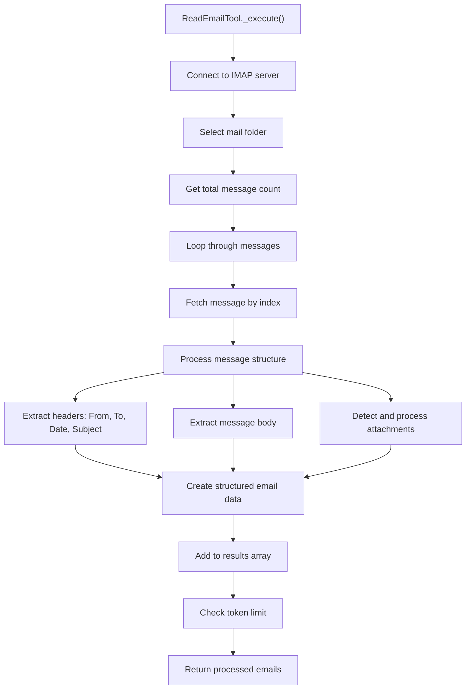
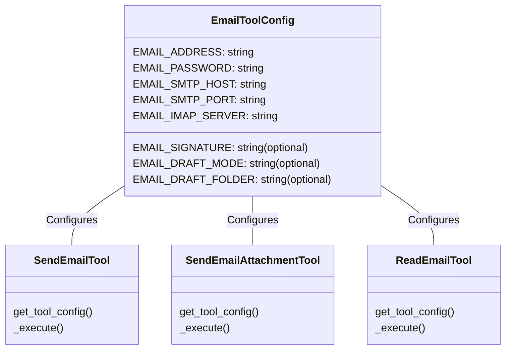
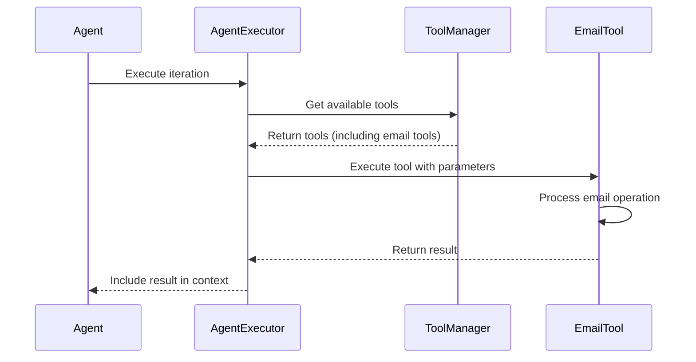

<!-- source: DeepWiki mcp.deepwiki.com · repo TransformerOptimus/SuperAGI · page 4.3 Email and Communication Tools · fetched 2026-10-26 -->

# Email and Communication Tools

<details>
<summary>Relevant source files</summary>

The following files were used as context for generating this wiki page:

- [superagi/helper/imap_email.py](superagi/helper/imap_email.py)
- [superagi/helper/read_email.py](superagi/helper/read_email.py)
- [superagi/tools/email/read_email.py](superagi/tools/email/read_email.py)
- [superagi/tools/email/send_email.py](superagi/tools/email/send_email.py)
- [superagi/tools/email/send_email_attachment.py](superagi/tools/email/send_email_attachment.py)
- [tests/__init__.py](tests/__init__.py)

</details>


This document describes the email and communication tools in SuperAGI that enable agents to send and receive emails. These tools allow AI agents to communicate with external systems and humans through email channels, providing capabilities for sending basic emails, emails with attachments, and reading emails from IMAP mailboxes.

## Overview of Email Tools

SuperAGI includes three main email tools, all implemented as extensions of the `BaseTool` class:

1. **SendEmailTool**: For sending plain text emails
2. **SendEmailAttachmentTool**: For sending emails with file attachments
3. **ReadEmailTool**: For reading and processing emails from IMAP mailboxes

These tools are supported by helper classes that handle IMAP connections, email processing, and parsing.

### Email Tools Architecture



Sources: [superagi/tools/email/send_email.py](), [superagi/tools/email/send_email_attachment.py](), [superagi/tools/email/read_email.py](), [superagi/helper/imap_email.py](), [superagi/helper/read_email.py]()

## Email Sending Capabilities

### SendEmailTool

The `SendEmailTool` provides functionality to send plain text emails with the following input parameters:

- `to`: Recipient email address
- `subject`: Email subject line
- `body`: Email body text

This tool is defined in [superagi/tools/email/send_email.py:12-87]() and follows the standard BaseTool implementation pattern.

```python
class SendEmailInput(BaseModel):
    to: str = Field(..., description="Email Address of the Receiver, default email address is 'example@example.com'")
    subject: str = Field(..., description="Subject of the Email to be sent")
    body: str = Field(..., description="Email Body to be sent. Escape special characters in the body. Do not add senders details and end it with Warm Regards without entering any name.")
```

Sources: [superagi/tools/email/send_email.py:12-16]()

### SendEmailAttachmentTool

The `SendEmailAttachmentTool` extends the email functionality to include file attachments with an additional parameter:

- `filename`: Name of the file to attach

This tool integrates with the agent's resource management system, supporting both local file system and S3 storage backends.

```python
class SendEmailAttachmentInput(BaseModel):
    to: str = Field(..., description="Email Address of the Receiver, default email address is 'example@example.com'")
    subject: str = Field(..., description="Subject of the Email to be sent")
    body: str = Field(..., description="Email Body to be sent, Do not add senders details in the email body and end it with Warm Regards without entering any name.")
    filename: str = Field(..., description="Name of the file to be sent as an Attachment with Email")
```

Sources: [superagi/tools/email/send_email_attachment.py:25-29]()

### Email Sending Flow

```mermaid
sequenceDiagram
    participant Agent as "Agent"
    participant Tool as "EmailTool"
    participant SMTP as "SMTP Server"
    participant IMAP as "IMAP Server (Draft Mode)"
    
    Agent->>Tool: Execute(to, subject, body, [filename])
    Tool->>Tool: Get email configuration
    
    alt With Attachment
        Tool->>Tool: Retrieve file from resources
    end
    
    alt Draft Mode Enabled
        Tool->>IMAP: Connect and authenticate
        Tool->>IMAP: Save to drafts folder
        IMAP-->>Tool: Confirm saved
    else Draft Mode Disabled
        Tool->>SMTP: Connect and authenticate
        Tool->>SMTP: Send email
        SMTP-->>Tool: Confirm sent
    end
    
    Tool-->>Agent: Return success/failure message
```



Sources: [superagi/tools/email/send_email.py:31-87](), [superagi/tools/email/send_email_attachment.py:47-143]()

### Draft Mode

Both email sending tools support a "draft mode" feature, which saves emails to the drafts folder instead of sending them immediately. This is controlled by the `EMAIL_DRAFT_MODE` configuration parameter. When set to "TRUE", emails are saved to the drafts folder specified by `EMAIL_DRAFT_FOLDER` instead of being sent.

```python
send_to_draft = self.get_tool_config('EMAIL_DRAFT_MODE') or "FALSE"
if send_to_draft.upper() == "TRUE":
    send_to_draft = True
else:
    send_to_draft = False

if send_to_draft:
    draft_folder = self.get_tool_config('EMAIL_DRAFT_FOLDER')
    imap_server = self.get_tool_config('EMAIL_IMAP_SERVER')
    conn = ImapEmail().imap_open(draft_folder, email_sender, email_password, imap_server)
    conn.append(
        draft_folder,
        "",
        imaplib.Time2Internaldate(time.time()),
        str(message).encode("UTF-8")
    )
    return f"Email went to {draft_folder}"
```

Sources: [superagi/tools/email/send_email.py:57-73](), [superagi/tools/email/send_email_attachment.py:114-129]()

## Email Reading Capabilities

### ReadEmailTool

The `ReadEmailTool` allows agents to retrieve and process emails from an IMAP mailbox with the following parameters:

- `imap_folder`: The folder to read from (defaults to "INBOX")
- `page`: Page number for pagination (defaults to 0)
- `limit`: Maximum number of emails to retrieve (defaults to 5)

This tool connects to an IMAP server, fetches emails, extracts headers and body content, and returns a structured representation of the emails.

```python
class ReadEmailInput(BaseModel):
    imap_folder: str = Field(..., description="Email folder to read from. default value is \"INBOX\"")
    page: int = Field(...,
                      description="The index of the page result the function should resturn. Defaults to 0, the first page.")
    limit: int = Field(..., description="Number of emails to fetch in one cycle. Defaults to 5.")
```

Sources: [superagi/tools/email/read_email.py:13-17]()

### Email Reading Process



Sources: [superagi/tools/email/read_email.py:33-69](), [superagi/helper/read_email.py:9-87]()

## Helper Classes

### ImapEmail

The `ImapEmail` helper class manages IMAP connections and folder handling:

- `imap_open()`: Establishes connections to IMAP servers
- `adjust_imap_folder()`: Adjusts folder names based on the email provider (e.g., Gmail has special folder naming)

```python
def imap_open(self, imap_folder, email_sender, email_password, imap_server) -> imaplib.IMAP4_SSL:
    """
    Function to open an IMAP connection to the email server.
    """
    conn = imaplib.IMAP4_SSL(imap_server)
    conn.login(email_sender, email_password)
    conn.select(imap_folder)
    return conn
```

Sources: [superagi/helper/imap_email.py:6-21]()

### ReadEmail

The `ReadEmail` helper provides utilities for email processing:

- `clean_email_body()`: Sanitizes and formats email body text
- `obtain_header()`: Extracts and processes email headers
- `download_attachment()`: Handles attachment downloading

Sources: [superagi/helper/read_email.py:8-87]()

## Configuration Requirements

### Required Configuration Parameters

For email tools to function properly, the following configuration parameters must be set:

| Parameter | Description | Required For |
|-----------|-------------|-------------|
| `EMAIL_ADDRESS` | Sender's email address | All email tools |
| `EMAIL_PASSWORD` | Sender's email password | All email tools |
| `EMAIL_SMTP_HOST` | SMTP server hostname | Send Email tools |
| `EMAIL_SMTP_PORT` | SMTP server port | Send Email tools |
| `EMAIL_IMAP_SERVER` | IMAP server hostname | Read Email tool, Draft mode |
| `EMAIL_SIGNATURE` | Optional signature to append to emails | Send Email tools |
| `EMAIL_DRAFT_MODE` | "TRUE" to save to drafts instead of sending | Send Email tools |
| `EMAIL_DRAFT_FOLDER` | Name of the drafts folder | Send Email tools (when draft mode enabled) |

### Configuration Flow



Sources: [superagi/tools/email/send_email.py:43-48](), [superagi/tools/email/send_email_attachment.py:97-102](), [superagi/tools/email/read_email.py:45-50]()

## Integration with Agent System

The email tools integrate with the broader agent system through the tool execution framework. Agents can access these tools if they are included in the agent's toolkit configuration.



Sources: [superagi/tools/email/send_email.py](), [superagi/tools/email/send_email_attachment.py](), [superagi/tools/email/read_email.py]()

## Error Handling

The email tools include several error handling mechanisms:

1. **Configuration Validation**:
   - Check if email address and password are provided
   - Return appropriate error messages if missing

2. **File Access Checks** (for `SendEmailAttachmentTool`):
   - Verify if the file exists
   - Handle S3 and local file system appropriately

3. **Email Processing Safeguards** (for `ReadEmailTool`):
   - Safe handling of email content types
   - Character encoding and decoding safeguards
   - Empty results handling

Sources: [superagi/tools/email/send_email.py:45-48](), [superagi/tools/email/send_email_attachment.py:74-78](), [superagi/tools/email/read_email.py:66-67]()

## Summary

The Email and Communication Tools in SuperAGI provide agents with robust capabilities for email communication, including sending plain emails, emails with attachments, and reading emails from IMAP servers. These tools are configurable through the tool configuration system and integrate with the agent execution framework. They provide a foundation for building agents that can communicate via email channels, potentially allowing for scheduling, reporting, notifications, and other email-based workflows.

---

