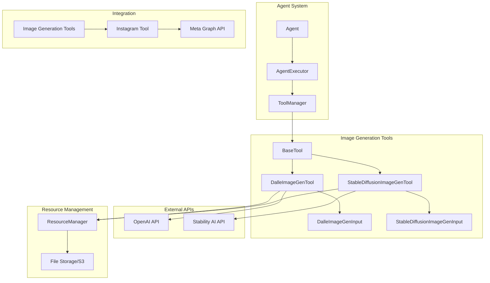
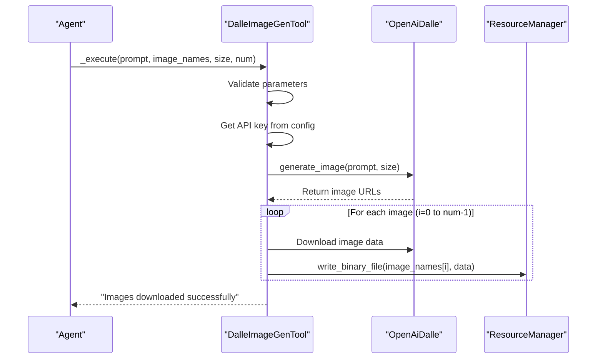
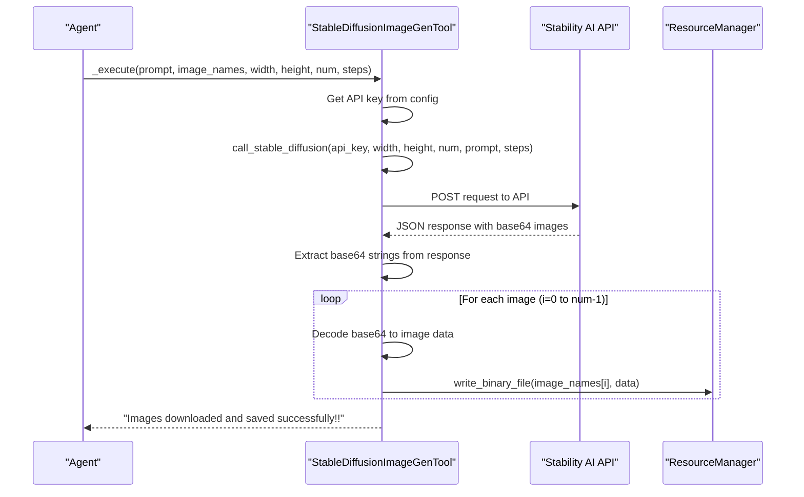
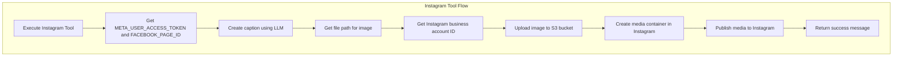

<!-- source: DeepWiki mcp.deepwiki.com · repo TransformerOptimus/SuperAGI · page 4.4 Image Generation Tools · fetched 2026-10-26 -->

# Image Generation Tools

<details>
<summary>Relevant source files</summary>

The following files were used as context for generating this wiki page:

- [superagi/tools/image_generation/dalle_image_gen.py](superagi/tools/image_generation/dalle_image_gen.py)
- [superagi/tools/image_generation/stable_diffusion_image_gen.py](superagi/tools/image_generation/stable_diffusion_image_gen.py)
- [superagi/tools/instagram_tool/README.MD](superagi/tools/instagram_tool/README.MD)
- [superagi/tools/instagram_tool/instagram.py](superagi/tools/instagram_tool/instagram.py)
- [superagi/tools/instagram_tool/instagram_toolkit.py](superagi/tools/instagram_tool/instagram_toolkit.py)
- [tests/unit_tests/tools/image_generation/test_dalle_image_gen.py](tests/unit_tests/tools/image_generation/test_dalle_image_gen.py)
- [tests/unit_tests/tools/image_generation/test_stable_diffusion_image_gen.py](tests/unit_tests/tools/image_generation/test_stable_diffusion_image_gen.py)
- [tests/unit_tests/tools/instagram_tool/__init__.py](tests/unit_tests/tools/instagram_tool/__init__.py)
- [tests/unit_tests/tools/instagram_tool/test_instagram_tool.py](tests/unit_tests/tools/instagram_tool/test_instagram_tool.py)
- [tests/unit_tests/tools/instagram_tool/test_instagram_toolkit.py](tests/unit_tests/tools/instagram_tool/test_instagram_toolkit.py)

</details>


This document explains the image generation capabilities in SuperAGI, which enable agents to create images based on text prompts. SuperAGI provides integration with two popular image generation models: OpenAI's DALL-E and Stability AI's Stable Diffusion. These tools allow agents to generate custom images that can be stored in the resource system and used in various tasks, including social media posting.

## Overview

Image generation tools in SuperAGI extend the BaseTool class and implement specific functionality to interact with external image generation APIs. The system currently includes two primary image generation tools:

1. DALL-E Image Generation Tool - Uses OpenAI's DALL-E model
2. Stable Diffusion Image Generation Tool - Uses Stability AI's Stable Diffusion model

These tools can be used independently or in combination with other tools, such as the Instagram Tool, which allows posting generated images to social media.

## Architecture

### Image Generation Tools System Architecture



Sources: [superagi/tools/image_generation/dalle_image_gen.py](), [superagi/tools/image_generation/stable_diffusion_image_gen.py](), [superagi/tools/instagram_tool/instagram.py]()

## DALL-E Image Generation Tool

The DALL-E Image Generation Tool leverages OpenAI's DALL-E model to generate images based on text prompts. It is implemented in the `DalleImageGenTool` class.

### Input Schema

The `DalleImageGenInput` class defines the input parameters for the DALL-E tool:

| Parameter | Type | Description | Default |
|-----------|------|-------------|---------|
| prompt | string | Text description for image generation | Required |
| size | integer | Size of the image to be generated | 512 |
| num | integer | Number of images to generate | 2 |
| image_names | list | Names for the generated image files | Required |

### Implementation Details

The DALL-E tool operates through the following workflow:

1. Validates input parameters (including checking for a valid API key)
2. Adjusts the size parameter to one of the accepted values (256, 512, or 1024)
3. Calls the OpenAI DALL-E API through the `OpenAiDalle` class
4. Downloads the generated images from the URLs provided in the response
5. Saves the images using the resource manager with the specified file names



Sources: [superagi/tools/image_generation/dalle_image_gen.py:19-71]()

## Stable Diffusion Image Generation Tool

The Stable Diffusion Image Generation Tool uses Stability AI's Stable Diffusion model to create images from text prompts. It provides more customization options than the DALL-E tool.

### Input Schema

The `StableDiffusionImageGenInput` class defines the input parameters:

| Parameter | Type | Description | Default |
|-----------|------|-------------|---------|
| prompt | string | Text description for image generation | Required |
| height | integer | Height of the image in pixels | 512 |
| width | integer | Width of the image in pixels | 512 |
| num | integer | Number of images to generate | 2 |
| steps | integer | Number of diffusion steps to run | 50 |
| image_names | list | Names for the generated image files | Required |

### Implementation Details

The Stable Diffusion tool follows this workflow:

1. Retrieves the Stability API key from tool configuration
2. Calls the Stability AI API via the `call_stable_diffusion` method
3. Processes the base64-encoded images from the response
4. Decodes the images and saves them using the resource manager



Sources: [superagi/tools/image_generation/stable_diffusion_image_gen.py:15-98]()

## Integration with Instagram

SuperAGI includes an Instagram Tool that can work with the image generation tools to automate social media posting. This tool takes generated images and posts them to an Instagram business account.

### Instagram Tool Workflow



The Instagram Tool:
1. Creates an engaging caption for the post using an LLM
2. Retrieves the Instagram business account ID associated with the Facebook page
3. Uploads the image to an S3 bucket to make it publicly accessible
4. Creates a media container in Instagram with the image URL and caption
5. Publishes the media container to the Instagram account

Sources: [superagi/tools/instagram_tool/instagram.py:31-205]()

## Configuration Requirements

### DALL-E Image Generation Tool

Required configuration in the toolkit settings:

| Key | Description |
|-----|-------------|
| OPENAI_API_KEY | Your OpenAI API key with DALL-E access |

### Stable Diffusion Image Generation Tool

Required configuration in the toolkit settings:

| Key | Description |
|-----|-------------|
| STABILITY_API_KEY | Your Stability AI API key |
| ENGINE_ID | The engine ID to use (e.g., "stable-diffusion-v1-5") |

### Instagram Tool

Required configuration in the toolkit settings:

| Key | Description |
|-----|-------------|
| META_USER_ACCESS_TOKEN | User access token for the Meta Graph API |
| FACEBOOK_PAGE_ID | ID of the Facebook page connected to your Instagram business account |
| INSTAGRAM_TOOL_BUCKET_NAME | S3 bucket name for temporary image storage (environment variable) |

Sources: [superagi/tools/instagram_tool/instagram_toolkit.py:7-18](), [superagi/tools/instagram_tool/README.MD:16-31]()

## Usage Examples

### Generating Images with DALL-E

```
{
  "prompt": "A futuristic city with flying cars and tall glass buildings",
  "size": 1024,
  "num": 2,
  "image_names": ["future_city_1.png", "future_city_2.png"]
}
```

### Generating Images with Stable Diffusion

```
{
  "prompt": "A detailed oil painting of a mountain landscape with a lake",
  "height": 768,
  "width": 768,
  "num": 1,
  "steps": 50,
  "image_names": ["landscape.png"]
}
```

### Posting to Instagram

```
{
  "photo_description": "A beautiful AI-generated landscape painting",
  "filename": "landscape.png"
}
```

## Error Handling

Both image generation tools implement error handling for:

1. Missing API keys - Returns a message indicating the need to add the API key in configuration
2. Invalid API responses - Returns the error message from the API response
3. Size parameter validation - The DALL-E tool automatically adjusts sizes to valid values (256, 512, or 1024)
4. Engine constraints - The Stable Diffusion tool enforces minimum image dimensions based on the selected engine

Sources: [superagi/tools/image_generation/dalle_image_gen.py:57-62](), [superagi/tools/image_generation/stable_diffusion_image_gen.py:48-55](), [superagi/tools/image_generation/stable_diffusion_image_gen.py:77-82]()

## Testing

SuperAGI includes unit tests for both image generation tools to ensure they function correctly. These tests mock the external API calls to simulate responses and verify that the tools process the results correctly.

Test files:
- [tests/unit_tests/tools/image_generation/test_dalle_image_gen.py]()
- [tests/unit_tests/tools/image_generation/test_stable_diffusion_image_gen.py]()

## Limitations and Considerations

1. DALL-E only supports specific image sizes (256×256, 512×512, or 1024×1024)
2. Stable Diffusion may have minimum size requirements depending on the engine selected
3. Instagram Tool requires an Instagram Business Account and Facebook Page connection
4. Image generation can be computationally expensive and may have usage costs associated with the external APIs

---

