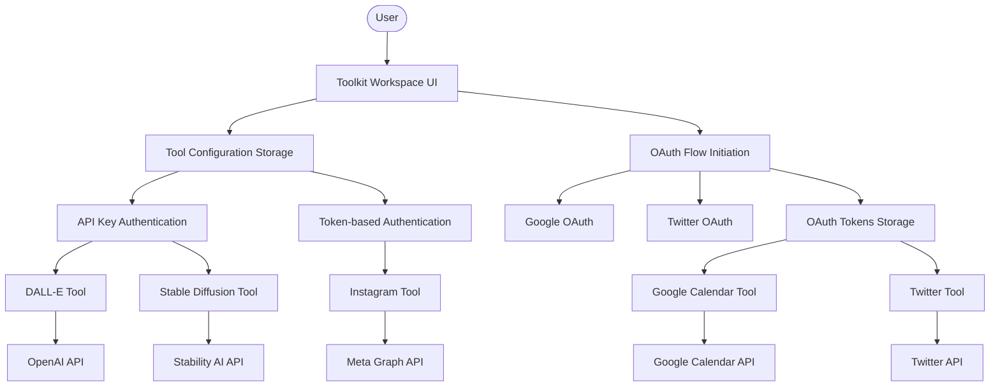
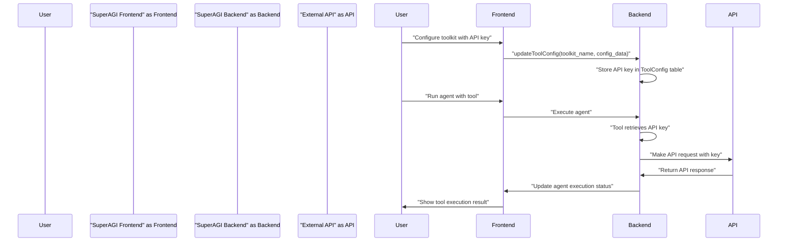
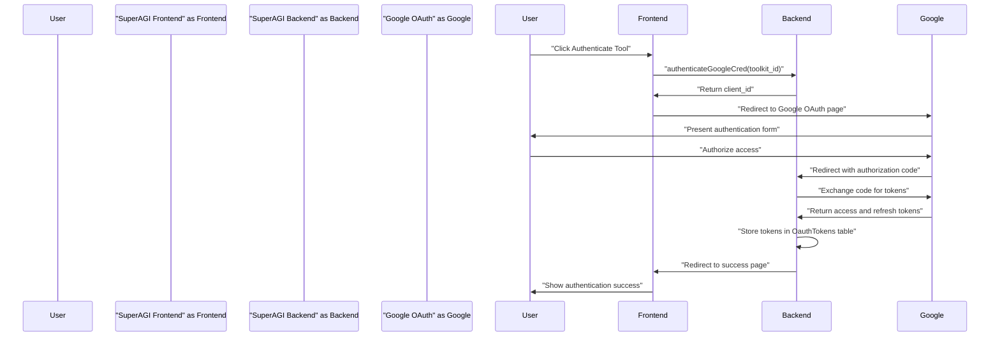
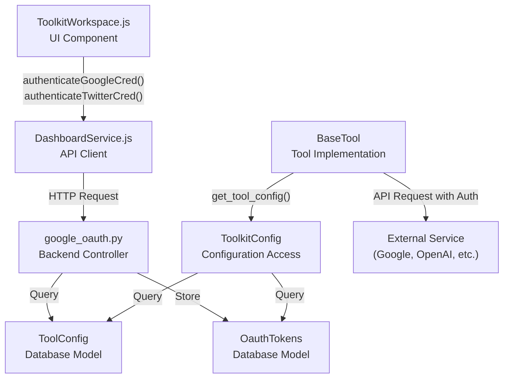

<!-- source: DeepWiki mcp.deepwiki.com · repo TransformerOptimus/SuperAGI · page 4.5 Tool Authentication · fetched 2026-10-26 -->

# Tool Authentication

<details>
<summary>Relevant source files</summary>

The following files were used as context for generating this wiki page:

- [gui/pages/Content/APM/ApmDashboard.js](gui/pages/Content/APM/ApmDashboard.js)
- [gui/pages/Content/Marketplace/MarketKnowledge.js](gui/pages/Content/Marketplace/MarketKnowledge.js)
- [gui/pages/Content/Toolkits/ToolkitWorkspace.js](gui/pages/Content/Toolkits/ToolkitWorkspace.js)
- [gui/pages/Content/Toolkits/Toolkits.js](gui/pages/Content/Toolkits/Toolkits.js)
- [superagi/controllers/google_oauth.py](superagi/controllers/google_oauth.py)
- [superagi/tools/image_generation/dalle_image_gen.py](superagi/tools/image_generation/dalle_image_gen.py)
- [superagi/tools/image_generation/stable_diffusion_image_gen.py](superagi/tools/image_generation/stable_diffusion_image_gen.py)
- [superagi/tools/instagram_tool/README.MD](superagi/tools/instagram_tool/README.MD)
- [superagi/tools/instagram_tool/instagram.py](superagi/tools/instagram_tool/instagram.py)
- [superagi/tools/instagram_tool/instagram_toolkit.py](superagi/tools/instagram_tool/instagram_toolkit.py)
- [tests/unit_tests/tools/image_generation/test_dalle_image_gen.py](tests/unit_tests/tools/image_generation/test_dalle_image_gen.py)
- [tests/unit_tests/tools/image_generation/test_stable_diffusion_image_gen.py](tests/unit_tests/tools/image_generation/test_stable_diffusion_image_gen.py)
- [tests/unit_tests/tools/instagram_tool/__init__.py](tests/unit_tests/tools/instagram_tool/__init__.py)
- [tests/unit_tests/tools/instagram_tool/test_instagram_tool.py](tests/unit_tests/tools/instagram_tool/test_instagram_tool.py)
- [tests/unit_tests/tools/instagram_tool/test_instagram_toolkit.py](tests/unit_tests/tools/instagram_tool/test_instagram_toolkit.py)

</details>


This page documents the authentication mechanisms used by SuperAGI tools to securely connect with external services and APIs. It covers how different tools authenticate with their respective services, the supported authentication methods, and how to configure authentication credentials in the system.

For information about the general tools system, see [Tools System](#4), and for details about specific tools, see their respective pages such as [Email and Communication Tools](#4.3) or [Image Generation Tools](#4.4).

## Overview of Authentication Methods

SuperAGI supports three primary authentication methods for external service integration:

1. **API Key Authentication**: Simple string tokens used for services like DALL-E and Stable Diffusion
2. **OAuth Authentication**: Interactive authentication flow for services like Google Calendar and Twitter
3. **Token-based Authentication**: Pre-obtained tokens for services like Instagram/Meta

The diagram below shows the relationship between these authentication methods and the tools that use them:



Sources: 
- [superagi/tools/image_generation/dalle_image_gen.py:54-62]()
- [superagi/tools/image_generation/stable_diffusion_image_gen.py:46-51]()
- [superagi/tools/instagram_tool/instagram.py:63-69]()
- [gui/pages/Content/Toolkits/ToolkitWorkspace.js:90-113]()

## Authentication Methods

### API Key Authentication

Many tools in SuperAGI use API keys for authentication. These are simple string tokens that are passed with API requests to verify the identity of the requester.

#### Implementation

In the code, API keys are retrieved using the `get_tool_config` method and validated before making API requests:

```python
# Example from DALL-E Image Generation Tool
api_key = self.get_tool_config("OPENAI_API_KEY")
if api_key is None:
    return "Enter your OpenAi api key in the configuration"
```

The sequence diagram below illustrates the API key authentication flow:



Sources:
- [superagi/tools/image_generation/dalle_image_gen.py:60-62]()
- [superagi/tools/image_generation/stable_diffusion_image_gen.py:48-51]()

### OAuth Authentication

OAuth is used for more complex authentication scenarios where users need to grant permission for SuperAGI to access their accounts on external services.

#### Google OAuth Flow

The Google OAuth flow in SuperAGI follows the standard OAuth 2.0 authorization code flow:



The frontend initiates the authentication by redirecting to Google's OAuth page:

```javascript
function getGoogleToken(client_data) {
  var redirect_uri = "";
  if (env == "PROD") {
    redirect_uri = 'https://app.superagi.com/api/google/oauth-tokens';
  } else {
    redirect_uri = "http://localhost:3000/api/google/oauth-tokens";
  }
  const client_id = client_data.client_id
  const scope = 'https://www.googleapis.com/auth/calendar';
  window.location.href = `https://accounts.google.com/o/oauth2/v2/auth?client_id=${client_id}&redirect_uri=${redirect_uri}&access_type=offline&approval_prompt=force&response_type=code&scope=${scope}&state=${toolkitDetails.id}`;
}
```

The backend handles the OAuth callback and token exchange:

```python
@router.get('/oauth-tokens')
async def google_auth_calendar(code: str = Query(...), state: str = Query(...)):
    toolkit_id = int(state)
    # Get client_id and client_secret from the database
    # Exchange code for tokens
    # Store tokens in the database
```

Sources:
- [gui/pages/Content/Toolkits/ToolkitWorkspace.js:32-42]()
- [gui/pages/Content/Toolkits/ToolkitWorkspace.js:90-101]()
- [superagi/controllers/google_oauth.py:24-64]()

#### Twitter OAuth Flow

Twitter uses a similar OAuth process with its own endpoints:

```javascript
function getTwitterToken(oauth_data) {
  window.location.href = `https://api.twitter.com/oauth/authenticate?oauth_token=${oauth_data.oauth_token}`
}
```

Sources:
- [gui/pages/Content/Toolkits/ToolkitWorkspace.js:44-46]()
- [gui/pages/Content/Toolkits/ToolkitWorkspace.js:102-112]()

### Token-based Authentication

Some services like Instagram/Meta require pre-obtained tokens. Users must obtain these tokens separately and configure them in the toolkit.

For example, the Instagram Tool requires a Meta user access token and Facebook page ID:

```python
meta_user_access_token = self.get_tool_config("META_USER_ACCESS_TOKEN")
facebook_page_id = self.get_tool_config("FACEBOOK_PAGE_ID")

if meta_user_access_token is None:
    return "Error: Missing meta user access token."

if facebook_page_id is None:
    return "Error: Missing facebook page id."
```

Sources:
- [superagi/tools/instagram_tool/instagram.py:63-69]()
- [superagi/tools/instagram_tool/instagram_toolkit.py:14-18]()

## Configuration and Storage

### Configuring Authentication in the UI

Authentication credentials are configured in the Toolkit Workspace UI. The interface provides input fields for credentials and buttons to initiate OAuth flows when needed.

The configuration UI allows users to:
1. Enter API keys and other credentials
2. Initiate OAuth authentication for supported services
3. Update stored credentials

```javascript
{apiConfigs.length > 0 ? (apiConfigs.map((config, index) => (
  <div key={index}>
    <div className="vertical_containers w_100 color_gray mb_20 text_align_left">
      <label className="mb_6">{convertToTitleCase(config.key)}</label>
      <div className={styles.search_box}>
        <input className="color_white" type={config?.is_secret ? 'password' : 'text'} 
               value={config.value || ''} onChange={(event) => handleKeyChange(event, index)}/>
      </div>
    </div>
  </div>
))) : (<div>No configurations found</div>)}

{apiConfigs.length > 0 && (
  <div className="horizontal_space_between">
    {authenticateToolkits.includes(toolkitDetails.name) &&
      <button className="primary_button w_fit_content" onClick={() => handleAuthenticateClick(toolkitDetails.name)}>
        Authenticate Tool
      </button>}
      <button className="primary_button" onClick={handleUpdateChanges}>
        Update Changes
      </button>
  </div>)}
```

Sources:
- [gui/pages/Content/Toolkits/ToolkitWorkspace.js:188-209]()

### Credential Storage and Security

Authentication credentials are stored securely in the database:

1. **ToolConfig table**: Stores API keys, client IDs, and other simple credentials
2. **OauthTokens table**: Stores OAuth tokens obtained from authentication flows

Sensitive credentials are encrypted before storage and decrypted when needed:

```python
if(is_encrypted(client_id.value)):
    client_id = decrypt_data(client_id.value)
else:
    client_id = client_id.value
```

Sources:
- [superagi/controllers/google_oauth.py:28-36]()
- [superagi/controllers/google_oauth.py:74-81]()

## Supported Tools and Authentication Methods

The following table summarizes the tools in SuperAGI and their authentication methods:

| Tool/Toolkit | Authentication Method | Required Credentials |
|--------------|------------------------|----------------------|
| DALL-E Image Generation | API Key | OPENAI_API_KEY |
| Stable Diffusion Image Generation | API Key | STABILITY_API_KEY, ENGINE_ID |
| Google Calendar | OAuth | GOOGLE_CLIENT_ID, GOOGLE_CLIENT_SECRET |
| Twitter | OAuth | (OAuth token handled by the system) |
| Instagram | Token-based | META_USER_ACCESS_TOKEN, FACEBOOK_PAGE_ID |

Sources:
- [superagi/tools/image_generation/dalle_image_gen.py:20-71]()
- [superagi/tools/image_generation/stable_diffusion_image_gen.py:25-98]()
- [superagi/tools/instagram_tool/instagram_toolkit.py:7-18]()
- [gui/pages/Content/Toolkits/ToolkitWorkspace.js:20]()

## Authentication Flow in Code

The diagram below illustrates the code paths involved in tool authentication:



Sources:
- [gui/pages/Content/Toolkits/ToolkitWorkspace.js:90-113]()
- [superagi/controllers/google_oauth.py:24-64]()
- [superagi/tools/image_generation/dalle_image_gen.py:60-71]()
- [superagi/tools/instagram_tool/instagram.py:63-69]()

## Summary

Tool Authentication in SuperAGI provides a flexible and secure way for tools to authenticate with external services. The system supports API keys, OAuth, and token-based authentication methods, accommodating a wide range of external service requirements. The toolkit workspace UI provides an intuitive interface for configuring authentication credentials, and the backend handles the secure storage and retrieval of these credentials.

By understanding how tool authentication works in SuperAGI, developers can integrate new external services and users can securely configure their tools to work with third-party APIs.

---

