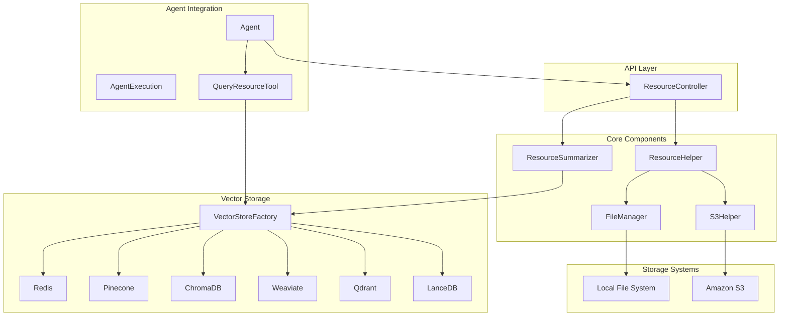
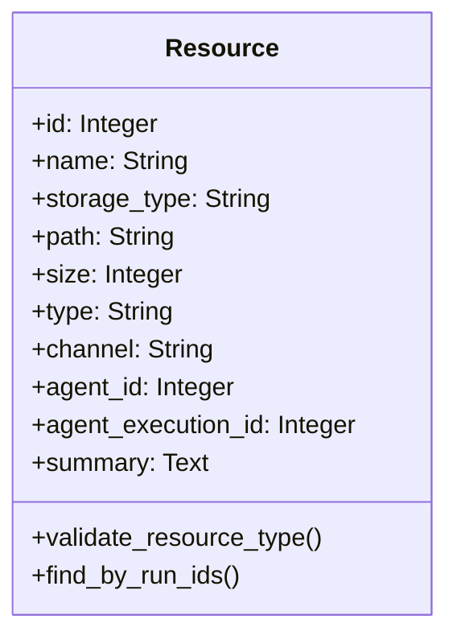
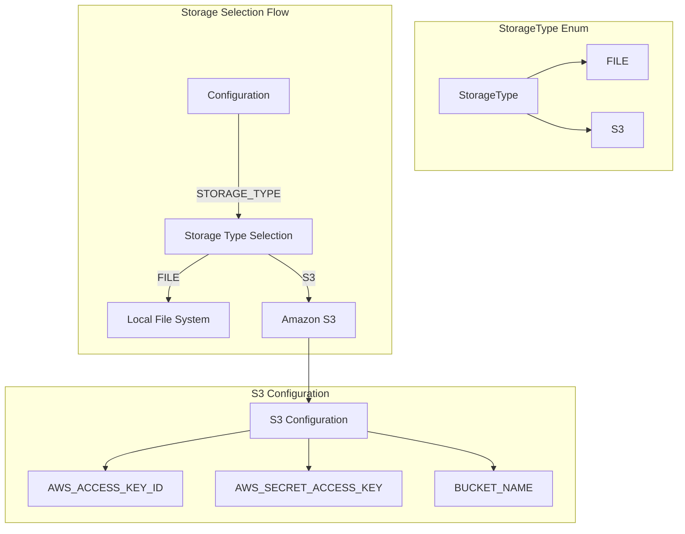
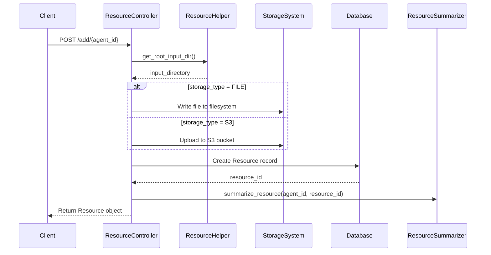
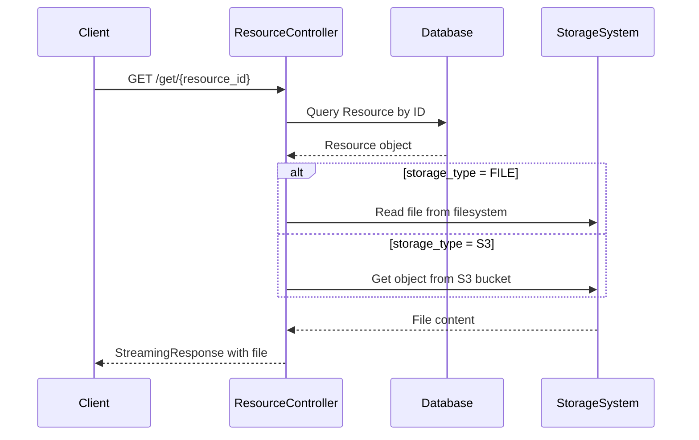
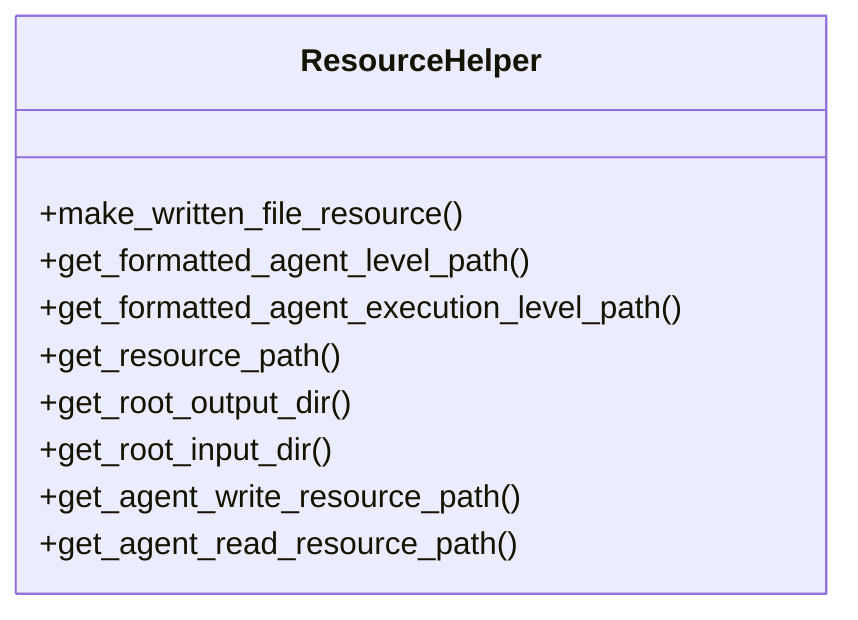
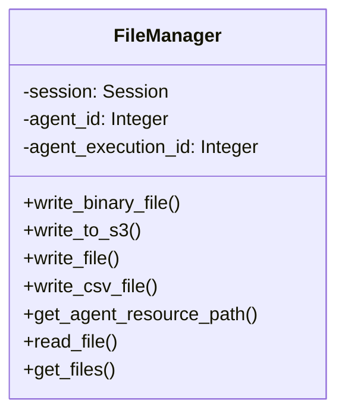
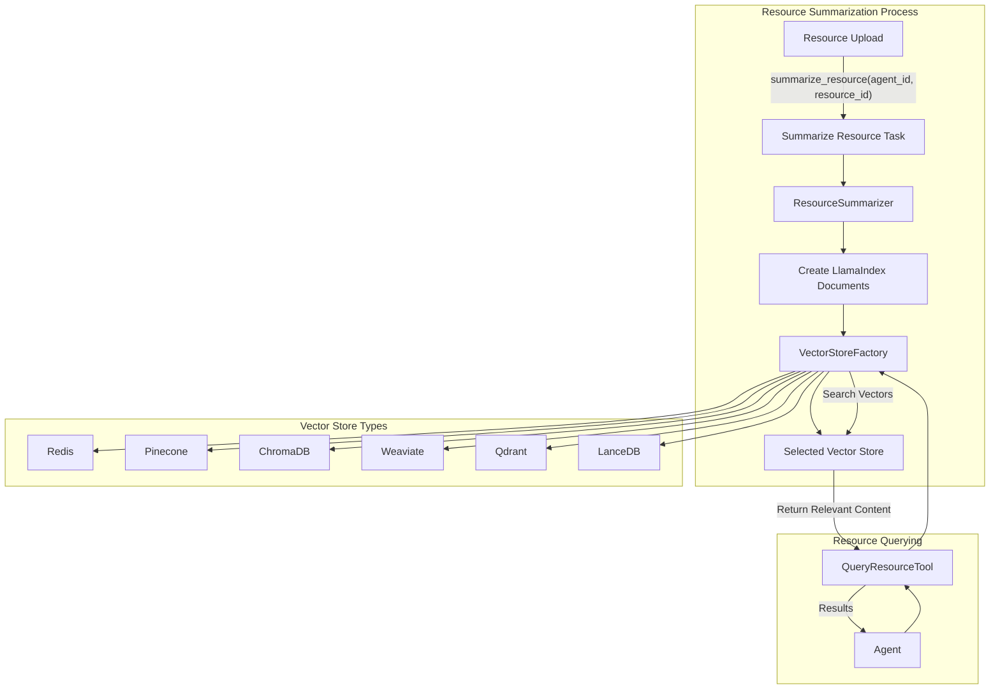
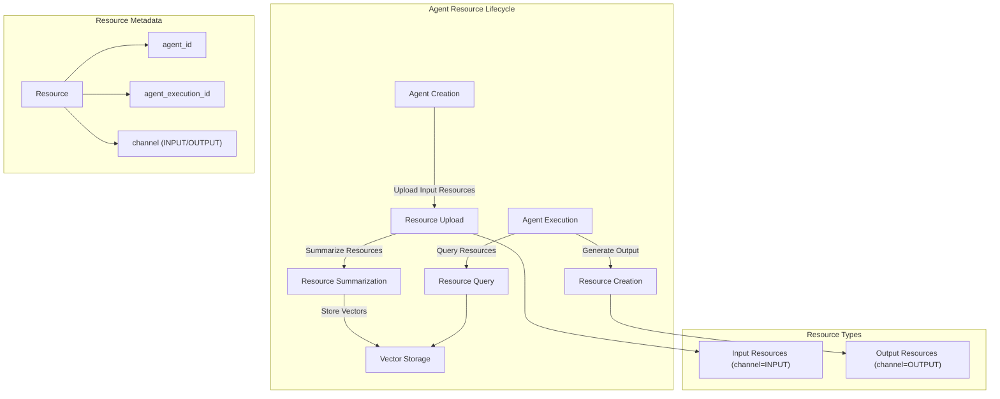
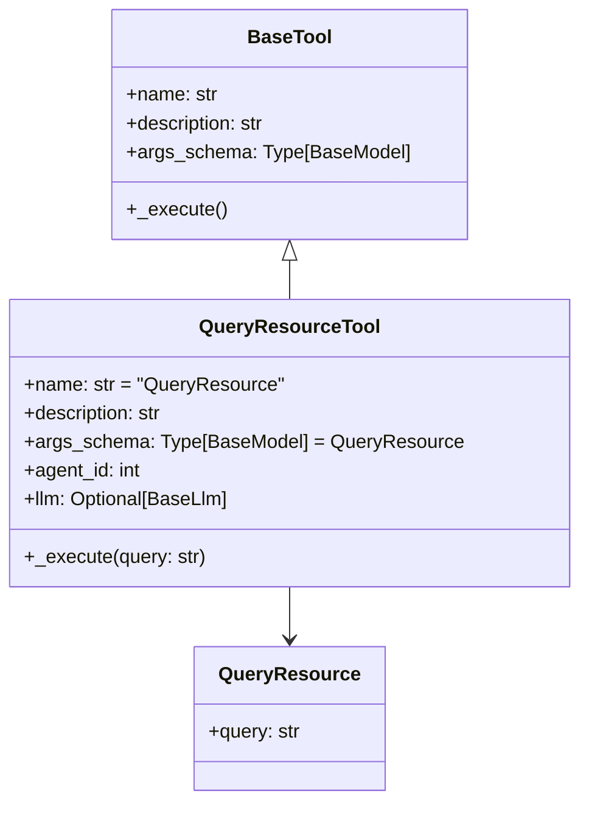

<!-- source: DeepWiki mcp.deepwiki.com · repo TransformerOptimus/SuperAGI · page 5 Resource Management · fetched 2026-10-26 -->

# Resource Management

Relevant source files

The following files were used as context for generating this wiki page:

- [migrations/versions/c02f3d759bf3_add_summary_to_resource.py](migrations/versions/c02f3d759bf3_add_summary_to_resource.py)
- [superagi/controllers/resources.py](superagi/controllers/resources.py)
- [superagi/helper/resource_helper.py](superagi/helper/resource_helper.py)
- [superagi/models/resource.py](superagi/models/resource.py)
- [superagi/resource_manager/file_manager.py](superagi/resource_manager/file_manager.py)
- [superagi/resource_manager/resource_summary.py](superagi/resource_manager/resource_summary.py)
- [superagi/tools/resource/__init__.py](superagi/tools/resource/__init__.py)
- [superagi/tools/resource/query_resource.py](superagi/tools/resource/query_resource.py)
- [superagi/tools/resource/resource_toolkit.py](superagi/tools/resource/resource_toolkit.py)
- [superagi/types/storage_types.py](superagi/types/storage_types.py)
- [superagi/types/vector_store_types.py](superagi/types/vector_store_types.py)
- [superagi/worker.py](superagi/worker.py)
- [tests/unit_tests/helper/test_resource_helper.py](tests/unit_tests/helper/test_resource_helper.py)

## Purpose and Scope

Resource Management in SuperAGI provides a system for handling files, data, and artifacts that agents work with. It enables the storage, retrieval, processing, and querying of resources within the agent ecosystem. This system supports both local file storage and S3 cloud storage, along with vectorization capabilities for efficient resource querying.

For information on how Language Models are integrated with resources, see [LLM Integration](#6).

## System Architecture

Sources: [superagi/controllers/resources.py](), [superagi/helper/resource_helper.py](), [superagi/resource_manager/file_manager.py](), [superagi/resource_manager/resource_summary.py](), [superagi/types/vector_store_types.py]()

## Resource Model

The Resource model is the core entity that represents files and data in the system.

### Resource Attributes

| Attribute | Type | Description |
|-----------|------|-------------|
| `id` | Integer | Primary key identifier for the resource |
| `name` | String | Name of the resource (e.g., file name) |
| `storage_type` | String | Storage system used (FILE or S3) |
| `path` | String | Path where the resource is stored |
| `size` | Integer | Size of the resource in bytes |
| `type` | String | MIME type of the resource (e.g., application/pdf) |
| `channel` | String | Whether the resource is an input (INPUT) or output (OUTPUT) |
| `agent_id` | Integer | ID of the agent associated with the resource |
| `agent_execution_id` | Integer | ID of the agent execution that created/used the resource |
| `summary` | Text | Summary of the resource content (for efficient querying) |

Sources: [superagi/models/resource.py](), [migrations/versions/c02f3d759bf3_add_summary_to_resource.py]()

## Storage Systems

SuperAGI supports two primary storage types for resources:

### Local File Storage

Local file storage stores resources on the filesystem where SuperAGI is running. File paths are determined based on the agent and agent execution IDs, creating a hierarchical structure.

Key configuration:
- `RESOURCES_INPUT_ROOT_DIR`: Root directory for input resources
- `RESOURCES_OUTPUT_ROOT_DIR`: Root directory for output resources

### S3 Storage

Amazon S3 storage enables storing resources in the cloud. This requires proper AWS credentials configuration.

Key configuration:
- `AWS_ACCESS_KEY_ID`: AWS access key ID for S3 authentication
- `AWS_SECRET_ACCESS_KEY`: AWS secret access key for S3 authentication
- `BUCKET_NAME`: Name of the S3 bucket to store resources in

Sources: [superagi/types/storage_types.py](), [superagi/helper/resource_helper.py:27-29](), [superagi/controllers/resources.py:25-29]()

## Resource Operations

### Resource Upload Flow

### Resource Download Flow

### Resource Operations API Endpoints

| Endpoint | Method | Description |
|----------|--------|-------------|
| `/add/{agent_id}` | POST | Upload a file as a resource for an agent |
| `/get/all/{agent_id}` | GET | Get all resources for an agent |
| `/get/{resource_id}` | GET | Download a specific resource by ID |

Sources: [superagi/controllers/resources.py:32-174]()

## Resource Helper

The ResourceHelper class provides utility functions for managing resource paths and creating resource objects.

### Path Management

ResourceHelper provides methods to generate appropriate paths for resources based on the configuration, agent, and execution context:

1. **Root Directories**:
   - `get_root_input_dir()`: Returns the configured root directory for input resources
   - `get_root_output_dir()`: Returns the configured root directory for output resources

2. **Agent-Specific Paths**:
   - `get_formatted_agent_level_path()`: Formats a path with the agent ID/name
   - `get_formatted_agent_execution_level_path()`: Formats a path with the agent execution ID/name
   - `get_agent_write_resource_path()`: Gets the path to write agent-specific resources
   - `get_agent_read_resource_path()`: Gets the path to read agent-specific resources

3. **Resource Creation**:
   - `make_written_file_resource()`: Creates a Resource object for files written by agents

Sources: [superagi/helper/resource_helper.py](), [tests/unit_tests/helper/test_resource_helper.py]()

## File Manager

The FileManager class provides high-level methods for file operations:

### Key Operations

1. **File Writing**:
   - `write_file()`: Writes text content to a file
   - `write_binary_file()`: Writes binary data to a file
   - `write_csv_file()`: Writes CSV data to a file

2. **File Reading**:
   - `read_file()`: Reads content from a file
   - `get_files()`: Lists all files in the agent's resource directory

3. **S3 Integration**:
   - `write_to_s3()`: Uploads files to S3 when S3 storage is configured

Sources: [superagi/resource_manager/file_manager.py]()

## Resource Summarization and Vectorization

Resources can be summarized and vectorized for efficient querying by agents:

### Summarization Process

1. When a resource is uploaded, a background task `summarize_resource` is triggered
2. The task creates documents from the resource using LlamaIndex
3. The documents are added to a vector store for semantic searching
4. A summary of the resource content is generated and stored

### Querying Resources

Agents can query resources using the QueryResourceTool, which:
1. Takes a natural language query from the agent
2. Converts the query to a vector using the same model as summarization
3. Searches the vector store for semantically similar content
4. Returns the relevant information to the agent

### Supported Vector Stores

| Vector Store | Description |
|--------------|-------------|
| Redis | In-memory database with vector search capabilities |
| Pinecone | Managed vector database optimized for similarity search |
| Chroma | Open-source embedding database |
| Weaviate | Vector search engine and knowledge graph |
| Qdrant | Vector similarity search engine |
| LanceDB | Serverless vector database |

Sources: [superagi/worker.py:75-104](), [superagi/resource_manager/resource_summary.py](), [superagi/tools/resource/query_resource.py](), [superagi/types/vector_store_types.py]()

## Integration with Agents

Resources are tightly integrated with agents and agent executions:

### Agent Resource Relationships

1. **Input Resources**:
   - Uploaded by users for agents to use
   - Processed and vectorized for semantic search
   - Associated with agents through the `agent_id` field

2. **Output Resources**:
   - Generated by agents during execution
   - Stored with references to both agent and execution
   - Associated with both agent and execution through `agent_id` and `agent_execution_id` fields

3. **Resource Summary**:
   - Agents maintain a summary of all their input resources
   - This summary is stored in the agent configuration as `resource_summary`
   - Used to provide context to the agent about available resources

Sources: [superagi/helper/resource_helper.py:14-80](), [superagi/resource_manager/resource_summary.py:50-89]()

## Query Resource Tool

Agents can use the QueryResourceTool to search and retrieve information from resources:

### Usage Flow

1. Agent constructs a query about information it needs from resources
2. Query is passed to the QueryResourceTool
3. The tool:
   - Connects to the configured vector store
   - Applies filters to limit results to the agent's resources
   - Executes the semantic search
   - Returns relevant information to the agent

### Configuration

The QueryResourceTool is configured with:
- `RESOURCE_VECTOR_STORE`: Type of vector store to use (Redis, Pinecone, etc.)
- `RESOURCE_VECTOR_STORE_INDEX_NAME`: Name of the index in the vector store

Sources: [superagi/tools/resource/query_resource.py](), [superagi/tools/resource/resource_toolkit.py]()

## Summary

The Resource Management system in SuperAGI provides a comprehensive framework for handling files and data within the agent ecosystem. It supports:

1. Multiple storage backends (local filesystem and Amazon S3)
2. Resource uploading, downloading, and listing
3. Automatic resource summarization and vectorization
4. Vector-based semantic search for intelligent resource querying
5. Integration with agents and agent executions
6. Tool-based querying for agents to access resource information

This system enables agents to efficiently work with various resources and retrieve relevant information when needed for their tasks.

---

