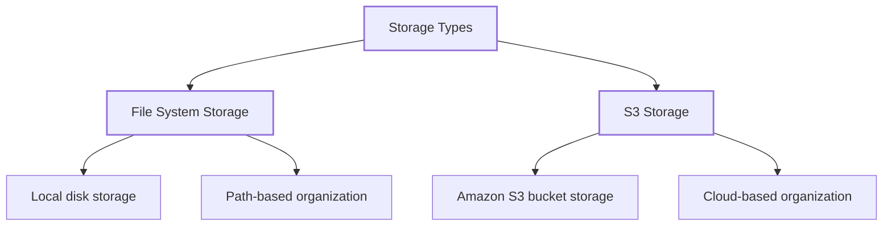
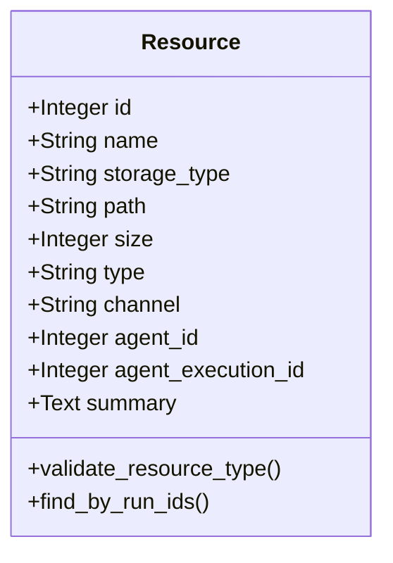
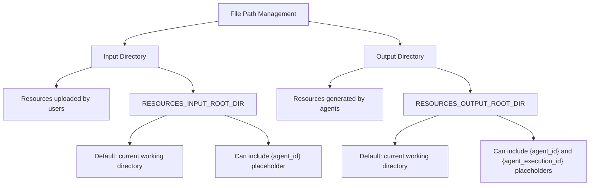
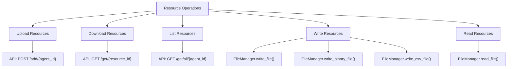
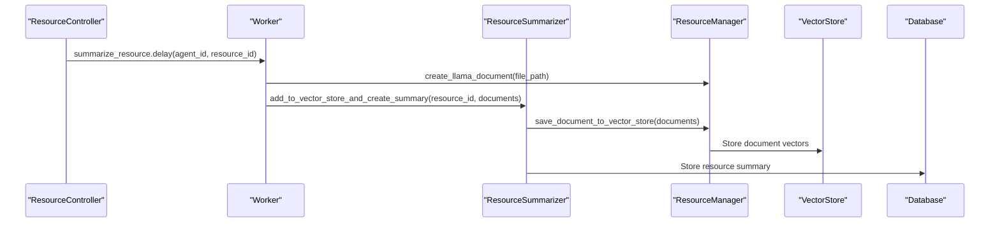
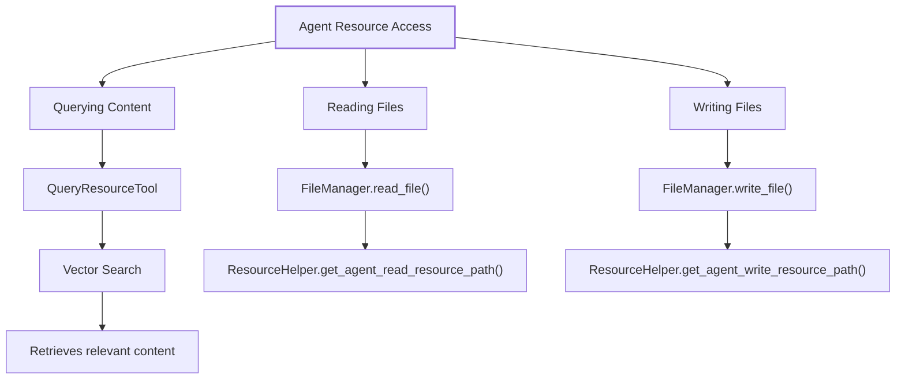

<!-- source: DeepWiki mcp.deepwiki.com · repo TransformerOptimus/SuperAGI · page 5.1 File Storage · fetched 2026-10-26 -->

# File Storage

<details>
<summary>Relevant source files</summary>

The following files were used as context for generating this wiki page:

- [migrations/versions/c02f3d759bf3_add_summary_to_resource.py](migrations/versions/c02f3d759bf3_add_summary_to_resource.py)
- [superagi/controllers/resources.py](superagi/controllers/resources.py)
- [superagi/helper/resource_helper.py](superagi/helper/resource_helper.py)
- [superagi/models/resource.py](superagi/models/resource.py)
- [superagi/resource_manager/file_manager.py](superagi/resource_manager/file_manager.py)
- [superagi/resource_manager/resource_summary.py](superagi/resource_manager/resource_summary.py)
- [superagi/tools/resource/__init__.py](superagi/tools/resource/__init__.py)
- [superagi/tools/resource/query_resource.py](superagi/tools/resource/query_resource.py)
- [superagi/tools/resource/resource_toolkit.py](superagi/tools/resource/resource_toolkit.py)
- [superagi/types/storage_types.py](superagi/types/storage_types.py)
- [superagi/types/vector_store_types.py](superagi/types/vector_store_types.py)
- [superagi/worker.py](superagi/worker.py)
- [tests/unit_tests/helper/test_resource_helper.py](tests/unit_tests/helper/test_resource_helper.py)

</details>


The File Storage system in SuperAGI provides mechanisms for storing, retrieving, and managing files used by agents. SuperAGI supports both local file system storage and Amazon S3 cloud storage, allowing flexibility in deployment configurations. This document details how files are stored, accessed, and managed throughout the system.

For information about vector database integration used for storing and retrieving knowledge from these files, see [Vector Databases](#5.2).

## Storage Types

SuperAGI supports two primary storage types for managing resources:



Sources: [superagi/types/storage_types.py]()

### File System Storage

The default storage method is local file system storage, which stores files on the server's disk. This is suitable for local deployments or when all files should be kept on the server where SuperAGI is running.

Key characteristics:
- Files are organized in directories based on agent and execution IDs
- Root directories can be configured via environment variables
- Simple to set up with no additional dependencies

### Amazon S3 Storage

For cloud deployments or cases where more scalable storage is needed, SuperAGI supports storing files in Amazon S3 buckets.

Key characteristics:
- Requires AWS credentials configuration
- Scales well for larger deployments
- Provides redundancy and availability guarantees
- Suitable for distributed deployments

### Configuration

Storage type is configured through the `STORAGE_TYPE` environment variable, which accepts either `FILE` or `S3`:

```
STORAGE_TYPE=FILE  # For local file system storage
STORAGE_TYPE=S3    # For Amazon S3 storage
```

When using S3 storage, additional configuration is required:
- `AWS_ACCESS_KEY_ID`: AWS access key
- `AWS_SECRET_ACCESS_KEY`: AWS secret key
- `BUCKET_NAME`: S3 bucket name to store files

Sources: [superagi/types/storage_types.py](), [superagi/controllers/resources.py:64-65]()

## Resource Model

Files in SuperAGI are represented by the `Resource` model, which contains metadata about each stored file:



Key attributes:
- `name`: The file name 
- `storage_type`: Storage type (`FILE` or `S3`)
- `path`: Path to the file within the storage system
- `size`: File size in bytes
- `type`: MIME type of the file (e.g., "application/pdf")
- `channel`: Whether the file is an input (`INPUT`) or output (`OUTPUT`)
- `agent_id`: ID of the agent associated with the resource
- `agent_execution_id`: ID of the specific agent execution that created or used the resource
- `summary`: Optional text summary of the file content (generated through LLM processing)

Sources: [superagi/models/resource.py]()

## File Path Management

SuperAGI uses a structured approach to managing file paths, with separate directories for input and output files:



### Directory Configuration

The root directories for file storage are configured through environment variables:
- `RESOURCES_INPUT_ROOT_DIR`: Root directory for files uploaded by users
- `RESOURCES_OUTPUT_ROOT_DIR`: Root directory for files generated by agents

If these are not specified, the current working directory is used.

### Path Templates

Path templates can include placeholders to organize files by agent and execution:
- `{agent_id}`: Replaced with `AgentName_ID` (e.g., "TestAgent_1")
- `{agent_execution_id}`: Replaced with `ExecutionName_ID` (e.g., "TestExecution_1")

For example, with `RESOURCES_OUTPUT_ROOT_DIR=/data/{agent_id}/{agent_execution_id}/` and an agent named "ResearchBot" with ID 42 and execution ID 123, a file path might resolve to `/data/ResearchBot_42/Execution_123/output.txt`.

Sources: [superagi/helper/resource_helper.py:82-91](), [superagi/helper/resource_helper.py:114-125]()

## Resource Operations

SuperAGI provides several operations for managing resources:



### Uploading Resources

Files can be uploaded via the REST API endpoint `/add/{agent_id}`. The process includes:
1. Validating the agent exists
2. Checking if the file type is supported (PDF, DOCX, PPTX, CSV, TXT, EPUB)
3. Determining storage location based on storage type
4. Storing the file and creating a Resource record
5. Triggering background summarization

```python
POST /add/{agent_id}
Parameters:
  - agent_id (path): ID of the agent
  - file (form): Uploaded file
  - name (form): Name of the resource
  - size (form): Size of the resource
  - type (form): Type of the resource
```

Sources: [superagi/controllers/resources.py:32-97]()

### Downloading Resources

Files can be downloaded via the REST API endpoint `/get/{resource_id}`:
1. Validates the resource exists
2. Checks if the user has permission to access the resource
3. Retrieves the file from the storage system
4. Streams the file content as a download response

```python
GET /get/{resource_id}
Parameters:
  - resource_id (path): ID of the resource to download
```

Sources: [superagi/controllers/resources.py:118-174]()

### Listing Resources

All resources for an agent can be listed via the REST API endpoint `/get/all/{agent_id}`:

```python
GET /get/all/{agent_id}
Parameters:
  - agent_id (path): ID of the agent
```

Sources: [superagi/controllers/resources.py:100-115]()

### File Operations

The `FileManager` class provides methods for agents to read and write files:

| Method | Description |
|--------|-------------|
| `write_file` | Writes text content to a file |
| `write_binary_file` | Writes binary data (e.g., images) to a file |
| `write_csv_file` | Writes CSV data to a file |
| `read_file` | Reads content from a file |
| `get_files` | Lists all files in the agent's directory |

For each operation, the system:
1. Resolves the appropriate file path
2. Performs the file operation on the local file system
3. If using S3 storage, also synchronizes the file to the S3 bucket
4. For write operations, creates or updates the Resource record

Sources: [superagi/resource_manager/file_manager.py]()

## Resource Summarization and Vectorization

When resources are uploaded, SuperAGI processes them in the background to enable semantic search and retrieval:



The process involves:
1. Extracting text content from the uploaded file
2. Processing the content into chunks for vectorization
3. Creating vector embeddings of the content chunks
4. Storing the embeddings in the configured vector store
5. Generating a summary of the resource content
6. Storing the summary in the Resource record

This enables agents to:
- Search through document content semantically
- Retrieve relevant information from stored files
- Use the QueryResourceTool to access information in documents

Sources: [superagi/worker.py:75-104](), [superagi/resource_manager/resource_summary.py]()

## Integration with Agents

Agents can interact with stored resources in several ways:



### File Access

Agents can read existing files and write new files using the `FileManager`:
- Input files are searched first in the input directory, then in the output directory
- Output files are always written to the output directory
- Path resolution considers agent and execution context

### Resource Querying

The `QueryResourceTool` lets agents semantically search through resources:
1. Agent submits a natural language query
2. System searches the vector store for relevant content
3. Relevant passages are retrieved and returned to the agent

This tool is particularly useful for tasks that require extracting information from large documents or multiple files.

Sources: [superagi/tools/resource/query_resource.py]()

## Storage Implementation Details

### File System Implementation

When using file system storage:
1. Files are stored at the computed path on disk
2. Directory structure is created if it doesn't exist
3. File operations use standard Python file I/O

### S3 Implementation

When using S3 storage:
1. Files are temporarily stored on the local file system
2. Files are then uploaded to the configured S3 bucket
3. File paths in S3 include a "resources" prefix
4. Downloads retrieve content from S3 and stream it to the client

For S3 storage, the system also maintains a local copy of files for processing purposes, such as vectorization.

Sources: [superagi/controllers/resources.py:78-85](), [superagi/resource_manager/file_manager.py:35-47]()

## Summary

The SuperAGI File Storage system provides a flexible framework for managing resources across different storage backends. It handles file operations, path resolution, and integrates with the agent system to enable both input/output file handling and semantic search capabilities.

Key benefits:
- Support for both local and cloud storage
- Structured organization of files by agent and execution
- Integration with vector stores for semantic search
- Background processing for extracting and summarizing content
- Comprehensive API for resource management

This system forms the foundation for agent-based document processing and information extraction capabilities in SuperAGI.

---

