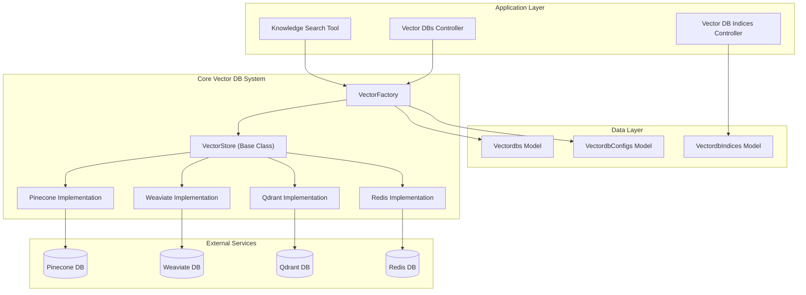
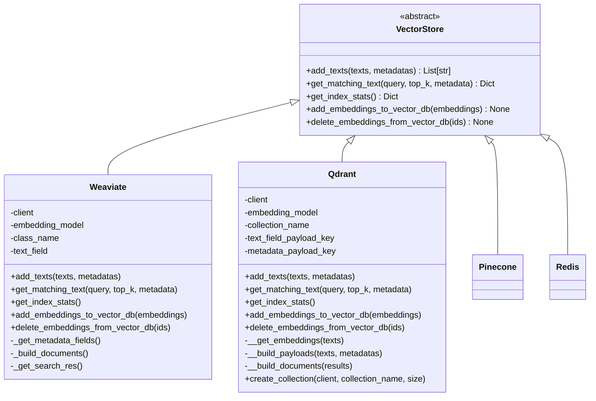
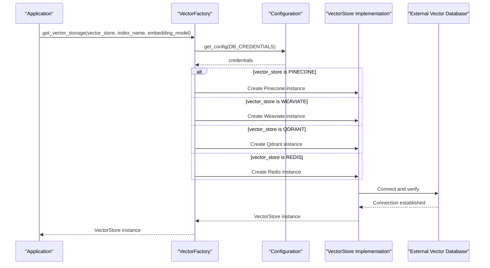
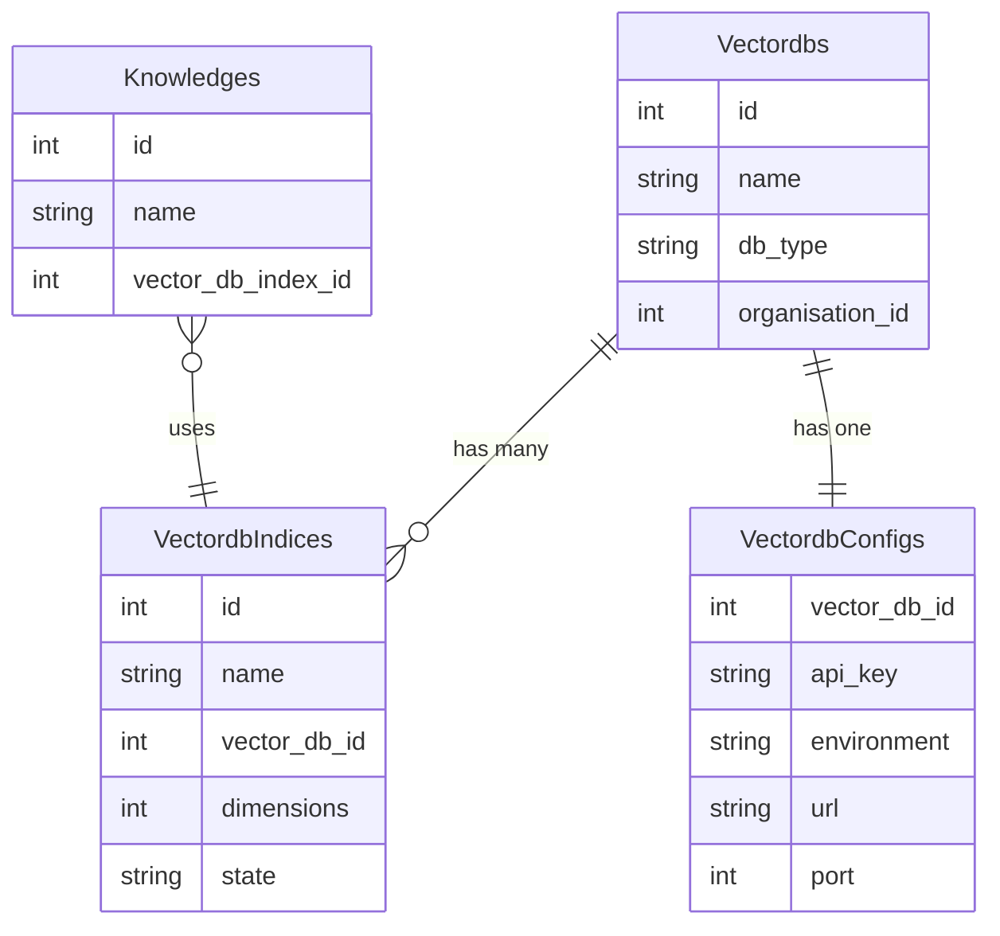
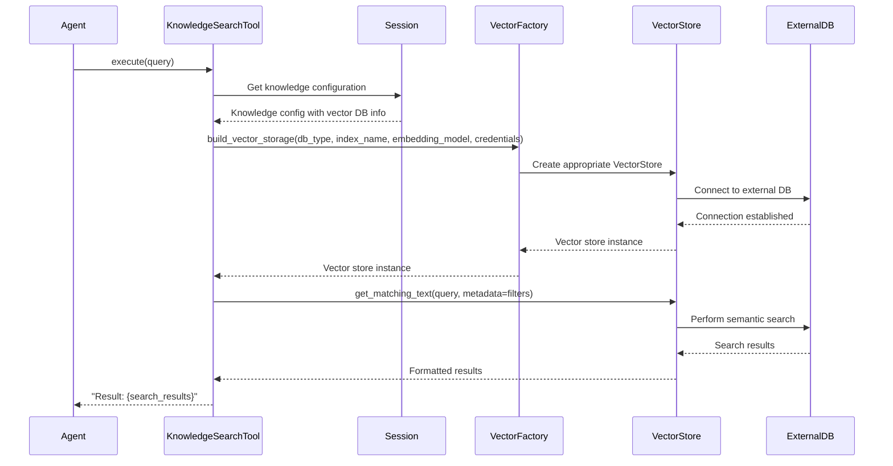
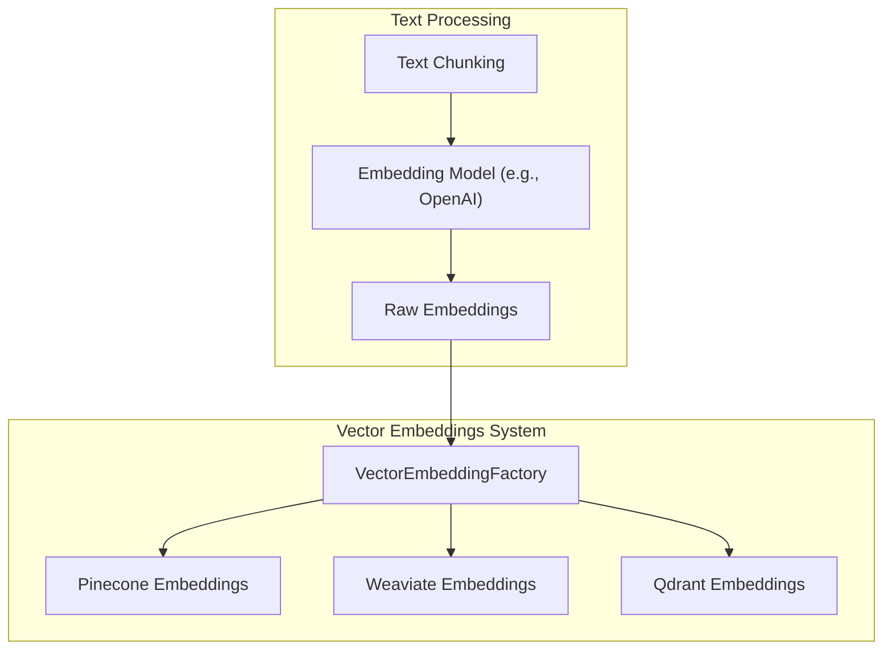
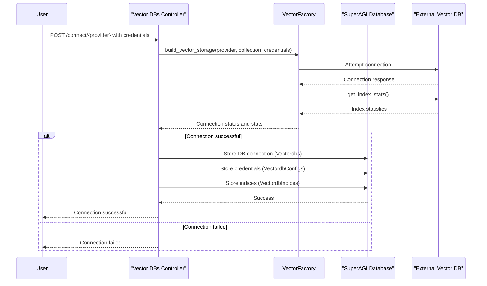

<!-- source: DeepWiki mcp.deepwiki.com · repo TransformerOptimus/SuperAGI · page 5.2 Vector Databases · fetched 2026-10-26 -->

# Vector Databases

<details>
<summary>Relevant source files</summary>

The following files were used as context for generating this wiki page:

- [.github/ISSUE_TEMPLATE/1.BUG_REPORT.yml](.github/ISSUE_TEMPLATE/1.BUG_REPORT.yml)
- [.github/workflows/codeql.yml](.github/workflows/codeql.yml)
- [superagi/controllers/vector_db_indices.py](superagi/controllers/vector_db_indices.py)
- [superagi/controllers/vector_dbs.py](superagi/controllers/vector_dbs.py)
- [superagi/models/vector_db_indices.py](superagi/models/vector_db_indices.py)
- [superagi/tools/knowledge_search/knowledge_search.py](superagi/tools/knowledge_search/knowledge_search.py)
- [superagi/vector_embeddings/vector_embedding_factory.py](superagi/vector_embeddings/vector_embedding_factory.py)
- [superagi/vector_embeddings/weaviate.py](superagi/vector_embeddings/weaviate.py)
- [superagi/vector_store/qdrant.py](superagi/vector_store/qdrant.py)
- [superagi/vector_store/vector_factory.py](superagi/vector_store/vector_factory.py)
- [superagi/vector_store/weaviate.py](superagi/vector_store/weaviate.py)
- [tests/integration_tests/vector_embeddings/test_weaviate.py](tests/integration_tests/vector_embeddings/test_weaviate.py)
- [tests/integration_tests/vector_store/test_qdrant.py](tests/integration_tests/vector_store/test_qdrant.py)
- [tests/integration_tests/vector_store/test_weaviate.py](tests/integration_tests/vector_store/test_weaviate.py)
- [tests/unit_tests/vector_store/__init__.py](tests/unit_tests/vector_store/__init__.py)
- [tests/unit_tests/vector_store/test_vector_factory.py](tests/unit_tests/vector_store/test_vector_factory.py)

</details>


## Purpose and Scope

This document covers the vector database integration within SuperAGI, explaining how vector databases are configured, connected, and utilized within the system. Vector databases are essential for efficient storage and retrieval of embeddings, which enable semantic search capabilities in agents. This page focuses on the core architecture, supported vector database providers, and integration with the wider SuperAGI ecosystem.

For information about general resource management, see [Resource Management](#5). For specific details about file storage options, see [File Storage](#5.1).

## Vector Database Architecture

SuperAGI implements an abstraction layer for vector databases that allows the system to work with multiple vector database providers while maintaining a consistent interface. The architecture consists of several core components:



Vector Database System Architecture Diagram

Sources:
- [superagi/vector_store/vector_factory.py:15-111]()
- [superagi/controllers/vector_dbs.py:1-149]()
- [superagi/controllers/vector_db_indices.py:1-52]()

## Vector Store Base Class and Implementations

SuperAGI uses a common interface defined by the `VectorStore` base class that all specific vector database implementations must inherit from. This ensures consistent behavior regardless of the underlying vector database provider.



Vector Store Class Hierarchy Diagram

Sources:
- [superagi/vector_store/weaviate.py:43-147]()
- [superagi/vector_store/qdrant.py:31-288]()

### Common Vector Store Operations

All vector database implementations support these key operations:

1. **Adding Texts**: Converting text to embeddings and storing them in the vector database
2. **Querying Similar Texts**: Finding texts that are semantically similar to a query
3. **Getting Index Statistics**: Retrieving metadata about the vector database index
4. **Direct Embedding Management**: Adding or deleting embeddings directly

### Weaviate Implementation

The Weaviate implementation allows SuperAGI to connect to a Weaviate vector database. It handles:

- Client creation and management
- Text to embedding conversion
- Querying for similar texts
- Metadata filtering

```python
# Key operations in the Weaviate class
def add_texts(self, texts, metadatas=None, **kwargs):
    # Convert texts to embeddings and add them to the vector database
    
def get_matching_text(self, query, top_k=5, metadata=None, **kwargs):
    # Search for texts similar to the query
    
def get_index_stats(self):
    # Get statistics about the vector database index
    
def add_embeddings_to_vector_db(self, embeddings):
    # Add pre-computed embeddings to the vector database
    
def delete_embeddings_from_vector_db(self, ids):
    # Delete embeddings from the vector database
```

Sources:
- [superagi/vector_store/weaviate.py:53-126]()

### Qdrant Implementation

The Qdrant implementation provides similar functionality but for Qdrant vector database:

- Client creation and management
- Batch processing for efficiency
- Collection creation and management
- Payload management for metadata

```python
# Key operations in the Qdrant class
def add_texts(self, input_texts, metadata_list=None, id_list=None, batch_limit=64):
    # Add texts to the vector database with batching support
    
def get_matching_text(self, text=None, embedding=None, k=4, metadata=None):
    # Search for similar texts with optional filter criteria
    
def get_index_stats(self):
    # Get collection statistics
    
@classmethod
def create_collection(cls, client, collection_name, size):
    # Create a new collection in Qdrant
```

Sources:
- [superagi/vector_store/qdrant.py:59-280]()

## Vector Factory

The `VectorFactory` class serves as a factory for creating vector database instances based on configuration or explicit parameters. It abstracts away the complexity of creating specific vector database implementations.



Vector Store Initialization Sequence Diagram

Sources:
- [superagi/vector_store/vector_factory.py:15-111]()

The `VectorFactory` provides two main methods:

1. **get_vector_storage**: Creates a vector store based on configuration from environment variables
2. **build_vector_storage**: Creates a vector store using explicitly provided credentials

This factory pattern allows other components to create vector stores without needing to know the specific implementation details of each type.

## Data Models

SuperAGI uses several database models to manage vector database configurations and indices:

### Vectordbs

This model represents a connection to a vector database service:

- **id**: Unique identifier for the vector database connection
- **name**: User-friendly name for the vector database
- **db_type**: Type of vector database (Pinecone, Weaviate, Qdrant, etc.)
- **organisation_id**: Organization that owns this vector database connection

### VectordbIndices

This model represents an index or collection within a vector database:

- **id**: Unique identifier for the index
- **name**: Name of the index/collection
- **vector_db_id**: Reference to the parent vector database
- **dimensions**: Number of dimensions in the vector embeddings
- **state**: State of the index (None, Custom, Marketplace)



Vector Database Data Model Diagram

Sources:
- [superagi/models/vector_db_indices.py:1-59]()
- [superagi/controllers/vector_dbs.py:1-149]()

## API Endpoints

SuperAGI provides API endpoints for managing vector databases and their indices.

### Vector Database Controller

Endpoints for managing vector databases:

| Endpoint | Method | Description |
|----------|--------|-------------|
| /get/list | GET | Get list of vector databases |
| /marketplace/list | GET | Get list of marketplace vector databases |
| /user/list | GET | Get user's connected vector databases |
| /db/details/{vector_db_id} | GET | Get details of a specific vector database |
| /delete/{vector_db_id} | POST | Delete a vector database |
| /connect/pinecone | POST | Connect to a Pinecone vector database |
| /connect/qdrant | POST | Connect to a Qdrant vector database |
| /connect/weaviate | POST | Connect to a Weaviate vector database |
| /update/vector_db/{vector_db_id} | PUT | Update a vector database |

### Vector Database Indices Controller

Endpoints for managing vector database indices:

| Endpoint | Method | Description |
|----------|--------|-------------|
| /marketplace/valid_indices/{knowledge_name} | GET | Get valid indices for a marketplace knowledge |
| /user/valid_indices | GET | Get valid indices for a user |

Sources:
- [superagi/controllers/vector_dbs.py:14-147]()
- [superagi/controllers/vector_db_indices.py:10-52]()

## Integration with Knowledge Search

Vector databases are a critical component of the Knowledge Search functionality in SuperAGI. The Knowledge Search tool uses vector databases to find semantically similar content.



Knowledge Search Flow Using Vector Databases

Sources:
- [superagi/tools/knowledge_search/knowledge_search.py:24-59]()

## Vector Embeddings

SuperAGI includes a system for managing vector embeddings for different database types. The `VectorEmbeddingFactory` creates the appropriate embedding representation for each vector database.



Vector Embeddings System Diagram

Sources:
- [superagi/vector_embeddings/vector_embedding_factory.py:1-47]()
- [superagi/vector_embeddings/weaviate.py:1-15]()

## Vector Database Connection Process

The process for connecting to a vector database in SuperAGI involves several steps:

1. **User submits connection details** via API endpoints
2. **System validates the connection** by attempting to connect to the database
3. **Connection information is stored** in the database
4. **Indices are created or connected** to complete the setup



Vector Database Connection Process Diagram

Sources:
- [superagi/controllers/vector_dbs.py:64-122]()

## Conclusion

Vector databases are a critical component of SuperAGI's knowledge management system, providing efficient storage and retrieval of semantic embeddings. The system's modular architecture allows for easy integration of different vector database providers while maintaining a consistent interface for the rest of the application.

The abstraction layers provided by the `VectorStore` base class and `VectorFactory` make it possible to swap vector database implementations without affecting other parts of the system, providing flexibility and future-proofing as new vector database technologies emerge.

---

