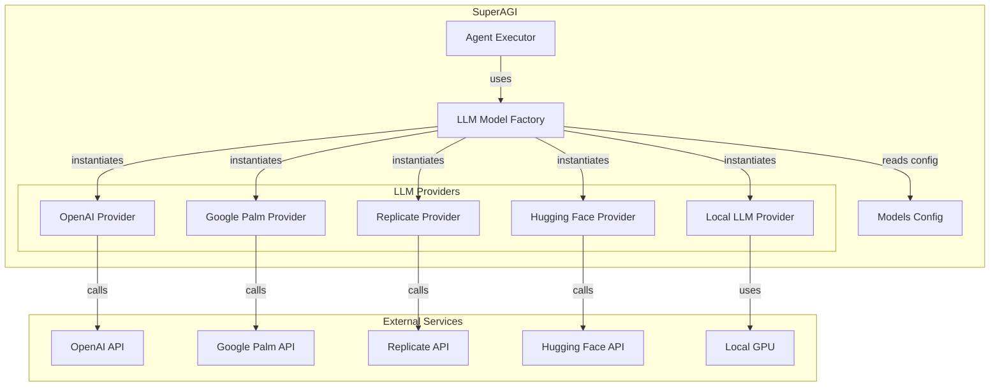
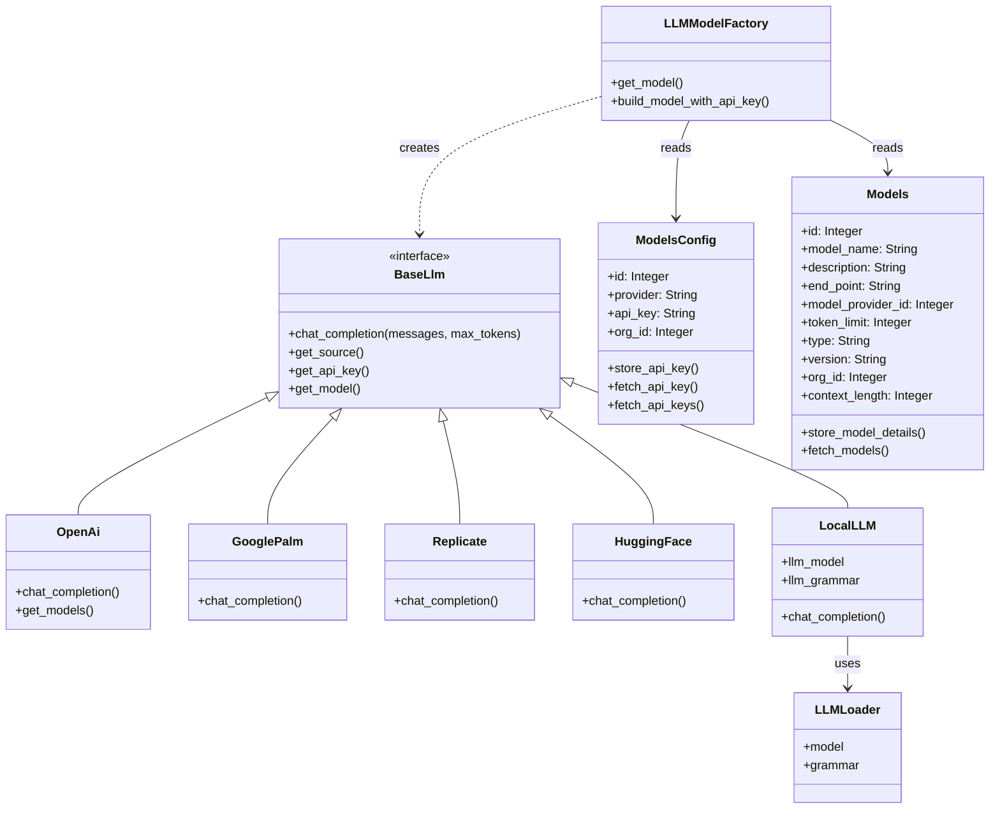
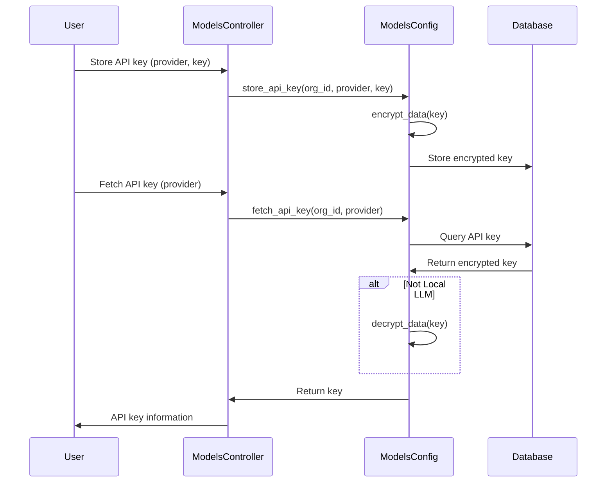
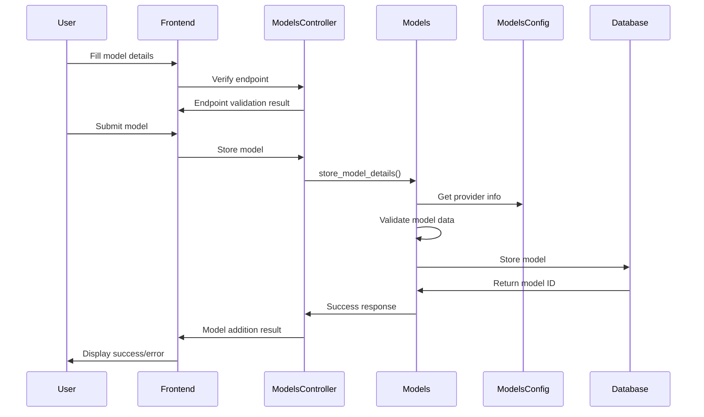
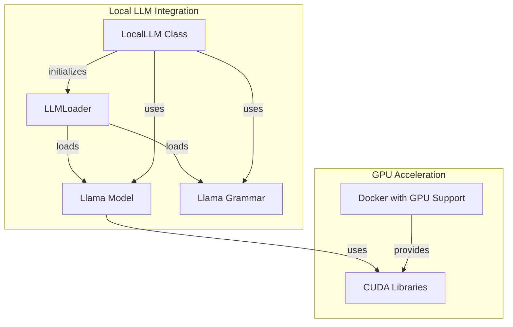
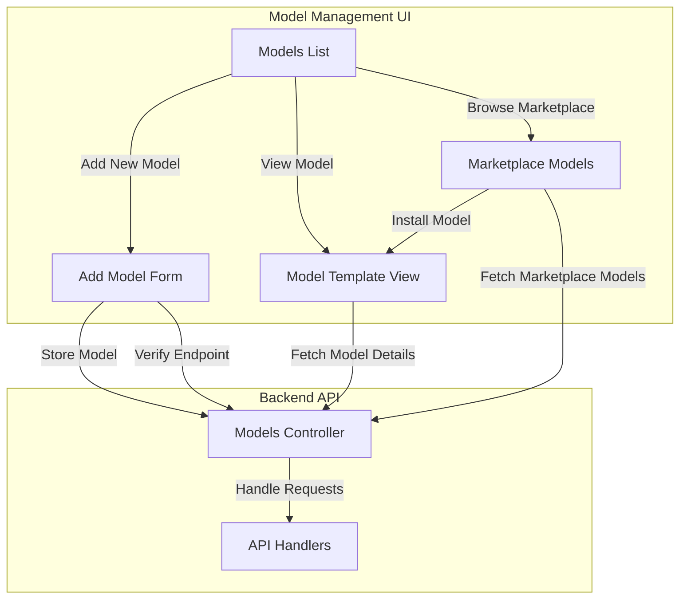
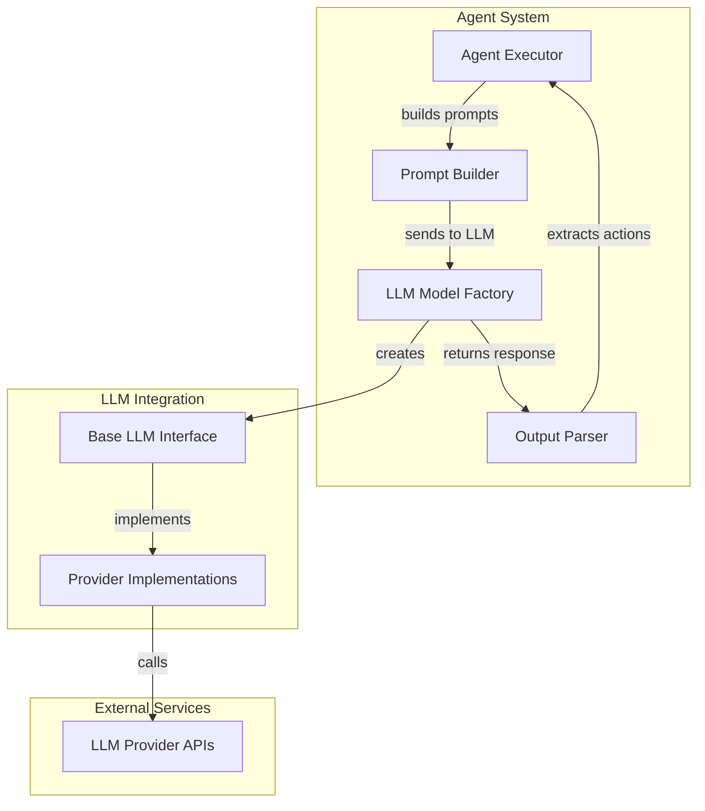
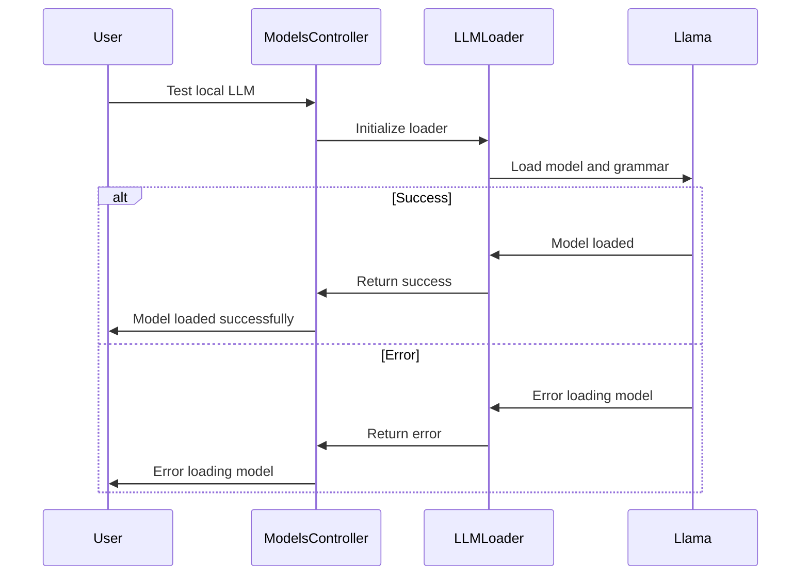

<!-- source: DeepWiki mcp.deepwiki.com · repo TransformerOptimus/SuperAGI · page 6 LLM Integration · fetched 2026-10-26 -->

# LLM Integration

<details>
<summary>Relevant source files</summary>

The following files were used as context for generating this wiki page:

- [Dockerfile-gpu](Dockerfile-gpu)
- [README.MD](README.MD)
- [config_template.yaml](config_template.yaml)
- [docker-compose-gpu.yml](docker-compose-gpu.yml)
- [gui/pages/Content/Models/AddModel.js](gui/pages/Content/Models/AddModel.js)
- [gui/pages/Content/Models/MarketModels.js](gui/pages/Content/Models/MarketModels.js)
- [gui/pages/Content/Models/ModelForm.js](gui/pages/Content/Models/ModelForm.js)
- [gui/pages/Content/Models/ModelTemplate.js](gui/pages/Content/Models/ModelTemplate.js)
- [gui/pages/Content/Models/Models.js](gui/pages/Content/Models/Models.js)
- [requirements.txt](requirements.txt)
- [superagi/controllers/models_controller.py](superagi/controllers/models_controller.py)
- [superagi/controllers/types/models_types.py](superagi/controllers/types/models_types.py)
- [superagi/helper/llm_loader.py](superagi/helper/llm_loader.py)
- [superagi/llms/llm_model_factory.py](superagi/llms/llm_model_factory.py)
- [superagi/llms/local_llm.py](superagi/llms/local_llm.py)
- [superagi/models/models.py](superagi/models/models.py)
- [superagi/models/models_config.py](superagi/models/models_config.py)
- [superagi/types/model_source_types.py](superagi/types/model_source_types.py)
- [tests/unit_tests/controllers/test_models_controller.py](tests/unit_tests/controllers/test_models_controller.py)
- [tests/unit_tests/tools/duck_duck_go/test_duckduckgo_results.py](tests/unit_tests/tools/duck_duck_go/test_duckduckgo_results.py)

</details>


This page documents the Language Model integration system in SuperAGI. It details how various LLM providers are integrated into the platform, how models are configured, and how the system interacts with them. For information about model management through the user interface, see [Model Management](#6.2).

## Overview

SuperAGI provides a flexible interface to work with various Language Model providers. The system supports integration with multiple LLM providers including OpenAI, Google Palm, Replicate, Hugging Face, and local LLMs. This modular design allows users to switch between different providers seamlessly while maintaining a consistent interface for agents to interact with language models.



Sources: [superagi/llms/llm_model_factory.py:1-55](), [superagi/types/model_source_types.py:1-33]()

## System Architecture

The LLM integration architecture in SuperAGI consists of several key components:



Sources: [superagi/llms/llm_model_factory.py:1-55](), [superagi/models/models.py:1-238](), [superagi/models/models_config.py:1-164](), [superagi/llms/local_llm.py:1-96]()

### Core Components

1. **BaseLlm**: An interface that defines the contract for all LLM providers
2. **ModelsConfig**: Database model for storing provider configurations and API keys
3. **Models**: Database model for storing specific model details
4. **LLMModelFactory**: Factory class for instantiating appropriate LLM provider classes
5. **Provider Implementations**: Concrete implementations for each supported LLM provider (OpenAI, Google Palm, etc.)

## Model Configuration Management

SuperAGI stores model configurations and API keys in the database, allowing users to manage multiple providers and models.

### Database Schema

#### ModelsConfig Table

| Column | Type | Description |
|--------|------|-------------|
| id | Integer | Primary key |
| provider | String | Name of the LLM provider (e.g., "OpenAI", "Google Palm") |
| api_key | String | Encrypted API key for the provider |
| org_id | Integer | Organization ID that owns this configuration |

#### Models Table

| Column | Type | Description |
|--------|------|-------------|
| id | Integer | Primary key |
| model_name | String | Name of the model (e.g., "gpt-3.5-turbo") |
| description | String | Description of the model |
| end_point | String | Custom endpoint URL (for Hugging Face) |
| model_provider_id | Integer | Foreign key to ModelsConfig |
| token_limit | Integer | Maximum token limit for the model |
| type | String | Type of model (Custom/Marketplace) |
| version | String | Version information (for Replicate) |
| org_id | Integer | Organization ID that owns this model |
| context_length | Integer | Context length for Local LLM models |

Sources: [superagi/models/models_config.py:12-34](), [superagi/models/models.py:15-57]()

## API Key Management

SuperAGI securely stores API keys for different LLM providers. The keys are encrypted before storage and decrypted when needed for API calls.



Sources: [superagi/models/models_config.py:78-139](), [superagi/controllers/models_controller.py:37-61]()

## Adding and Managing Models

SuperAGI provides APIs to add new models, verify endpoints, and fetch existing models. These APIs are used by the frontend to provide a user-friendly interface for model management.

### Model Addition Flow



Sources: [superagi/controllers/models_controller.py:73-82](), [superagi/models/models.py:108-162](), [gui/pages/Content/Models/ModelForm.js:1-217]()

## Supported LLM Providers

SuperAGI supports the following LLM providers:

### 1. OpenAI

Integration with OpenAI API for models like GPT-3.5 and GPT-4. Supported with customizable parameters like temperature, max tokens, etc.

### 2. Google Palm

Integration with Google's PaLM models through the Google API.

### 3. Replicate

Support for deploying models through Replicate, which provides a variety of open-source models.

### 4. Hugging Face

Integration with Hugging Face's model serving endpoints, allowing access to thousands of open-source models.

### 5. Local LLM

Support for running LLMs locally using GPU acceleration. This is particularly useful for self-hosting models or working with models that require privacy.

The system automatically detects which provider to use based on the model name and configuration.

Sources: [superagi/llms/llm_model_factory.py:12-42](), [config_template.yaml:1-126]()

## Local LLM Support

SuperAGI includes support for running language models locally using the llama-cpp-python library. This allows users to run LLMs on their own hardware, which can be useful for privacy or when working with custom models.



### Local LLM Configuration

To use local LLMs, SuperAGI provides a Docker configuration with GPU support. The key components include:

1. **LLMLoader**: Singleton class that loads the model and grammar
2. **LocalLLM**: Implementation of the BaseLlm interface for local models
3. **Docker GPU Configuration**: Setup for CUDA and GPU acceleration

Sources: [superagi/helper/llm_loader.py:1-39](), [superagi/llms/local_llm.py:1-96](), [docker-compose-gpu.yml:1-96](), [Dockerfile-gpu:1-45]()

### Using GPU Acceleration

For GPU-accelerated local LLMs, SuperAGI provides a specific Docker configuration:

```
docker compose -f docker-compose-gpu.yml up --build
```

This setup requires NVIDIA drivers and Docker with GPU support.

Sources: [README.MD:136-139](), [docker-compose-gpu.yml:16-22](), [docker-compose-gpu.yml:36-42]()

## Web Interface for Model Management

SuperAGI provides a web interface for managing LLM integrations. The interface allows users to:

1. Add API keys for different LLM providers
2. Add and configure models
3. Test models for compatibility
4. View model details



Sources: [gui/pages/Content/Models/Models.js:1-37](), [gui/pages/Content/Models/ModelForm.js:1-217](), [gui/pages/Content/Models/MarketModels.js:1-93](), [gui/pages/Content/Models/ModelTemplate.js:1-61]()

## Environment Configuration

SuperAGI uses a configuration file to set up default LLM parameters. An example configuration for LLM integration from the config template:

```yaml
# OpenAI API Configuration
OPENAI_API_KEY: YOUR_OPEN_API_KEY
OPENAI_API_BASE: https://api.openai.com/v1

# For locally hosted LLMs
# OPENAI_API_BASE: "http://super__tgwui:5001/v1"

# Google Palm Configuration
PALM_API_KEY: YOUR_PALM_API_KEY

# Replicate Configuration
REPLICATE_API_TOKEN: YOUR_REPLICATE_API_TOKEN

# Hugging Face Configuration
HUGGING_API_TOKEN: YOUR_HUGGING_FACE_API_TOKEN

# Model Configuration
MODEL_NAME: "gpt-3.5-turbo-0301"
RESOURCES_SUMMARY_MODEL_NAME: "gpt-3.5-turbo"
MAX_TOOL_TOKEN_LIMIT: 800
MAX_MODEL_TOKEN_LIMIT: 4032

# GPU Layers for Local LLM
GPU_LAYERS: GPU_LAYERS_THAT_YOU_WANT_TO_OFFLOAD
```

Sources: [config_template.yaml:2-125]()

## Integration with Agent System

Language models are a core component of SuperAGI's agent system. The agents use LLMs to:

1. Process and understand tasks
2. Generate responses
3. Make decisions
4. Use tools

The LLM integration provides a consistent interface for agents to interact with different language model providers, allowing for flexibility and customization.



Sources: [superagi/llms/llm_model_factory.py:1-55]()

## Testing and Verification

SuperAGI includes testing capabilities for LLM integrations, particularly for local LLMs. The `test_local_llm` endpoint allows users to verify that their local LLM configuration is working correctly.



Sources: [superagi/controllers/models_controller.py:178-204](), [tests/unit_tests/controllers/test_models_controller.py:110-118]()

## Summary

The LLM integration in SuperAGI provides a flexible and extensible system for working with different language model providers. The system includes:

1. Support for multiple LLM providers (OpenAI, Google Palm, Replicate, Hugging Face, Local LLM)
2. Secure API key management
3. Model configuration and management
4. Local LLM support with GPU acceleration
5. Integration with the agent system
6. Web interface for model management

This design allows users to easily switch between different LLM providers based on their requirements, while maintaining a consistent interface for agents to interact with language models.

---

