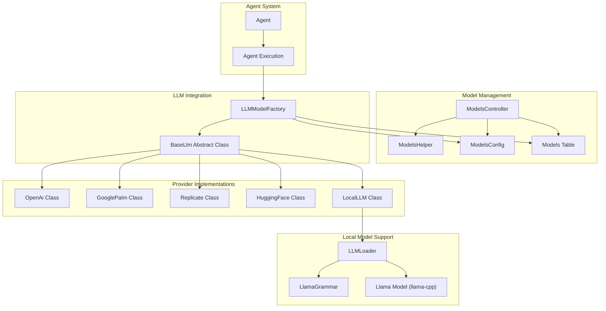
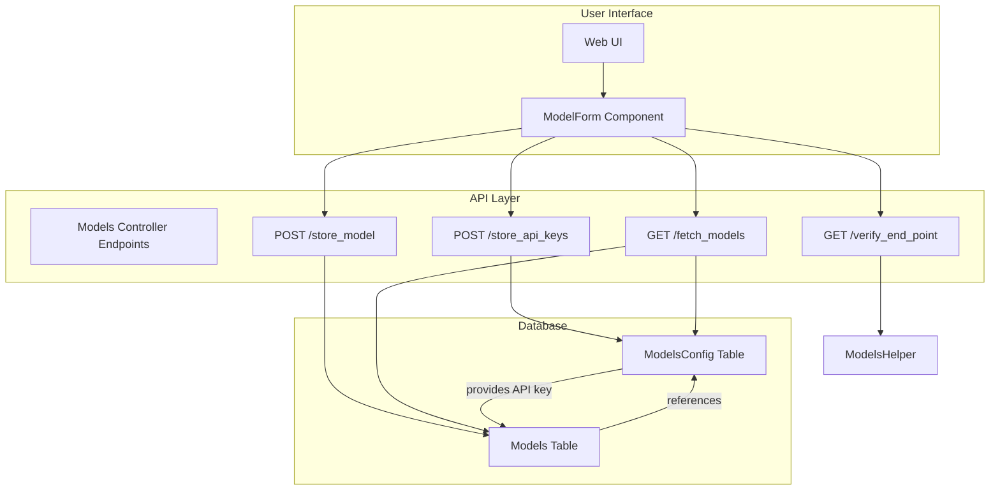

<!-- source: DeepWiki mcp.deepwiki.com · repo TransformerOptimus/SuperAGI · page 6.1 Supported LLM Providers · fetched 2026-10-26 -->

# Supported LLM Providers

<details>
<summary>Relevant source files</summary>

The following files were used as context for generating this wiki page:

- [Dockerfile-gpu](Dockerfile-gpu)
- [README.MD](README.MD)
- [config_template.yaml](config_template.yaml)
- [docker-compose-gpu.yml](docker-compose-gpu.yml)
- [gui/pages/Content/Models/AddModel.js](gui/pages/Content/Models/AddModel.js)
- [gui/pages/Content/Models/MarketModels.js](gui/pages/Content/Models/MarketModels.js)
- [gui/pages/Content/Models/ModelForm.js](gui/pages/Content/Models/ModelForm.js)
- [gui/pages/Content/Models/ModelTemplate.js](gui/pages/Content/Models/ModelTemplate.js)
- [gui/pages/Content/Models/Models.js](gui/pages/Content/Models/Models.js)
- [requirements.txt](requirements.txt)
- [superagi/controllers/models_controller.py](superagi/controllers/models_controller.py)
- [superagi/controllers/types/models_types.py](superagi/controllers/types/models_types.py)
- [superagi/helper/llm_loader.py](superagi/helper/llm_loader.py)
- [superagi/llms/llm_model_factory.py](superagi/llms/llm_model_factory.py)
- [superagi/llms/local_llm.py](superagi/llms/local_llm.py)
- [superagi/models/models.py](superagi/models/models.py)
- [superagi/models/models_config.py](superagi/models/models_config.py)
- [superagi/types/model_source_types.py](superagi/types/model_source_types.py)
- [tests/unit_tests/controllers/test_models_controller.py](tests/unit_tests/controllers/test_models_controller.py)
- [tests/unit_tests/tools/duck_duck_go/test_duckduckgo_results.py](tests/unit_tests/tools/duck_duck_go/test_duckduckgo_results.py)

</details>


## Purpose and Scope

This document details the Language Learning Model (LLM) providers supported by SuperAGI, including configuration options, integration methods, and management features. It serves as a technical reference for developers who want to understand how to configure, customize, and use different LLM providers within the SuperAGI framework.

For information about general model management in the system, see [Model Management](#6.2).

## Overview of Supported Providers

SuperAGI integrates with multiple LLM providers, giving users flexibility in choosing models based on their specific requirements, performance needs, and budget constraints.

Currently, SuperAGI supports the following LLM providers:

| Provider | Description | Configuration Key | Model Examples |
|----------|-------------|-------------------|----------------|
| OpenAI | GPT models with strong general capabilities | OPENAI_API_KEY | gpt-3.5-turbo, gpt-4 |
| Google Palm | Google's PaLM-based language models | PALM_API_KEY | models/chat-bison-001 |
| Hugging Face | Open-source models with custom endpoints | HUGGING_API_TOKEN | Custom endpoints |
| Replicate | Hosted models with versioning | REPLICATE_API_TOKEN | Requires version ID |
| Local LLM | Self-hosted models using llama-cpp | N/A | Custom local models |

Sources: [superagi/types/model_source_types.py](), [config_template.yaml](), [superagi/llms/llm_model_factory.py]()

## LLM Integration Architecture

SuperAGI uses a factory pattern to abstract away the specific details of each LLM provider while maintaining a consistent interface for the rest of the system.

### LLM Provider Integration Diagram



Sources: [superagi/llms/llm_model_factory.py](), [superagi/llms/local_llm.py](), [superagi/helper/llm_loader.py]()

## Model Configuration and Database Storage

The system stores model configurations and API keys in the database to ensure secure and persistent access.

### Model Data Flow Diagram



Sources: [superagi/controllers/models_controller.py](), [superagi/models/models_config.py](), [superagi/models/models.py](), [gui/pages/Content/Models/ModelForm.js]()

## Configuration Options

### Basic Configuration in config.yaml

Key settings in your `config.yaml` file:

```yaml
# API Keys for different providers
OPENAI_API_KEY: YOUR_OPEN_API_KEY
PALM_API_KEY: YOUR_PALM_API_KEY
REPLICATE_API_TOKEN: YOUR_REPLICATE_API_TOKEN
HUGGING_API_TOKEN: YOUR_HUGGING_FACE_API_TOKEN

# OpenAI endpoint (default or custom)
OPENAI_API_BASE: https://api.openai.com/v1
# For local LLM, use:
# OPENAI_API_BASE: "http://super__tgwui:5001/v1"

# Default model settings
MODEL_NAME: "gpt-3.5-turbo-0301"
RESOURCES_SUMMARY_MODEL_NAME: "gpt-3.5-turbo"
MAX_TOOL_TOKEN_LIMIT: 800
MAX_MODEL_TOKEN_LIMIT: 4032

# GPU settings for local LLM
GPU_LAYERS: 40  # GPU layers to offload
```

Sources: [config_template.yaml]()

### Database Schema

The system uses two main tables for model configuration:

1. **ModelsConfig** - Stores provider information and API keys:
   - `id`: Primary key
   - `provider`: Provider name (e.g., "OpenAI", "Google Palm")
   - `api_key`: Encrypted API key
   - `org_id`: Organization ID

2. **Models** - Stores specific model details:
   - `id`: Primary key
   - `model_name`: Name of the model
   - `description`: Description of the model
   - `end_point`: API endpoint (for Hugging Face)
   - `model_provider_id`: Reference to ModelsConfig table
   - `token_limit`: Maximum token limit
   - `type`: Model type (Custom/Marketplace)
   - `version`: Model version (for Replicate)
   - `org_id`: Organization ID
   - `context_length`: Context length (for local models)

Sources: [superagi/models/models_config.py](), [superagi/models/models.py]()

## Provider-Specific Details

### OpenAI

OpenAI is the default provider in SuperAGI, supporting models like GPT-3.5-Turbo and GPT-4.

**Configuration Requirements:**
- `OPENAI_API_KEY` in config.yaml or environment
- Optional custom `OPENAI_API_BASE` for proxies or custom endpoints

**Default Models:**
```python
default_models = {
    "gpt-3.5-turbo": 4032,
    "gpt-4": 8092,
    "gpt-3.5-turbo-16k": 16184
}
```

When an OpenAI API key is added, the system automatically adds these default models to the database.

Sources: [superagi/models/models_config.py:102-109]()

### Google Palm

Google Palm provides an alternative to OpenAI models through Google's PaLM API.

**Configuration Requirements:**
- `PALM_API_KEY` in config.yaml or environment
- Typically uses "models/chat-bison-001" as the model

Sources: [superagi/llms/llm_model_factory.py:31-33]()

### Hugging Face

Hugging Face integration allows the use of open-source models through custom endpoints.

**Configuration Requirements:**
- `HUGGING_API_TOKEN` in config.yaml or environment
- Model endpoint URL when adding a new model
- Endpoint must support the expected API format

Sources: [superagi/llms/llm_model_factory.py:34-36]()

### Replicate

Replicate hosts a variety of AI models that can be accessed through their API.

**Configuration Requirements:**
- `REPLICATE_API_TOKEN` in config.yaml or environment
- Model version ID when adding a new model

Sources: [superagi/llms/llm_model_factory.py:28-30]()

### Local LLM

SuperAGI supports running local models through the llama-cpp-python library.

**Configuration Requirements:**
- Docker with GPU support
- Model file in the specified path
- Context length specification
- Optional GPU acceleration settings

The system uses a singleton `LLMLoader` class to manage the loading of the model and grammar:

```python
# Simplified version of LLMLoader initialization
llm_model = Llama(
    model_path="/app/local_model_path", 
    n_ctx=context_length,
    n_gpu_layers=int(get_config('GPU_LAYERS', '-1'))
)
llm_grammar = LlamaGrammar.from_file("superagi/llms/grammar/json.gbnf")
```

For GPU acceleration, ensure you're using the GPU-enabled docker-compose file:
```shell
docker compose -f docker-compose-gpu.yml up --build
```

Sources: [superagi/llms/local_llm.py](), [superagi/helper/llm_loader.py](), [docker-compose-gpu.yml]()

## Adding and Managing Models

### Through the Web UI

The web UI provides a user-friendly interface for adding and managing models:

1. Navigate to the Models section
2. Click "Add Model"
3. Fill in the model details:
   - Name
   - Description
   - Provider selection
   - Provider-specific settings:
     - Endpoint URL for Hugging Face
     - Model version for Replicate
     - Context length for Local LLM
   - Token limit

The UI also provides options to test local models before adding them.

Sources: [gui/pages/Content/Models/ModelForm.js](), [gui/pages/Content/Models/AddModel.js]()

### Through the API

The Models Controller provides these endpoints for programmatic model management:

| Endpoint | Method | Description |
|----------|--------|-------------|
| `/models_controller/store_api_keys` | POST | Store provider API keys |
| `/models_controller/get_api_keys` | GET | Get all stored API keys |
| `/models_controller/get_api_key` | GET | Get specific provider API key |
| `/models_controller/verify_end_point` | GET | Verify model endpoint |
| `/models_controller/store_model` | POST | Add a new model |
| `/models_controller/fetch_models` | GET | Get all available models |
| `/models_controller/fetch_model/{model_id}` | GET | Get specific model details |
| `/models_controller/test_local_llm` | GET | Test local LLM functionality |

Example request for adding a model:
```json
{
  "model_name": "my-gpt-4",
  "description": "OpenAI GPT-4 model",
  "end_point": "",
  "model_provider_id": 1,
  "token_limit": 8092,
  "type": "Custom",
  "version": "",
  "context_length": 0
}
```

Sources: [superagi/controllers/models_controller.py]()

## Using Models in Agents

Once configured, models can be selected when creating or configuring agents. The system loads the appropriate model implementation through the `LLMModelFactory`:

```python
# Simplified version of model loading
def get_model(organisation_id, api_key, model="gpt-3.5-turbo", **kwargs):
    # Get model details from database
    model_instance = session.query(Models).filter(
        Models.org_id == organisation_id, 
        Models.model_name == model
    ).first()
    
    # Get provider information
    provider_name = session.query(ModelsConfig.provider).filter(
        ModelsConfig.org_id == organisation_id,
        ModelsConfig.id == model_instance.model_provider_id
    ).first().provider
    
    # Return appropriate implementation
    if provider_name == 'OpenAI':
        return OpenAi(model=model_instance.model_name, api_key=api_key)
    elif provider_name == 'Replicate':
        return Replicate(model=model_instance.model_name, version=model_instance.version, api_key=api_key)
    # Other providers...
    elif provider_name == 'Local LLM':
        return LocalLLM(model=model_instance.model_name, context_length=model_instance.context_length)
```

Sources: [superagi/llms/llm_model_factory.py:12-41]()

## Model Marketplace

SuperAGI includes a model marketplace that allows discovery and installation of pre-configured models:

1. Models can be browsed in the marketplace UI
2. Models can be installed with a single click
3. Installed models are added to the organization's available models

Sources: [gui/pages/Content/Models/MarketModels.js](), [gui/pages/Content/Models/ModelTemplate.js]()

## Best Practices

1. **Security:**
   - API keys are stored encrypted in the database
   - Consider using environment variables instead of config files
   - Regularly rotate API keys

2. **Performance:**
   - Match model token limits to your requirements
   - For performance-critical applications, consider local LLMs with GPU acceleration
   - Be mindful of token usage and costs with paid providers

3. **Model Selection:**
   - For general tasks, "gpt-3.5-turbo" provides a good balance of capability and cost
   - For complex reasoning, consider "gpt-4" or equivalent
   - For cost-sensitive applications, consider open-source models through Hugging Face or local LLMs

4. **Testing:**
   - Use the test functionality for local LLMs before deploying
   - Start with smaller models when experimenting
   - Consider fine-tuning open-source models for specific domains

Sources: [README.MD](), [superagi/controllers/models_controller.py:178-201]()

---

