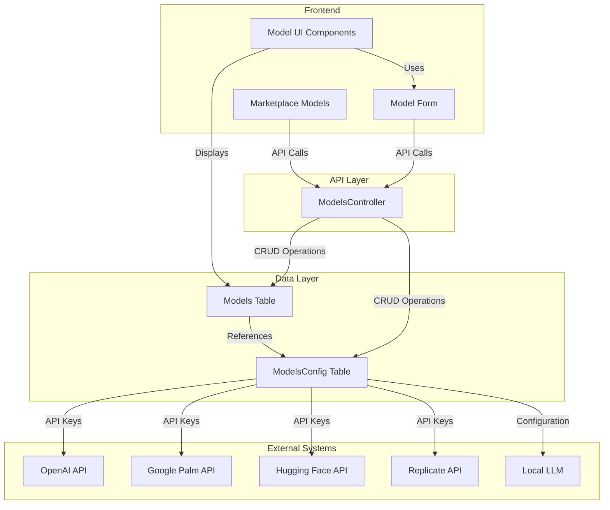
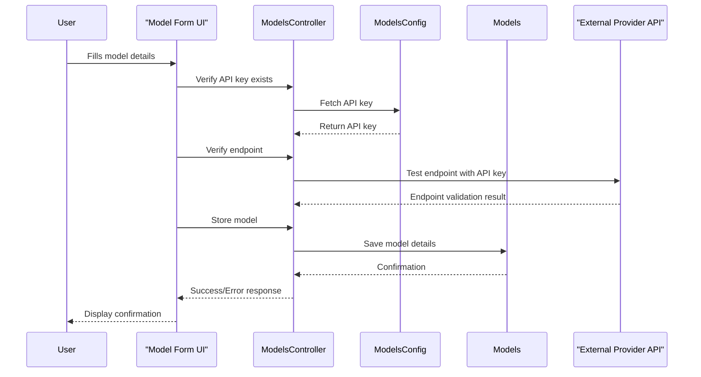
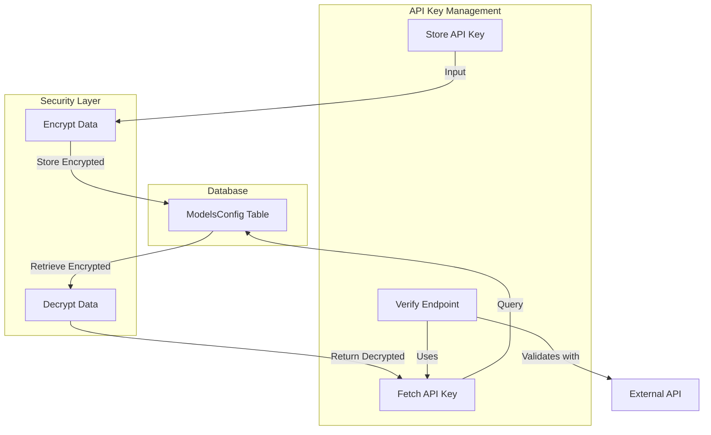
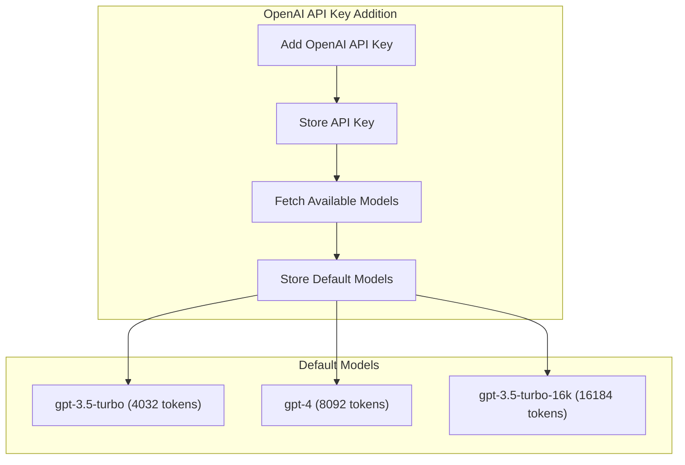
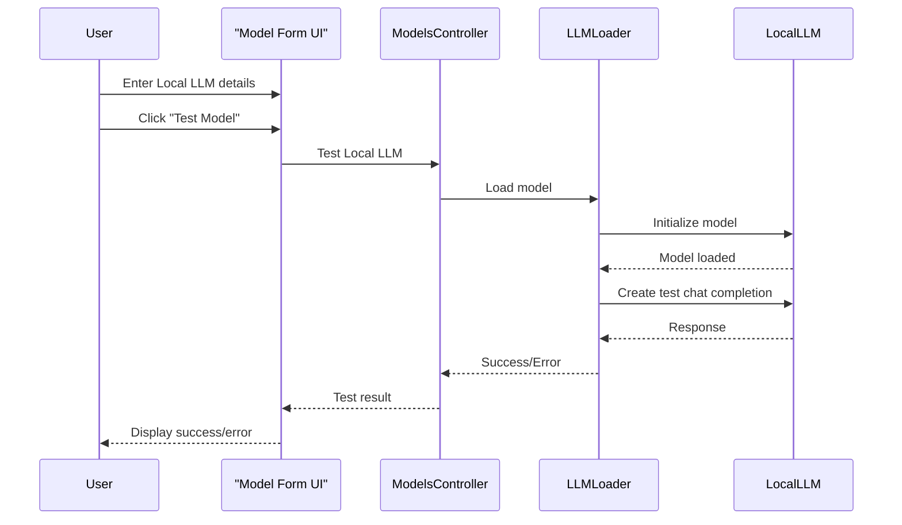
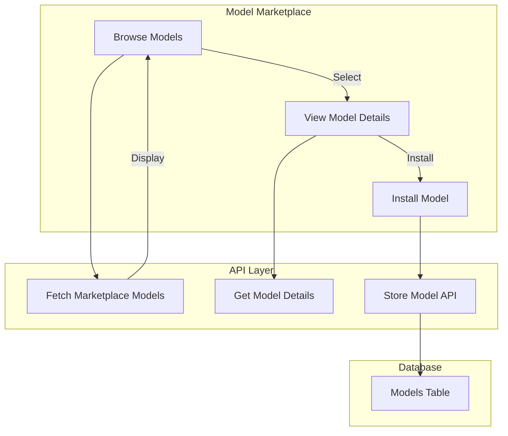

<!-- source: DeepWiki mcp.deepwiki.com · repo TransformerOptimus/SuperAGI · page 6.2 Model Management · fetched 2026-10-26 -->

# Model Management

Relevant source files

The following files were used as context for generating this wiki page:

- [gui/pages/Content/Models/AddModel.js](gui/pages/Content/Models/AddModel.js)
- [gui/pages/Content/Models/MarketModels.js](gui/pages/Content/Models/MarketModels.js)
- [gui/pages/Content/Models/ModelForm.js](gui/pages/Content/Models/ModelForm.js)
- [gui/pages/Content/Models/ModelTemplate.js](gui/pages/Content/Models/ModelTemplate.js)
- [gui/pages/Content/Models/Models.js](gui/pages/Content/Models/Models.js)
- [superagi/controllers/models_controller.py](superagi/controllers/models_controller.py)
- [superagi/controllers/types/models_types.py](superagi/controllers/types/models_types.py)
- [superagi/models/models.py](superagi/models/models.py)
- [superagi/models/models_config.py](superagi/models/models_config.py)
- [tests/unit_tests/controllers/test_models_controller.py](tests/unit_tests/controllers/test_models_controller.py)

This document explains how to manage and configure language models in SuperAGI. It covers the model registration process, API key management, and the model marketplace. For information about supported LLM providers, see [Supported LLM Providers](#6.1).

## Model Management Architecture

SuperAGI's model management system allows users to configure, store, and use various language models across different providers. The system comprises several core components that work together to provide a flexible model management experience.

The model management system allows users to:
1. Register and configure language models from various providers
2. Store and manage API keys for different model providers
3. Set model parameters like token limits and context length
4. Browse and install models from the marketplace

Sources:
- [superagi/controllers/models_controller.py]()
- [superagi/models/models.py]()
- [superagi/models/models_config.py]()

## Core Data Models

The model management system is built around two primary database entities:

### ModelsConfig

The `ModelsConfig` table stores API keys and configuration for model providers:

| Field | Type | Description |
|-------|------|-------------|
| id | Integer | Primary key |
| provider | String | Model provider name (e.g., OpenAI, Google Palm) |
| api_key | String | Encrypted API key for the provider |
| org_id | Integer | Organization ID that owns this configuration |

### Models 

The `Models` table stores details about individual models:

| Field | Type | Description |
|-------|------|-------------|
| id | Integer | Primary key |
| model_name | String | Name of the model (e.g., gpt-3.5-turbo) |
| description | String | Description of the model |
| end_point | String | Custom endpoint for the model (if applicable) |
| model_provider_id | Integer | References ModelsConfig.id |
| token_limit | Integer | Maximum tokens the model can process |
| type | String | Type of model (Custom or Marketplace) |
| version | String | Version of the model (for Replicate models) |
| org_id | Integer | Organization ID that owns this model |
| model_features | String | Features of the model |
| context_length | Integer | Context window size for the model |

Sources:
- [superagi/models/models.py:15-56]()
- [superagi/models/models_config.py:12-35]()

## Model Registration Flow

The process of adding a new model to SuperAGI involves several steps:

When adding a new model, the system:
1. Verifies that an API key exists for the selected model provider
2. Validates the endpoint (if applicable)
3. Stores the model details in the database

Sources:
- [superagi/controllers/models_controller.py:73-84]()
- [superagi/models/models.py:108-162]()
- [gui/pages/Content/Models/ModelForm.js:65-123]()

## API Key Management

API keys are securely stored and managed in the `ModelsConfig` table. The system encrypts API keys before storing them in the database.

Key API operations include:
- Storing API keys: Encrypts and saves API keys for model providers
- Fetching API keys: Retrieves and decrypts API keys for use
- Verifying endpoints: Tests if an endpoint is valid using the stored API key

Sources:
- [superagi/controllers/models_controller.py:37-70]()
- [superagi/models/models_config.py:78-139]()

## Supported Model Providers

SuperAGI supports the following model providers:

| Provider | Description | API Key Required |
|----------|-------------|-----------------|
| OpenAI | Models like GPT-3.5, GPT-4 | Yes |
| Google Palm | Google's PaLM models | Yes |
| Hugging Face | Hosted Hugging Face models | Yes |
| Replicate | Replicate-hosted models | Yes |
| Local LLM | Locally hosted models | No* |

*Local LLM requires local model files but no external API key

When an OpenAI API key is added, the system automatically detects and adds common models:

Sources:
- [superagi/models/models_config.py:101-110]()
- [gui/pages/Content/Models/ModelForm.js:9-10]()

## Local LLM Support

SuperAGI provides support for locally hosted language models. The system includes a mechanism to test if a local model is properly configured:

Local LLM configuration requires setting:
- Model context length
- Token limit
- No external API key is needed

Sources:
- [superagi/controllers/models_controller.py:178-204]()
- [superagi/models/models_config.py:158-164]()
- [gui/pages/Content/Models/ModelForm.js:177-201]()

## Model Marketplace

SuperAGI includes a marketplace where users can discover and install pre-configured models:

The marketplace functionality includes:
- Browsing available models from the SuperAGI marketplace
- Viewing detailed information about models
- Installing models to your organization
- Tracking model installation statistics

Sources:
- [superagi/controllers/models_controller.py:114-176]()
- [superagi/models/models.py:59-88]()
- [gui/pages/Content/Models/MarketModels.js]()

## User Interface for Model Management

The SuperAGI web interface provides several components for managing models:

### Model List View
Displays all models configured in the system with options to add new models.

### Add Model Form
Provides a form to add new models with fields for:
- Model name
- Description
- Model provider selection
- Token limit
- Context length (for Local LLM)
- Model endpoint (for Hugging Face)
- Model version (for Replicate)

### Model Marketplace
Embeds an iframe to the models.superagi.com marketplace where users can browse and install pre-configured models.

Sources:
- [gui/pages/Content/Models/Models.js]()
- [gui/pages/Content/Models/ModelForm.js]()
- [gui/pages/Content/Models/MarketModels.js]()
- [gui/pages/Content/Models/AddModel.js]()

## API Endpoints

The Models Controller provides several REST endpoints for model management:

| Endpoint | Method | Description |
|----------|--------|-------------|
| `/store_api_keys` | POST | Store API keys for model providers |
| `/get_api_keys` | GET | Retrieve all API keys |
| `/get_api_key` | GET | Retrieve a specific API key by provider |
| `/verify_end_point` | GET | Verify if an endpoint is valid |
| `/store_model` | POST | Store a new model |
| `/fetch_models` | GET | Fetch all models for the organization |
| `/fetch_model/{model_id}` | GET | Fetch details for a specific model |
| `/get/list` | GET | Get marketplace model list |
| `/test_local_llm` | GET | Test if a local LLM is properly configured |

Sources:
- [superagi/controllers/models_controller.py:37-204]()

---

