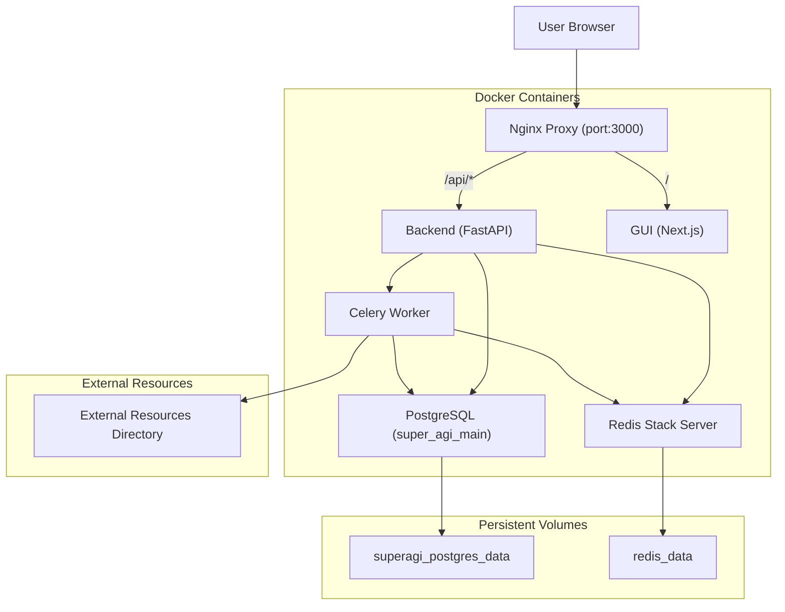
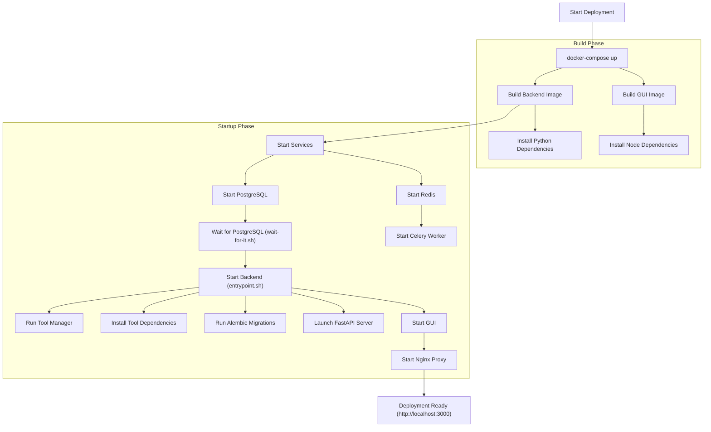
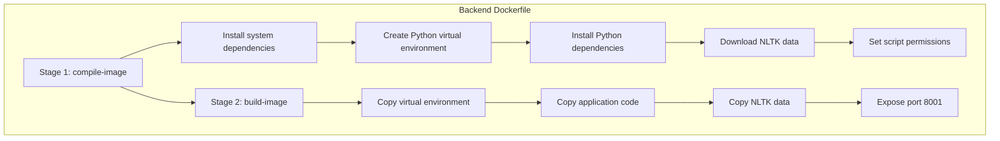
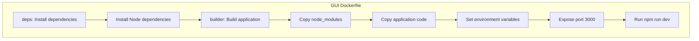

<!-- source: DeepWiki mcp.deepwiki.com · repo TransformerOptimus/SuperAGI · page 7.1 Docker Deployment · fetched 2026-10-26 -->

# Docker Deployment

<details>
<summary>Relevant source files</summary>

The following files were used as context for generating this wiki page:

- [.dockerignore](.dockerignore)
- [.gitignore](.gitignore)
- [Dockerfile](Dockerfile)
- [docker-compose.yaml](docker-compose.yaml)
- [entrypoint.sh](entrypoint.sh)
- [entrypoint_celery.sh](entrypoint_celery.sh)
- [gui/.dockerignore](gui/.dockerignore)
- [gui/Dockerfile](gui/Dockerfile)
- [gui/DockerfileProd](gui/DockerfileProd)
- [gui/next.config.js](gui/next.config.js)
- [gui/pages/Content/Agents/ActionConsole.js](gui/pages/Content/Agents/ActionConsole.js)
- [gui/pages/Content/Agents/RunHistory.js](gui/pages/Content/Agents/RunHistory.js)
- [nginx/default.conf](nginx/default.conf)
- [wait-for-it.sh](wait-for-it.sh)

</details>


This document provides a comprehensive guide for deploying SuperAGI using Docker. Docker containerization offers a simplified setup that packages all required dependencies and services, making deployment consistent across different environments. For information about non-Docker configuration options, see [Configuration Options](#7.2).

## 1. Deployment Architecture Overview

SuperAGI's Docker deployment architecture consists of multiple containerized services that work together to provide a complete system. The following diagram illustrates the architecture:



Sources: [docker-compose.yaml:1-76]()

## 2. Docker Services Explained

SuperAGI's Docker deployment consists of six main services defined in the `docker-compose.yaml` file:

### 2.1 Backend Service
- **Purpose**: Serves the FastAPI backend application
- **Build**: Uses the repository's root Dockerfile
- **Dependencies**: Requires Redis and PostgreSQL
- **Entrypoint**: Uses `wait-for-it.sh` to wait for PostgreSQL before starting via `entrypoint.sh`

### 2.2 Celery Service
- **Purpose**: Processes background tasks and asynchronous operations
- **Volume Mapping**: Maps the external resource directory for file storage
- **Entrypoint**: Uses `entrypoint_celery.sh` to start the Celery worker

### 2.3 GUI Service
- **Purpose**: Serves the Next.js frontend application
- **Build**: Uses the Dockerfile in the `gui` directory
- **Environment Configuration**: Configures API base URL during build

### 2.4 Redis Service
- **Purpose**: Provides caching, message broker, and vector database functionality
- **Image**: Uses `redis/redis-stack-server:latest`
- **Persistent Storage**: Uses a volume for data persistence

### 2.5 PostgreSQL Service
- **Purpose**: Primary database for storing system data
- **Image**: Uses `postgres:15`
- **Configuration**: Pre-configured with database name, username, and password
- **Persistent Storage**: Uses a volume for data persistence

### 2.6 Nginx Proxy
- **Purpose**: Routes requests to appropriate backend or frontend services
- **Port Mapping**: Maps container port 80 to host port 3000
- **Configuration**: Uses custom configuration from `nginx/default.conf`

Sources: [docker-compose.yaml:3-69](), [nginx/default.conf:1-27]()

## 3. Docker Deployment Process

The following diagram shows the build and startup sequence for the Docker deployment:



Sources: [docker-compose.yaml:12-23](), [entrypoint.sh:1-14](), [entrypoint_celery.sh:1-9]()

## 4. Container Build Details

### 4.1 Backend Container

The backend container uses a multi-stage build process to optimize the final image size:



Sources: [Dockerfile:1-39]()

### 4.2 GUI Container

The GUI container build process:



Sources: [gui/Dockerfile:1-20]()

## 5. Configuration Files

### 5.1 Docker Compose Configuration

The `docker-compose.yaml` file defines all services, their relationships, networking, and volume configurations. Key configuration aspects include:

| Service | Configuration Highlights |
|---------|--------------------------|
| backend | Mounts application code, depends on PostgreSQL and Redis |
| celery | Mounts external resource directory, processes background tasks |
| gui | Builds with API base URL configuration |
| super__redis | Redis Stack Server with persistent volume |
| super__postgres | PostgreSQL with environment variables and persistent volume |
| proxy | Nginx proxy with port mapping (3000:80) |

Sources: [docker-compose.yaml:1-76]()

### 5.2 Nginx Configuration

The Nginx proxy routes requests between the GUI and backend services:

| Path | Target | Purpose |
|------|--------|---------|
| `/` | `gui:3000` | Frontend application |
| `/api` | `backend:8001` | API routes (with path rewriting) |
| `/_next/webpack-hmr` | `gui:3000` | WebSocket for hot module replacement |

Sources: [nginx/default.conf:1-27]()

## 6. Deployment Instructions

### 6.1 Prerequisites

- Docker Engine (version 19.03.0+)
- Docker Compose (version 1.27.0+)
- Git (to clone the repository)

### 6.2 Deployment Steps

1. Clone the SuperAGI repository:
   ```
   git clone https://github.com/TransformerOptimus/SuperAGI.git
   cd SuperAGI
   ```

2. Start the Docker deployment:
   ```
   docker-compose up -d
   ```

3. Access the application at `http://localhost:3000`

### 6.3 Environment Configuration

SuperAGI can be configured through environment variables. The primary configuration for Docker deployments is:

| Variable | Purpose | Default |
|----------|---------|---------|
| EXTERNAL_RESOURCE_DIR | Directory for external resources | ./workspace |

Sources: [docker-compose.yaml:16]()

## 7. Customization Options

### 7.1 Exposing Database Ports

By default, the database ports are not exposed to the host. To expose them for external access, uncomment the relevant port mapping lines in `docker-compose.yaml`:

For PostgreSQL:
```yaml
# ports:
#   - "5432:5432"
```

For Redis:
```yaml
# ports:
#   - "6379:6379"
```

Sources: [docker-compose.yaml:40-41](), [docker-compose.yaml:56-57]()

### 7.2 External Resource Directory

You can customize the external resource directory by setting the `EXTERNAL_RESOURCE_DIR` environment variable when starting the deployment:

```
EXTERNAL_RESOURCE_DIR=/path/to/resources docker-compose up -d
```

Sources: [docker-compose.yaml:16]()

### 7.3 GUI Development Mode

The GUI container is configured to run in development mode by default. For production deployments, you would use the production Dockerfile (`DockerfileProd`).

Sources: [gui/Dockerfile:20](), [gui/DockerfileProd:1-43]()

## 8. Container Scripts and Entry Points

### 8.1 Backend Entry Point

The `entrypoint.sh` script is the main entry point for the backend container:

1. Downloads tools from marketplace and external repositories
2. Installs tool dependencies
3. Runs database migrations
4. Starts the FastAPI server

Sources: [entrypoint.sh:1-14]()

### 8.2 Celery Entry Point

The `entrypoint_celery.sh` script initializes the Celery worker:

1. Downloads tools
2. Installs tool dependencies
3. Starts the Celery worker with beat scheduler

Sources: [entrypoint_celery.sh:1-9]()

### 8.3 Wait For It Script

The `wait-for-it.sh` script is used to ensure PostgreSQL is ready before starting the backend:

- Checks if the PostgreSQL service is accepting connections
- Times out after a configurable period (60 seconds by default)
- Executes the backend entrypoint script once the database is ready

Sources: [wait-for-it.sh:1-183](), [docker-compose.yaml:12]()

## 9. Troubleshooting

### 9.1 Common Issues

- **Container startup failures**: Check logs with `docker-compose logs [service_name]`
- **Database connection issues**: Ensure PostgreSQL container is running and healthy
- **Missing volume data**: Verify that Docker volumes are properly created

### 9.2 Docker Volume Management

SuperAGI uses two persistent volumes:
- `superagi_postgres_data`: Stores PostgreSQL data
- `redis_data`: Stores Redis data

To list volumes:
```
docker volume ls
```

To inspect a volume:
```
docker volume inspect [volume_name]
```

Sources: [docker-compose.yaml:74-76]()

---

