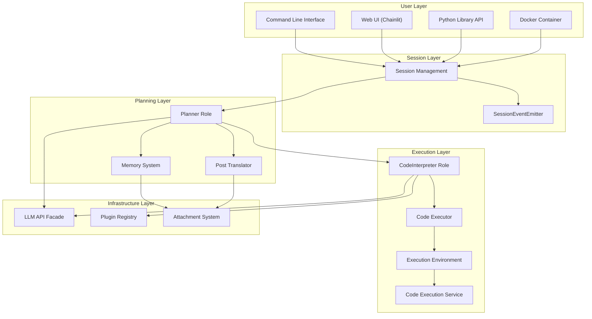
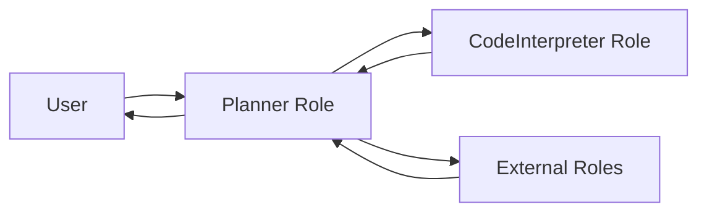
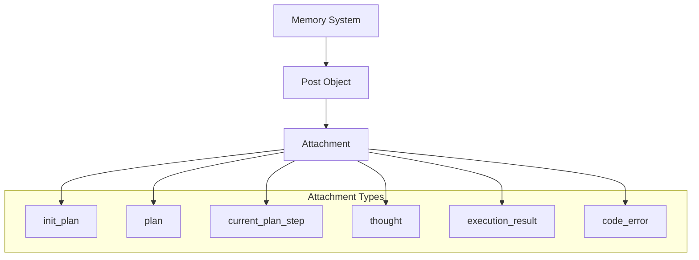
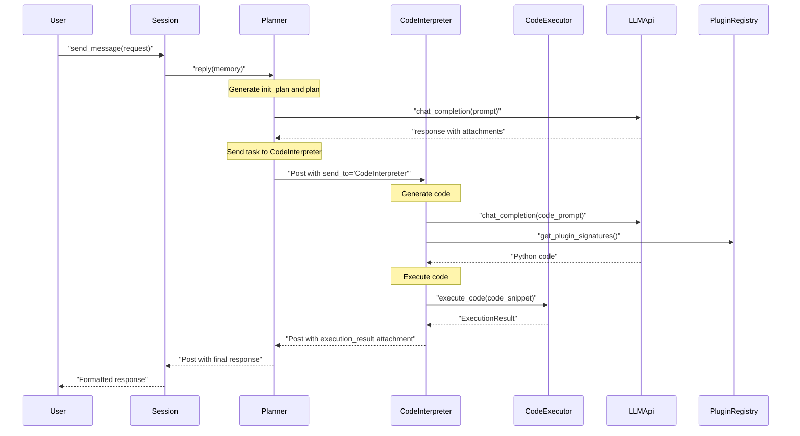

<!-- source: DeepWiki mcp.deepwiki.com · repo microsoft/TaskWeaver · page 1 Overview · fetched 2026-10-26 -->

# Overview

Relevant source files

The following files were used as context for generating this wiki page:

- [README.md](README.md)
- [taskweaver/memory/attachment.py](taskweaver/memory/attachment.py)
- [taskweaver/planner/planner_prompt.yaml](taskweaver/planner/planner_prompt.yaml)
- [website/blog/authors.yml](website/blog/authors.yml)
- [website/blog/evaluation.md](website/blog/evaluation.md)
- [website/blog/experience.md](website/blog/experience.md)
- [website/blog/local_llm.md](website/blog/local_llm.md)
- [website/blog/plugin.md](website/blog/plugin.md)
- [website/blog/reasoning.md](website/blog/reasoning.md)
- [website/blog/role.md](website/blog/role.md)
- [website/docusaurus.config.js](website/docusaurus.config.js)

## Purpose and Scope

This document provides a comprehensive overview of TaskWeaver, a code-first agent framework designed for seamlessly planning and executing data analytics tasks. It covers the framework's core architecture, key concepts, and how the various components work together to enable intelligent task automation.

For detailed information about specific components, see:
- System Architecture ([#2](#2))
- Core Components ([#3](#3)) 
- LLM Integration ([#4](#4))
- Plugin System ([#6](#6))
- User Interfaces ([#7](#7))

## What is TaskWeaver

TaskWeaver is a **code-first** agent framework that interprets user requests through code snippets and efficiently coordinates plugins to execute data analytics tasks in a stateful manner. Unlike traditional agent frameworks that only track chat history with LLMs in text, TaskWeaver preserves both the **chat history** and the **code execution history**, including in-memory data structures like DataFrames.

The framework's philosophy treats programming languages as the de facto communication medium for cyber-physical systems, similar to how natural language serves human communication. This approach enables TaskWeaver to handle complex data structures and maintain state across multiple interactions.

**Sources:** [README.md:14-18](), [website/blog/role.md:8-13]()

## Core Architecture

TaskWeaver's architecture is built around several key layers that work together to provide a comprehensive agent framework:

**Sources:** [README.md:20-22](), [taskweaver/memory/attachment.py:10-52]()

## Key Concepts

### Code-First Approach

TaskWeaver's code-first design means that user requests are converted into executable code snippets rather than being processed purely through natural language. This approach provides several advantages:

- **Rich Data Structures**: Work directly with Python objects like DataFrames instead of string representations
- **Stateful Execution**: Maintain variables and state across multiple interactions within a session
- **Expressiveness**: Handle complex data analytics tasks that are naturally represented in code

**Sources:** [README.md:14-18](), [website/blog/role.md:8-16]()

### Roles and Multi-Agent System

TaskWeaver implements a role-based architecture where different agents specialize in specific tasks:

- **Planner**: Central orchestrator that decomposes tasks, manages workflows, and coordinates other roles
- **CodeInterpreter**: Generates and executes Python code based on task requirements
- **External Roles**: Specialized roles for specific domains (e.g., WebExplorer, ImageReader)

All roles communicate exclusively through the Planner, ensuring controlled conversation flow and coordination.

**Sources:** [taskweaver/planner/planner_prompt.yaml:18-37](), [website/blog/role.md:70-88]()

### Plugin System

Plugins extend TaskWeaver's functionality by wrapping custom algorithms and tools into callable functions:

| Component | Purpose | File Location |
|-----------|---------|---------------|
| `Plugin` base class | Foundation for all plugins | Plugin implementation files |
| Plugin YAML configs | Define function signatures and metadata | `project/plugins/*.yaml` |
| `PluginRegistry` | Manages plugin loading and selection | Core framework |

Plugins can maintain state across calls and have their own configurations, making them more powerful than simple stateless functions.

**Sources:** [website/blog/plugin.md:10-27](), [website/blog/plugin.md:87-101]()

### Memory and Communication

TaskWeaver uses a sophisticated memory and communication system built around `Post` objects and `Attachment` types:

Each interaction creates `Post` objects containing structured `Attachment` data that preserves both conversation context and execution state.

**Sources:** [taskweaver/memory/attachment.py:10-52](), [taskweaver/memory/attachment.py:54-129]()

## How It Works Together

The following diagram illustrates a typical task execution flow, showing how components interact using actual code entities:

This flow demonstrates how:
1. User requests flow through the `Session` to the `Planner`
2. The `Planner` uses `LLMApi` to generate structured plans with `init_plan` and `plan` attachments
3. Tasks are delegated to `CodeInterpreter` via `Post` objects with `send_to` fields
4. Code execution happens through `CodeExecutor` with results captured in `execution_result` attachments
5. All communication maintains structured context through the `Attachment` system

**Sources:** [taskweaver/planner/planner_prompt.yaml:67-75](), [taskweaver/memory/attachment.py:18-31]()

## Key Features

TaskWeaver provides several distinctive capabilities that make it suitable for complex data analytics tasks:

| Feature | Description | Benefit |
|---------|-------------|---------|
| **Task Decomposition** | Breaks complex tasks into manageable subtasks with dependency tracking | Handles multi-step workflows reliably |
| **Reflective Execution** | Reviews and adjusts execution based on results | Improves task completion accuracy |
| **Stateful Sessions** | Maintains variables and context across interactions | Enables iterative data exploration |
| **Code Verification** | Validates generated code before execution | Reduces runtime errors and security risks |
| **Plugin Orchestration** | Coordinates custom algorithms and tools | Extends functionality for domain-specific needs |
| **Rich Data Handling** | Works with complex Python objects directly | Better than string-based data manipulation |

**Sources:** [README.md:51-64]()

## Getting Started

TaskWeaver can be used in multiple ways depending on your needs:

- **Command Line Interface**: Direct interaction via `python -m taskweaver -p ./project/`
- **Web UI**: Browser-based interface using Chainlit for demonstration and exploration
- **Python Library**: Integration into existing applications as a library
- **Docker Container**: Containerized deployment with isolated execution environment

The framework uses container mode by default for secure code execution, though local execution is also supported for development scenarios.

**Sources:** [README.md:116-141]()

---

