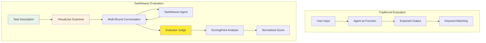
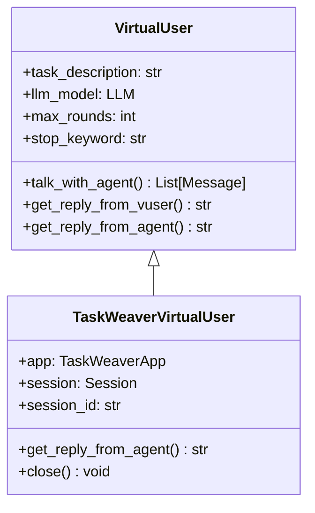
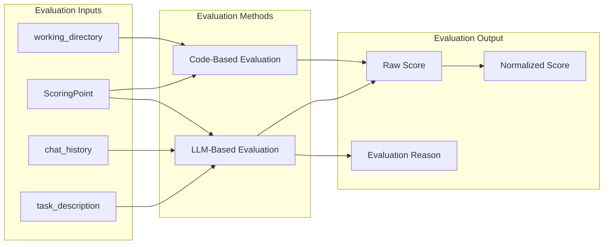
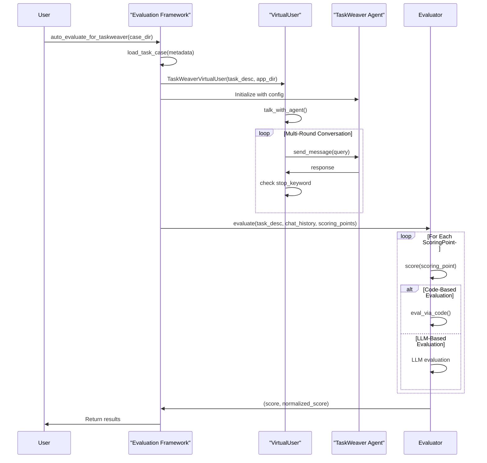
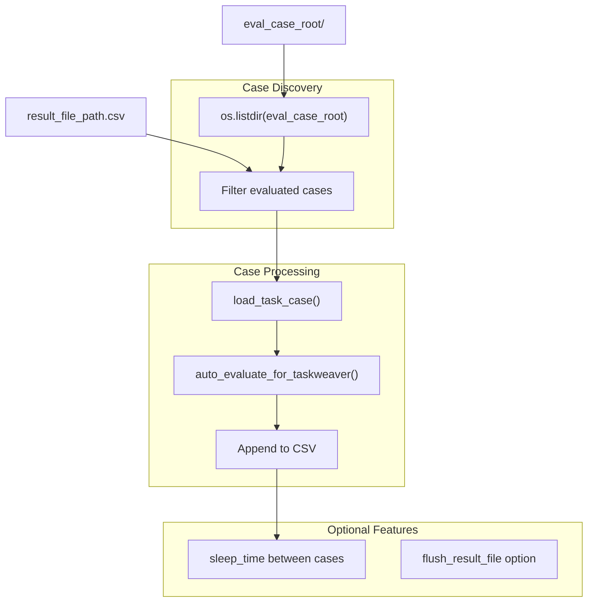
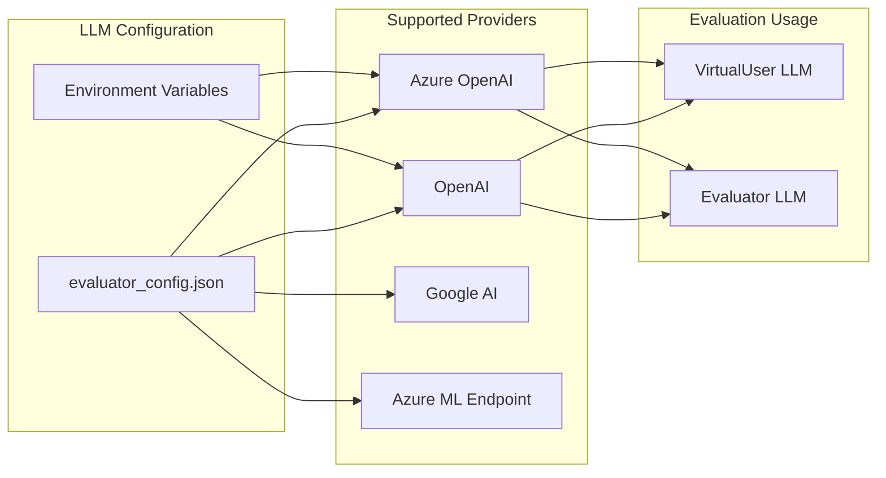
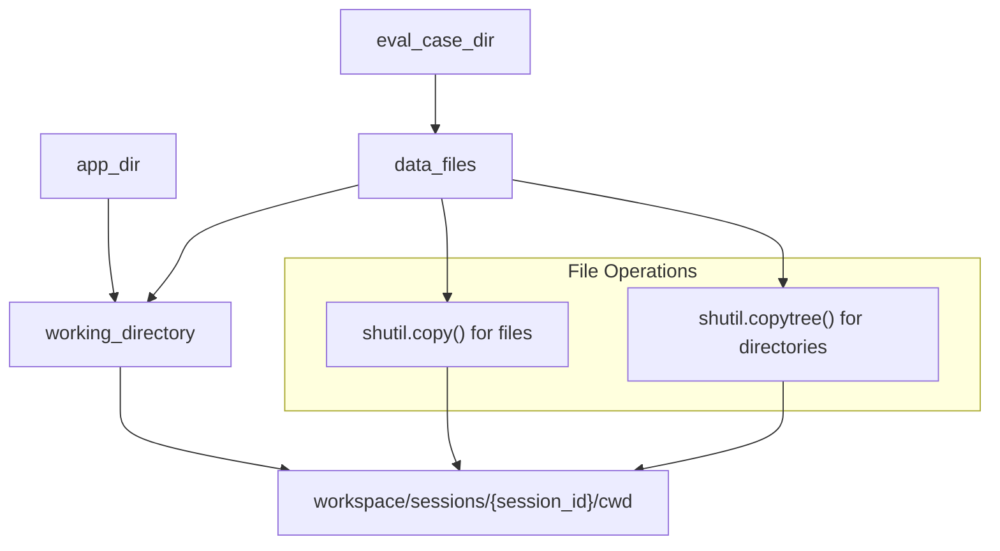

<!-- source: DeepWiki mcp.deepwiki.com · repo microsoft/TaskWeaver · page 10 Evaluation and Testing · fetched 2026-10-26 -->

# Evaluation and Testing

<details>
<summary>Relevant source files</summary>

The following files were used as context for generating this wiki page:

- [auto_eval/evaluator.py](auto_eval/evaluator.py)
- [auto_eval/taskweaver_eval.py](auto_eval/taskweaver_eval.py)
- [taskweaver/code_interpreter/code_interpreter_cli_only/code_generator_cli_only.py](taskweaver/code_interpreter/code_interpreter_cli_only/code_generator_cli_only.py)
- [website/blog/authors.yml](website/blog/authors.yml)
- [website/blog/evaluation.md](website/blog/evaluation.md)
- [website/blog/experience.md](website/blog/experience.md)
- [website/blog/local_llm.md](website/blog/local_llm.md)
- [website/blog/plugin.md](website/blog/plugin.md)
- [website/blog/reasoning.md](website/blog/reasoning.md)
- [website/blog/role.md](website/blog/role.md)
- [website/docusaurus.config.js](website/docusaurus.config.js)

</details>


This document covers TaskWeaver's automated evaluation framework, which provides comprehensive testing capabilities for agent performance assessment. The framework implements a conversational evaluation methodology that treats agents as interactive partners rather than simple input-output functions.

For information about observability and monitoring during runtime, see [Observability and Tracing](#11). For configuration and verification of system components, see [Configuration and Verification](#9).

## Evaluation Philosophy

TaskWeaver's evaluation framework addresses the limitations of traditional agent testing by implementing a conversational evaluation approach. Instead of treating agents as pure functions that map input to output, the framework recognizes that agents are interactive systems that may require clarification, ask follow-up questions, and exhibit different but equally valid behavioral patterns.



**Conversational Evaluation Workflow**

Sources: [auto_eval/evaluator.py:1-269](), [website/blog/evaluation.md:1-150]()

## Core Components

### VirtualUser Class

The `VirtualUser` serves as an automated examiner that conducts conversations with agents under test. It manages the conversation flow and determines when to stop based on predefined criteria.



**VirtualUser Class Hierarchy**

The `TaskWeaverVirtualUser` implements TaskWeaver-specific conversation handling:

- Initializes a `TaskWeaverApp` with specified configuration
- Manages session lifecycle and message routing
- Extracts final responses from conversation rounds
- Supports verbose mode for detailed conversation logging

Sources: [auto_eval/evaluator.py:80-142](), [auto_eval/taskweaver_eval.py:19-51]()

### Evaluator Class

The `Evaluator` acts as a judge that assesses agent performance based on conversation history and predefined scoring criteria.



**Evaluation Methods and Data Flow**

Sources: [auto_eval/evaluator.py:144-269]()

### ScoringPoint Configuration

The `ScoringPoint` dataclass defines evaluation criteria with flexible scoring mechanisms:

| Field | Type | Description |
|-------|------|-------------|
| `score_point` | str | Description of the evaluation criterion |
| `weight` | float | Relative importance of this criterion |
| `eval_code` | Optional[str] | Python code for automated verification |

**Code-Based Evaluation Example:**
```yaml
scoring_points:
  - score_point: "The two files 'a.txt' and 'b.txt' should contain the same number"
    weight: 1
    eval_code: |-
      content_a = open('a.txt', 'r').read().strip()
      content_b = open('b.txt', 'r').read().strip()
      assert content_a == content_b, f"content of a.txt: {content_a}, content of b.txt: {content_b}"
```

Sources: [auto_eval/evaluator.py:20-25](), [website/blog/evaluation.md:87-106]()

## Evaluation Workflow

### Single Case Evaluation

The complete evaluation process for a single test case follows this sequence:



**Single Case Evaluation Sequence**

Sources: [auto_eval/taskweaver_eval.py:53-109]()

### Batch Evaluation

For systematic testing across multiple cases, the framework supports batch evaluation with result persistence:



**Batch Evaluation Process Flow**

Sources: [auto_eval/taskweaver_eval.py:112-156]()

## Test Case Configuration

### Evaluation Case Structure

Each evaluation case is defined by a YAML configuration file containing task metadata and evaluation criteria:

```yaml
version: "1.0"
task_description: |-
  The task has many rounds. The initial total sum is 0. 
  Starting from round 1 to round 50, you should ask the agent to add the current round number to the total sum.
  
app_dir: "./project"
config_var:
  llm.model: "gpt-4"
  
dependencies:
  - package: pandas>=1.0.0
  - package: numpy>=1.20.0
  
data_files:
  - "sample_data.csv"
  - "test_folder/"
  
pre_command:
  - "pip install required-package"
  
scoring_points:
  - score_point: "The agent succeeds in 10 rounds, the sum should be 55."
    weight: 1
  - score_point: "The agent succeeds in 50 rounds, the sum should be 1275."
    weight: 5

max_rounds: 50
verbose: false
```

### Configuration Fields

| Field | Type | Description |
|-------|------|-------------|
| `app_dir` | str | TaskWeaver application directory |
| `config_var` | dict | Agent configuration overrides |
| `dependencies` | list | Required package versions |
| `data_files` | list | Files copied to working directory |
| `pre_command` | list | Setup commands executed before evaluation |
| `scoring_points` | list | Evaluation criteria with weights |
| `max_rounds` | int | Maximum conversation rounds |
| `verbose` | bool | Enable detailed conversation logging |

Sources: [auto_eval/taskweaver_eval.py:56-65](), [website/blog/evaluation.md:107-116]()

## LLM Integration for Evaluation

### Supported LLM Providers

The evaluation framework supports multiple LLM providers for both agent execution and evaluation:



**LLM Provider Integration**

The `config_llm()` function handles provider-specific initialization based on the `llm.api_type` configuration:

- **OpenAI**: Requires `llm.api_key` and `llm.model`
- **Azure OpenAI**: Requires `llm.api_base`, `llm.api_key`, `llm.api_version`, `llm.model`
- **Google AI**: Requires `GOOGLE_API_KEY` environment variable and `llm.model`
- **Azure ML**: Requires `llm.api_base` and `llm.api_key`

Sources: [auto_eval/evaluator.py:43-77]()

### Prompt Templates

The evaluation system uses structured prompt templates for consistent LLM interaction:

**VirtualUser Prompt Structure:**
- `instruction_template`: System instructions for examiner behavior
- `kick_off_message`: Initial conversation starter
- `stop_keyword`: Conversation termination signal

**Evaluator Prompt Structure:**
- `instruction_template`: Evaluation guidelines and response format
- `response_schema`: JSON schema for structured evaluation responses

Sources: [auto_eval/evaluator.py:16-17](), [auto_eval/evaluator.py:82-99]()

## Running Evaluations

### Command Line Interface

The evaluation framework provides a command-line interface for both single case and batch evaluation:

```bash
# Single case evaluation
python auto_eval/taskweaver_eval.py -m single -p /path/to/case_dir

# Batch evaluation
python auto_eval/taskweaver_eval.py -m batch -p /path/to/cases_root -r results.csv

# Batch evaluation with options
python auto_eval/taskweaver_eval.py -m batch -p /path/to/cases_root -r results.csv --fresh --sleep 10
```

### CLI Arguments

| Argument | Description |
|----------|-------------|
| `-m, --mode` | Evaluation mode: `single` or `batch` |
| `-p, --path` | Path to case file or directory |
| `-r, --result` | Result file path for batch mode |
| `-t, --threshold` | Interrupt threshold for multi-round chat |
| `-f, --fresh` | Flush existing result file |
| `-s, --sleep` | Sleep time between evaluations (seconds) |

Sources: [auto_eval/taskweaver_eval.py:158-216]()

### Working Directory Management

The evaluation framework automatically manages working directories and file copying:



**Working Directory Setup**

The working directory is constructed as: `{app_dir}/workspace/sessions/{session_id}/cwd`

All data files specified in the case configuration are automatically copied to this directory before evaluation begins.

Sources: [auto_eval/taskweaver_eval.py:84-94]()

## Extending the Evaluation Framework

### Adapting for Other Agents

The evaluation framework is designed to be extensible for other agent systems. To adapt it for a different agent, implement the `VirtualUser` interface:

```python
class CustomAgentVirtualUser(VirtualUser):
    def __init__(self, task_description: str, agent_config: dict):
        super().__init__(task_description)
        # Initialize your agent here
        self.agent = CustomAgent(config=agent_config)
    
    def get_reply_from_agent(self, message: str, verbose: bool = False) -> str:
        # Implement agent-specific message handling
        response = self.agent.send_message(message)
        return response.content
    
    def close(self):
        # Cleanup agent resources
        self.agent.shutdown()
```

Key requirements for agent integration:
- Instantiate as a Python object with configuration
- Provide a working directory for file operations
- Support conversational message exchange
- Handle session lifecycle management

Sources: [website/blog/evaluation.md:123-149]()

### Custom Scoring Mechanisms

The framework supports both LLM-based and code-based evaluation. For specialized evaluation needs, extend the code-based evaluation approach:

```python
# Example: Custom file validation
eval_code: |-
    import json
    import os
    
    # Validate JSON output format
    output_file = "agent_output.json"
    assert os.path.exists(output_file), "Output file not found"
    
    with open(output_file, 'r') as f:
        data = json.load(f)
    
    assert "results" in data, "Missing results field"
    assert len(data["results"]) > 0, "Empty results"
```

Code-based evaluation provides precise, deterministic scoring for scenarios where LLM evaluation may be insufficient or inconsistent.

Sources: [auto_eval/evaluator.py:183-227]()

---

