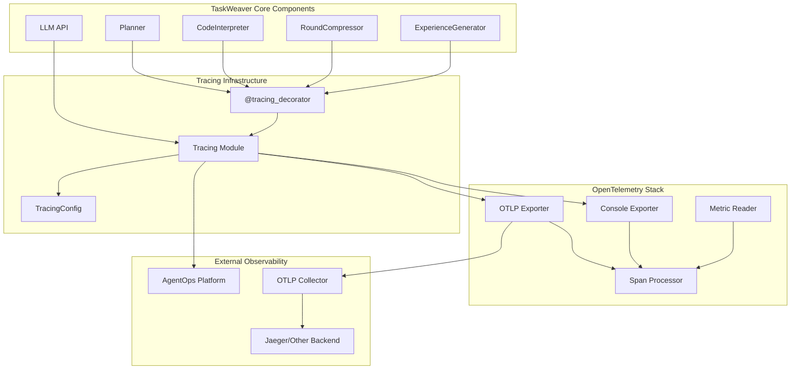
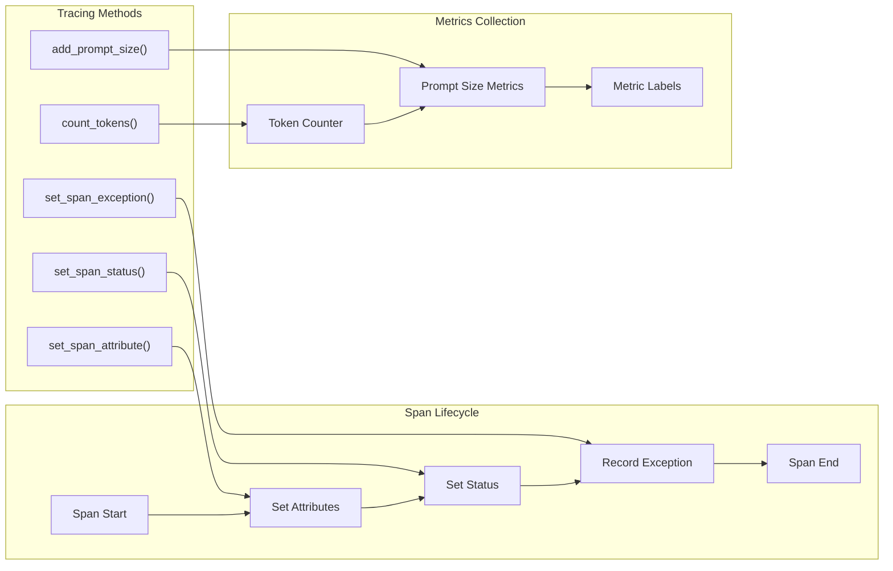
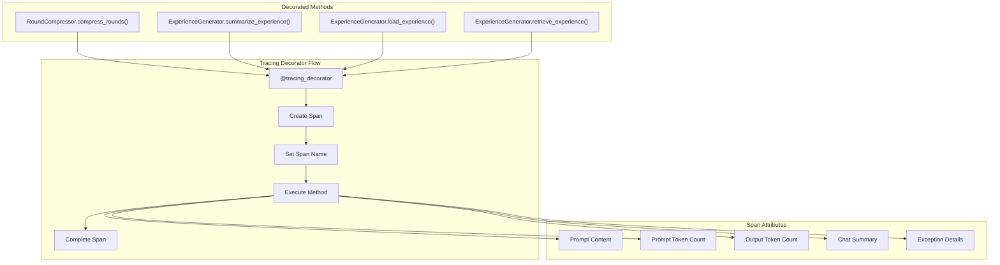
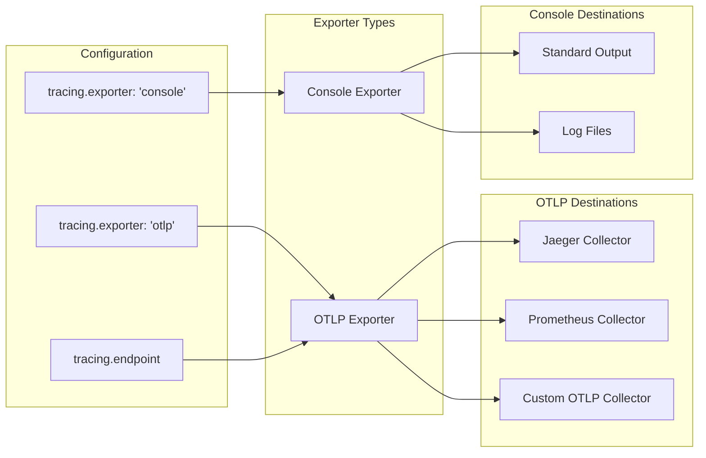
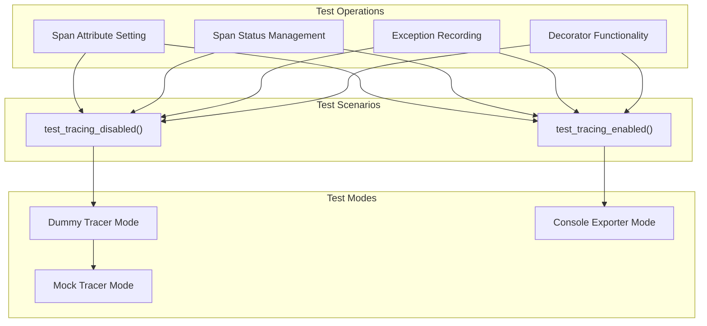

<!-- source: DeepWiki mcp.deepwiki.com · repo microsoft/TaskWeaver · page 11 Observability and Tracing · fetched 2026-10-26 -->

# Observability and Tracing

<details>
<summary>Relevant source files</summary>

The following files were used as context for generating this wiki page:

- [taskweaver/memory/compression.py](taskweaver/memory/compression.py)
- [taskweaver/memory/experience.py](taskweaver/memory/experience.py)
- [taskweaver/module/tracing.py](taskweaver/module/tracing.py)
- [tests/unit_tests/test_tracing.py](tests/unit_tests/test_tracing.py)
- [website/docs/FAQ.md](website/docs/FAQ.md)
- [website/docs/advanced/observability.md](website/docs/advanced/observability.md)
- [website/docs/code_execution.md](website/docs/code_execution.md)
- [website/docs/llms/Keywords-AI.md](website/docs/llms/Keywords-AI.md)
- [website/sidebars.js](website/sidebars.js)

</details>


This document covers TaskWeaver's observability and tracing capabilities, including OpenTelemetry integration for distributed tracing and metrics collection, and AgentOps integration for agent-specific monitoring. These systems provide insights into task execution, LLM interactions, and overall system performance.

For LLM-specific configuration and integration details, see [LLM Integration](#4). For deployment and infrastructure monitoring, see [Deployment and Infrastructure](#12).

## Overview

TaskWeaver provides two primary observability mechanisms:

1. **OpenTelemetry Integration** - Standards-based distributed tracing and metrics collection
2. **AgentOps Integration** - Agent-specific monitoring and analytics platform

These systems work together to provide comprehensive visibility into TaskWeaver's execution flow, from high-level task planning through code generation and execution.



**TaskWeaver Observability Architecture**

Sources: [taskweaver/module/tracing.py:1-230](), [website/docs/advanced/observability.md:1-60](), [taskweaver/memory/compression.py:44-121](), [taskweaver/memory/experience.py:106-143]()

## OpenTelemetry Integration

TaskWeaver's core tracing system is built on OpenTelemetry standards, providing distributed tracing capabilities and metrics collection for monitoring system performance and behavior.

### Core Tracing Components

The tracing system is implemented in the `Tracing` class with the following key components:

| Component | Purpose | File Location |
|-----------|---------|---------------|
| `TracingConfig` | Configuration management for tracing settings | [taskweaver/module/tracing.py:13-21]() |
| `Tracing` | Main tracing implementation with OpenTelemetry integration | [taskweaver/module/tracing.py:31-157]() |
| `tracing_decorator` | Method decorator for automatic span creation | [taskweaver/module/tracing.py:209-222]() |
| `DummyTracer` | No-op tracer when tracing is disabled | [taskweaver/module/tracing.py:159-177]() |

### Span and Metrics Management



**OpenTelemetry Span and Metrics Flow**

The system provides static methods for span management:

- `Tracing.set_span_attribute(key, value)` - Adds metadata to current span
- `Tracing.set_span_status(status_code, message)` - Sets span completion status
- `Tracing.set_span_exception(exception)` - Records exception information
- `Tracing.add_prompt_size(size, labels)` - Tracks LLM token usage
- `Tracing.count_tokens(data)` - Counts tokens in text data

Sources: [taskweaver/module/tracing.py:111-157]()

### Configuration Options

The `TracingConfig` class provides the following configuration parameters:

| Parameter | Default Value | Description |
|-----------|---------------|-------------|
| `enabled` | `False` | Enable/disable tracing functionality |
| `endpoint` | `http://127.0.0.1:4317` | OTLP collector endpoint |
| `service_name` | `taskweaver.otlp.tracer` | Service identifier in traces |
| `exporter` | `otlp` | Exporter type (`otlp` or `console`) |
| `tokenizer_target_model` | `gpt-4` | Model for token counting |

Configuration is typically set in `taskweaver_config.json`:

```json
{
  "tracing.enabled": true,
  "tracing.endpoint": "http://localhost:4317",
  "tracing.service_name": "my-taskweaver-service",
  "tracing.exporter": "otlp"
}
```

Sources: [taskweaver/module/tracing.py:13-21]()

## Tracing Implementation Patterns

### Automatic Tracing with Decorators

TaskWeaver uses the `@tracing_decorator` pattern extensively throughout the codebase for automatic span creation:



**Tracing Decorator Implementation Flow**

The decorator automatically generates span names using the pattern `{ClassName}.{method_name}`, as implemented in [taskweaver/module/tracing.py:216-219]().

### LLM Interaction Tracing

The system provides detailed tracing for LLM interactions, particularly in the `RoundCompressor` and `ExperienceGenerator` components:

```python
# Example from RoundCompressor._summarize()
prompt_size = self.tracing.count_tokens(json.dumps(prompt))
self.tracing.add_prompt_size(size=prompt_size, labels={"direction": "input"})
self.tracing.set_span_attribute("prompt", json.dumps(prompt, indent=2))
self.tracing.set_span_attribute("prompt_size", prompt_size)

# After LLM response
output_size = self.tracing.count_tokens(new_summary)
self.tracing.set_span_attribute("output_size", output_size)
self.tracing.add_prompt_size(size=output_size, labels={"direction": "output"})
```

Sources: [taskweaver/memory/compression.py:94-114](), [taskweaver/memory/experience.py:124-141]()

## AgentOps Integration

TaskWeaver integrates with the AgentOps platform for agent-specific monitoring and analytics, providing higher-level insights into agent behavior and performance.

### Integration Setup

AgentOps integration requires the following steps:

1. **Install AgentOps Package**
   ```bash
   pip install agentops
   ```

2. **Initialize AgentOps Client**
   ```python
   import agentops
   agentops.init(api_key="your_api_key")
   ```

3. **Configure TaskWeaver Event Handler**
   ```python
   from agentops.providers.taskweaver import TaskWeaverEventHandler
   handler = TaskWeaverEventHandler()
   ```

### Event Tracking Capabilities

AgentOps provides tracking for:

- **LLM Calls** - Automatically tracked when AgentOps client is initialized
- **Agent Events** - Tracked through `TaskWeaverEventHandler`
- **Session Management** - Complete session lifecycle monitoring
- **Performance Metrics** - Execution times and resource usage

### Usage Modes and Limitations

| Usage Mode | LLM Tracking | Event Tracking | Notes |
|------------|--------------|----------------|-------|
| Library Mode | ✅ Full | ✅ Full | Complete observability when handler is configured |
| Web UI Mode | ✅ Full | ✅ Full | Complete observability when handler is configured |
| Terminal Mode | ✅ Full | ❌ Limited | Only LLM calls tracked automatically |

Sources: [website/docs/advanced/observability.md:1-60]()

## Exporter Configuration

TaskWeaver supports multiple tracing exporters for different deployment scenarios:



**Tracing Exporter Configuration Options**

The exporter type is configured via the `tracing.exporter` parameter:

- `otlp` - Exports to OTLP-compatible collectors (production use)
- `console` - Exports to console output (development/debugging)

Sources: [taskweaver/module/tracing.py:76-83]()

## Testing and Validation

The tracing system includes comprehensive test coverage to ensure reliability:



**Tracing Test Coverage Architecture**

The test suite validates both disabled and enabled tracing modes, ensuring the system gracefully handles all configuration scenarios without impacting core functionality.

Sources: [tests/unit_tests/test_tracing.py:1-89]()

---

