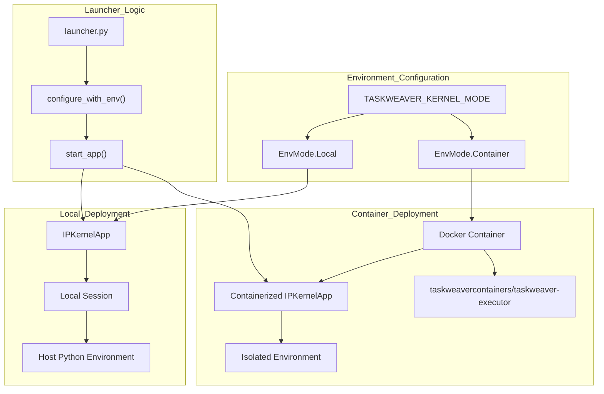
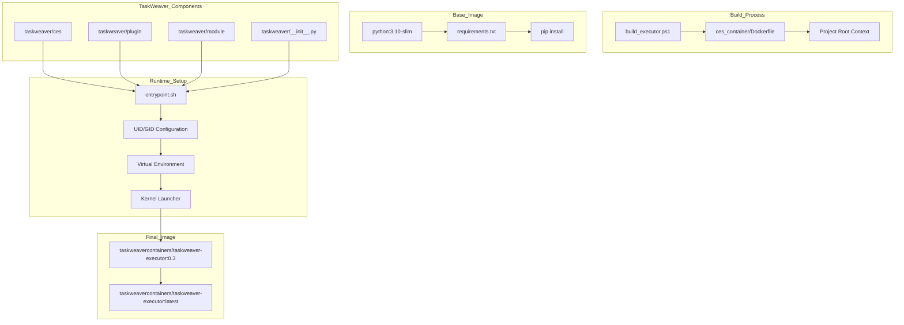
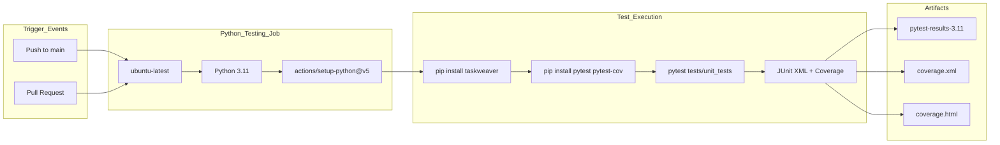
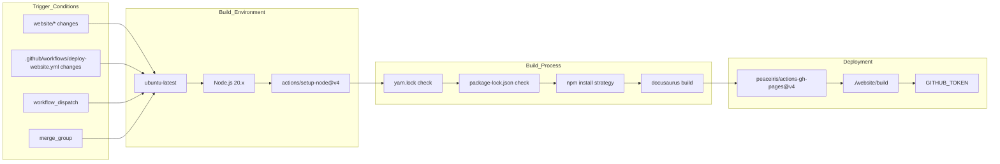

<!-- source: DeepWiki mcp.deepwiki.com · repo microsoft/TaskWeaver · page 12 Deployment and Infrastructure · fetched 2026-10-26 -->

# Deployment and Infrastructure

Relevant source files

The following files were used as context for generating this wiki page:

- [.gitattributes](.gitattributes)
- [.github/workflows/deploy-website.yaml](.github/workflows/deploy-website.yaml)
- [.github/workflows/pytest.yml](.github/workflows/pytest.yml)
- [docker/ces_container/Dockerfile](docker/ces_container/Dockerfile)
- [docker/ces_container/entrypoint.sh](docker/ces_container/entrypoint.sh)
- [scripts/build_executor.ps1](scripts/build_executor.ps1)
- [taskweaver/ces/kernel/ctx_magic.py](taskweaver/ces/kernel/ctx_magic.py)
- [taskweaver/ces/kernel/ext.py](taskweaver/ces/kernel/ext.py)
- [taskweaver/ces/kernel/launcher.py](taskweaver/ces/kernel/launcher.py)
- [tests/unit_tests/test_environment.py](tests/unit_tests/test_environment.py)
- [website/package-lock.json](website/package-lock.json)
- [website/package.json](website/package.json)

## Purpose and Scope

This document covers TaskWeaver's deployment options, infrastructure components, and CI/CD workflows. It focuses on the containerized execution environment, build processes, and deployment configurations that enable TaskWeaver to run in various environments from local development to production deployments.

For information about the core execution environment and kernel management, see [Code Execution Service](#5).

## Deployment Modes

TaskWeaver supports two primary deployment modes for code execution, configured through the `TASKWEAVER_KERNEL_MODE` environment variable:

### Local Mode
In local mode, TaskWeaver executes code directly on the host system using local Python environments. This mode is suitable for development and testing scenarios.

### Container Mode
Container mode isolates code execution within Docker containers, providing enhanced security and environment consistency. This is the recommended mode for production deployments.

**Deployment Mode Architecture**

Sources: [taskweaver/ces/kernel/launcher.py:6-91](), [tests/unit_tests/test_environment.py:88-192]()

## Container Infrastructure

TaskWeaver's containerized execution relies on a purpose-built Docker image that provides an isolated, reproducible environment for code execution.

### Docker Image Components

**Container Build Architecture**

Sources: [docker/ces_container/Dockerfile:1-25](), [scripts/build_executor.ps1:1-28](), [docker/ces_container/entrypoint.sh:1-15]()

### Container Runtime Configuration

The container execution environment is configured through environment variables and supports user/group ID mapping for security:

| Environment Variable | Purpose | Default Value |
|---------------------|---------|---------------|
| `TASKWEAVER_UID` | Container user ID | 10002 |
| `TASKWEAVER_GID` | Container group ID | 10002 |
| `TASKWEAVER_CES_DIR` | CES directory path | `./ces` |
| `TASKWEAVER_CWD` | Working directory | Current directory |
| `TASKWEAVER_SESSION_ID` | Session identifier | `session_id` |
| `TASKWEAVER_KERNEL_ID` | Kernel identifier | `kernel_id` |

The entrypoint script creates a non-root user, sets up a virtual environment with system site packages, and launches the TaskWeaver kernel.

Sources: [docker/ces_container/entrypoint.sh:3-14](), [taskweaver/ces/kernel/launcher.py:10-52]()

## CI/CD Pipelines

TaskWeaver employs GitHub Actions for continuous integration and deployment workflows covering both testing and documentation deployment.

### Testing Pipeline

**CI/CD Testing Flow**

Sources: [.github/workflows/pytest.yml:1-44]()

### Website Deployment Pipeline

The website deployment pipeline builds and deploys the Docusaurus documentation site to GitHub Pages:

**Documentation Deployment Flow**

Sources: [.github/workflows/deploy-website.yaml:1-44](), [website/package.json:1-54]()

## Environment Configuration

TaskWeaver's execution environment is highly configurable through environment variables and runtime parameters that control kernel behavior, networking, and session management.

### Kernel Configuration Variables

The kernel launcher reads configuration from environment variables to support both local and containerized deployment scenarios:

| Variable | Purpose | Container Mode | Local Mode |
|----------|---------|----------------|------------|
| `TASKWEAVER_KERNEL_MODE` | Execution mode | `container` | `local` |
| `TASKWEAVER_CES_DIR` | CES directory | Container mount | Local path |
| `TASKWEAVER_CWD` | Working directory | Container workdir | Host workdir |
| `TASKWEAVER_PORT_START` | Port range start | 12345 | 12345 |
| `TASKWEAVER_KERNEL_IP` | Kernel IP binding | 0.0.0.0 | 0.0.0.0 |
| `TASKWEAVER_ENV_ID` | Environment ID | Runtime value | `local` |
| `TASKWEAVER_SESSION_DIR` | Session directory | Container mount | Host path |

### Magic Command Integration

The kernel provides magic commands for runtime configuration and plugin management through the `TaskWeaverContextMagic` and `TaskWeaverPluginMagic` classes:

**Magic Command Architecture**

```mermaid
graph TD
    subgraph "IPython_Extension"
        LoadExtension["load_ipython_extension()"]
        InteractiveShell["InteractiveShell"]
        MagicsRegistration["register_magics()"]
    end
    
    subgraph "Context_Magic_Commands"
        SessionInit["%_taskweaver_session_init"]
        UpdateSessionVar["%_taskweaver_update_session_var"]
        CheckSessionVar["%_taskweaver_check_session_var"]
        ConvertPath["%_taskweaver_convert_path"]
        ExecPreCheck["%_taskweaver_exec_pre_check"]
        ExecPostCheck["%_taskweaver_exec_post_check"]
    end
    
    subgraph "Plugin_Magic_Commands"
        PluginRegister["%_taskweaver_plugin_register"]
        PluginTest["%_taskweaver_plugin_test"]
        PluginLoad["%_taskweaver_plugin_load"]
        PluginUnload["%_taskweaver_plugin_unload"]
    end
    
    subgraph "Executor_Backend"
        ExecutorClass["Executor"]
        SessionVarDict["session_var"]
        PluginRegistry["plugin registry"]
        LoadLib["load_lib()"]
    end
    
    LoadExtension --> InteractiveShell
    InteractiveShell --> MagicsRegistration
    
    SessionInit --> ExecutorClass
    UpdateSessionVar --> SessionVarDict
    CheckSessionVar --> SessionVarDict
    ConvertPath --> ExecutorClass
    ExecPreCheck --> ExecutorClass
    ExecPostCheck --> ExecutorClass
    
    PluginRegister --> PluginRegistry
    PluginTest --> PluginRegistry
    PluginLoad --> PluginRegistry
    PluginUnload --> PluginRegistry
    
    ExecutorClass --> LoadLib
    ExecutorClass --> SessionVarDict
    ExecutorClass --> PluginRegistry
```

Sources: [taskweaver/ces/kernel/ctx_magic.py:136-156](), [taskweaver/ces/kernel/launcher.py:10-52]()

## Infrastructure Requirements

### System Dependencies

TaskWeaver requires the following infrastructure components for optimal operation:

- **Python Runtime**: Python 3.10+ for container mode, Python 3.11+ for local development
- **Docker Engine**: Required for container-based execution mode
- **Node.js**: Version 18.0+ for website building and development
- **Network Ports**: Configurable port range starting from 12345 for kernel communication

### Security Considerations

Container mode provides several security benefits:

1. **Process Isolation**: Code execution is isolated within containers
2. **User Mapping**: Non-root execution with configurable UID/GID mapping
3. **Network Isolation**: Controlled port exposure and network access
4. **File System Isolation**: Containerized file system with selective mounting

### Testing Infrastructure

The test suite includes infrastructure validation for both deployment modes:

- **Local Mode Tests**: Verify kernel startup, session management, and code execution
- **Container Mode Tests**: Validate Docker container functionality and package installation
- **CI/CD Integration**: Automated testing on Ubuntu with Python 3.11

Sources: [tests/unit_tests/test_environment.py:88-192](), [.github/workflows/pytest.yml:11-44]()