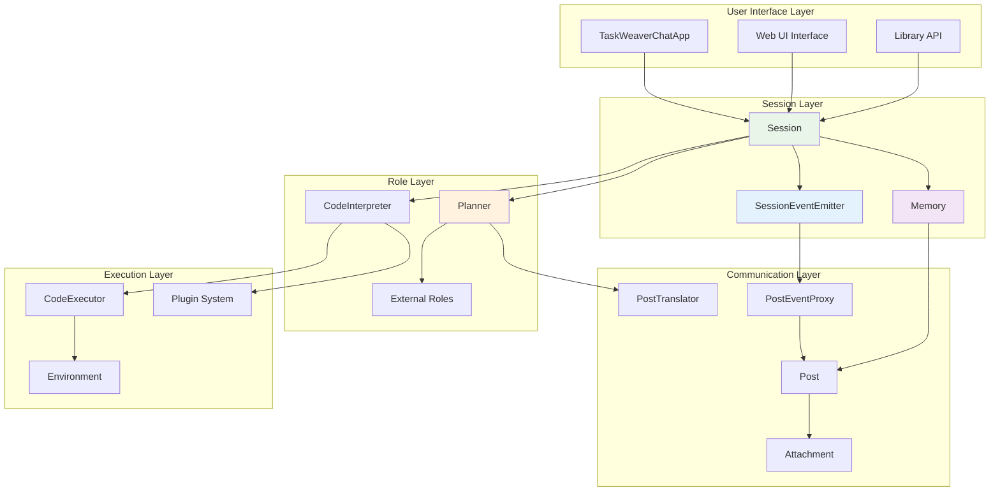
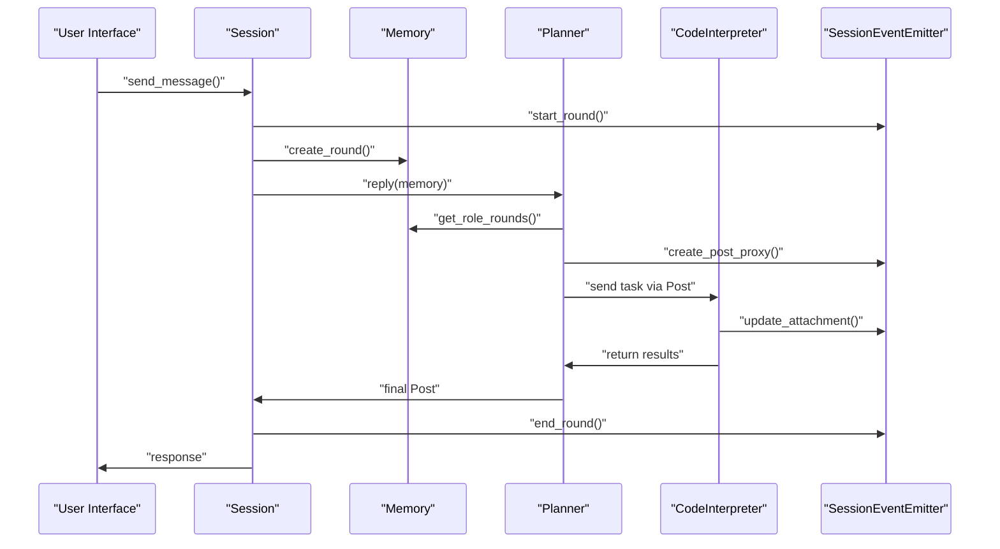
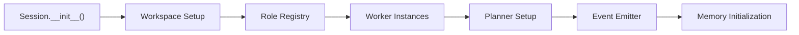
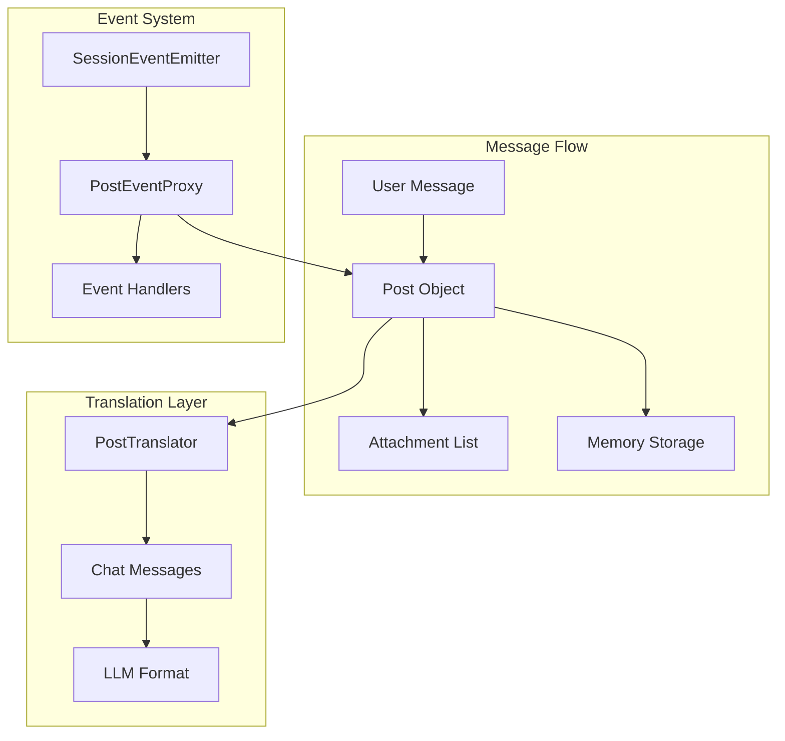
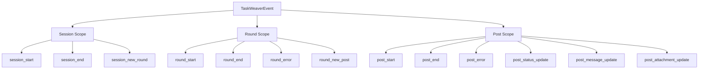
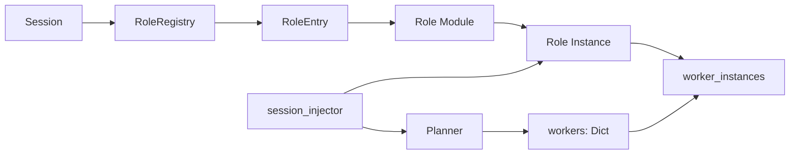
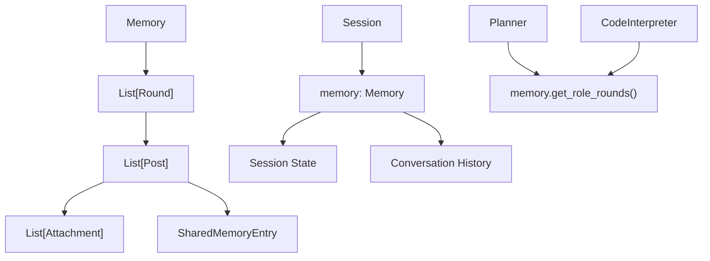

<!-- source: DeepWiki mcp.deepwiki.com · repo microsoft/TaskWeaver · page 3 Core Components · fetched 2026-10-26 -->

# Core Components

Relevant source files

The following files were used as context for generating this wiki page:

- [README.md](README.md)
- [taskweaver/chat/console/chat.py](taskweaver/chat/console/chat.py)
- [taskweaver/memory/attachment.py](taskweaver/memory/attachment.py)
- [taskweaver/module/event_emitter.py](taskweaver/module/event_emitter.py)
- [taskweaver/planner/planner.py](taskweaver/planner/planner.py)
- [taskweaver/planner/planner_prompt.yaml](taskweaver/planner/planner_prompt.yaml)
- [taskweaver/session/session.py](taskweaver/session/session.py)

This document provides an overview of the essential components that form TaskWeaver's core functionality. These components work together to enable the code-first agent framework's ability to plan, execute, and coordinate data analytics tasks.

For detailed information about specific subsystems, see [Planner](#3.1), [Session Management](#3.2), [Memory and Communication System](#3.3), and [Code Interpreter](#3.4). For LLM integration details, see [LLM Integration](#4). For code execution specifics, see [Code Execution Service](#5).

## Component Architecture Overview

The core of TaskWeaver consists of five primary components that handle different aspects of the agent framework's operation:

**Core Component Interaction Flow**

Sources: [taskweaver/session/session.py:44-364](), [taskweaver/planner/planner.py:46-372](), [taskweaver/module/event_emitter.py:231-300](), [taskweaver/memory/attachment.py:54-130]()

## Session Management

The `Session` class serves as the central coordinator for all TaskWeaver operations, managing the lifecycle of user interactions and orchestrating communication between different roles.

### Session Components

| Component | Class | Purpose |
|-----------|-------|---------|
| Session Core | `Session` | Main session orchestration and state management |
| Configuration | `AppSessionConfig` | Session-level configuration and role management |
| Metadata | `SessionMetadata` | Session information storage |
| Event Handling | `SessionEventEmitter` | Event-driven communication system |

### Session Initialization

The session initialization process involves several key steps handled in the `Session.__init__()` method:

The session manages role instances through the `worker_instances` dictionary and validates role configuration in [taskweaver/session/session.py:96-119](). The planner is initialized with access to all worker instances in [taskweaver/session/session.py:111-118]().

Sources: [taskweaver/session/session.py:44-127](), [taskweaver/session/session.py:18-35]()

## Communication System

TaskWeaver's communication system is built around the `Post` and `Attachment` model, enabling structured information exchange between components.

### Communication Architecture

### Attachment Types

The system uses strongly-typed attachments defined in `AttachmentType` enum to categorize different kinds of content:

| Category | Attachment Types | Purpose |
|----------|------------------|---------|
| Planning | `init_plan`, `plan`, `current_plan_step`, `plan_reasoning` | Planner task decomposition |
| Code Generation | `thought`, `reply_type`, `reply_content` | CodeInterpreter responses |
| Code Execution | `execution_status`, `execution_result`, `artifact_paths` | Execution results |
| Verification | `verification`, `code_error`, `revise_message` | Code validation |
| Shared Memory | `shared_memory_entry` | Cross-component data sharing |

The `PostEventProxy` class provides a streaming interface for building posts incrementally in [taskweaver/module/event_emitter.py:126-229]().

Sources: [taskweaver/memory/attachment.py:10-53](), [taskweaver/module/event_emitter.py:126-229](), [taskweaver/planner/planner.py:71-71]()

## Event-Driven Architecture

TaskWeaver implements a comprehensive event system that enables real-time communication and status updates across all components.

### Event Hierarchy

### Event Flow Implementation

The event system is implemented through three main classes:
- `SessionEventEmitter` - Central event dispatcher in [taskweaver/module/event_emitter.py:231-300]()
- `PostEventProxy` - Post-specific event proxy in [taskweaver/module/event_emitter.py:126-229]()
- `SessionEventHandlerBase` - Base class for event handlers in [taskweaver/module/event_emitter.py:61-124]()

The console interface demonstrates event handling implementation in `TaskWeaverRoundUpdater` class [taskweaver/chat/console/chat.py:68-408]().

Sources: [taskweaver/module/event_emitter.py:15-53](), [taskweaver/module/event_emitter.py:231-300](), [taskweaver/chat/console/chat.py:68-148]()

## Role System Integration

The core components integrate with TaskWeaver's role system through standardized interfaces and dependency injection.

### Role Integration Pattern

The session creates and manages role instances through dependency injection in [taskweaver/session/session.py:94-119](), binding each role instance to the session injector for proper lifecycle management.

Role instances are stored in the `worker_instances` dictionary and accessed by alias, enabling the planner to coordinate with different specialized roles based on their capabilities.

Sources: [taskweaver/session/session.py:94-119](), [taskweaver/planner/planner.py:57-69]()

## Memory Integration

The core components integrate closely with TaskWeaver's memory system to maintain conversation state and enable context-aware operations.

### Memory Structure

Memory is initialized in the session constructor [taskweaver/session/session.py:87-87]() and used throughout the conversation flow to maintain state and provide context to roles.

The planner accesses memory through `memory.get_role_rounds(role=self.alias)` in [taskweaver/planner/planner.py:244-244]() to retrieve conversation history for prompt composition.

Sources: [taskweaver/session/session.py:87-87](), [taskweaver/planner/planner.py:244-244](), [taskweaver/memory/attachment.py:47-48]()

---

