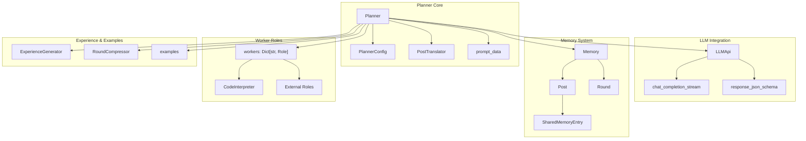
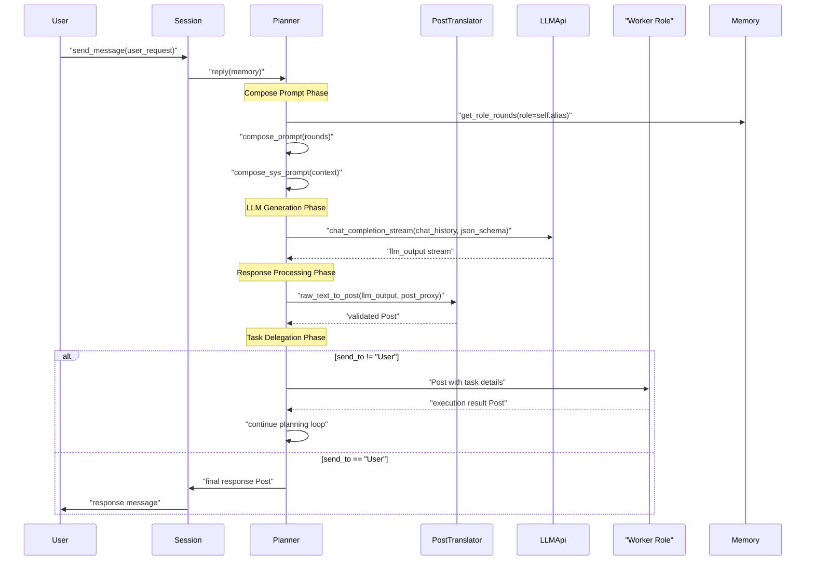
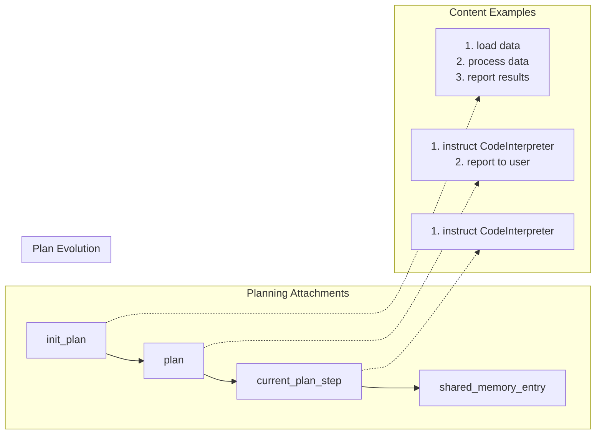
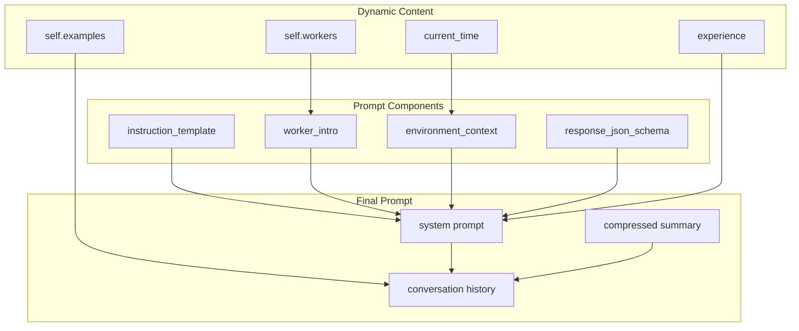
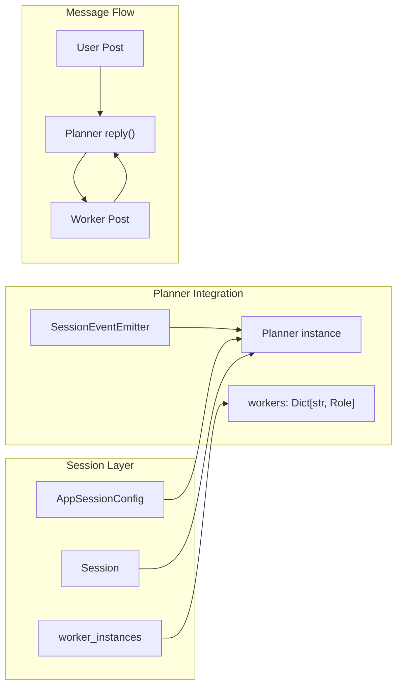

<!-- source: DeepWiki mcp.deepwiki.com · repo microsoft/TaskWeaver · page 3.1 Planner · fetched 2026-10-26 -->

# Planner

<details>
<summary>Relevant source files</summary>

The following files were used as context for generating this wiki page:

- [taskweaver/chat/console/chat.py](taskweaver/chat/console/chat.py)
- [taskweaver/module/event_emitter.py](taskweaver/module/event_emitter.py)
- [taskweaver/planner/planner.py](taskweaver/planner/planner.py)
- [taskweaver/role/translator.py](taskweaver/role/translator.py)
- [taskweaver/session/session.py](taskweaver/session/session.py)
- [tests/unit_tests/test_planner.py](tests/unit_tests/test_planner.py)
- [tests/unit_tests/test_translator.py](tests/unit_tests/test_translator.py)
- [website/blog/authors.yml](website/blog/authors.yml)
- [website/blog/evaluation.md](website/blog/evaluation.md)
- [website/blog/experience.md](website/blog/experience.md)
- [website/blog/local_llm.md](website/blog/local_llm.md)
- [website/blog/plugin.md](website/blog/plugin.md)
- [website/blog/reasoning.md](website/blog/reasoning.md)
- [website/blog/role.md](website/blog/role.md)
- [website/docusaurus.config.js](website/docusaurus.config.js)

</details>


The Planner is TaskWeaver's central orchestrator responsible for task decomposition, workflow management, and coordination of other roles in the system. It receives user requests, breaks them down into executable steps, tracks progress, and manages the overall conversation flow. For information about code execution, see [Code Execution Service](#5). For details about memory and communication, see [Memory and Communication System](#3.3).

## Architecture Overview

The Planner operates as the primary decision-making component that sits between the user and execution roles, managing the entire task lifecycle from initial planning to completion.

### Core Planner Architecture



Sources: [taskweaver/planner/planner.py:46-92](), [taskweaver/session/session.py:111-118]()

## Planning Process Flow

The Planner follows a structured workflow for processing user requests and managing task execution.

### Task Processing Workflow



Sources: [taskweaver/planner/planner.py:237-371](), [taskweaver/session/session.py:174-202]()

## Core Components

### Planner Class Structure

The `Planner` class extends the base `Role` class and implements the core planning functionality through several key methods and properties.

| Component | Purpose | Key Methods/Properties |
|-----------|---------|----------------------|
| `PlannerConfig` | Configuration management | `prompt_file_path`, `prompt_compression`, `llm_alias` |
| `Planner` | Main orchestrator class | `reply()`, `compose_prompt()`, `compose_sys_prompt()` |
| `PostTranslator` | Communication formatting | `raw_text_to_post()`, `post_to_raw_text()` |
| Response Schema | LLM output validation | `response_json_schema`, `check_post_validity()` |

Sources: [taskweaver/planner/planner.py:24-44](), [taskweaver/planner/planner.py:46-92]()

### Planning State Management

The Planner maintains detailed state about task progress through structured attachments in Post objects:



Sources: [taskweaver/planner/planner.py:271-277](), [taskweaver/planner/planner.py:327-337]()

## Prompt Engineering and LLM Integration

### System Prompt Construction

The Planner dynamically constructs system prompts that include worker descriptions, environment context, and response schemas:



Sources: [taskweaver/planner/planner.py:94-110](), [taskweaver/planner/planner.py:197-235]()

### Response Validation and Error Handling

The Planner implements robust validation to ensure LLM responses contain required fields and follow the expected format:

```python
def check_post_validity(post: Post):
    missing_elements: List[str] = []
    validation_errors: List[str] = []
    
    # Required fields validation
    if not post.send_to or post.send_to == "Unknown":
        missing_elements.append("send_to")
    if not post.message or post.message.strip() == "":
        missing_elements.append("message")
        
    # Required attachments validation  
    attachment_types = [attachment.type for attachment in post.attachment_list]
    if AttachmentType.init_plan not in attachment_types:
        missing_elements.append("init_plan")
    # ... additional validations
```

Sources: [taskweaver/planner/planner.py:260-280](), [taskweaver/planner/planner.py:339-361]()

## Integration with Core Systems

### Session Management Integration

The Planner integrates tightly with the Session system for lifecycle management and conversation routing:



Sources: [taskweaver/session/session.py:111-118](), [taskweaver/session/session.py:183-200]()

### Memory and Experience Integration  

The Planner leverages the memory system for conversation history and experience-based learning:

| Integration Point | Purpose | Implementation |
|------------------|---------|---------------|
| `Memory.get_role_rounds()` | Retrieve conversation history | [taskweaver/planner/planner.py:244]() |
| `ExperienceGenerator` | Learn from past interactions | [taskweaver/planner/planner.py:89]() |
| `RoundCompressor` | Manage prompt length | [taskweaver/planner/planner.py:219-226]() |
| `SharedMemoryEntry` | Cross-role information sharing | [taskweaver/planner/planner.py:332-337]() |

Sources: [taskweaver/planner/planner.py:252-253](), [taskweaver/planner/planner.py:218-232]()

## Configuration and Customization

### PlannerConfig Options

The `PlannerConfig` class provides several configuration options for customizing Planner behavior:

```yaml
# Core configuration options
prompt_file_path: "path/to/planner_prompt.yaml"
prompt_compression: false
compression_prompt_path: "path/to/compression_prompt.yaml" 
llm_alias: "custom_llm_endpoint"

# Experience and learning
use_experience: true
experience_dir: "experience"

# Advanced features  
max_self_ask_num: 3
```

Sources: [taskweaver/planner/planner.py:24-44](), [taskweaver/planner/planner.py:84-85]()

### Prompt Template Structure

The Planner uses YAML-based prompt templates that define the instruction format and response schema:

```yaml
instruction_template: |
  You are the Planner who can coordinate Workers to finish the user task.
  # ... detailed instructions
  
response_json_schema: |
  {
    "type": "object",
    "properties": {
      "response": {
        "type": "object", 
        "properties": {
          "init_plan": {"type": "string"},
          "plan": {"type": "string"},
          "current_plan_step": {"type": "string"},
          "send_to": {"type": "string"},
          "message": {"type": "string"}
        },
        "required": ["init_plan", "plan", "current_plan_step", "send_to", "message"]
      }
    }
  }
```

Sources: [taskweaver/planner/planner.py:73-81](), [taskweaver/planner/planner.py:284-289]()

---

