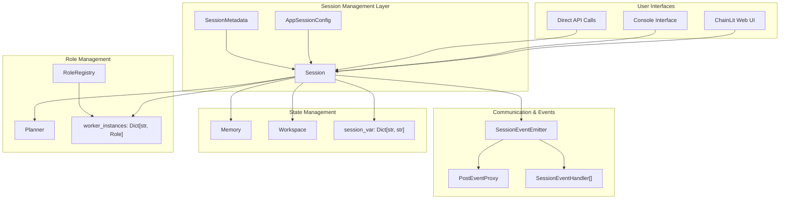
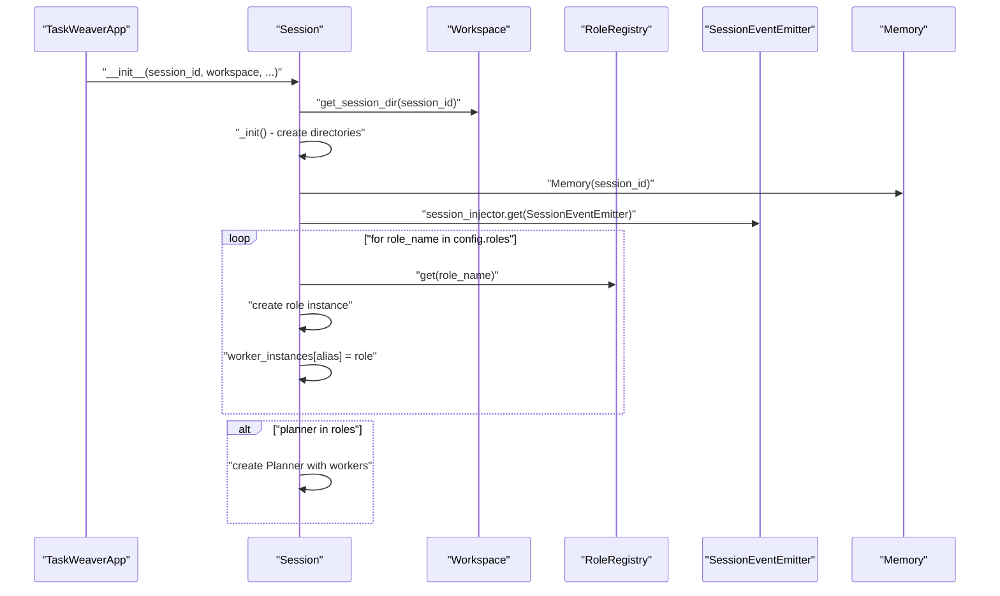
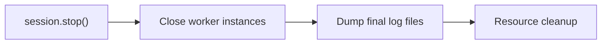
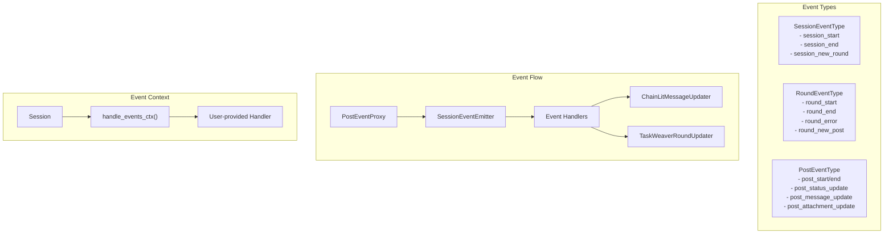
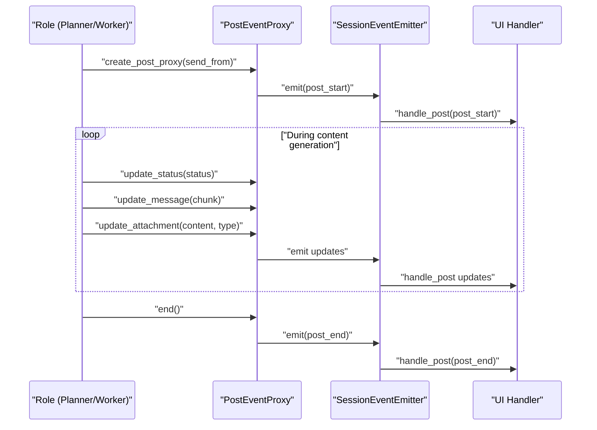
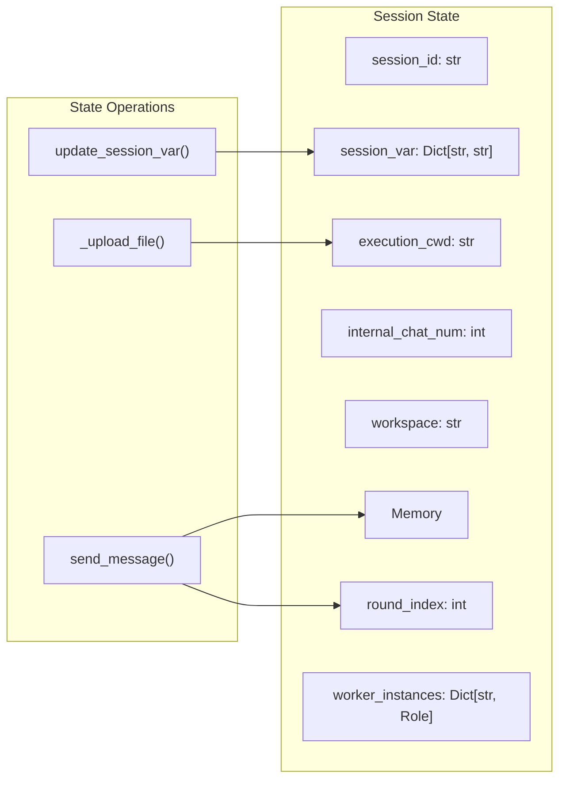
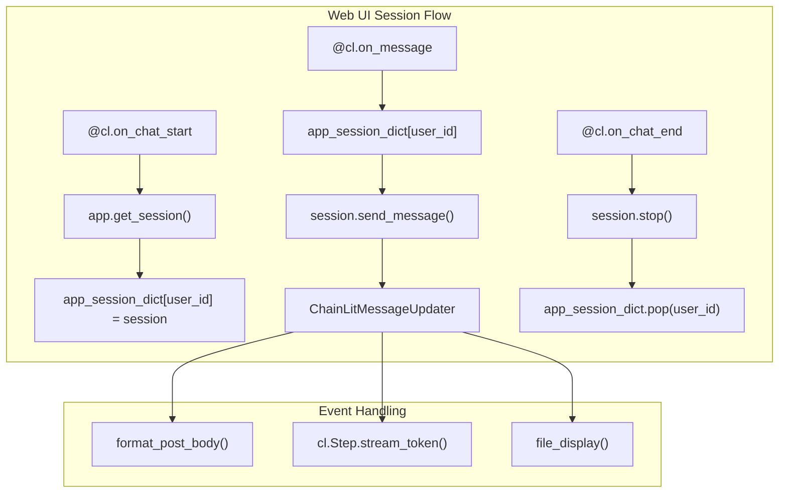
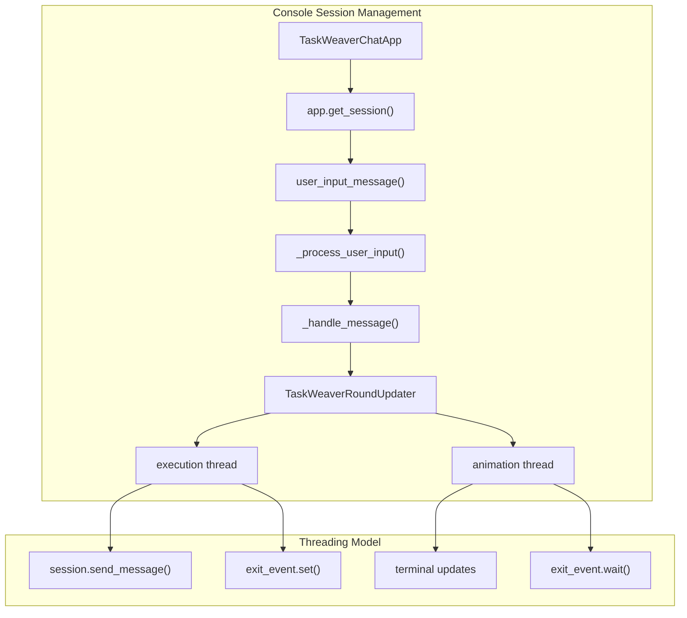

<!-- source: DeepWiki mcp.deepwiki.com · repo microsoft/TaskWeaver · page 3.2 Session Management · fetched 2026-10-26 -->

# Session Management

<details>
<summary>Relevant source files</summary>

The following files were used as context for generating this wiki page:

- [.gitignore](.gitignore)
- [playground/UI/.chainlit/config.toml](playground/UI/.chainlit/config.toml)
- [playground/UI/app.py](playground/UI/app.py)
- [playground/UI/public/style_v1.css](playground/UI/public/style_v1.css)
- [taskweaver/chat/console/chat.py](taskweaver/chat/console/chat.py)
- [taskweaver/module/event_emitter.py](taskweaver/module/event_emitter.py)
- [taskweaver/planner/planner.py](taskweaver/planner/planner.py)
- [taskweaver/session/session.py](taskweaver/session/session.py)
- [website/docs/usage/webui.md](website/docs/usage/webui.md)

</details>


## Purpose and Scope

This document covers TaskWeaver's session management system, which orchestrates conversation rounds, manages state, and coordinates communication between users and TaskWeaver's internal roles. Session management is responsible for the lifecycle of user interactions, message routing, event handling, and maintaining conversation context.

For information about the Planner's role orchestration within sessions, see [Planner](#3.1). For details about memory storage and communication protocols, see [Memory and Communication System](#3.3).

## Session Architecture

TaskWeaver's session management centers around the `Session` class, which acts as the primary coordinator for all user interactions. Each session maintains its own isolated workspace, memory, and set of role instances.

### Core Session Components



**Sources:** [taskweaver/session/session.py:44-127](), [taskweaver/module/event_emitter.py:231-300]()

## Session Lifecycle

### Session Initialization

The session initialization process involves several critical steps that set up the execution environment and role instances:



**Sources:** [taskweaver/session/session.py:45-127](), [taskweaver/session/session.py:128-142]()

### Session Termination

When a session ends, resources must be properly cleaned up:



**Sources:** [taskweaver/session/session.py:348-357]()

## Message Routing and Round Management

### Round-Based Communication

TaskWeaver organizes conversations into rounds, where each round represents a complete user request and response cycle. The session manages the complex routing of messages between different roles.

```mermaid
graph TB
    subgraph "Round Lifecycle"
        UserMessage["User Message"] --> CreateRound["memory.create_round()"]
        CreateRound --> StartRound["event_emitter.start_round()"]
        StartRound --> MessageRouting["Message Routing Logic"]
        
        MessageRouting --> PlannerMode{"Planner Mode?"}
        PlannerMode -->|Yes| PlannerFlow["Planner → Worker → User"]
        PlannerMode -->|No| DirectFlow["Direct Worker → User"]
        
        PlannerFlow --> EndRound["event_emitter.end_round()"]
        DirectFlow --> EndRound
    end
    
    subgraph "Internal Chat Loop"
        SendMessage["_send_message()"] --> RecipientCheck{"Recipient?"}
        RecipientCheck -->|Planner| PlannerReply["planner.reply()"]
        RecipientCheck -->|Worker| WorkerReply["worker.reply()"]
        RecipientCheck -->|User| AddToRound["chat_round.add_post()"]
        
        PlannerReply --> CheckSendTo{"post.send_to == 'User'?"}
        WorkerReply --> CheckSendTo
        CheckSendTo -->|No| InternalChatCheck["internal_chat_num < max?"]
        CheckSendTo -->|Yes| AddToRound
        InternalChatCheck -->|Yes| SendMessage
        InternalChatCheck -->|No| ErrorLimit["Exception: limit exceeded"]
    end
```



**Sources:** [taskweaver/session/session.py:162-276](), [taskweaver/session/session.py:204-246]()

### Message Routing Logic

The session implements sophisticated message routing to handle both planner-based and direct worker communication:

| Mode | Description | Message Flow |
|------|-------------|--------------|
| **Planner Mode** | Default mode with task orchestration | User → Planner → Worker(s) → User |
| **No-Planner Mode** | Direct worker communication | User → Worker → User |

**Sources:** [taskweaver/session/session.py:205-246]()

## Event System Integration

### Event-Driven Communication

TaskWeaver's session management relies heavily on an event system for real-time updates and UI integration:



**Sources:** [taskweaver/module/event_emitter.py:15-53](), [taskweaver/module/event_emitter.py:126-229]()

### PostEventProxy for Streaming Updates

The `PostEventProxy` enables real-time streaming of post content during generation:



**Sources:** [taskweaver/module/event_emitter.py:126-229](), [taskweaver/planner/planner.py:255-257]()

## Session State Management

### Session Variables and Context

Each session maintains isolated state including variables, workspace, and execution context:



**Sources:** [taskweaver/session/session.py:72-90](), [taskweaver/session/session.py:143-159]()

### File Upload and Management

Sessions handle file uploads and manage them within the execution workspace:

| Method | Purpose | File Handling |
|--------|---------|---------------|
| `_upload_file()` | Upload files to session workspace | Copies files to `execution_cwd` |
| `send_message()` | Process message with files | Handles file metadata and content |
| `_get_full_path()` | Resolve workspace paths | Ensures proper path resolution |

**Sources:** [taskweaver/session/session.py:318-346]()

## User Interface Integration

### Web UI Session Management

The Chainlit-based web UI manages sessions through a global session dictionary:



**Sources:** [playground/UI/app.py:380-394](), [playground/UI/app.py:396-457]()

### Console Interface Session Management

The console interface uses a different session management approach with threading:



**Sources:** [taskweaver/chat/console/chat.py:410-527](), [taskweaver/chat/console/chat.py:68-408]()

## Session Configuration

### AppSessionConfig Options

The session behavior is controlled through configuration parameters:

| Configuration | Default | Description |
|---------------|---------|-------------|
| `max_internal_chat_round_num` | 10 | Maximum internal messages between roles |
| `experience_dir` | `{app_base_path}/experience` | Directory for storing experiences |
| `roles` | `["planner", "code_interpreter"]` | List of roles to instantiate |

**Sources:** [taskweaver/session/session.py:18-35]()

### Session Metadata

Each session maintains metadata for identification and workspace management:

```python
@dataclass
class SessionMetadata:
    session_id: str
    workspace: str
    execution_cwd: str
```

**Sources:** [taskweaver/session/session.py:37-42]()

The session management system provides the foundation for TaskWeaver's interactive capabilities, coordinating between user interfaces, role instances, and the underlying execution environment while maintaining proper state isolation and event-driven updates.

---

