<!-- source: DeepWiki mcp.deepwiki.com · repo microsoft/TaskWeaver · page 3.3 Memory and Communication System · fetched 2026-10-26 -->

# Memory and Communication System

Relevant source files

The following files were used as context for generating this wiki page:

- [taskweaver/chat/console/chat.py](taskweaver/chat/console/chat.py)
- [taskweaver/memory/compression.py](taskweaver/memory/compression.py)
- [taskweaver/memory/experience.py](taskweaver/memory/experience.py)
- [taskweaver/module/event_emitter.py](taskweaver/module/event_emitter.py)
- [taskweaver/module/tracing.py](taskweaver/module/tracing.py)
- [taskweaver/planner/planner.py](taskweaver/planner/planner.py)
- [taskweaver/role/translator.py](taskweaver/role/translator.py)
- [taskweaver/session/session.py](taskweaver/session/session.py)
- [tests/unit_tests/test_planner.py](tests/unit_tests/test_planner.py)
- [tests/unit_tests/test_tracing.py](tests/unit_tests/test_tracing.py)
- [tests/unit_tests/test_translator.py](tests/unit_tests/test_translator.py)

## Purpose and Scope

The Memory and Communication System is the central nervous system of TaskWeaver, responsible for storing conversation history, managing inter-component communication, and facilitating real-time event propagation. This system bridges natural language interactions with structured data exchange between TaskWeaver's roles (Planner, CodeInterpreter, etc.).

For information about the Planner's orchestration logic, see [Planner](#3.1). For session lifecycle management, see [Session Management](#3.2). For code execution context, see [Code Execution Service](#5).

## Core Architecture

The Memory and Communication System consists of three interconnected subsystems:

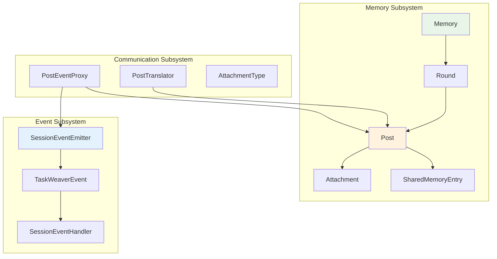

**Memory Architecture Overview**

Sources: [taskweaver/memory/](#), [taskweaver/module/event_emitter.py:1-300](), [taskweaver/role/translator.py:1-301]()

## Memory Subsystem

### Memory and Round Management

The `Memory` class serves as the primary container for conversation history, organizing interactions into sequential `Round` objects. Each round represents a complete user-system interaction cycle.

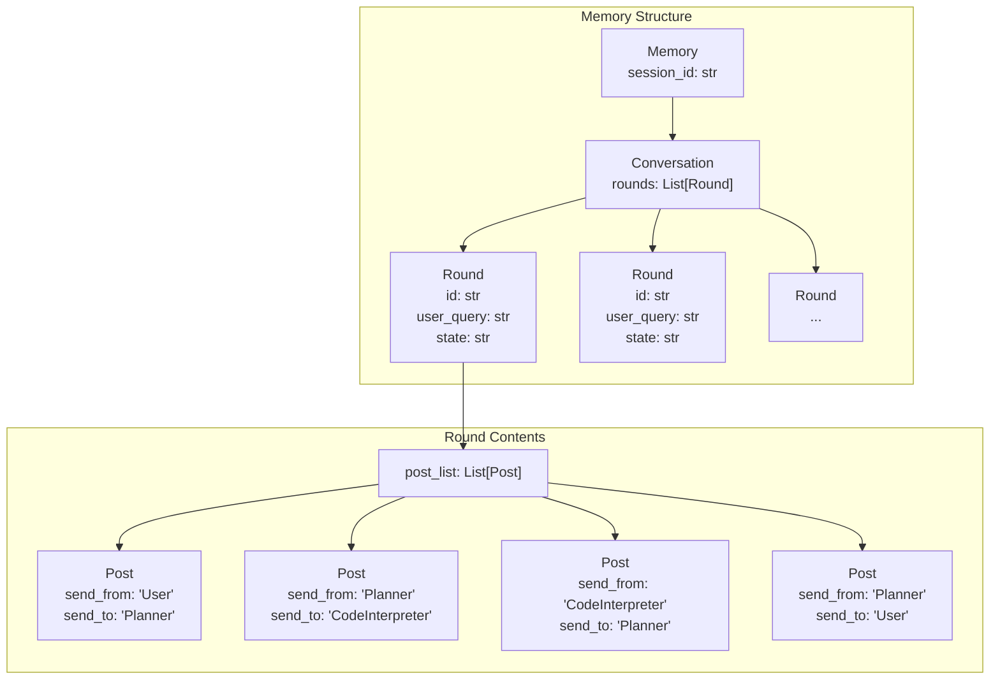

**Memory and Round Structure**

Sources: [taskweaver/session/session.py:86-87](), [taskweaver/session/session.py:166-167](), [tests/unit_tests/test_planner.py:155-172]()

### Post and Attachment System

`Post` objects are the fundamental communication units between TaskWeaver components. Each post contains a message and optional attachments that carry structured data.

| Attachment Type | Purpose | Example Content |
|----------------|---------|-----------------|
| `init_plan` | Initial task decomposition | "1. load data\n2. analyze\n3. report" |
| `plan` | Current execution plan | "1. instruct CodeInterpreter\n2. report results" |
| `current_plan_step` | Active step | "1. instruct CodeInterpreter to load data" |
| `thought` | Reasoning process | "I need to analyze the data first" |
| `python` | Code to execute | "import pandas as pd\ndf = pd.read_csv('data.csv')" |
| `execution_result` | Code output | "DataFrame loaded with 1000 rows" |
| `shared_memory_entry` | Cross-round state | SharedMemoryEntry object |

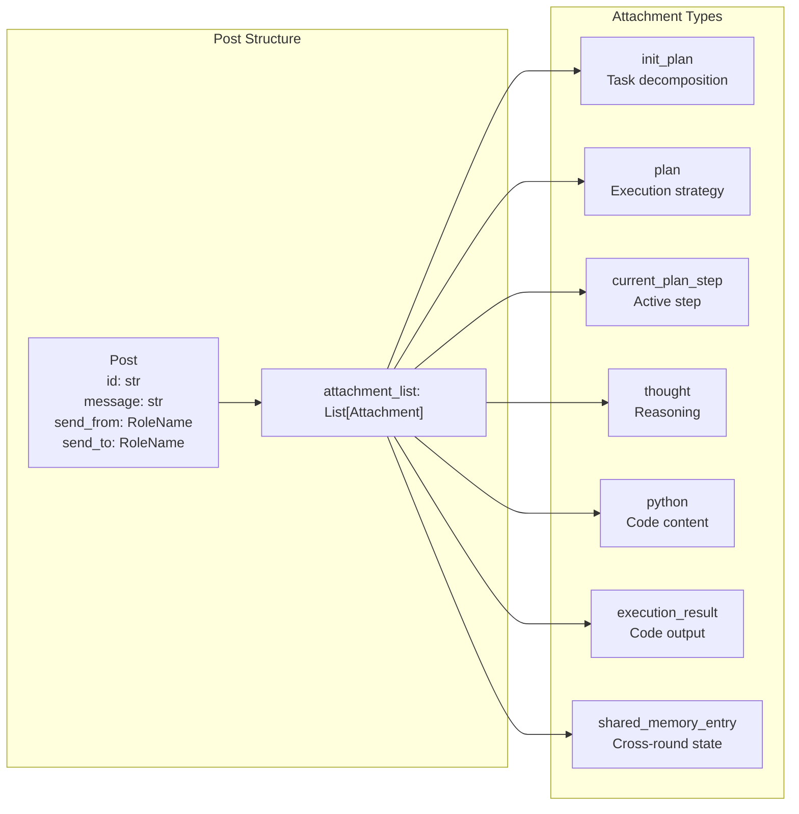

**Post and Attachment Architecture**

Sources: [taskweaver/memory/attachment.py:](#), [tests/unit_tests/test_planner.py:89-123](), [taskweaver/planner/planner.py:327-337]()

### Shared Memory System

The `SharedMemoryEntry` system enables cross-round state persistence, allowing information to flow between different conversation rounds.

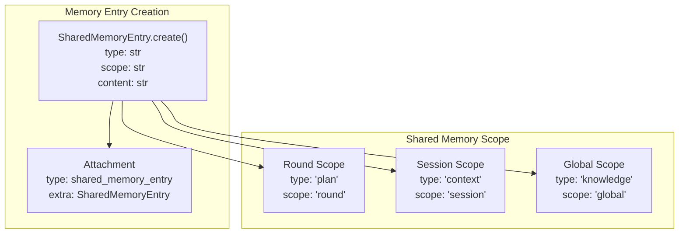

**Shared Memory Architecture**

Sources: [taskweaver/planner/planner.py:329-337](), [taskweaver/memory/memory.py:](#), [tests/unit_tests/test_planner.py:90-101]()

## Communication Subsystem

### PostTranslator System

The `PostTranslator` class bridges the gap between raw LLM text output and structured `Post` objects, handling streaming JSON parsing and incremental post construction.

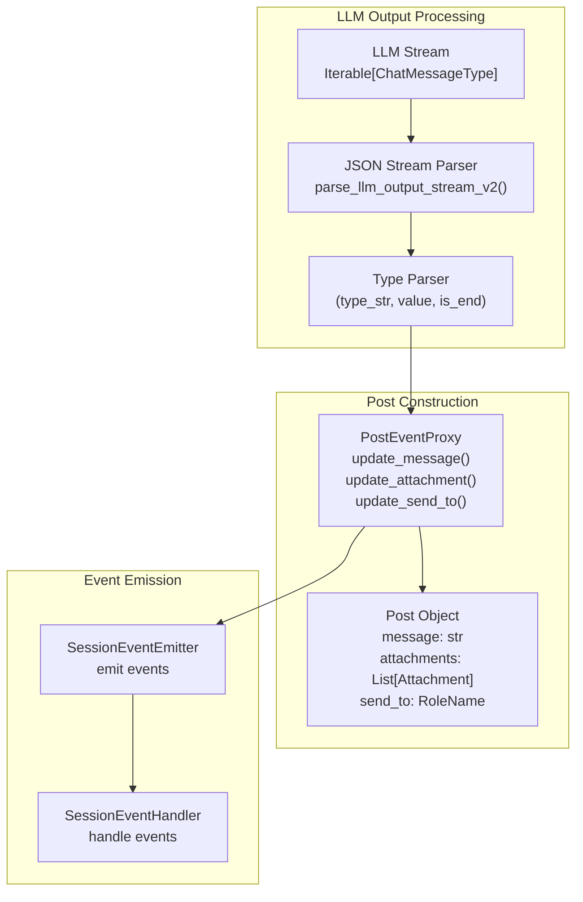

**PostTranslator Processing Flow**

The translator supports both streaming and batch processing modes:

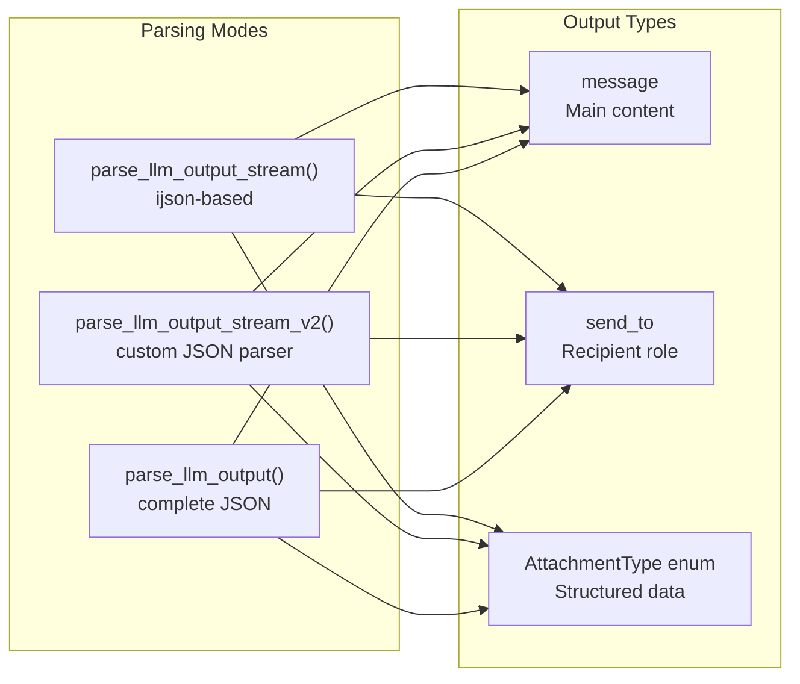

**PostTranslator Parsing Architecture**

Sources: [taskweaver/role/translator.py:34-133](), [taskweaver/role/translator.py:255-294](), [tests/unit_tests/test_translator.py:63-71]()

### Real-time Communication Flow

The communication system enables real-time streaming updates during LLM response generation:

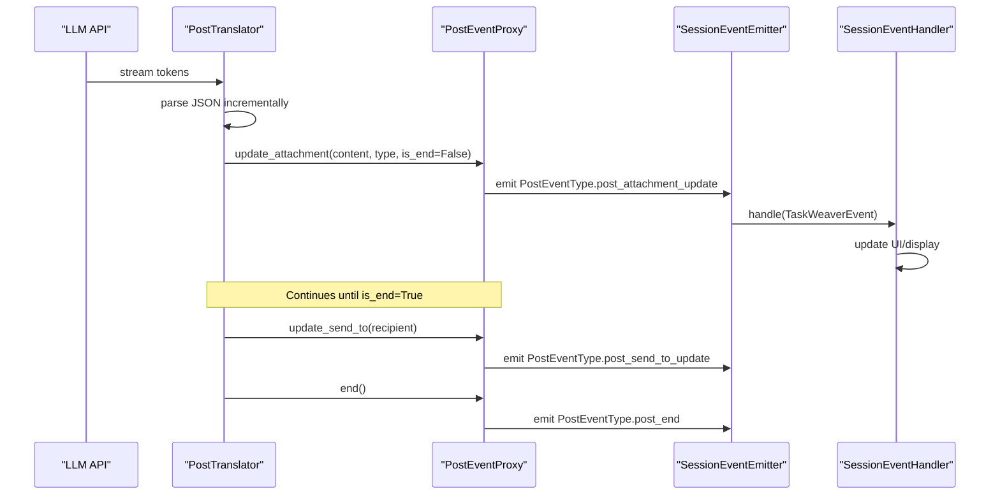

**Real-time Communication Sequence**

Sources: [taskweaver/role/translator.py:76-109](), [taskweaver/module/event_emitter.py:166-202](), [taskweaver/chat/console/chat.py:103-149]()

## Event Subsystem

### Event Architecture

The event system provides a comprehensive framework for monitoring and reacting to system state changes across three scopes: session, round, and post.

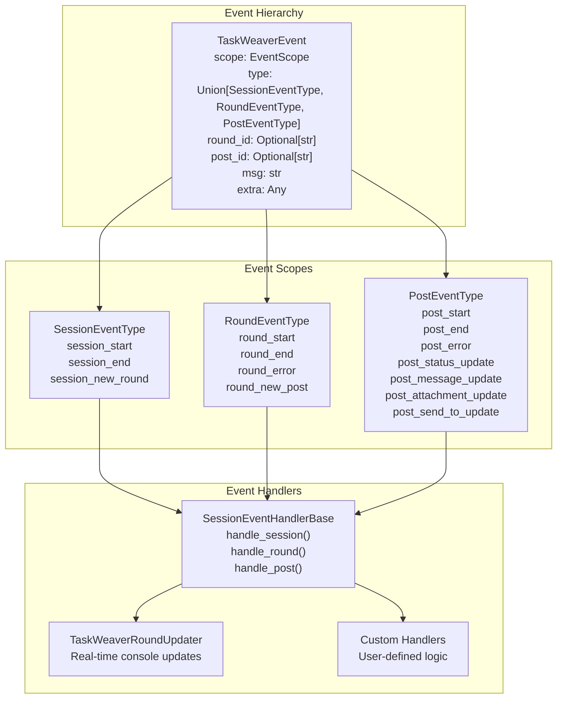

**Event System Architecture**

### PostEventProxy Pattern

The `PostEventProxy` implements a builder pattern for constructing posts while emitting real-time events:

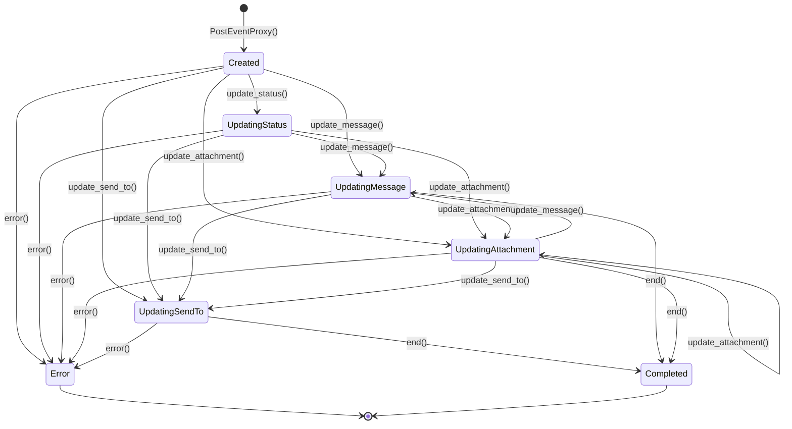

**PostEventProxy State Machine**

Sources: [taskweaver/module/event_emitter.py:126-229](), [taskweaver/module/event_emitter.py:45-53](), [taskweaver/chat/console/chat.py:68-149]()

## Advanced Memory Features

### Round Compression

The `RoundCompressor` manages long conversations by summarizing older rounds while retaining recent context:

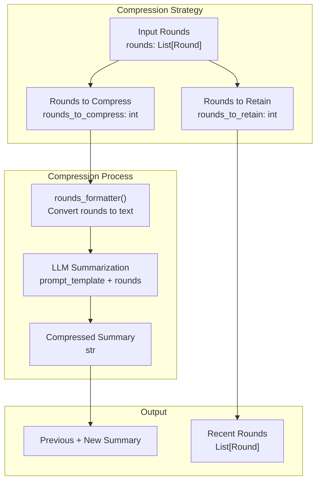

**Round Compression Architecture**

Sources: [taskweaver/memory/compression.py:44-75](), [taskweaver/planner/planner.py:218-226]()

### Experience System

The experience system enables TaskWeaver to learn from past successful interactions and apply that knowledge to new tasks:

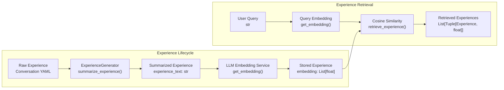

**Experience System Architecture**

Sources: [taskweaver/memory/experience.py:59-295](), [taskweaver/memory/experience.py:267-295](), [taskweaver/planner/planner.py:252]()

## Integration with Core Components

### Session Integration

The memory and communication system integrates tightly with the session management layer:

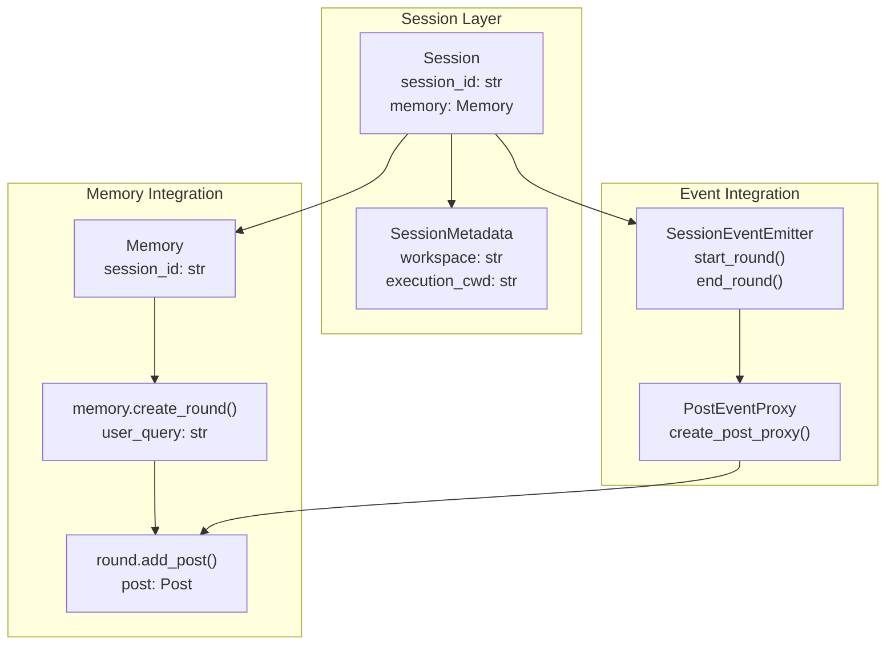

**Session-Memory Integration**

### Planner Integration

The Planner leverages the memory system for conversation history and the communication system for structured responses:

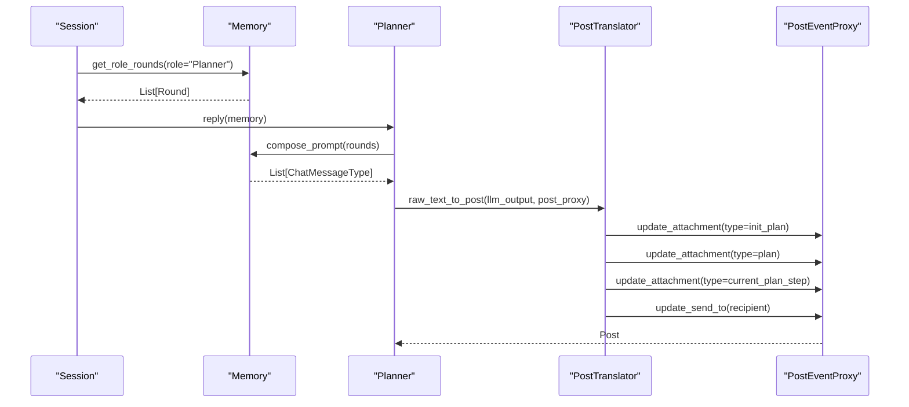

**Planner-Memory Communication Flow**

Sources: [taskweaver/session/session.py:183-200](), [taskweaver/planner/planner.py:237-371](), [taskweaver/planner/planner.py:321-325]()

The Memory and Communication System serves as the backbone for all TaskWeaver interactions, providing persistent storage, structured communication, and real-time event propagation that enables the coordinated operation of all system components.

---

