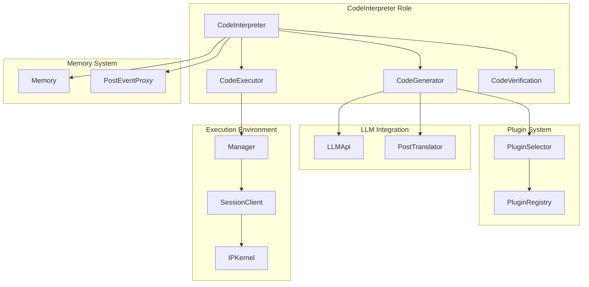
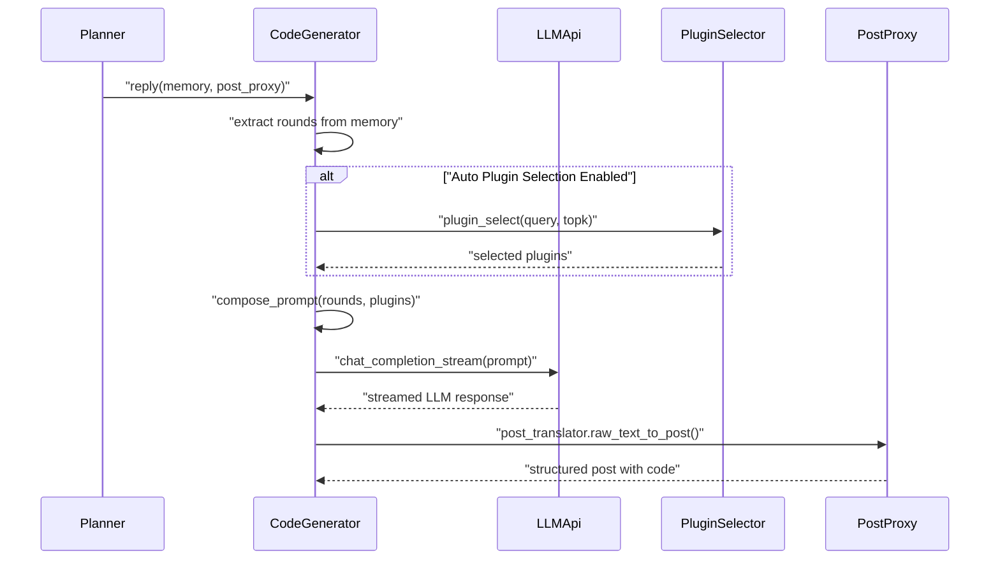
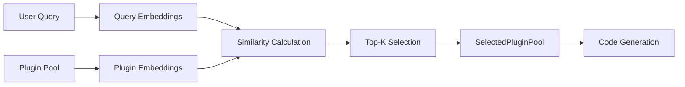
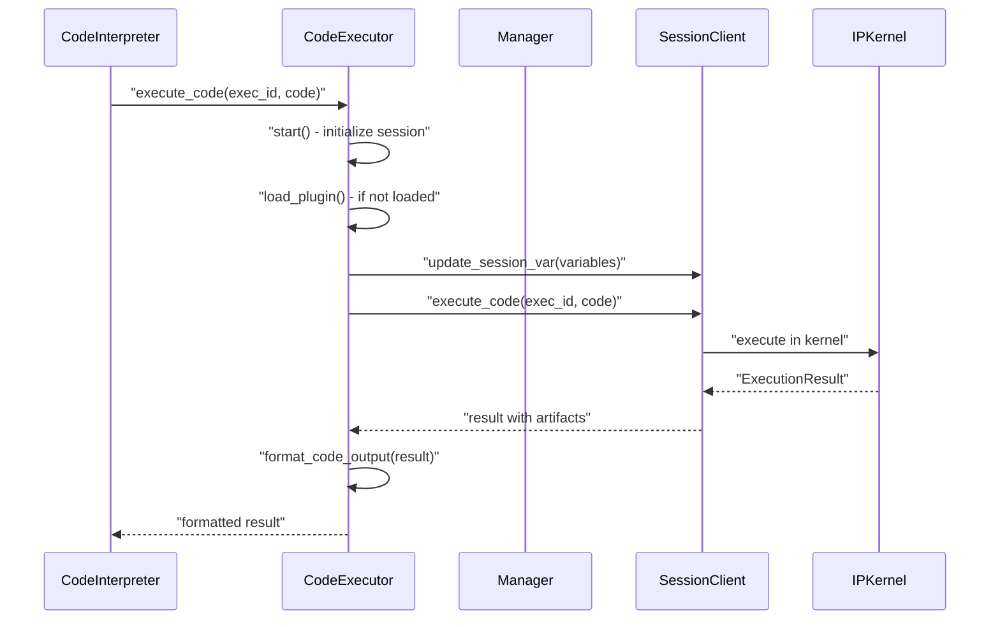
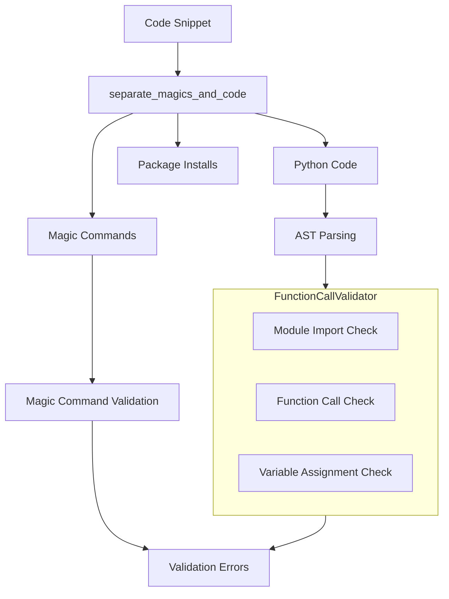
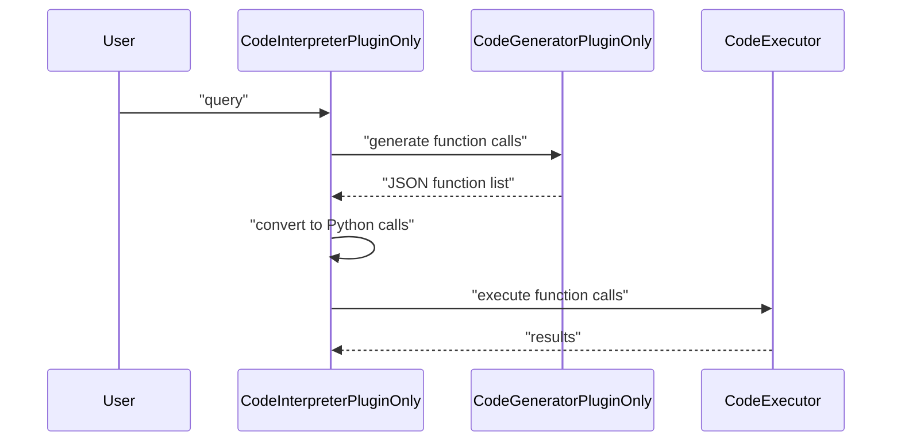
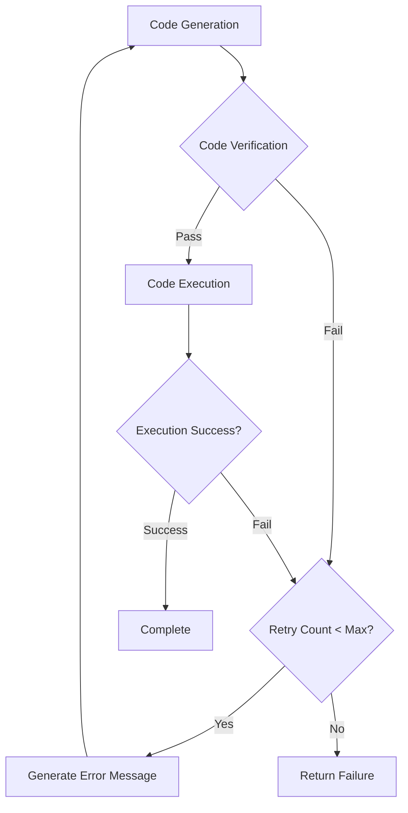

<!-- source: DeepWiki mcp.deepwiki.com · repo microsoft/TaskWeaver · page 3.4 Code Interpreter · fetched 2026-10-26 -->

# Code Interpreter

<details>
<summary>Relevant source files</summary>

The following files were used as context for generating this wiki page:

- [taskweaver/code_interpreter/__init__.py](taskweaver/code_interpreter/__init__.py)
- [taskweaver/code_interpreter/code_executor.py](taskweaver/code_interpreter/code_executor.py)
- [taskweaver/code_interpreter/code_interpreter/code_generator.py](taskweaver/code_interpreter/code_interpreter/code_generator.py)
- [taskweaver/code_interpreter/code_interpreter/code_interpreter.py](taskweaver/code_interpreter/code_interpreter/code_interpreter.py)
- [taskweaver/code_interpreter/code_interpreter_cli_only/code_interpreter_cli_only.py](taskweaver/code_interpreter/code_interpreter_cli_only/code_interpreter_cli_only.py)
- [taskweaver/code_interpreter/code_interpreter_plugin_only/code_interpreter_plugin_only.py](taskweaver/code_interpreter/code_interpreter_plugin_only/code_interpreter_plugin_only.py)
- [taskweaver/code_interpreter/code_verification.py](taskweaver/code_interpreter/code_verification.py)
- [taskweaver/logging/__init__.py](taskweaver/logging/__init__.py)
- [taskweaver/memory/post.py](taskweaver/memory/post.py)
- [tests/unit_tests/test_code_generator.py](tests/unit_tests/test_code_generator.py)
- [tests/unit_tests/test_code_verification.py](tests/unit_tests/test_code_verification.py)

</details>


The Code Interpreter is TaskWeaver's core component responsible for translating natural language requests into executable Python code and managing the entire code generation-to-execution pipeline. It bridges the gap between the Planner's task decomposition and actual code execution, serving as TaskWeaver's primary computational engine.

For information about the overall task orchestration, see [Planner](#3.1). For details about the underlying execution environment and containerization, see [Code Execution Service](#5).

## Architecture Overview

The Code Interpreter operates as a composite Role that integrates multiple specialized components to handle the complete code lifecycle:

### Core Components Diagram



Sources: [taskweaver/code_interpreter/code_interpreter/code_interpreter.py:84-116](), [taskweaver/code_interpreter/code_interpreter/code_generator.py:52-97](), [taskweaver/code_interpreter/code_executor.py:42-66]()

### Component Responsibilities

| Component | Primary Responsibility | Key Classes |
|-----------|----------------------|-------------|
| **CodeGenerator** | LLM-based code generation with context awareness | `CodeGenerator`, `CodeGeneratorConfig` |
| **CodeExecutor** | Code execution and artifact management | `CodeExecutor` |
| **CodeVerification** | Security and safety validation of generated code | `FunctionCallValidator` |
| **PluginSelector** | Automatic plugin selection based on query context | `PluginSelector`, `SelectedPluginPool` |

## Code Generation Process

The `CodeGenerator` class implements a sophisticated LLM-based code generation system that produces Python code tailored to user requests:

### Generation Pipeline



Sources: [taskweaver/code_interpreter/code_interpreter/code_generator.py:321-410]()

### Prompt Engineering Features

The `CodeGenerator` employs several advanced prompt engineering techniques:

- **Context Summarization**: Uses `RoundCompressor` for managing long conversation histories
- **Plugin Integration**: Dynamically includes relevant plugin documentation in prompts
- **Experience Learning**: Leverages `ExperienceGenerator` for learning from past executions
- **Planning Enrichment**: Incorporates shared memory entries from planning phase

Sources: [taskweaver/code_interpreter/code_interpreter/code_generator.py:146-187](), [taskweaver/code_interpreter/code_interpreter/code_generator.py:305-320]()

### Auto Plugin Selection

When enabled, the system automatically selects relevant plugins based on semantic similarity:



Sources: [taskweaver/code_interpreter/code_interpreter/code_generator.py:89-94](), [taskweaver/code_interpreter/code_interpreter/code_generator.py:305-320]()

## Code Execution Process

The `CodeExecutor` manages the complete execution lifecycle, from code preparation to result formatting:

### Execution Flow



Sources: [taskweaver/code_interpreter/code_executor.py:68-111]()

### Artifact Management

The execution system handles various types of artifacts generated during code execution:

| Artifact Type | File Extension | Description |
|---------------|----------------|-------------|
| `file` | Various | Generic file artifacts |
| `image` | `.png`, `.jpg`, `.gif`, `.svg` | Image outputs from visualizations |
| `chart` | `.json` | Chart data and configurations |

Artifacts are automatically saved to the workspace directory and made available via URI references.

Sources: [taskweaver/code_interpreter/code_executor.py:17-40](), [taskweaver/code_interpreter/code_executor.py:85-103]()

## Code Verification System

The verification system provides security controls through the `FunctionCallValidator` class:

### Verification Components



Sources: [taskweaver/code_interpreter/code_verification.py:8-131](), [taskweaver/code_interpreter/code_verification.py:142-176]()

### Security Controls

The verification system supports multiple security policies:

- **Module Restrictions**: Allowlist/blocklist for Python module imports
- **Function Restrictions**: Control over callable functions 
- **Variable Restrictions**: Control over variable assignments
- **Magic Command Filtering**: Blocks potentially dangerous Jupyter magic commands

Sources: [taskweaver/code_interpreter/code_verification.py:178-214]()

## Code Interpreter Variants

TaskWeaver provides specialized variants of the Code Interpreter for different use cases:

### Variant Comparison

| Variant | Code Generation | Execution Target | Use Case |
|---------|----------------|------------------|----------|
| **CodeInterpreter** | Full Python code via LLM | Python kernel | General-purpose data analysis and computation |
| **CodeInterpreterPluginOnly** | Plugin function calls only | Plugin functions | Restricted environments, specific workflows |
| **CodeInterpreterCLIOnly** | CLI commands | Shell execution | System administration, file operations |

### Plugin-Only Variant

The `CodeInterpreterPluginOnly` restricts code generation to plugin function calls:



Sources: [taskweaver/code_interpreter/code_interpreter_plugin_only/code_interpreter_plugin_only.py:31-162]()

## Configuration Options

The Code Interpreter supports extensive configuration through `CodeInterpreterConfig`:

### Core Configuration

```yaml
code_interpreter:
  use_local_uri: true                    # Use local file URIs for artifacts
  max_retry_count: 3                     # Maximum retry attempts for failed executions
  code_verification_on: false            # Enable code verification
  code_prefix: ""                        # Prefix to add to all executed code

  # Security settings
  allowed_modules: 
    - pandas
    - matplotlib
    - numpy
    - sklearn
  blocked_functions:
    - eval
    - exec
    - open
```

### Code Generator Configuration

```yaml
code_generator:
  role_name: "ProgramApe"                # Name used in prompts
  load_plugin: true                      # Include plugin documentation
  prompt_compression: false              # Enable conversation compression
  enable_auto_plugin_selection: false   # Enable automatic plugin selection
  auto_plugin_selection_topk: 3         # Number of plugins to select
  llm_alias: ""                          # Specific LLM to use
```

Sources: [taskweaver/code_interpreter/code_interpreter/code_interpreter.py:19-61](), [taskweaver/code_interpreter/code_interpreter/code_generator.py:23-50]()

## Error Handling and Recovery

The Code Interpreter implements robust error handling with automatic retry mechanisms:

### Retry Logic Flow



The system provides specific error messages for different failure types:
- Code verification failures trigger `format_code_correction_message()`
- Output format failures trigger `format_output_revision_message()`
- Execution failures include detailed error information and logs

Sources: [taskweaver/code_interpreter/code_interpreter/code_interpreter.py:171-294](), [taskweaver/code_interpreter/code_interpreter/code_generator.py:425-439]()

---

