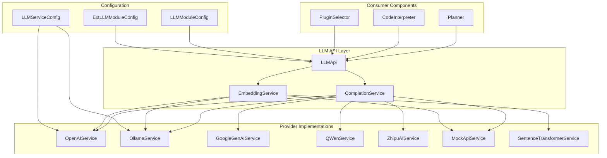
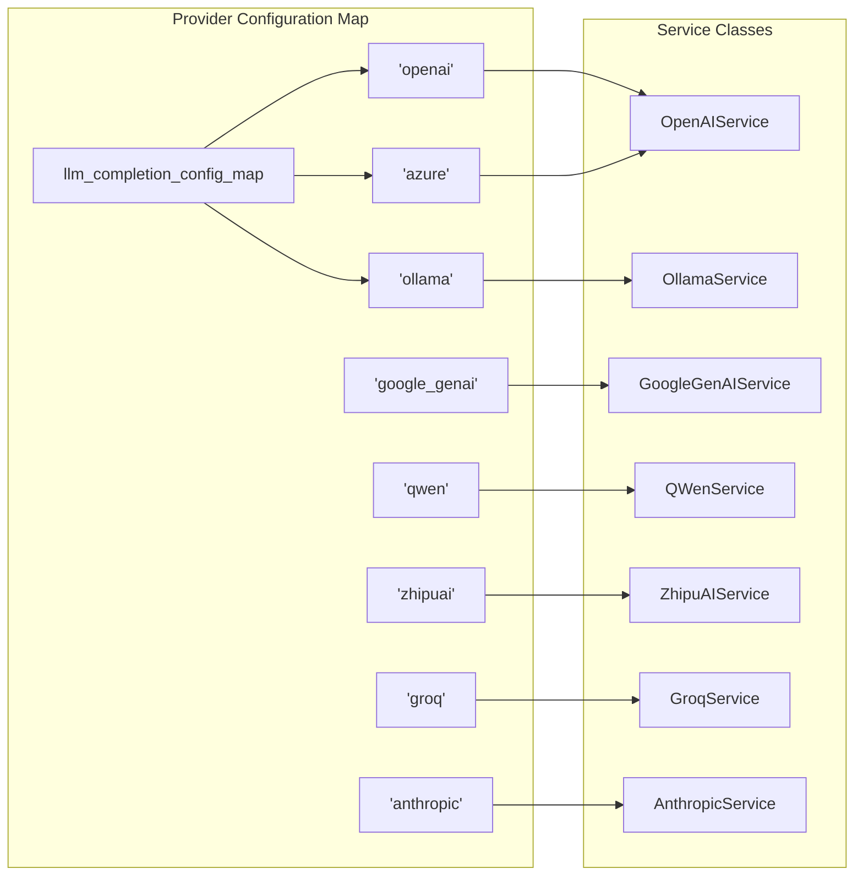
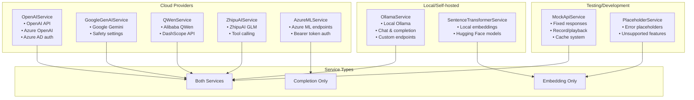
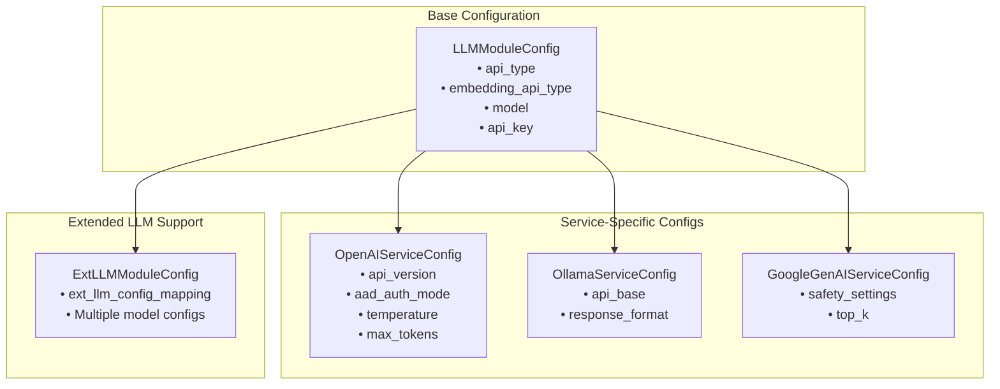

<!-- source: DeepWiki mcp.deepwiki.com · repo microsoft/TaskWeaver · page 4 LLM Integration · fetched 2026-10-26 -->

# LLM Integration

<details>
<summary>Relevant source files</summary>

The following files were used as context for generating this wiki page:

- [requirements.txt](requirements.txt)
- [taskweaver/code_interpreter/code_interpreter/code_generator_prompt.yaml](taskweaver/code_interpreter/code_interpreter/code_generator_prompt.yaml)
- [taskweaver/llm/__init__.py](taskweaver/llm/__init__.py)
- [taskweaver/llm/azure_ml.py](taskweaver/llm/azure_ml.py)
- [taskweaver/llm/base.py](taskweaver/llm/base.py)
- [taskweaver/llm/google_genai.py](taskweaver/llm/google_genai.py)
- [taskweaver/llm/mock.py](taskweaver/llm/mock.py)
- [taskweaver/llm/ollama.py](taskweaver/llm/ollama.py)
- [taskweaver/llm/openai.py](taskweaver/llm/openai.py)
- [taskweaver/llm/placeholder.py](taskweaver/llm/placeholder.py)
- [taskweaver/llm/qwen.py](taskweaver/llm/qwen.py)
- [taskweaver/llm/sentence_transformer.py](taskweaver/llm/sentence_transformer.py)
- [taskweaver/llm/zhipuai.py](taskweaver/llm/zhipuai.py)
- [taskweaver/memory/plugin.py](taskweaver/memory/plugin.py)
- [tests/unit_tests/test_embedding.py](tests/unit_tests/test_embedding.py)
- [tests/unit_tests/test_plugin.py](tests/unit_tests/test_plugin.py)
- [tests/unit_tests/test_plugin_selector.py](tests/unit_tests/test_plugin_selector.py)

</details>


## Purpose and Scope

This document covers TaskWeaver's LLM (Large Language Model) integration system, which provides a unified abstraction layer for interacting with multiple LLM providers and embedding services. The system enables TaskWeaver components to use different LLM providers through consistent interfaces without being coupled to specific implementations.

For information about how LLMs are used within specific TaskWeaver components, see [Planner](#3.1) and [Code Interpreter](#3.4). For deployment and configuration details, see [Configuration and Verification](#9).

## Architecture Overview

TaskWeaver's LLM integration follows a provider pattern with clear separation between interfaces, configuration, and implementations. The system supports both completion services (chat/text generation) and embedding services through standardized APIs.

### LLM Integration Architecture



Sources: [taskweaver/llm/__init__.py:44-134](), [taskweaver/llm/base.py:30-120]()

## LLM API Facade

The `LLMApi` class serves as the main entry point for LLM operations, providing a unified interface that abstracts provider-specific implementations and manages service instantiation.

### Provider Mapping and Initialization



The `LLMApi` constructor uses the `api_type` configuration to select appropriate service implementations. It supports both primary LLM services and additional external LLM models through the `ExtLLMModuleConfig`.

Key methods provided by `LLMApi`:

| Method | Purpose | Return Type |
|--------|---------|-------------|
| `chat_completion()` | Synchronous chat completion | `ChatMessageType` |
| `chat_completion_stream()` | Streaming chat completion | `Generator[ChatMessageType, None, None]` |
| `get_embedding()` | Single string embedding | `List[float]` |
| `get_embedding_list()` | Batch string embeddings | `List[List[float]]` |

Sources: [taskweaver/llm/__init__.py:27-134](), [taskweaver/llm/__init__.py:135-206]()

## Service Abstractions

TaskWeaver defines two primary service interfaces that all LLM providers must implement:

### CompletionService Interface

The `CompletionService` abstract base class defines the contract for text generation services:

```python
@abc.abstractmethod
def chat_completion(
    self,
    messages: List[ChatMessageType],
    stream: bool = True,
    temperature: Optional[float] = None,
    max_tokens: Optional[int] = None,
    top_p: Optional[float] = None,
    stop: Optional[List[str]] = None,
    **kwargs: Any,
) -> Generator[ChatMessageType, None, None]:
```

### EmbeddingService Interface

The `EmbeddingService` abstract base class defines the contract for embedding generation:

```python
@abc.abstractmethod
def get_embeddings(self, strings: List[str]) -> List[List[float]]:
```

Sources: [taskweaver/llm/base.py:79-120]()

## Provider Implementations

TaskWeaver supports multiple LLM providers through dedicated service implementations. Each provider handles authentication, API communication, and response formatting specific to that service.

### Provider Implementation Matrix



### OpenAI Service Implementation

The `OpenAIService` supports multiple OpenAI-compatible endpoints and authentication methods:

- **Standard OpenAI**: API key authentication
- **Azure OpenAI**: API key with versioned endpoints  
- **Azure AD**: Interactive login, device flow, or service principal authentication

The service handles streaming responses, tool calling, and constrained generation features.

Sources: [taskweaver/llm/openai.py:19-434]()

### Local LLM Support

The `OllamaService` enables integration with locally-hosted models through the Ollama API:

- Supports both `/api/chat` (newer) and `/api/generate` (fallback) endpoints
- Configurable base URL for custom Ollama installations
- JSON response format support for structured outputs

Sources: [taskweaver/llm/ollama.py:16-204]()

## Configuration System

The LLM integration uses a hierarchical configuration system that allows for flexible provider setup and parameter tuning.

### Configuration Hierarchy



### Configuration Parameters

| Parameter | Purpose | Default | Providers |
|-----------|---------|---------|-----------|
| `api_type` | Primary LLM provider | `"openai"` | All |
| `embedding_api_type` | Embedding provider | `"sentence_transformers"` | Embedding services |
| `model` | Model name/ID | Provider-specific | All |
| `temperature` | Response randomness | `0.0` | Most providers |
| `max_tokens` | Response length limit | `1024` | Most providers |
| `use_mock` | Enable mock layer | `false` | Testing |

Sources: [taskweaver/llm/base.py:30-64](), [taskweaver/llm/openai.py:19-111]()

## Advanced Features

### Stream Smoothing

The `LLMApi` includes a sophisticated stream smoothing mechanism that normalizes response timing across different providers to improve user experience:

```python
def _stream_smoother(
    self,
    stream_init: Callable[[], Generator[ChatMessageType, None, None]],
) -> Generator[ChatMessageType, None, None]:
```

The smoother:
- Buffers incoming chunks from the LLM provider
- Calculates adaptive output speed based on input rate
- Provides consistent chunk timing regardless of provider behavior
- Handles interruption and cleanup gracefully

Sources: [taskweaver/llm/__init__.py:207-388]()

### Mock and Testing Infrastructure

The `MockApiService` provides comprehensive testing capabilities:

#### Mock Service Modes

```mermaid
graph LR
    subgraph "Mock Modes"
        Fixed["fixed<br/>Static responses"]
        RecordOnly["record_only<br/>Capture real responses"]
        PlaybackOnly["playback_only<br/>Use cached responses"]
        PlaybackOrRecord["playback_or_record<br/>Hybrid mode"]
    end
    
    subgraph "Cache System"
        MockCache["MockCacheStore<br/>• YAML persistence<br/>• MD5 query hashing<br/>• TTL support"]
    end
    
    Fixed --> MockCache
    RecordOnly --> MockCache
    PlaybackOnly --> MockCache
    PlaybackOrRecord --> MockCache
```



The mock service enables:
- **Fixed responses**: Predetermined outputs for testing
- **Record/playback**: Capture real LLM interactions for reproducible tests
- **Caching**: Persistent storage of LLM responses with query matching
- **Delay simulation**: Configurable response timing for UI testing

Sources: [taskweaver/llm/mock.py:33-353]()

### Function Calling and Tools Support

Several providers support structured function calling for plugin integration:

- **OpenAI**: Native tools/function calling support
- **ZhipuAI**: Compatible tools implementation  
- **Plugin integration**: Automatic tool schema generation from plugin specifications

The system automatically converts plugin definitions to tool schemas compatible with function-calling APIs.

Sources: [taskweaver/llm/openai.py:174-236](), [taskweaver/memory/plugin.py:240-279]()

## Error Handling and Resilience

The LLM integration includes comprehensive error handling for common failure scenarios:

### Provider-Specific Error Handling

Each service implementation includes specific error handling for API failures:

```python
except openai.APITimeoutError as e:
    raise Exception(f"OpenAI API request timed out: {e}")
except openai.APIConnectionError as e:
    raise Exception(f"OpenAI API request failed to connect: {e}")
except openai.BadRequestError as e:
    raise Exception(f"OpenAI API request was invalid: {e}")
```

### Fallback Mechanisms

- **Ollama service**: Automatic fallback from chat to completion API
- **Mock service**: Graceful degradation when cache misses occur
- **Placeholder services**: Clear error messages for unsupported features

Sources: [taskweaver/llm/openai.py:274-294](), [taskweaver/llm/ollama.py:63-82](), [taskweaver/llm/placeholder.py:1-36]()

---

