<!-- source: DeepWiki mcp.deepwiki.com · repo microsoft/TaskWeaver · page 5 Code Execution Service · fetched 2026-10-26 -->

# Code Execution Service

Relevant source files

The following files were used as context for generating this wiki page:

- [.gitattributes](.gitattributes)
- [docker/ces_container/Dockerfile](docker/ces_container/Dockerfile)
- [docker/ces_container/entrypoint.sh](docker/ces_container/entrypoint.sh)
- [project/examples/planner_examples/example-planner-echo.yaml](project/examples/planner_examples/example-planner-echo.yaml)
- [project/examples/planner_examples/example-planner-recepta.yaml](project/examples/planner_examples/example-planner-recepta.yaml)
- [scripts/build_executor.ps1](scripts/build_executor.ps1)
- [taskweaver/ces/__init__.py](taskweaver/ces/__init__.py)
- [taskweaver/ces/environment.py](taskweaver/ces/environment.py)
- [taskweaver/ces/kernel/ctx_magic.py](taskweaver/ces/kernel/ctx_magic.py)
- [taskweaver/ces/kernel/ext.py](taskweaver/ces/kernel/ext.py)
- [taskweaver/ces/kernel/launcher.py](taskweaver/ces/kernel/launcher.py)
- [taskweaver/ces/manager/sub_proc.py](taskweaver/ces/manager/sub_proc.py)
- [taskweaver/ces/runtime/executor.py](taskweaver/ces/runtime/executor.py)
- [taskweaver/ext_role/recepta/__init__.py](taskweaver/ext_role/recepta/__init__.py)
- [taskweaver/ext_role/recepta/recepta.py](taskweaver/ext_role/recepta/recepta.py)
- [taskweaver/ext_role/recepta/recepta.role.yaml](taskweaver/ext_role/recepta/recepta.role.yaml)
- [taskweaver/module/execution_service.py](taskweaver/module/execution_service.py)
- [tests/unit_tests/test_environment.py](tests/unit_tests/test_environment.py)

The Code Execution Service (CES) is TaskWeaver's isolated code execution environment that provides secure, sandboxed Python code execution capabilities. It manages IPython kernels, handles plugin loading, and maintains execution state across user sessions. The service supports both local and containerized execution modes for flexibility and security.

For information about how the Code Execution Service integrates with the broader TaskWeaver architecture, see [System Architecture](#2). For details about plugin development and management, see [Plugin System](#6).

## Architecture Overview

The Code Execution Service follows a manager-client pattern with pluggable execution environments:

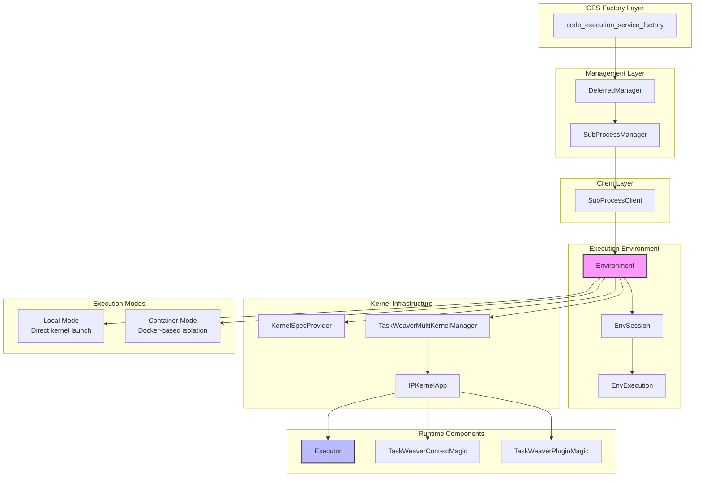

*Sources: taskweaver/ces/__init__.py, taskweaver/ces/environment.py, taskweaver/ces/manager/sub_proc.py, taskweaver/ces/kernel/launcher.py*

## Service Factory and Configuration

The CES uses a factory pattern for initialization through the `code_execution_service_factory` function:

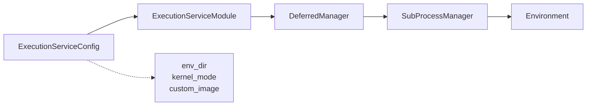

The configuration supports key parameters:

| Parameter | Default | Description |
|-----------|---------|-------------|
| `env_dir` | `{app_base_path}/env` | Directory for execution environments |
| `kernel_mode` | `"container"` | Execution mode: `"local"` or `"container"` |
| `custom_image` | `None` | Custom Docker image for container mode |

*Sources: taskweaver/module/execution_service.py:11-36, taskweaver/ces/__init__.py:8-23*

## Environment Management

### Environment Class

The `Environment` class [taskweaver/ces/environment.py:113-178]() is the core component managing kernel lifecycle and execution:

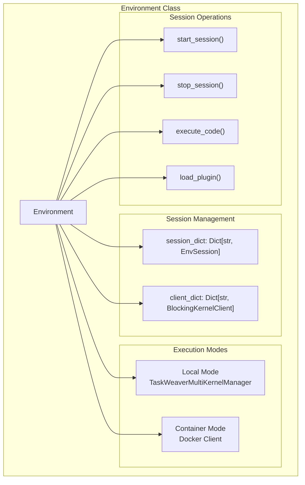

*Sources: taskweaver/ces/environment.py:113-178*

### Session Lifecycle

Each execution session follows a defined lifecycle managed by `EnvSession`:

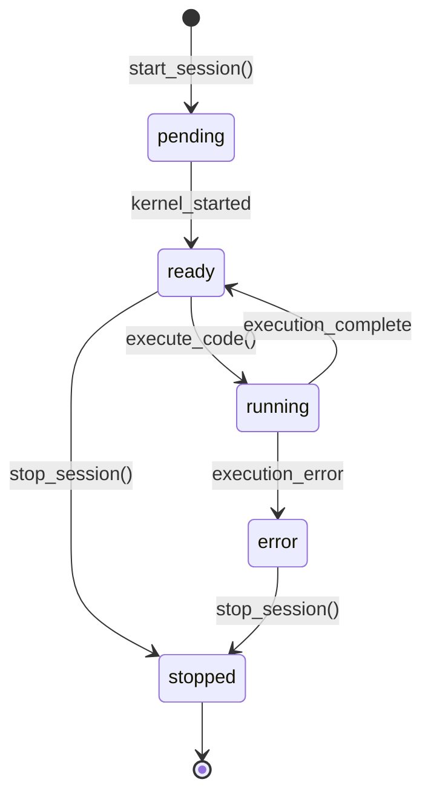

Session state is tracked through the `EnvSession` dataclass [taskweaver/ces/environment.py:58-73]():

| Field | Type | Description |
|-------|------|-------------|
| `session_id` | `str` | Unique session identifier |
| `kernel_status` | `Literal` | Current kernel state |
| `kernel_id` | `str` | IPython kernel identifier |
| `execution_count` | `int` | Number of executions performed |
| `session_dir` | `str` | Session workspace directory |
| `session_var` | `Dict[str, str]` | Session variables |
| `plugins` | `Dict[str, EnvPlugin]` | Loaded plugins |

*Sources: taskweaver/ces/environment.py:58-73, taskweaver/ces/environment.py:187-310*

## Execution Modes

### Local Mode

Local mode [taskweaver/ces/environment.py:200-236]() runs IPython kernels directly on the host system:

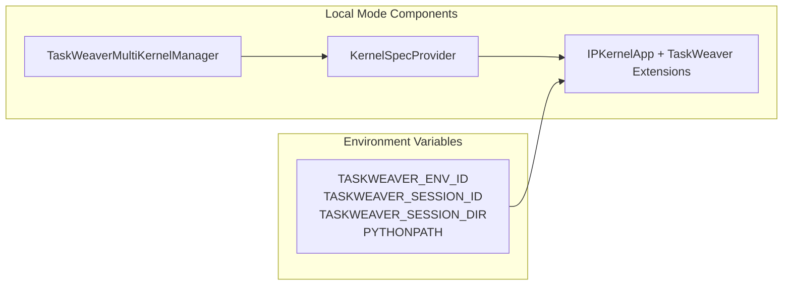

*Sources: taskweaver/ces/environment.py:200-236, taskweaver/ces/environment.py:75-91*

### Container Mode

Container mode [taskweaver/ces/environment.py:237-308]() provides Docker-based isolation using the `taskweavercontainers/taskweaver-executor` image:

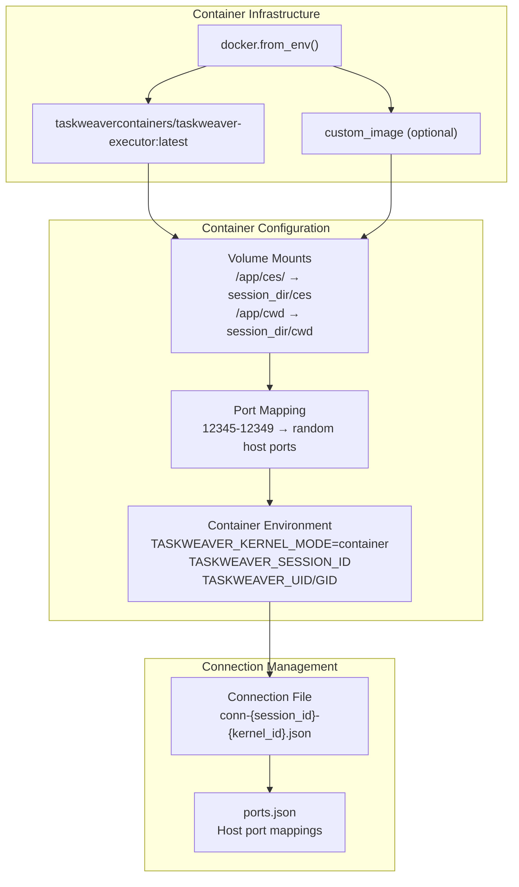

*Sources: taskweaver/ces/environment.py:237-308, docker/ces_container/Dockerfile, docker/ces_container/entrypoint.sh*

## Kernel Integration

### Kernel Launcher

The kernel launcher [taskweaver/ces/kernel/launcher.py]() initializes IPython kernels with TaskWeaver extensions:

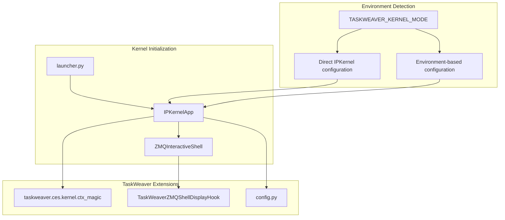

*Sources: taskweaver/ces/kernel/launcher.py, taskweaver/ces/kernel/ext.py*

### Magic Commands

TaskWeaver extends IPython with custom magic commands through `TaskWeaverContextMagic` and `TaskWeaverPluginMagic`:

| Magic Command | Type | Purpose |
|---------------|------|---------|
| `%_taskweaver_session_init` | Line | Initialize TaskWeaver context |
| `%%_taskweaver_update_session_var` | Cell | Update session variables |
| `%_taskweaver_check_session_var` | Line | Display session variables |
| `%_taskweaver_exec_pre_check` | Line | Pre-execution setup |
| `%_taskweaver_exec_post_check` | Line | Post-execution cleanup |
| `%%_taskweaver_plugin_register` | Cell | Register plugin code |
| `%%_taskweaver_plugin_load` | Cell | Load plugin with configuration |
| `%_taskweaver_plugin_test` | Line | Test plugin functionality |
| `%_taskweaver_plugin_unload` | Line | Unload plugin |

*Sources: taskweaver/ces/kernel/ctx_magic.py:19-155*

## Runtime Execution

### Executor Class

The `Executor` class [taskweaver/ces/runtime/executor.py:139-236]() manages plugin lifecycle and execution context:

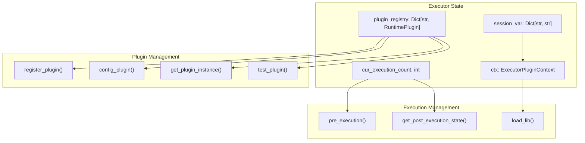

*Sources: taskweaver/ces/runtime/executor.py:139-236*

### Code Execution Flow

The code execution process follows a structured pipeline:

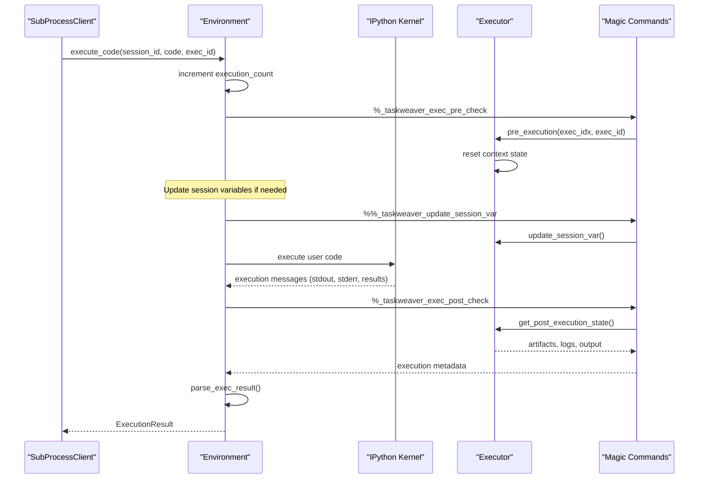

*Sources: taskweaver/ces/environment.py:312-343, taskweaver/ces/kernel/ctx_magic.py:50-61*

## Container Infrastructure

### Docker Image Build

The executor container is built using a multi-stage process:

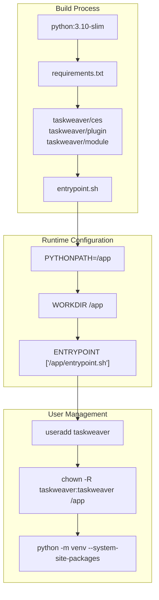

*Sources: docker/ces_container/Dockerfile, docker/ces_container/entrypoint.sh, scripts/build_executor.ps1*

### Container Security

The container implements security measures through user isolation and environment configuration:

| Security Feature | Implementation | Purpose |
|------------------|----------------|---------|
| Non-root execution | `useradd -u $USER_ID taskweaver` | Prevent privilege escalation |
| Volume isolation | Bind mounts for `/app/ces` and `/app/cwd` | Limit filesystem access |
| Port isolation | Dynamic port mapping | Prevent port conflicts |
| UID/GID mapping | `TASKWEAVER_UID`/`TASKWEAVER_GID` | File permission consistency |

*Sources: docker/ces_container/entrypoint.sh:3-13, taskweaver/ces/environment.py:250-254*

## Client Interface

### SubProcessClient

The `SubProcessClient` class [taskweaver/ces/manager/sub_proc.py:9-52]() provides the primary interface to the execution service:

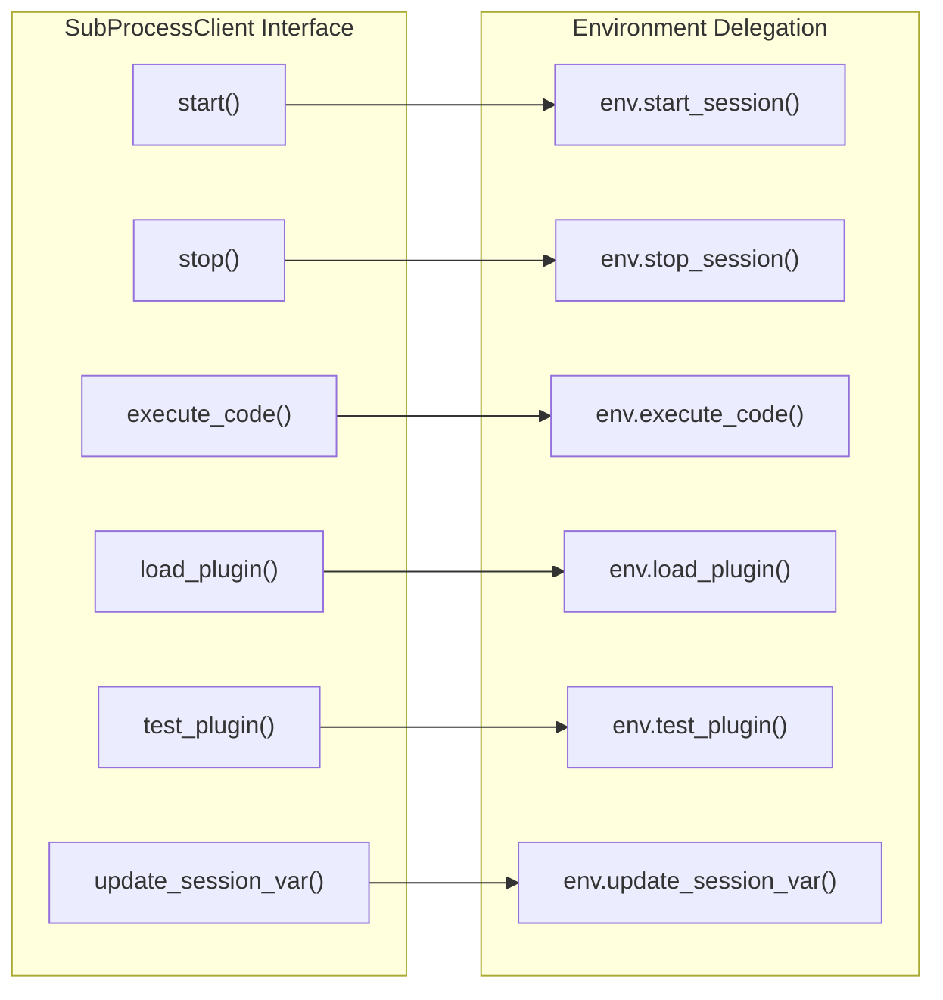

*Sources: taskweaver/ces/manager/sub_proc.py:9-52*

## Testing and Validation

The CES includes comprehensive testing for both local and container modes:

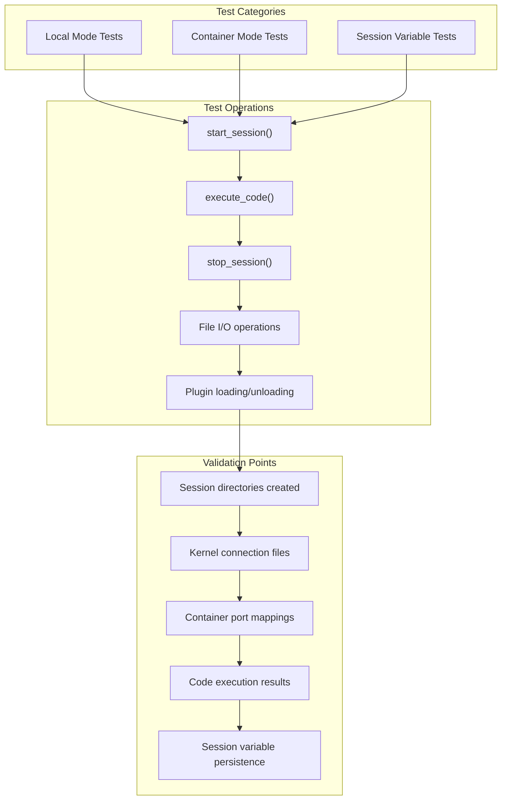

*Sources: tests/unit_tests/test_environment.py:88-191*

---

