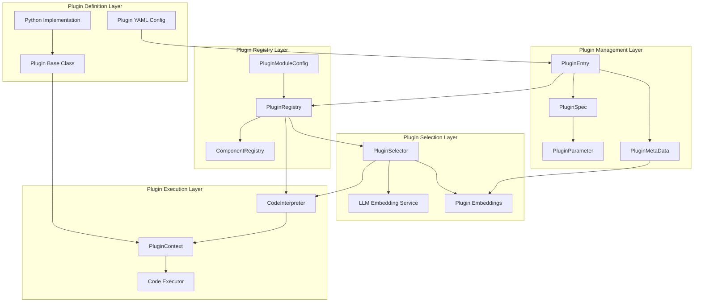
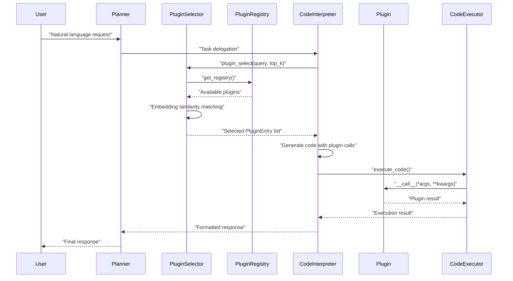
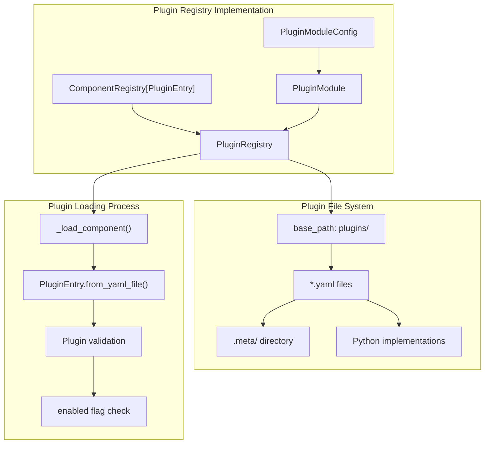
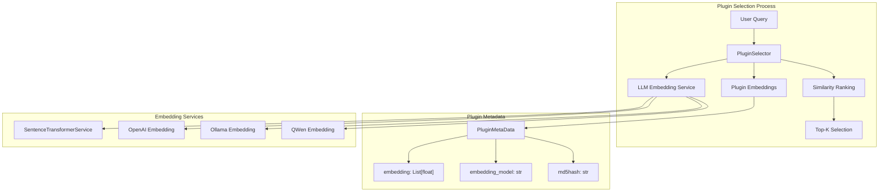
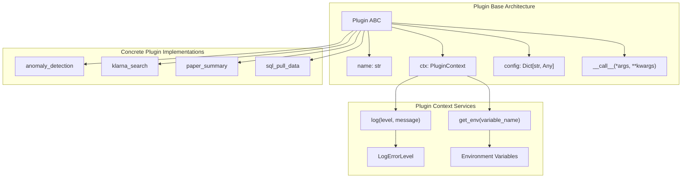
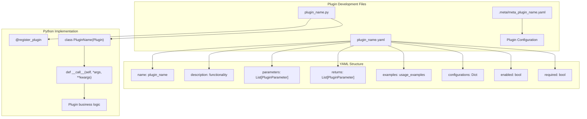

<!-- source: DeepWiki mcp.deepwiki.com · repo microsoft/TaskWeaver · page 6 Plugin System · fetched 2026-10-26 -->

# Plugin System

<details>
<summary>Relevant source files</summary>

The following files were used as context for generating this wiki page:

- [project/plugins/README.md](project/plugins/README.md)
- [taskweaver/ext_role/web_explorer/README.md](taskweaver/ext_role/web_explorer/README.md)
- [taskweaver/ext_role/web_search/README.md](taskweaver/ext_role/web_search/README.md)
- [taskweaver/memory/plugin.py](taskweaver/memory/plugin.py)
- [taskweaver/misc/component_registry.py](taskweaver/misc/component_registry.py)
- [taskweaver/plugin/base.py](taskweaver/plugin/base.py)
- [tests/unit_tests/test_embedding.py](tests/unit_tests/test_embedding.py)
- [tests/unit_tests/test_plugin.py](tests/unit_tests/test_plugin.py)
- [tests/unit_tests/test_plugin_selector.py](tests/unit_tests/test_plugin_selector.py)
- [website/blog/authors.yml](website/blog/authors.yml)
- [website/blog/evaluation.md](website/blog/evaluation.md)
- [website/blog/experience.md](website/blog/experience.md)
- [website/blog/local_llm.md](website/blog/local_llm.md)
- [website/blog/plugin.md](website/blog/plugin.md)
- [website/blog/reasoning.md](website/blog/reasoning.md)
- [website/blog/role.md](website/blog/role.md)
- [website/docusaurus.config.js](website/docusaurus.config.js)

</details>


This document covers TaskWeaver's plugin architecture, which enables extending agent capabilities through reusable code components. The plugin system provides a framework for defining, registering, selecting, and executing custom functionality within the code execution environment.

For information about external roles that complement plugins, see [External Roles](6.1). For details about code execution where plugins are invoked, see [Code Execution Service](5).

## Plugin Architecture Overview

TaskWeaver's plugin system bridges natural language requests with executable code through a layered architecture that manages plugin metadata, selection, and execution.

### Core Plugin Architecture



**Sources:** [taskweaver/memory/plugin.py:14-325](), [taskweaver/plugin/base.py:9-44](), [taskweaver/misc/component_registry.py:14-95]()

### Plugin Data Flow



**Sources:** [tests/unit_tests/test_plugin_selector.py:30-40](), [taskweaver/memory/plugin.py:282-297]()

## Plugin Components

### PluginEntry

The `PluginEntry` class represents a complete plugin definition, combining specification, implementation, and metadata.

| Property | Type | Description |
|----------|------|-------------|
| `name` | `str` | Plugin identifier |
| `plugin_only` | `bool` | Function calling mode flag |
| `impl` | `str` | Python implementation reference |
| `spec` | `PluginSpec` | Plugin specification |
| `config` | `Dict[str, Any]` | Plugin configuration |
| `required` | `bool` | Required plugin flag |
| `enabled` | `bool` | Plugin activation status |
| `meta_data` | `PluginMetaData` | Plugin metadata |

The `PluginEntry.from_yaml_file()` method loads plugin definitions from YAML configurations:

```python
@staticmethod
def from_yaml_file(path: str) -> Optional["PluginEntry"]:
    content = read_yaml(path)
    yaml_file_name = os.path.basename(path)
    meta_file_path = os.path.join(
        os.path.dirname(path),
        ".meta",
        f"meta_{yaml_file_name}",
    )
```

**Sources:** [taskweaver/memory/plugin.py:174-225]()

### PluginSpec

The `PluginSpec` class defines the plugin's interface specification, including parameters and return values.

| Property | Type | Description |
|----------|------|-------------|
| `name` | `str` | Plugin function name |
| `description` | `str` | Plugin functionality description |
| `examples` | `str` | Usage examples |
| `args` | `List[PluginParameter]` | Function parameters |
| `returns` | `List[PluginParameter]` | Return value specifications |

The `format_prompt()` method generates LLM-compatible function signatures:

```python
def format_prompt(self) -> str:
    def normalize_type(t: str) -> str:
        if t.lower() == "string":
            return "str"
        if t.lower() == "integer":
            return "int"
        return t
```

**Sources:** [taskweaver/memory/plugin.py:83-171]()

### PluginParameter

The `PluginParameter` class represents individual plugin parameters and return values.

| Property | Type | Description |
|----------|------|-------------|
| `name` | `str` | Parameter name |
| `type` | `str` | Parameter type |
| `required` | `bool` | Required parameter flag |
| `description` | `str` | Parameter description |

**Sources:** [taskweaver/memory/plugin.py:43-80]()

## Plugin Registry and Management

### PluginRegistry

The `PluginRegistry` extends `ComponentRegistry[PluginEntry]` to manage plugin discovery and loading.



The `_load_component()` method handles individual plugin loading:

```python
def _load_component(self, path: str) -> Tuple[str, PluginEntry]:
    entry: Optional[PluginEntry] = PluginEntry.from_yaml_file(path)
    if entry is None:
        raise Exception(f"failed to loading plugin from {path}")
    if not entry.enabled:
        raise ComponentDisabledException(f"plugin {entry.name} is disabled")
    return entry.name, entry
```

**Sources:** [taskweaver/memory/plugin.py:282-325](), [taskweaver/misc/component_registry.py:14-95]()

### Plugin Module Configuration

The `PluginModuleConfig` manages plugin system configuration:

```python
class PluginModuleConfig(ModuleConfig):
    def _configure(self) -> None:
        self._set_name("plugin")
        app_dir = self.src.app_base_path
        self.base_path = self._get_path(
            "base_path",
            os.path.join(
                app_dir,
                "plugins",
            ),
        )
```

**Sources:** [taskweaver/memory/plugin.py:299-325]()

## Plugin Selection and Embeddings

### Plugin Selection Architecture



The plugin selection test demonstrates embedding-based selection:

```python
def test_plugin_selector():
    app_config = AppConfigSource(
        config={
            "plugin.base_path": os.path.join(os.path.dirname(os.path.abspath(__file__)), "data/plugins"),
            "llm.embedding_api_type": "sentence_transformers",
            "llm.embedding_model": "all-mpnet-base-v2",
            "code_generator.enable_auto_plugin_selection": True,
        },
    )
    plugin_selector = app_injector.get(PluginSelector)
    plugin_selector.refresh()
    plugin_selector.load_plugin_embeddings()

    query1 = "detect abnormal data points in ./data.csv."
    selected_plugins = plugin_selector.plugin_select(query1, top_k=3)
    assert any([p.name == "anomaly_detection" for p in selected_plugins])
```

**Sources:** [tests/unit_tests/test_plugin_selector.py:13-40](), [tests/unit_tests/test_embedding.py:15-121]()

### PluginMetaData Structure

The `PluginMetaData` class stores plugin embeddings and metadata:

| Property | Type | Description |
|----------|------|-------------|
| `name` | `str` | Plugin name |
| `embedding` | `List[float]` | Embedding vector |
| `embedding_model` | `str` | Embedding model used |
| `path` | `str` | Metadata file path |
| `md5hash` | `str` | Plugin content hash |

**Sources:** [taskweaver/memory/plugin.py:14-40]()

## Plugin Base Class and Context

### Plugin Base Implementation



The `Plugin` base class defines the plugin interface:

```python
class Plugin(ABC):
    def __init__(self, name: str, ctx: PluginContext, config: Dict[str, Any]) -> None:
        super().__init__()
        self.name: str = name
        self.ctx: PluginContext = ctx
        self.config: Dict[str, Any] = config

    @abstractmethod
    def __call__(self, *args: Any, **kwargs: Any) -> Any:
        """entry point for the execution of the plugin function"""

    def log(self, level: LogErrorLevel, message: str) -> None:
        """log a message from the plugin"""
        self.ctx.log(level, "Plugin-" + self.name, message)

    def get_env(self, variable_name: str) -> str:
        """get an environment variable from the context"""
        return self.ctx.get_env(self.name, variable_name)
```

**Sources:** [taskweaver/plugin/base.py:9-44]()

## Plugin Examples and Structure

### Available Plugin Types

Based on the plugin documentation, TaskWeaver includes several built-in plugins:

| Plugin Name | Purpose | Dependencies | Enabled by Default |
|-------------|---------|--------------|-------------------|
| `klarna_search` | Product search via Klarna API | None | Yes |
| `paper_summary` | PDF research paper summarization | Langchain | No |
| `sql_pull_data` | Natural language to SQL conversion | Langchain | No |
| `web_search` | Web search capabilities | API keys | Varies |
| `anomaly_detection` | Time series anomaly detection | None | Yes |

**Plugin Configuration Example (sql_pull_data):**

The `sql_pull_data` plugin demonstrates advanced plugin configuration:

```yaml
# Plugin requires Langchain installation
# Database profiling: table names, schema, sample data
# Natural language to SQL conversion
# GPT model configuration required in plugin YAML
```

**Sources:** [project/plugins/README.md:1-27]()

### Plugin Development Structure



**Sources:** [website/blog/plugin.md:10-130](), [taskweaver/memory/plugin.py:185-224]()

## Plugin Integration with Code Execution

### Code Generation and Plugin Integration

The plugin system integrates with the code generation process through function signatures and examples:

```python
# Plugin prompt formatting for LLM code generation
def format_prompt(self) -> str:
    examples = format_examples(self.examples)
    examples = f"# Examples:\n# {examples}\n" if examples else ""
    param_list = ",".join([format_arg_val(p) for p in self.args])
    return f"# {self.description}\n{examples}" f"def {self.name}({param_list}) -> {return_type}:...\n"

# Function calling format for plugin_only plugins
def format_function_calling(self) -> PromptToolType:
    assert self.plugin_only is True, "Only `plugin_only` plugins can be called in this way."
    function: PromptToolType = {
        "type": "function",
        "function": {
            "name": self.name,
            "description": self.spec.description,
            "parameters": {
                "type": "object",
                "properties": param_dict,
                "required": required_params,
            },
        },
    }
```

**Sources:** [taskweaver/memory/plugin.py:117-171](), [taskweaver/memory/plugin.py:240-280]()

### Plugin Lifecycle in Code Execution

1. **Plugin Discovery**: `PluginRegistry` scans the plugins directory for YAML files
2. **Plugin Loading**: `PluginEntry.from_yaml_file()` creates plugin entries
3. **Plugin Selection**: `PluginSelector.plugin_select()` chooses relevant plugins
4. **Code Generation**: LLM generates code with plugin function calls
5. **Plugin Instantiation**: Plugins are instantiated in the execution environment
6. **Plugin Execution**: Plugin `__call__()` methods are invoked
7. **Result Processing**: Plugin outputs are integrated into the execution flow

**Sources:** [taskweaver/memory/plugin.py:290-297](), [website/blog/plugin.md:102-125]()

---

