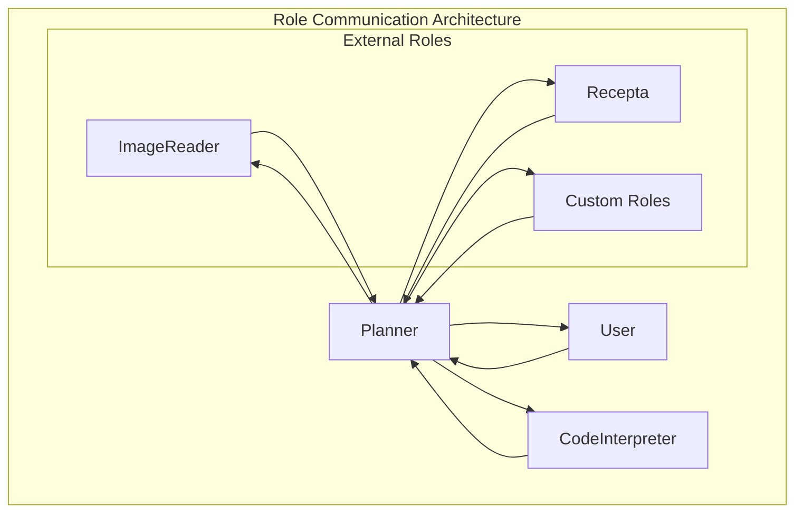
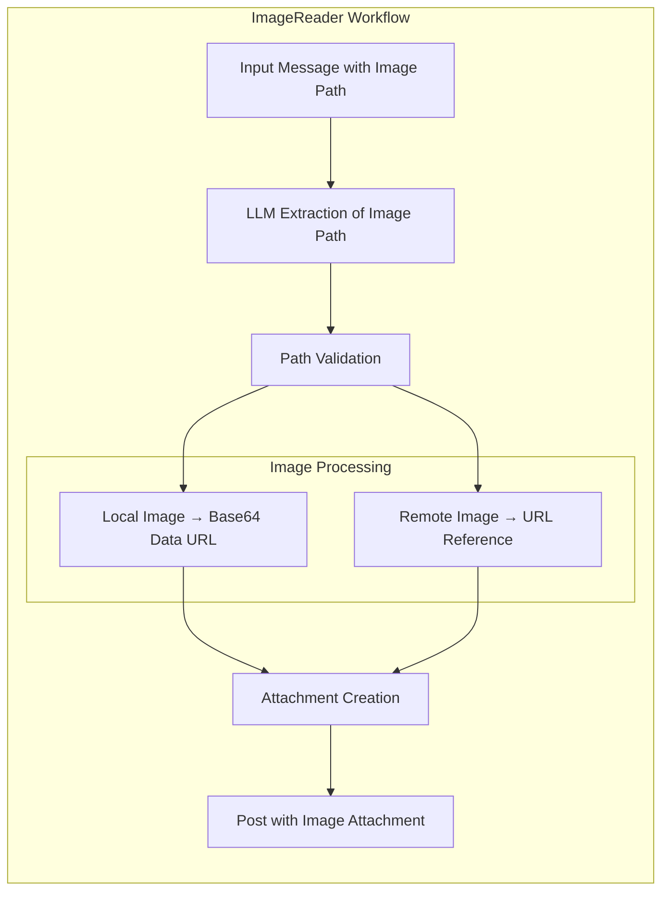
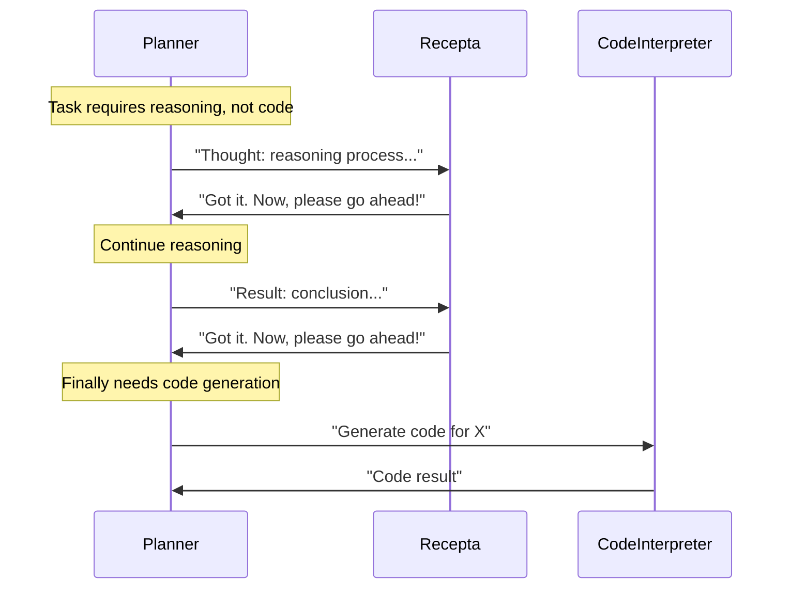
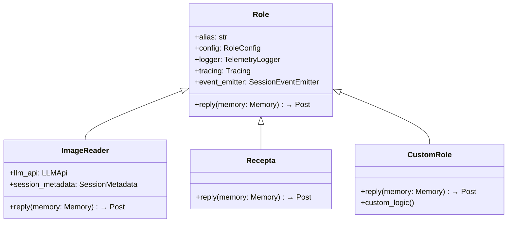
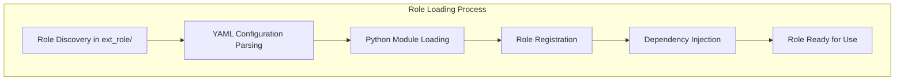
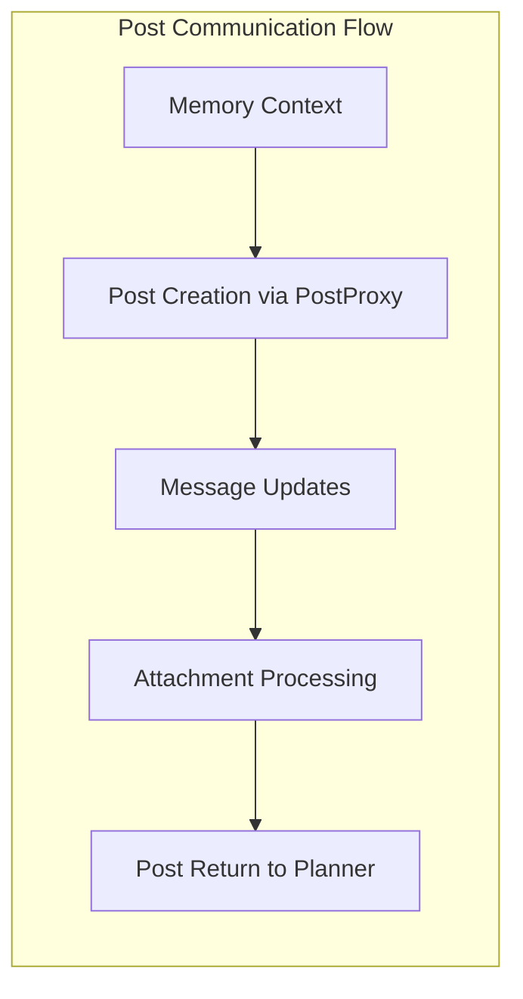

<!-- source: DeepWiki mcp.deepwiki.com · repo microsoft/TaskWeaver · page 6.1 External Roles · fetched 2026-10-26 -->

# External Roles

<details>
<summary>Relevant source files</summary>

The following files were used as context for generating this wiki page:

- [project/examples/planner_examples/example-planner-echo.yaml](project/examples/planner_examples/example-planner-echo.yaml)
- [project/examples/planner_examples/example-planner-recepta.yaml](project/examples/planner_examples/example-planner-recepta.yaml)
- [taskweaver/ces/runtime/executor.py](taskweaver/ces/runtime/executor.py)
- [taskweaver/ext_role/image_reader/__init__.py](taskweaver/ext_role/image_reader/__init__.py)
- [taskweaver/ext_role/image_reader/image_reader.py](taskweaver/ext_role/image_reader/image_reader.py)
- [taskweaver/ext_role/image_reader/image_reader.role.yaml](taskweaver/ext_role/image_reader/image_reader.role.yaml)
- [taskweaver/ext_role/recepta/__init__.py](taskweaver/ext_role/recepta/__init__.py)
- [taskweaver/ext_role/recepta/recepta.py](taskweaver/ext_role/recepta/recepta.py)
- [taskweaver/ext_role/recepta/recepta.role.yaml](taskweaver/ext_role/recepta/recepta.role.yaml)
- [taskweaver/llm/util.py](taskweaver/llm/util.py)
- [website/blog/authors.yml](website/blog/authors.yml)
- [website/blog/evaluation.md](website/blog/evaluation.md)
- [website/blog/experience.md](website/blog/experience.md)
- [website/blog/local_llm.md](website/blog/local_llm.md)
- [website/blog/plugin.md](website/blog/plugin.md)
- [website/blog/reasoning.md](website/blog/reasoning.md)
- [website/blog/role.md](website/blog/role.md)
- [website/docusaurus.config.js](website/docusaurus.config.js)

</details>


External roles extend TaskWeaver's capabilities beyond code generation by providing specialized functionality that doesn't naturally fit into the code-first paradigm. This document covers the built-in external roles, their architecture, and how to develop custom external roles.

For information about the core role system architecture, see [Core Components](#3). For details about the main Planner role, see [Planner](#3.1).

## Role System Overview

External roles are specialized components that handle tasks not naturally represented as code snippets. While TaskWeaver's core philosophy is code-first, certain tasks like reading images, accessing external knowledge bases, or supporting reasoning processes are better handled by dedicated roles rather than forcing them through code generation.



**Role Communication Principles:**
- All roles communicate exclusively with the Planner (star topology)
- Communication occurs through `Post` objects containing natural language messages
- Roles cannot directly communicate with each other
- The Planner orchestrates multi-role workflows

Sources: [website/blog/role.md:70-104](), [taskweaver/role/role.py](), [taskweaver/memory/post.py]()

## Built-in External Roles

### ImageReader Role

The `ImageReader` role processes image-related requests by extracting image paths from messages and converting them into structured attachments that other components can consume.



**ImageReader Implementation Details:**
- **Class**: `ImageReader` inherits from `Role`
- **Configuration**: `ImageReaderConfig` extends `RoleConfig`
- **LLM Integration**: Uses `LLMApi` to extract image paths from natural language
- **Image Processing**: Converts local images to base64 data URLs using `local_image_to_data_url()`
- **Attachment Types**: Creates `AttachmentType.image_url` attachments

**Key Methods:**
- `reply(memory: Memory) -> Post`: Main processing method
- `local_image_to_data_url(image_path)`: Converts local images to data URLs

Sources: [taskweaver/ext_role/image_reader/image_reader.py:45-119](), [taskweaver/ext_role/image_reader/image_reader.role.yaml:1-6]()

### Recepta Role

The `Recepta` role serves as a reasoning facilitator, allowing the Planner to document thought processes without requiring code generation or interaction with other workers.



**Recepta Characteristics:**
- **Purpose**: Enables Planner reasoning without forced code generation
- **Response Pattern**: Always replies with "Got it. Now, please go ahead!"
- **Use Cases**: Text processing, information extraction, logical reasoning tasks
- **Configuration**: Minimal configuration via `ReceptaConfig`

**Benefits of Recepta:**
- Reduces unnecessary LLM calls for code generation
- Maintains task decomposition and tracking
- Improves efficiency for reasoning-heavy tasks
- Preserves conversation flow

Sources: [taskweaver/ext_role/recepta/recepta.py:16-44](), [website/blog/reasoning.md:376-474](), [taskweaver/ext_role/recepta/recepta.role.yaml:1-8]()

## External Role Development

### Base Role Architecture

All external roles inherit from the `Role` base class and implement the core `reply` method:



**Required Components for Custom Roles:**

| Component | Purpose | Required |
|-----------|---------|----------|
| `RoleConfig` subclass | Configuration management | Yes |
| `reply()` method | Main processing logic | Yes |
| YAML configuration file | Role metadata and intro | Yes |
| Dependency injection setup | Integration with TaskWeaver | Yes |

Sources: [taskweaver/role/role.py](), [taskweaver/ext_role/image_reader/image_reader.py:40-61]()

### Role Configuration Files

External roles require YAML configuration files defining their metadata and introduction:

```yaml
# Example role configuration structure
alias: RoleName
module: taskweaver.ext_role.role_name.role_name.RoleClassName
intro: |-
  - Role description line 1
  - Role description line 2
  - Usage guidelines
```

**Configuration Fields:**
- `alias`: Role identifier used in communication
- `module`: Python module path to role implementation
- `intro`: Multi-line description for the Planner's understanding

Sources: [taskweaver/ext_role/image_reader/image_reader.role.yaml:1-6](), [taskweaver/ext_role/recepta/recepta.role.yaml:1-8]()

## Role Lifecycle and Integration

### Role Loading and Registration



**Role Integration Points:**
- **Directory Structure**: Roles located in `taskweaver/ext_role/` subdirectories
- **Module Discovery**: Automatic scanning of role directories
- **Configuration Management**: YAML-based configuration loading
- **Dependency Injection**: Integration with TaskWeaver's IoC container
- **Session Integration**: Roles available throughout session lifecycle

### Communication Protocol

External roles communicate with the Planner through structured `Post` objects:



**Communication Components:**
- `PostEventProxy`: Facilitates post creation and updates
- `Memory`: Provides conversation context and history
- `Attachment`: Structured data transfer mechanism
- `Post`: Final communication object

Sources: [taskweaver/memory/post.py](), [taskweaver/module/event_emitter.py](), [taskweaver/memory/attachment.py]()

## Configuration and Deployment

### Session Role Configuration

External roles are activated by configuring the session role list:

```json
{
  "session.roles": [
    "planner",
    "code_interpreter", 
    "image_reader",
    "recepta"
  ]
}
```

**Role Activation:**
- Roles must be explicitly listed in `session.roles` configuration
- Order in the list doesn't affect functionality
- Disabled roles are ignored during session initialization

### Role-Specific Configuration

Individual roles can have custom configuration parameters:

```json
{
  "image_reader.parameter_name": "value",
  "recepta.decorator": "custom_decorator"
}
```

Sources: [taskweaver/ext_role/recepta/recepta.py:12-14](), [website/blog/reasoning.md:476-483]()

---

