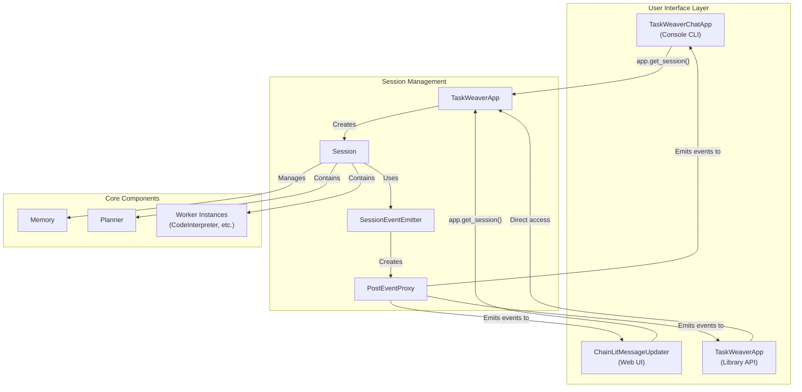
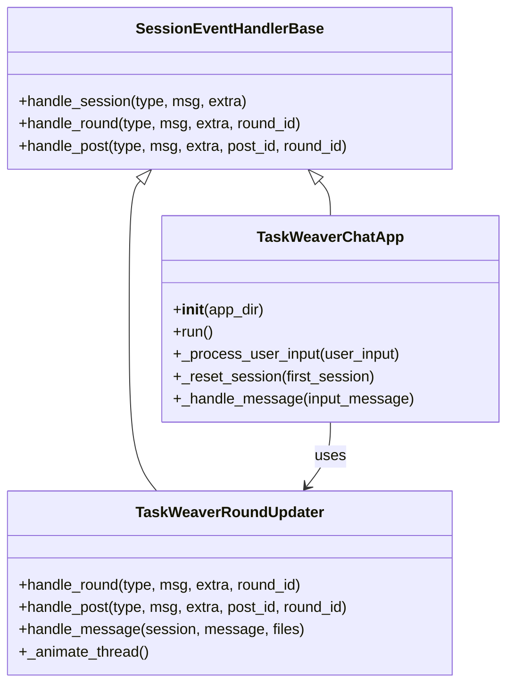
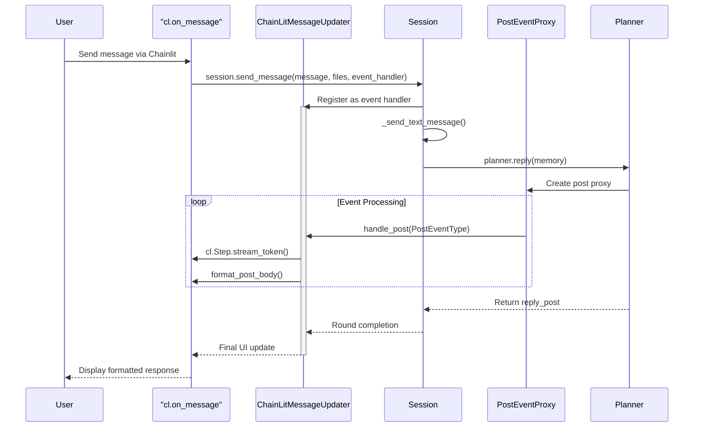
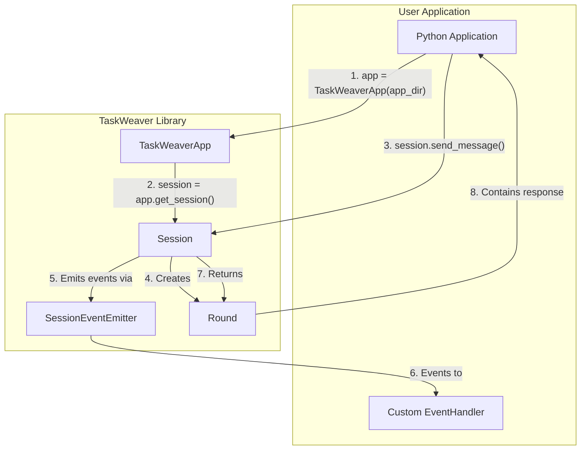
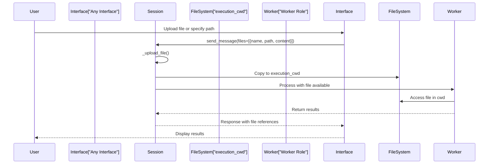
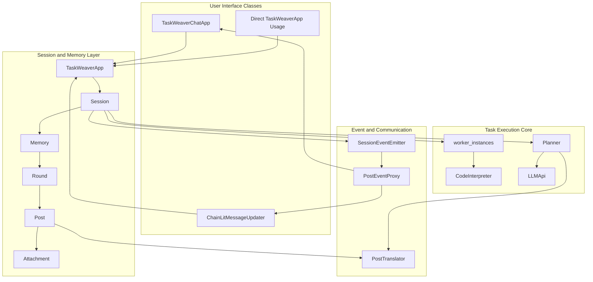

<!-- source: DeepWiki mcp.deepwiki.com · repo microsoft/TaskWeaver · page 7 User Interfaces · fetched 2026-10-26 -->

# User Interfaces

<details>
<summary>Relevant source files</summary>

The following files were used as context for generating this wiki page:

- [.gitignore](.gitignore)
- [playground/UI/.chainlit/config.toml](playground/UI/.chainlit/config.toml)
- [playground/UI/app.py](playground/UI/app.py)
- [playground/UI/public/style_v1.css](playground/UI/public/style_v1.css)
- [taskweaver/chat/console/chat.py](taskweaver/chat/console/chat.py)
- [taskweaver/module/event_emitter.py](taskweaver/module/event_emitter.py)
- [taskweaver/planner/planner.py](taskweaver/planner/planner.py)
- [taskweaver/session/session.py](taskweaver/session/session.py)
- [website/docs/usage/webui.md](website/docs/usage/webui.md)

</details>


This page documents the different user interfaces available for interacting with TaskWeaver. TaskWeaver offers multiple ways to access its functionality, each designed for different use cases and environments. For specific configuration details about individual interfaces, see [Console Interface](#7.1) and [Web UI](#7.2).

## Overview of Available Interfaces

TaskWeaver provides three primary methods of interaction:

1. **Console CLI** - A command-line interface for direct terminal interaction
2. **Web UI** - A browser-based graphical interface built with Chainlit
3. **Library API** - Programmatic integration for embedding TaskWeaver in other applications

## Interface Architecture

TaskWeaver Interface Architecture



Sources: [taskweaver/chat/console/chat.py:414-415](), [playground/UI/app.py:34-36](), [taskweaver/session/session.py:44-127]()

## Console CLI

The Console CLI provides a terminal-based interface for interacting with TaskWeaver. It supports rich text formatting, command handling, and file operations.

### Features

- Command-driven interface with history support
- File attachment handling 
- Session management commands
- Progress visualization and status updates
- Formatted message display

### Core Components



Sources: [taskweaver/chat/console/chat.py:410-526](), [taskweaver/chat/console/chat.py:68-408]()

### Usage 

The Console CLI is invoked through the `chat_taskweaver()` function in [taskweaver/chat/console/chat.py:525-526](), which initializes a `TaskWeaverChatApp` instance and runs it. Users interact with the CLI by typing messages and commands processed in `_process_user_input()`.

Key commands include:
- `/help` or `/h` or `/?` - Display help information
- `/load <file>` or `/file <file>` or `/img <file>` - Load a file as an attachment
- `/reset` - Reset the current session
- `/clear` - Clear the console
- `/exit` or `/bye` or `/quit` - Exit the chat console
- `/save` - Save the chat history for experience extraction
- `/info` - Display session information

Sources: [taskweaver/chat/console/chat.py:431-456](), [taskweaver/chat/console/chat.py:461-475]()

## Web UI

TaskWeaver provides a browser-based interface built with Chainlit. This graphical interface makes it easier to interact with TaskWeaver and visualize results.

### Implementation

The Web UI is implemented in the playground directory and uses Chainlit to provide an interactive chat interface. The Chainlit application is configured in `playground/UI/app.py`.

Web UI Event Flow



Sources: [playground/UI/app.py:396-456](), [playground/UI/app.py:129-218](), [taskweaver/session/session.py:277-316]()

### Key Components

The `ChainLitMessageUpdater` class in [playground/UI/app.py:129-218]() handles UI updates based on TaskWeaver session events:

| Method | Purpose | Event Types Handled |
|--------|---------|-------------------|
| `handle_round()` | Processes round-level events | `round_error` |
| `handle_post()` | Processes post-level events | `post_start`, `post_end`, `post_attachment_update`, `post_message_update`, `post_status_update` |
| `format_post_body()` | Formats content for display | All attachment types with streaming support |
| `format_attachment()` | Formats different attachment types | `plan`, `init_plan`, `execution_result`, `reply_content` |
| `format_message()` | Formats messages with code highlighting | Markdown with code block parsing |

The UI is styled using custom CSS in [playground/UI/public/style_v1.css:1-193](), which provides:
- `.tw-atta` - Attachment container styling
- `.tw-plan` - Plan visualization with numbered steps
- `.tw-status` - Status indicator with animation
- `.tw-end-cursor` - Blinking cursor for streaming text

Sources: [playground/UI/app.py:129-218](), [playground/UI/app.py:253-377](), [playground/UI/public/style_v1.css:17-193]()

### Configuration

The Web UI is configured through `playground/UI/.chainlit/config.toml`, which specifies:

- UI settings (name, theme, etc.)
- Feature toggles
- Session handling
- Visual customization

Sources: [playground/UI/.chainlit/config.toml:1-85]()

### Usage

To use the Web UI:

1. Install Chainlit: `pip install -U "chainlit<1.1.300"`
2. Navigate to the UI directory: `cd playground/UI/`
3. Run the Chainlit application: `chainlit run app.py`
4. Access the UI at `http://localhost:8000`

The Web UI supports:
- Text conversation with TaskWeaver
- File uploads
- Visualization of code execution results
- Displaying generated images and tables

Sources: [website/docs/usage/webui.md:1-36]()

## Library API

TaskWeaver can be embedded as a Python library in other applications through the `TaskWeaverApp` class, providing programmatic access to all TaskWeaver functionality.

### Core Usage Pattern

Library API Integration Pattern



### Key Components for Integration

| Component | Class | Purpose |
|-----------|-------|---------|
| Main Entry Point | `TaskWeaverApp` | Application initialization and session management |
| Session Management | `Session` | Manages conversation state and message processing |
| Event Handling | `SessionEventHandlerBase` | Base class for custom event handlers |
| Response Container | `Round` | Contains conversation round with posts and attachments |
| Event System | `SessionEventEmitter` | Emits real-time events during processing |

### Basic Usage Example

The following pattern is used by both the Console CLI and Web UI:

```python
from taskweaver.app.app import TaskWeaverApp

# Initialize TaskWeaver
app = TaskWeaverApp(app_dir="project_path", use_local_uri=True)

# Get a session
session = app.get_session()

# Send a message and get response
round_result = session.send_message(
    message="Your request here",
    files=[{"name": "file.csv", "path": "/path/to/file.csv"}],
    event_handler=custom_handler  # Optional
)

# Access the response
final_post = round_result.post_list[-1]
response_message = final_post.message
```

### Custom Event Handler Implementation

To receive real-time updates during processing, implement a custom event handler:

```python
from taskweaver.module.event_emitter import SessionEventHandlerBase

class MyEventHandler(SessionEventHandlerBase):
    def handle_post(self, type, msg, extra, post_id, round_id, **kwargs):
        if type == PostEventType.post_message_update:
            print(f"Streaming message: {msg}")
        elif type == PostEventType.post_attachment_update:
            print(f"Attachment update: {extra['type']}")
```

Sources: [taskweaver/chat/console/chat.py:414-418](), [playground/UI/app.py:34-36](), [taskweaver/session/session.py:277-316](), [taskweaver/module/event_emitter.py:61-124]()

## File Upload and Attachment Support

All TaskWeaver interfaces support file attachments and uploads, which are processed through the session's file handling system.

### File Upload Flow

File Processing in TaskWeaver Interfaces



### File Handling Implementation

The file upload process is handled in `Session._upload_file()` at [taskweaver/session/session.py:318-332]():

| Interface | File Upload Method | Supported Types |
|-----------|-------------------|-----------------|
| **Console CLI** | `/load <path>` command | All file types via local path |
| **Web UI** | Drag-and-drop or file picker | Images, documents, data files |
| **Library API** | `files` parameter in `send_message()` | Programmatic file objects |

Each interface converts files to a common format with `name`, `path`, and optional `content` fields before passing to the session.

Sources: [taskweaver/session/session.py:296-332](), [playground/UI/app.py:396-456](), [taskweaver/chat/console/chat.py:480-494]()

## Interface Feature Comparison

The following table compares features across the different interfaces:

| Feature | Console CLI | Web UI | Library API |
|---------|------------|--------|------------|
| Text interaction | ✅ | ✅ | ✅ |
| File attachments | ✅ | ✅ | ✅ |
| Image display | ❌ | ✅ | ✅ |
| Interactive components | ❌ | ✅ | ✅ |
| Progress visualization | ✅ (text-based) | ✅ (graphical) | ✅ (programmable) |
| Session management | ✅ | ✅ | ✅ |
| Custom event handling | Limited | Limited | Full control |
| Environment | Terminal | Browser | Programmatic |
| Deployment complexity | Low | Medium | Varies |
| User experience | Command-based | Graphical | Programmatic |

Sources: [taskweaver/chat/console/chat.py:410-526](), [playground/UI/app.py:129-379](), [taskweaver/session/session.py:44-364]()

## Integration with TaskWeaver Architecture

The user interfaces are integrated into the overall TaskWeaver architecture as follows:

Complete Interface Integration with TaskWeaver Core



Sources: [taskweaver/chat/console/chat.py:410-418](), [playground/UI/app.py:129-218](), [taskweaver/session/session.py:44-127](), [taskweaver/module/event_emitter.py:231-299]()

Each user interface ultimately interacts with the core Session management system, which coordinates the task planning and execution process. The interfaces provide different ways to submit requests, monitor progress, and receive results, but they all leverage the same underlying capabilities of the TaskWeaver system.

---

