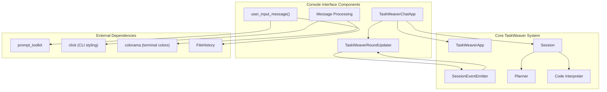
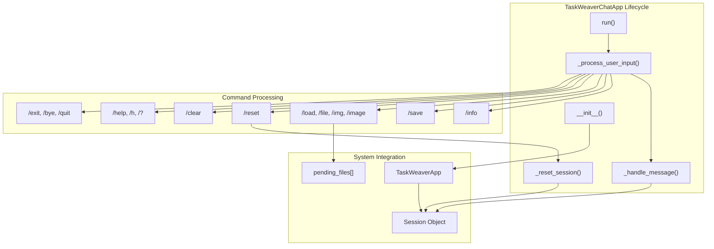
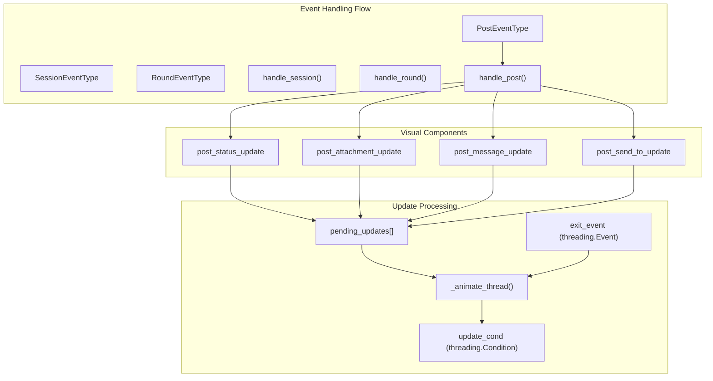
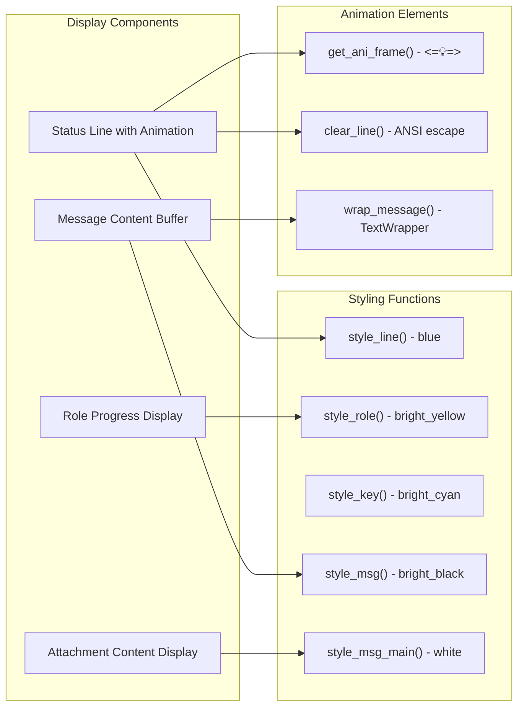
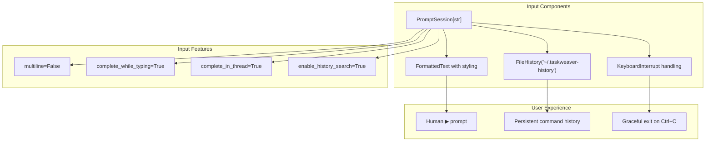
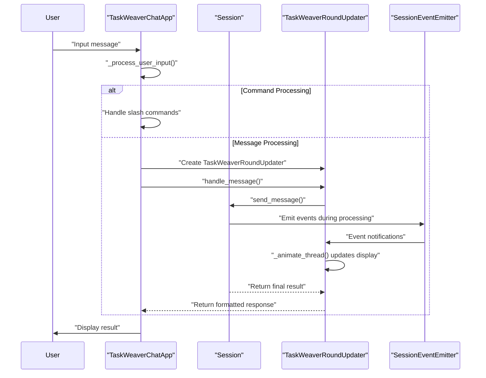
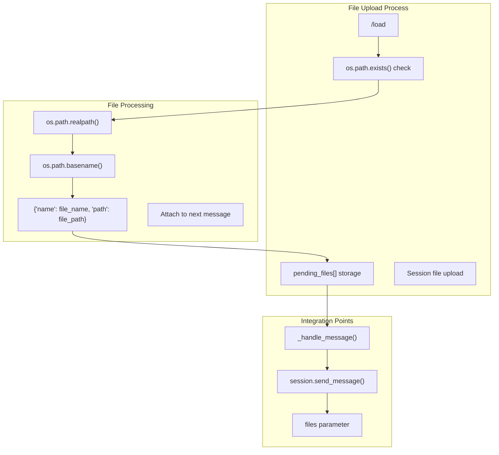
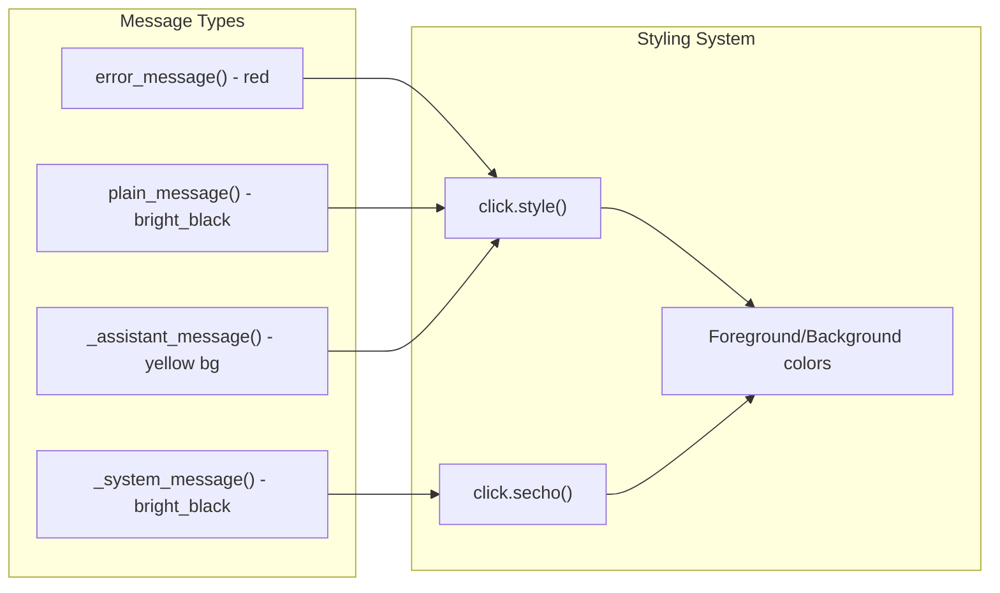

<!-- source: DeepWiki mcp.deepwiki.com · repo microsoft/TaskWeaver · page 7.1 Console Interface · fetched 2026-10-26 -->

# Console Interface

Relevant source files

The following files were used as context for generating this wiki page:

- [taskweaver/chat/console/chat.py](taskweaver/chat/console/chat.py)
- [taskweaver/module/event_emitter.py](taskweaver/module/event_emitter.py)
- [taskweaver/planner/planner.py](taskweaver/planner/planner.py)
- [taskweaver/session/session.py](taskweaver/session/session.py)
- [website/docs/FAQ.md](website/docs/FAQ.md)
- [website/docs/advanced/observability.md](website/docs/advanced/observability.md)
- [website/docs/code_execution.md](website/docs/code_execution.md)
- [website/docs/llms/Keywords-AI.md](website/docs/llms/Keywords-AI.md)
- [website/sidebars.js](website/sidebars.js)

The Console Interface provides a command-line interface for interacting with TaskWeaver through terminal-based conversations. This interface enables users to send messages, upload files, manage sessions, and receive real-time updates during task execution through a text-based UI with rich formatting and interactive features.

For information about the web-based user interface, see [Web UI](#7.2). For details about TaskWeaver's overall session management system, see [Session Management](#3.2).

## Architecture Overview

The console interface is built around two main components that work together to provide a seamless command-line experience: the main chat application and the real-time update handler.

Sources: [taskweaver/chat/console/chat.py:410-530](), [taskweaver/chat/console/chat.py:68-202]()

## Main Console Application

The `TaskWeaverChatApp` class serves as the primary entry point for the console interface, managing the overall application lifecycle and user interaction loop.

### Core Application Structure

Sources: [taskweaver/chat/console/chat.py:410-430](), [taskweaver/chat/console/chat.py:425-460]()

### Command System Implementation

The console interface supports a comprehensive set of slash commands for various operations:

| Command | Function | Implementation |
|---------|----------|----------------|
| `/exit`, `/bye`, `/quit` | Exit application | [taskweaver/chat/console/chat.py:434-435]() |
| `/help`, `/h`, `/?` | Show help message | [taskweaver/chat/console/chat.py:436-438]() |
| `/clear` | Clear console screen | [taskweaver/chat/console/chat.py:439-441]() |
| `/reset` | Reset current session | [taskweaver/chat/console/chat.py:442-444]() |
| `/load`, `/file`, `/img`, `/image` | Load file for upload | [taskweaver/chat/console/chat.py:445-448]() |
| `/save` | Save chat history | [taskweaver/chat/console/chat.py:449-451]() |
| `/info` | Display session info | [taskweaver/chat/console/chat.py:452-455]() |

Sources: [taskweaver/chat/console/chat.py:431-457]()

## Real-Time Update Handler

The `TaskWeaverRoundUpdater` class implements `SessionEventHandlerBase` to provide real-time visual feedback during conversation rounds through an animated interface.

### Event Processing Architecture

Sources: [taskweaver/chat/console/chat.py:68-149](), [taskweaver/chat/console/chat.py:203-408]()

### Animation and Display System

The console interface provides rich visual feedback through a sophisticated animation system that displays real-time progress:

Sources: [taskweaver/chat/console/chat.py:213-284](), [taskweaver/chat/console/chat.py:276-408]()

## User Input Management

The console interface uses `prompt_toolkit` for enhanced user input handling with features like command history, auto-completion, and keyboard interrupt handling.

### Input Processing Flow

Sources: [taskweaver/chat/console/chat.py:33-66]()

## Session Integration

The console interface integrates deeply with TaskWeaver's session management system, handling file uploads, session variables, and conversation state.

### Session Interaction Pattern

Sources: [taskweaver/chat/console/chat.py:150-201](), [taskweaver/session/session.py:277-316]()

## File Upload and Management

The console interface supports file upload through the `/load` command system, managing pending files that are attached to the next message sent to the session.

### File Handling Architecture

Sources: [taskweaver/chat/console/chat.py:480-494](), [taskweaver/chat/console/chat.py:509-519]()

## Error Handling and User Feedback

The console interface provides comprehensive error handling and user feedback through styled message functions and graceful error recovery.

### Error Management System

| Error Type | Handler | Display Function |
|------------|---------|------------------|
| Empty input | Input validation | [taskweaver/chat/console/chat.py:427-429]() |
| Unknown commands | Command parsing | [taskweaver/chat/console/chat.py:456-457]() |
| File not found | File validation | [taskweaver/chat/console/chat.py:485-487]() |
| Session errors | Event handling | [taskweaver/chat/console/chat.py:98-102]() |
| Keyboard interrupt | Input handling | [taskweaver/chat/console/chat.py:185-190]() |

The interface uses `click` for styled terminal output with consistent color schemes and formatting:

Sources: [taskweaver/chat/console/chat.py:19-31](), [taskweaver/chat/console/chat.py:506-523]()

---

