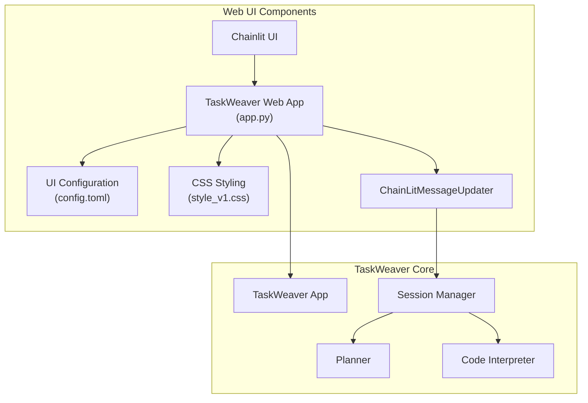
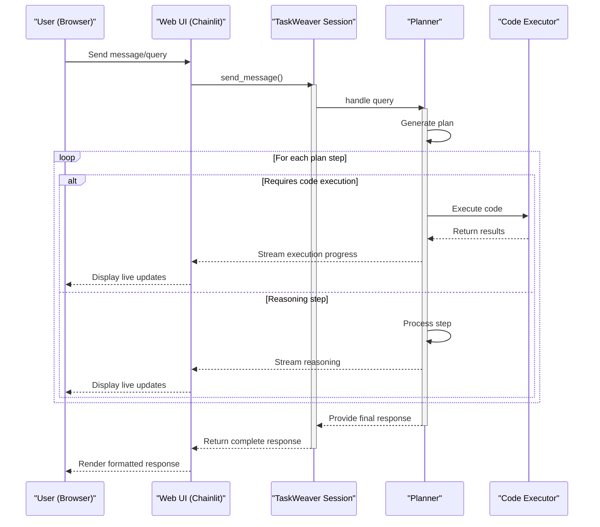
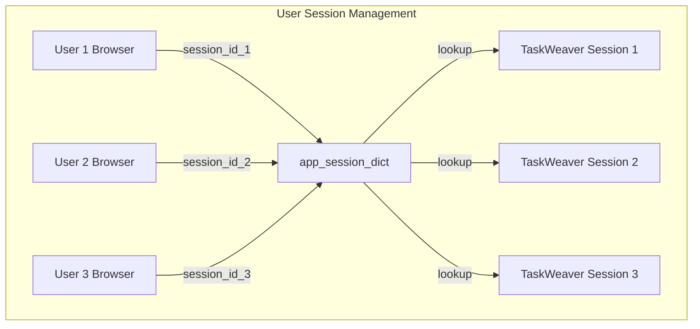
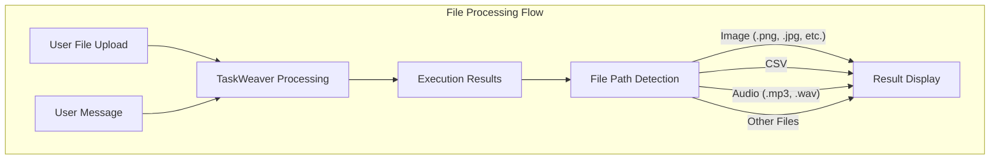
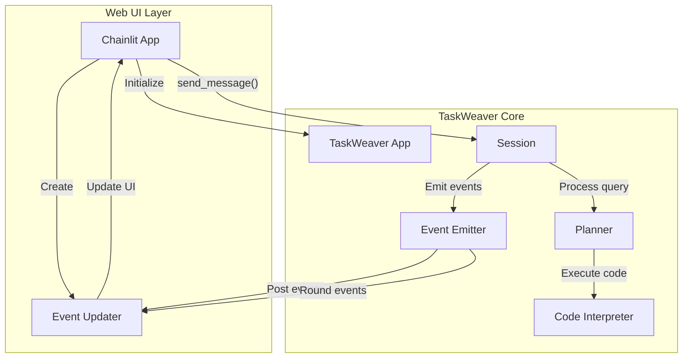

<!-- source: DeepWiki mcp.deepwiki.com · repo microsoft/TaskWeaver · page 7.2 Web UI · fetched 2026-10-26 -->

# Web UI

Relevant source files

The following files were used as context for generating this wiki page:

- [.gitignore](.gitignore)
- [playground/UI/.chainlit/config.toml](playground/UI/.chainlit/config.toml)
- [playground/UI/app.py](playground/UI/app.py)
- [playground/UI/public/style_v1.css](playground/UI/public/style_v1.css)
- [website/docs/FAQ.md](website/docs/FAQ.md)
- [website/docs/advanced/observability.md](website/docs/advanced/observability.md)
- [website/docs/code_execution.md](website/docs/code_execution.md)
- [website/docs/llms/Keywords-AI.md](website/docs/llms/Keywords-AI.md)
- [website/docs/usage/webui.md](website/docs/usage/webui.md)
- [website/sidebars.js](website/sidebars.js)

The Web UI provides a browser-based interface for interacting with TaskWeaver. It offers an interactive chat experience, file upload capabilities, and visual rendering of code execution results, plans, and other outputs. This document describes the architecture, components, and usage of the TaskWeaver Web UI.

For information about the command-line interface, see [Console Interface](#7.1).

## Overview

The TaskWeaver Web UI is built using Chainlit, a Python framework for creating chat-based interfaces. It provides a more user-friendly alternative to the console interface, with support for rich content display including images, tables, code blocks, and downloadable files.

Sources: [playground/UI/app.py:13-34](), [playground/UI/.chainlit/config.toml:36-60]()

## Architecture

The Web UI connects to the TaskWeaver system through session management and event handling mechanisms. It translates TaskWeaver's outputs into properly formatted HTML with styling appropriate for web display.

Sources: [playground/UI/app.py:396-457]()

## Key Components

### ChainLitMessageUpdater

The `ChainLitMessageUpdater` is the core component that bridges TaskWeaver's event system with the Chainlit UI. It handles:

- Post start/end events
- Attachment updates
- Message formatting
- Live updates as TaskWeaver processes the request

It translates TaskWeaver's internal representations into properly formatted HTML with specific styling for different types of content (code, plans, execution results).

Sources: [playground/UI/app.py:129-377]()

### Session Management

Each user connecting to the Web UI gets assigned a unique session. The system maintains a dictionary mapping user IDs to TaskWeaver sessions, allowing multiple users to interact with the system simultaneously without interference.

Sources: [playground/UI/app.py:36-36](), [playground/UI/app.py:380-394]()

### Message Processing

When a user sends a message, the system:

1. Creates a new processing step for visual tracking
2. Passes the message to the TaskWeaver session
3. Processes any file uploads
4. Streams updates as TaskWeaver processes the request
5. Formats and renders the final response

The UI displays intermediate results and execution progress in real-time, providing a more interactive experience than the console interface.

Sources: [playground/UI/app.py:396-457]()

### File and Image Handling

The Web UI supports uploading files which can be used by TaskWeaver's plugins and code execution. It also properly renders generated artifacts including:

- Images
- CSV files (displayed as tables)
- Audio files
- Downloadable result files

Sources: [playground/UI/app.py:69-114](), [playground/UI/app.py:427-451]()

## Content Formatting

The UI formats different types of content in specialized ways:

### Plan Display

Plans are displayed as numbered steps with connecting lines, making it easy to follow the sequence of operations TaskWeaver intends to perform.

### Code Blocks

Code blocks are syntax-highlighted and formatted for readability. Python code is particularly well-formatted as it's the primary language for TaskWeaver's code execution.

### Execution Results

Results from code execution are displayed in formatted blocks, with special handling for tabular data, images, and other output types.

Sources: [playground/UI/public/style_v1.css:16-192](), [playground/UI/app.py:252-290]()

## Usage Instructions

To start the Web UI:

1. Ensure TaskWeaver is properly installed and configured
2. Install Chainlit: `pip install -U "chainlit<1.1.300"`
3. Navigate to the UI directory: `cd playground/UI/`
4. Run the app: `chainlit run app.py`
5. Open a browser and go to http://localhost:8000

Note that this Web UI is intended for development and testing purposes. For production use, additional security measures would be needed.

Sources: [website/docs/usage/webui.md:1-36]()

## Security Considerations

The Web UI is designed as a development and testing tool, not a production-ready interface. When using it:

- Be cautious about exposing the port to public networks
- Consider that the interface doesn't include built-in authentication
- Remember that file uploads are stored in the session's working directory

For production deployments, additional security measures such as authentication, access control, and secure file handling would need to be implemented.

Sources: [website/docs/usage/webui.md:3-8]()

## Configuration Options

The Web UI can be customized through the Chainlit configuration file located at `.chainlit/config.toml`. Key configuration options include:

| Configuration | Description | Default |
|---------------|-------------|---------|
| `name` | Name displayed in the UI | "TaskWeaver" |
| `show_readme_as_default` | Show readme when conversation is empty | true |
| `default_collapse_content` | Collapse large content | false |
| `unsafe_allow_html` | Allow HTML rendering in messages | true |
| `spontaneous_file_upload.enabled` | Allow file uploads | true |
| `custom_css` | Path to custom CSS | "/public/style_v1.css" |

Sources: [playground/UI/.chainlit/config.toml:36-60]()

## Integration with TaskWeaver Core

The Web UI connects to TaskWeaver's core system through the following mechanism:

The Web UI initializes a TaskWeaver app instance and creates sessions for each user. It passes messages from the user to the appropriate session and registers an event handler to receive updates as the session processes the request. These updates are used to provide real-time feedback in the UI.

Sources: [playground/UI/app.py:24-36](), [playground/UI/app.py:129-219]()

---

