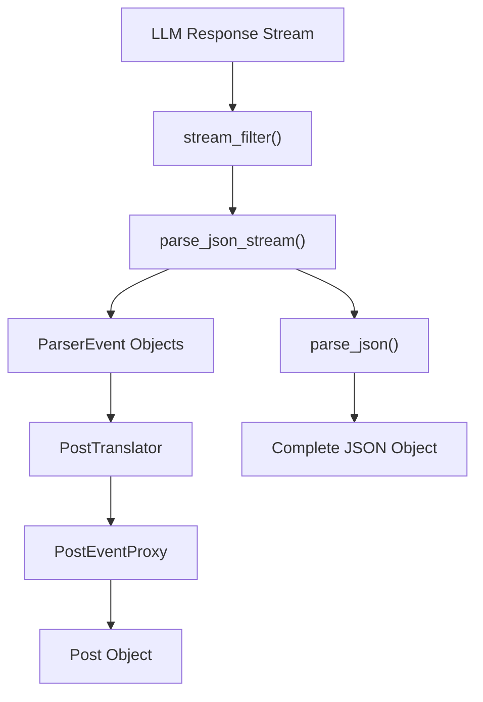
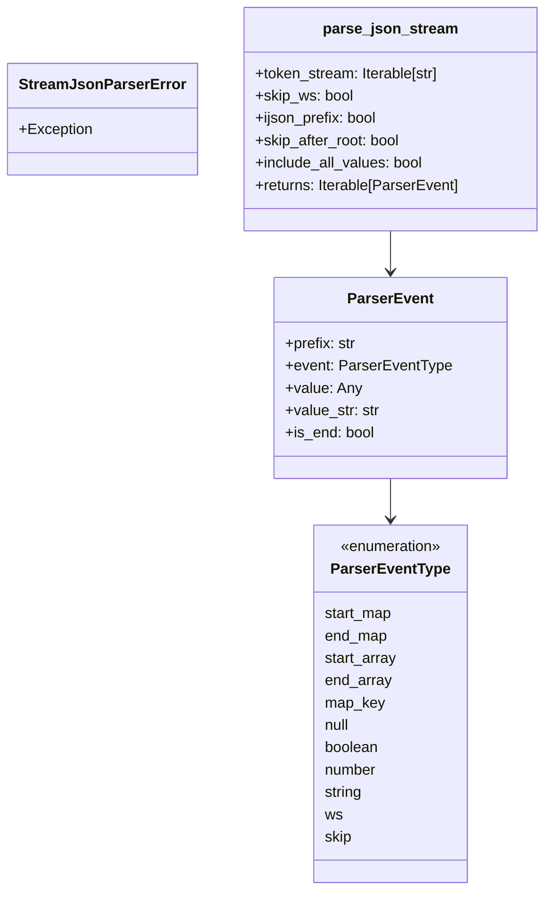
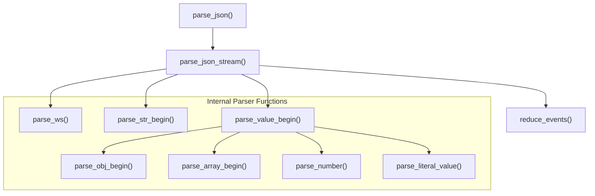
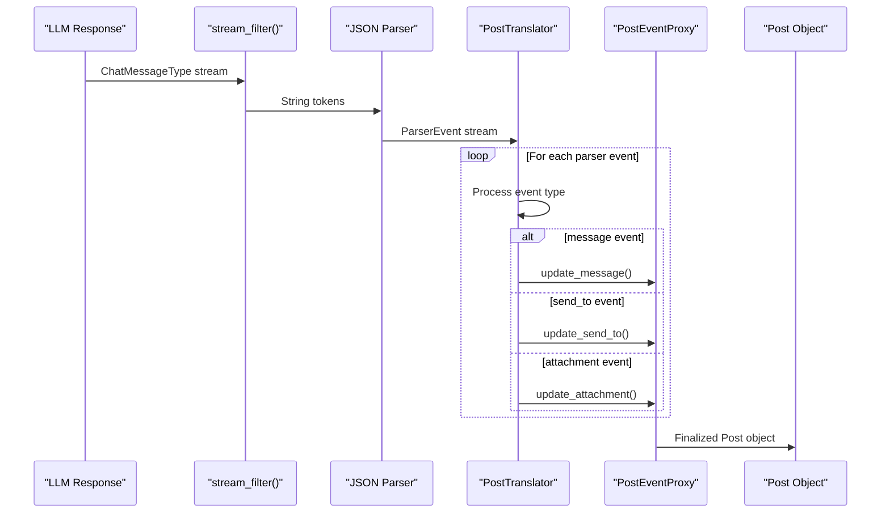
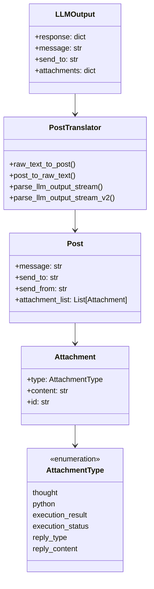
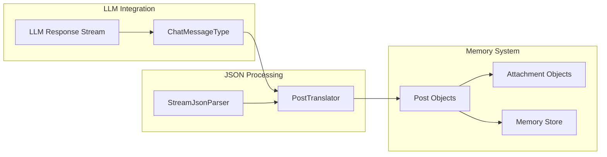

<!-- source: DeepWiki mcp.deepwiki.com · repo microsoft/TaskWeaver · page 8 JSON Processing and Utilities · fetched 2026-10-26 -->

# JSON Processing and Utilities

<details>
<summary>Relevant source files</summary>

The following files were used as context for generating this wiki page:

- [taskweaver/role/translator.py](taskweaver/role/translator.py)
- [taskweaver/utils/json_parser.py](taskweaver/utils/json_parser.py)
- [tests/unit_tests/test_json_parser.py](tests/unit_tests/test_json_parser.py)
- [tests/unit_tests/test_planner.py](tests/unit_tests/test_planner.py)
- [tests/unit_tests/test_translator.py](tests/unit_tests/test_translator.py)

</details>


This document covers TaskWeaver's JSON processing infrastructure, which provides streaming JSON parsing capabilities and utilities for converting between LLM outputs and structured Post objects. The system is primarily designed to handle real-time JSON parsing of LLM responses as they are received, enabling progressive parsing and early termination of processing when needed.

For information about the Memory and Communication System that uses these JSON utilities, see [Memory and Communication System](#3.3). For details about LLM Integration that produces the JSON responses being parsed, see [LLM Integration](#4).

## Architecture Overview

TaskWeaver's JSON processing system consists of two main components: a custom streaming JSON parser and a Post translator that converts between raw LLM text and structured Post objects.

### JSON Processing Data Flow



Sources: [taskweaver/role/translator.py:45-75](), [taskweaver/utils/json_parser.py:80-86]()

## Streaming JSON Parser

The core JSON parsing functionality is implemented in the `StreamJsonParser` which provides incremental JSON parsing capabilities for handling streaming data from LLMs.

### Parser Event System



Sources: [taskweaver/utils/json_parser.py:28-34](), [taskweaver/utils/json_parser.py:6-21](), [taskweaver/utils/json_parser.py:80-86]()

### Parser State Management

The streaming parser maintains internal state using a stack-based approach to track the current parsing context:

| State Type | Purpose | State Data |
|------------|---------|------------|
| `root` | Root parsing state | `(has_root_elem, has_skip_cnt)` |
| `object` | Inside JSON object | None |
| `object_value` | Parsing object value | `(key, value_to_begin, value_to_end)` |
| `array` | Inside JSON array | `(idx, value_begins, require_value)` |
| `string` | Parsing string value | `(in_escape, escape_buf, value_buf, is_obj_key)` |
| `number` | Parsing numeric value | `(buf, in_exp, in_frac, in_exp_sign)` |
| `literal` | Parsing literal (true/false/null) | `(buf, ev, literal, value)` |
| `ws` | Parsing whitespace | None |

Sources: [taskweaver/utils/json_parser.py:36-45](), [taskweaver/utils/json_parser.py:89-96]()

### Key Parser Functions



Sources: [taskweaver/utils/json_parser.py:465-488](), [taskweaver/utils/json_parser.py:48-73](), [taskweaver/utils/json_parser.py:125-430]()

## Post Translator

The `PostTranslator` class bridges the gap between raw LLM output and structured TaskWeaver Post objects, using the streaming JSON parser to process responses incrementally.

### Translation Architecture



Sources: [taskweaver/role/translator.py:34-132](), [taskweaver/role/translator.py:255-300]()

### Parser Version Comparison

The `PostTranslator` supports two parsing approaches:

| Feature | V1 Parser (ijson) | V2 Parser (custom) |
|---------|-------------------|-------------------|
| **Implementation** | `parse_llm_output_stream()` | `parse_llm_output_stream_v2()` |
| **Dependencies** | External ijson library | Built-in streaming parser |
| **Event Granularity** | Complete values only | Character-by-character |
| **Early Termination** | Limited | Full support |
| **Complex Objects** | Basic support | Advanced handling |
| **Performance** | Standard | Optimized for streaming |

Sources: [taskweaver/role/translator.py:187-254](), [taskweaver/role/translator.py:255-300]()

### Post Structure Translation



Sources: [taskweaver/role/translator.py:134-163](), [taskweaver/memory/attachment.py](), [taskweaver/memory/post.py]()

## Usage Patterns

### Early Stop Processing

The JSON processing system supports early termination of parsing when specific conditions are met:

```python
def early_stop(type: AttachmentType, text: str) -> bool:
    if type in [AttachmentType.reply_content]:
        return True
    return False
```

This pattern is commonly used when only specific attachment types are needed, allowing the system to stop processing as soon as the required data is available.

Sources: [tests/unit_tests/test_translator.py:134-147]()

### Streaming Response Handling

The system processes LLM responses incrementally:

1. **Stream Filtering**: Tracks token usage and logs complete output
2. **Event Generation**: Converts tokens to parser events  
3. **Incremental Updates**: Updates Post objects as data arrives
4. **Validation**: Applies validation functions to completed posts

Sources: [taskweaver/role/translator.py:46-66](), [taskweaver/role/translator.py:77-132]()

### Error Handling

The JSON parser provides robust error handling for malformed or incomplete JSON:

| Error Type | Handling Strategy |
|------------|------------------|
| `StreamJsonParserError` | Logged with context information |
| Incomplete JSON | Detected via state stack validation |
| Invalid escape sequences | Specific error messages for debugging |
| Unexpected tokens | State-aware error reporting |

Sources: [taskweaver/utils/json_parser.py:24-25](), [taskweaver/utils/json_parser.py:452-456](), [taskweaver/role/translator.py:290-293]()

## Integration with TaskWeaver Components

### Memory System Integration

The JSON utilities integrate closely with TaskWeaver's memory system through the Post and Attachment objects:



Sources: [taskweaver/role/translator.py:8-14](), [taskweaver/memory/post.py](), [taskweaver/memory/attachment.py]()

### Event System Integration

The JSON processing system integrates with TaskWeaver's event emission system through `PostEventProxy`:

```python
post_proxy = event_emitter.create_post_proxy("CodeInterpreter")
translator.raw_text_to_post(
    llm_output=llm_response,
    post_proxy=post_proxy,
    early_stop=early_stop_func,
    use_v2_parser=True
)
```

Sources: [taskweaver/role/translator.py:37](), [tests/unit_tests/test_translator.py:142-148]()

## Testing and Validation

The JSON processing system includes comprehensive test coverage for various scenarios:

### Test Categories

| Test Type | Coverage | Test Files |
|-----------|----------|------------|
| **Parser Correctness** | Valid JSON objects, arrays, primitives | `test_json_parser.py` |
| **Error Handling** | Malformed JSON, incomplete streams | `test_json_parser.py` |
| **Translation** | LLM output to Post conversion | `test_translator.py` |
| **Streaming** | Incremental parsing, early termination | `test_translator.py` |
| **Integration** | End-to-end planner workflows | `test_planner.py` |

Sources: [tests/unit_tests/test_json_parser.py:53-126](), [tests/unit_tests/test_translator.py:63-231](), [tests/unit_tests/test_planner.py:174-213]()

---

