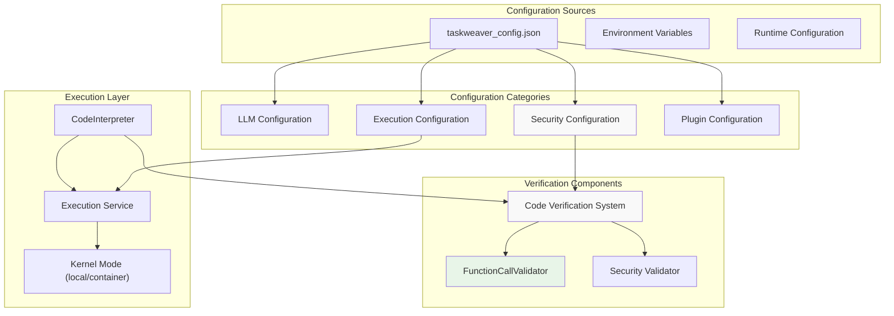
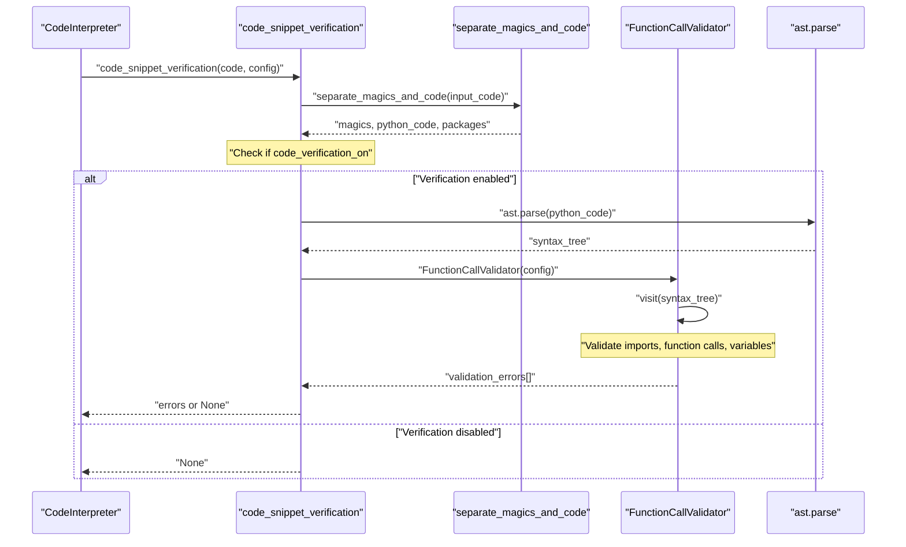
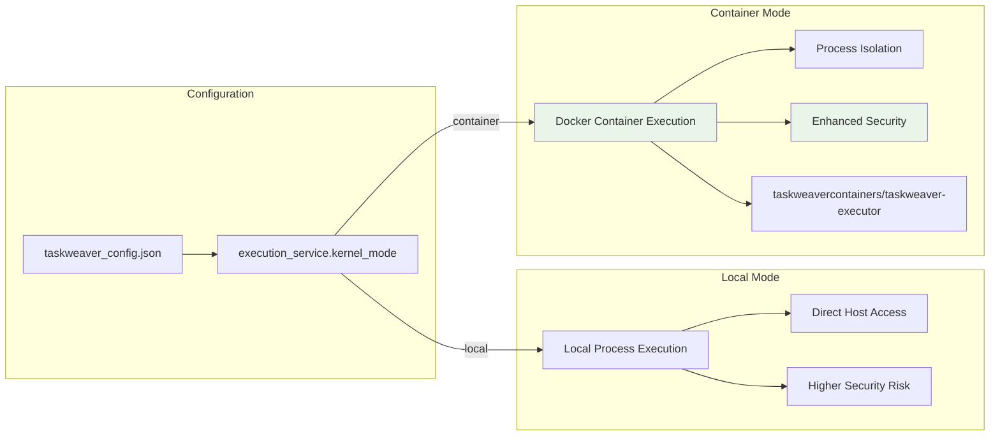
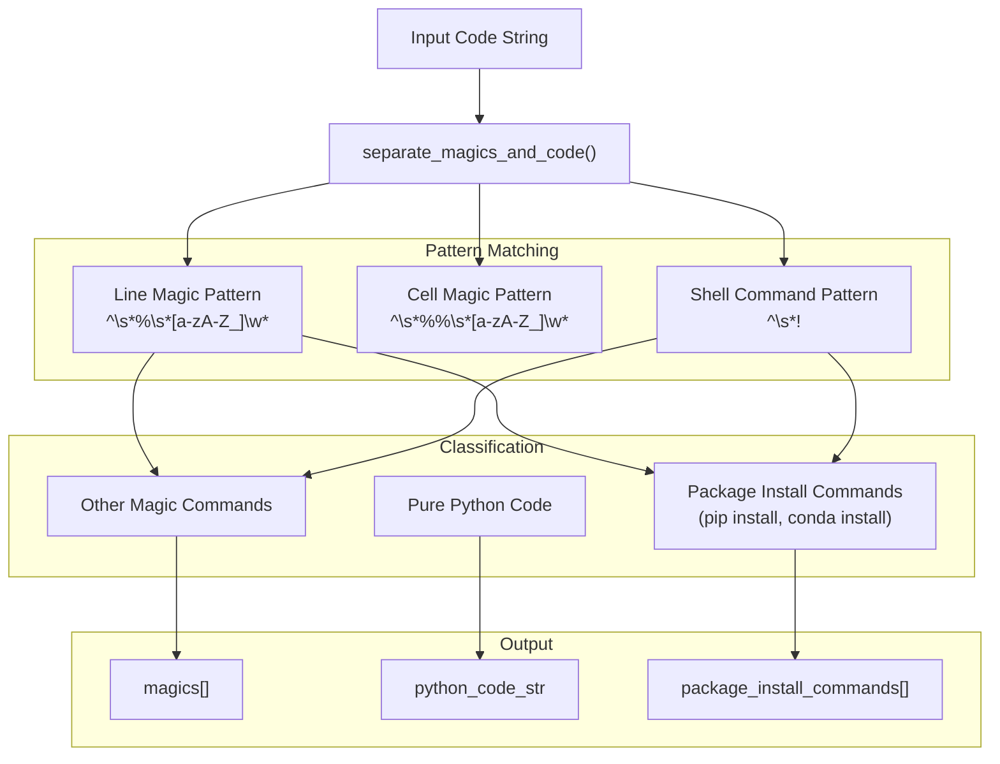

<!-- source: DeepWiki mcp.deepwiki.com · repo microsoft/TaskWeaver · page 9 Configuration and Verification · fetched 2026-10-26 -->

# Configuration and Verification

<details>
<summary>Relevant source files</summary>

The following files were used as context for generating this wiki page:

- [taskweaver/code_interpreter/__init__.py](taskweaver/code_interpreter/__init__.py)
- [taskweaver/code_interpreter/code_verification.py](taskweaver/code_interpreter/code_verification.py)
- [tests/unit_tests/test_code_verification.py](tests/unit_tests/test_code_verification.py)
- [website/docs/FAQ.md](website/docs/FAQ.md)
- [website/docs/advanced/observability.md](website/docs/advanced/observability.md)
- [website/docs/code_execution.md](website/docs/code_execution.md)
- [website/docs/llms/Keywords-AI.md](website/docs/llms/Keywords-AI.md)
- [website/sidebars.js](website/sidebars.js)

</details>


This document covers TaskWeaver's configuration system and code verification capabilities, including security settings, execution environment configuration, and the verification process that ensures safe code execution. For information about the core session management and memory systems, see [Session Management](#3.2) and [Memory and Communication System](#3.3). For details about the plugin system configuration, see [Plugin System](#6).

## Configuration System Overview

TaskWeaver uses a centralized configuration system that controls various aspects of the framework's behavior, from LLM integration to code execution security. The primary configuration is managed through JSON files, with runtime verification ensuring safe code execution.

**Configuration Architecture**



Sources: [taskweaver/code_interpreter/code_verification.py:1-214](), [website/docs/code_execution.md:29-40]()

## Code Verification System

The code verification system provides security controls by analyzing generated code before execution using AST-based validation. It supports granular control over allowed modules, functions, and variables.

**Core Verification Components**

| Component | Purpose | Configuration Options |
|-----------|---------|---------------------|
| `FunctionCallValidator` | AST-based code analysis | `allowed_functions`, `blocked_functions` |
| Module Validator | Import statement validation | `allowed_modules`, `blocked_modules` |
| Variable Validator | Variable assignment control | `allowed_variables` |
| Magic Command Filter | Jupyter magic command handling | Automatic separation and filtering |

**Verification Process Flow**



Sources: [taskweaver/code_interpreter/code_verification.py:178-214](), [taskweaver/code_interpreter/code_verification.py:8-131]()

## Security Configuration Options

The verification system supports multiple security models through configuration parameters that can be set in the TaskWeaver configuration file.

**Module Access Control**

```json
{
  "code_verification": {
    "code_verification_on": true,
    "allowed_modules": ["pandas", "numpy", "matplotlib"],
    "blocked_modules": ["os", "subprocess", "sys"]
  }
}
```

**Function Access Control**

```json
{
  "code_verification": {
    "allowed_functions": ["print", "len", "range", "sum"],
    "blocked_functions": ["exec", "eval", "__import__"]
  }
}
```

**Variable Control**

```json
{
  "code_verification": {
    "allowed_variables": ["data", "result", "temp_var"]
  }
}
```

**Validation Logic Implementation**

The `FunctionCallValidator` class implements the core validation logic using the visitor pattern on Python AST nodes:

| Validation Method | AST Node Type | Purpose |
|------------------|---------------|---------|
| `visit_Import` | `ast.Import` | Validates `import module` statements |
| `visit_ImportFrom` | `ast.ImportFrom` | Validates `from module import` statements |
| `visit_Call` | `ast.Call` | Validates function call expressions |
| `visit_Assign` | `ast.Assign` | Validates variable assignments |

Sources: [taskweaver/code_interpreter/code_verification.py:44-101](), [taskweaver/code_interpreter/code_verification.py:110-127](), [tests/unit_tests/test_code_verification.py:4-42]()

## Execution Environment Configuration

TaskWeaver supports two execution modes with different security and isolation characteristics, configurable through the `execution_service.kernel_mode` parameter.

**Execution Mode Configuration**



**Mode Comparison**

| Aspect | Local Mode | Container Mode (Default) |
|--------|------------|-------------------------|
| Security | Limited isolation | Full process isolation |
| Setup | No additional setup | Requires Docker installation |
| Performance | Faster startup | Slower startup due to container |
| File Access | Full host filesystem | Mapped workspace directory only |
| Network | Full network access | Configurable network restrictions |

Sources: [website/docs/code_execution.md:13-26](), [website/docs/code_execution.md:29-40]()

## Magic Command Handling

The verification system separates Python code from Jupyter magic commands and handles them differently based on security policies.

**Magic Command Separation Process**



Sources: [taskweaver/code_interpreter/code_verification.py:142-175](), [tests/unit_tests/test_code_verification.py:226-249]()

## Configuration File Structure

TaskWeaver uses JSON configuration files with hierarchical structure for organizing different configuration categories.

**Core Configuration Sections**

```json
{
  "llm": {
    "api_type": "openai",
    "api_key": "your_api_key",
    "model": "gpt-4"
  },
  "execution_service": {
    "kernel_mode": "container",
    "code_verification_on": true
  },
  "code_verification": {
    "allowed_modules": ["pandas", "numpy"],
    "blocked_functions": ["exec", "eval"]
  },
  "plugin": {
    "enabled": true,
    "plugin_dir": "./plugins"
  }
}
```

**Configuration Categories and Parameters**

| Category | Key Parameters | Purpose |
|----------|---------------|---------|
| `llm` | `api_type`, `api_key`, `model` | LLM provider configuration |
| `execution_service` | `kernel_mode`, `code_verification_on` | Code execution settings |
| `code_verification` | `allowed_modules`, `blocked_functions` | Security verification rules |
| `plugin` | `enabled`, `plugin_dir` | Plugin system configuration |

Sources: [website/docs/code_execution.md:32-40](), [website/docs/llms/Keywords-AI.md:22-28]()

## Error Handling and Validation Messages

The verification system provides detailed error messages for debugging configuration issues and code validation failures.

**Validation Error Types**

```mermaid
graph TD
    subgraph "Syntax Errors"
        SyntaxError["SyntaxError Exception"]
        ErrorMsg1["Syntax error: {error_details}"]
    end
    
    subgraph "Module Validation Errors"
        ModuleError["Module Import Violation"]
        ErrorMsg2["Importing module 'module_name' is not allowed"]
    end
    
    subgraph "Function Validation Errors"
        FunctionError["Function Call Violation"]
        ErrorMsg3["Function 'function_name' is not allowed"]
    end
    
    subgraph "Variable Validation Errors"
        VariableError["Variable Assignment Violation"]
        ErrorMsg4["Assigning to variable_name is not allowed"]
    end
    
    subgraph "Magic Command Errors"
        MagicError["Disallowed Magic Commands"]
        ErrorMsg5["Magic commands except package install are not allowed"]
    end
    
    SyntaxError --> ErrorMsg1
    ModuleError --> ErrorMsg2
    FunctionError --> ErrorMsg3
    VariableError --> ErrorMsg4
    MagicError --> ErrorMsg5
    
    style ErrorMsg1 fill:#ffe6e6
    style ErrorMsg2 fill:#ffe6e6
    style ErrorMsg3 fill:#ffe6e6
    style ErrorMsg4 fill:#ffe6e6
    style ErrorMsg5 fill:#ffe6e6
```



**Error Correction Workflow**

The system provides guidance for fixing validation errors through the `format_code_correction_message()` function, which generates user-friendly messages explaining how to resolve verification failures.

Sources: [taskweaver/code_interpreter/code_verification.py:56-59](), [taskweaver/code_interpreter/code_verification.py:133-139](), [tests/unit_tests/test_code_verification.py:247-249]()

## Troubleshooting Configuration Issues

Common configuration-related issues and their solutions are documented to help users resolve setup problems.

**Common Issues and Solutions**

| Issue | Error Message | Solution |
|-------|--------------|----------|
| Docker Connection | "Failed to connect to docker.daemon" | Set `kernel_mode` to `local` or install Docker |
| Plugin Loading | "failed to loading component from <name>.yaml" | Fix YAML syntax errors in plugin configuration |
| LLM Schema Validation | "Planner failed to generate send_to, message" | Use more powerful LLM model (GPT-3.5/GPT-4) |
| Event Loop Conflict | "This event loop is already running" | Avoid running in Jupyter Notebook environment |
| File Permissions | "Permissions assignment failed for secure file" | Set `JUPYTER_ALLOW_INSECURE_WRITES=true` for container |

**Configuration Validation Process**

The system validates configuration at startup and provides specific error messages for misconfigurations, helping users identify and fix issues quickly.

Sources: [website/docs/FAQ.md:19-24](), [website/docs/FAQ.md:26-31](), [website/docs/FAQ.md:67-74](), [website/docs/FAQ.md:128-137]()

---

