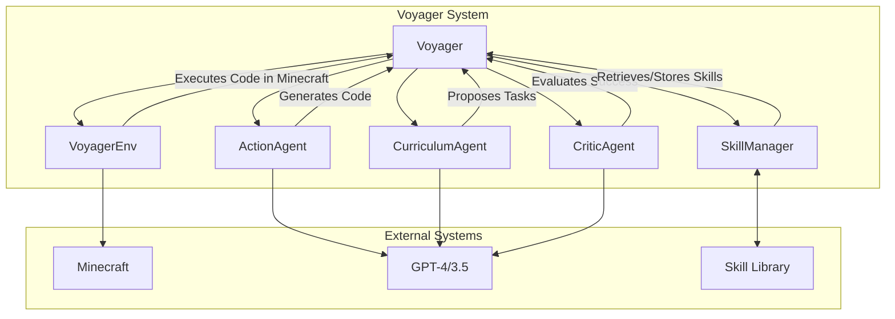
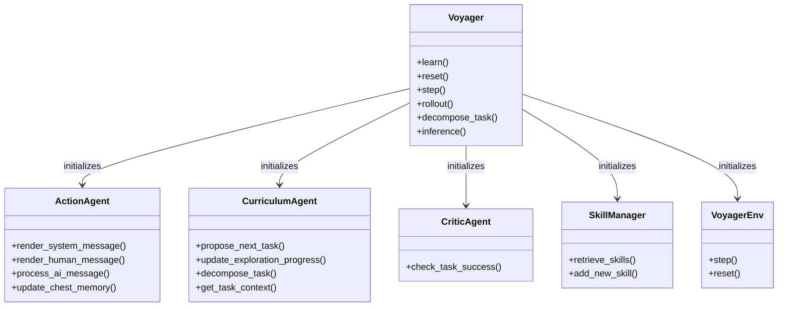
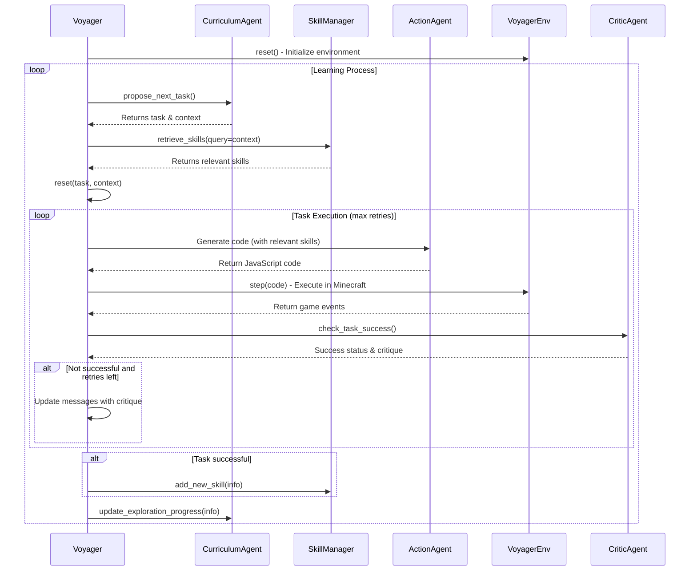
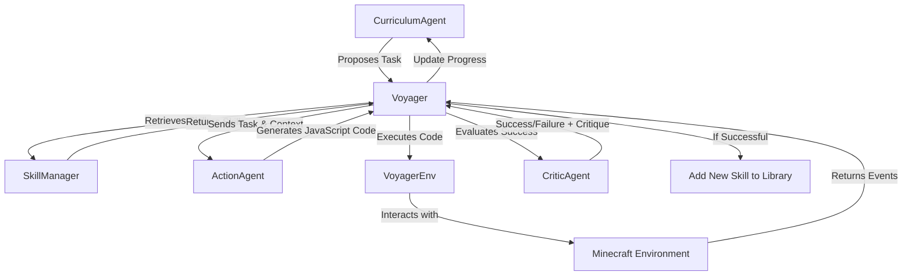

<!-- source: DeepWiki mcp.deepwiki.com · repo MineDojo/Voyager · page 1 Overview · fetched 2026-10-26 -->

# Overview

<details>
<summary>Relevant source files</summary>

The following files were used as context for generating this wiki page:

- [README.md](README.md)
- [voyager/__init__.py](voyager/__init__.py)
- [voyager/voyager.py](voyager/voyager.py)

</details>


## Purpose and Scope

This document provides a technical overview of Voyager, an open-ended embodied lifelong learning agent for Minecraft powered by Large Language Models (LLMs). It explains the core architecture, key components, and operating principles of the system. This overview focuses on explaining how Voyager autonomously explores Minecraft, acquires diverse skills, and makes discoveries without human intervention.

For detailed installation instructions, see [Installation and Setup](#2).

Sources: [README.md:21-37](), [voyager/voyager.py:52-58]()

## What is Voyager?

Voyager is an LLM-powered embodied agent that operates in Minecraft through a continuous learning cycle. The system leverages GPT-4 to acquire skills, explore the world, and accomplish tasks without human intervention. Voyager is designed to demonstrate in-context lifelong learning capabilities by maintaining an ever-growing skill library of executable code.

The system consists of three key components:
1. An automatic curriculum that maximizes exploration
2. A skill library that stores and retrieves complex behaviors as executable code
3. An iterative prompting mechanism that incorporates environment feedback, error handling, and self-verification

Sources: [README.md:21-37](), [voyager/voyager.py:52-102]()

## System Architecture Overview



*High-level architecture of the Voyager system*

Sources: [voyager/voyager.py:16-17](), [voyager/voyager.py:104-154]()

## Core Components

### Voyager Class

The `Voyager` class serves as the central orchestrator of the entire system. It initializes and manages all the specialized agents, handles the learning loop, and coordinates interactions with the Minecraft environment. The main methods include:

- `learn()`: Runs the lifelong learning process
- `reset()`: Resets the agent state for a new task
- `step()`: Executes one step in the action-observation loop
- `rollout()`: Completes a full task execution cycle
- `inference()`: Executes a specific task using the learned skill library
- `decompose_task()`: Breaks down complex tasks into manageable sub-goals

Sources: [voyager/voyager.py:17-162](), [voyager/voyager.py:295-412]()

### Agent System

Voyager employs a multi-agent architecture where specialized agents handle different aspects of the learning and execution process:



*Component relationships in the Voyager system*

Sources: [voyager/voyager.py:104-154]()

#### ActionAgent

The ActionAgent is responsible for generating executable JavaScript code to perform tasks in Minecraft. It leverages GPT models to translate high-level task descriptions into concrete implementations, handling the complexity of Minecraft's mechanics and physics.

Sources: [voyager/voyager.py:118-127](), [voyager/voyager.py:54]()

#### CurriculumAgent

The CurriculumAgent serves as the automatic curriculum generator, proposing new tasks based on the agent's current state, inventory, and exploration progress. It maintains records of completed and failed tasks to intelligently build on previous successes.

Sources: [voyager/voyager.py:128-139](), [voyager/voyager.py:55]()

#### CriticAgent

The CriticAgent evaluates whether tasks have been successfully completed by analyzing game events and environmental changes. It provides feedback that helps improve future attempts and determines when skills should be added to the skill library.

Sources: [voyager/voyager.py:140-145](), [voyager/voyager.py:56]()

#### SkillManager

The SkillManager handles the storage, retrieval, and organization of reusable skills. It maintains a vector database of skills that can be semantically queried to find relevant code for new tasks, facilitating knowledge transfer and reuse.

Sources: [voyager/voyager.py:146-153](), [voyager/voyager.py:57]()

## Learning and Task Execution



*Sequence diagram of Voyager's learning process*

Sources: [voyager/voyager.py:295-368](), [voyager/voyager.py:165-285]()

### Lifelong Learning Cycle

The lifelong learning cycle in Voyager follows these steps:

1. The CurriculumAgent proposes a new task based on current progress
2. The SkillManager retrieves relevant skills from its library
3. The ActionAgent generates JavaScript code to accomplish the task
4. The code is executed in the Minecraft environment via VoyagerEnv
5. The CriticAgent evaluates success or failure of the task
6. If successful, the new skill is added to the skill library
7. The cycle repeats with increasingly complex tasks

This process allows Voyager to continually build its knowledge and capabilities over time, with each new skill potentially becoming a building block for more complex behaviors.

Sources: [voyager/voyager.py:295-368]()

### Task Execution and Skill Acquisition

When executing a specific task, Voyager follows this process:

1. Reset agent state for the new task
2. Retrieve relevant skills from the skill library
3. Generate JavaScript code to accomplish the task
4. Execute the code in Minecraft
5. Evaluate success or failure
6. If failed and retries are available, regenerate code with critique
7. If successful, add the new skill to the library

This iterative approach allows Voyager to improve its solutions through feedback and gradually build a comprehensive library of reusable skills.

Sources: [voyager/voyager.py:165-285]()

## Data Flow



*Data flow in the Voyager system*

Sources: [voyager/voyager.py:104-154](), [voyager/voyager.py:295-368]()

## Key Features and Capabilities

1. **Automatic Curriculum Generation**: Proposes increasingly complex tasks based on current progress and environment state
2. **Skill Library Management**: Stores, retrieves, and composes reusable skills as executable code
3. **Iterative Prompting**: Incorporates feedback and self-verification for continuous improvement
4. **Task Decomposition**: Breaks complex tasks into manageable sub-goals
5. **Error Handling**: Manages execution errors and provides recovery mechanisms
6. **Checkpoint and Resume**: Supports saving progress and resuming learning from checkpoints

Sources: [README.md:21-37](), [voyager/voyager.py:295-368]()

## Usage Modes

Voyager supports two primary modes of operation:

1. **Learning Mode**: The agent continuously explores, learns new skills, and builds its skill library
   ```python
   voyager.learn()
   ```

2. **Inference Mode**: The agent uses its existing skill library to accomplish specific tasks
   ```python
   task = "Craft a diamond pickaxe"
   sub_goals = voyager.decompose_task(task)
   voyager.inference(sub_goals=sub_goals)
   ```

Sources: [README.md:94-96](), [README.md:138-143](), [voyager/voyager.py:295-368](), [voyager/voyager.py:380-412]()

For more detailed information about specific components, refer to:
- [Agents](#4) for details on the agent system
- [Skill System](#5) for information about the skill library and management
- [Environment Integration](#6) for details on Minecraft interaction
- [Usage and Examples](#7) for practical examples of using Voyager

Sources: [voyager/voyager.py:16-412](), [README.md:38-145]()

---

