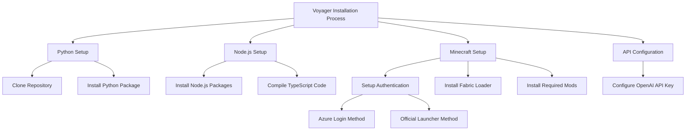
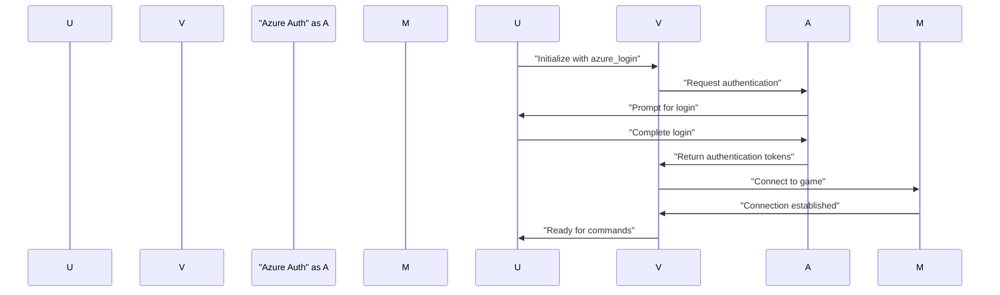
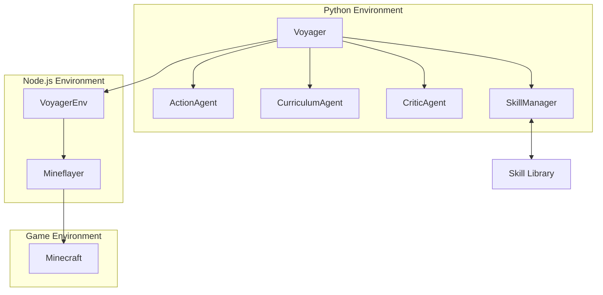

<!-- source: DeepWiki mcp.deepwiki.com · repo MineDojo/Voyager · page 2 Installation and Setup · fetched 2026-10-26 -->

# Installation and Setup

<details>
<summary>Relevant source files</summary>

The following files were used as context for generating this wiki page:

- [FAQ.md](FAQ.md)
- [README.md](README.md)
- [requirements.txt](requirements.txt)
- [setup.py](setup.py)

</details>


This document provides comprehensive instructions for installing and configuring the Voyager system, an open-ended embodied agent powered by large language models for Minecraft. It covers the complete setup process including Python installation, Node.js dependencies, Minecraft configuration, and required API keys.

For detailed information about Minecraft-specific setup, see [Minecraft Setup](#2.1). For Fabric mods installation, see [Fabric Mods Installation](#2.2).

## System Requirements

Before installing Voyager, ensure your system meets the following requirements:

| Component | Minimum Requirement |
|-----------|---------------------|
| Python    | ≥ 3.9               |
| Node.js   | ≥ 16.13.0           |
| Operating System | Ubuntu 20.04, Windows 11, or macOS (tested) |
| OpenAI API | Active account with API key |
| Minecraft | Java Edition with Fabric support |

Sources: [README.md:40-41]()

## Installation Overview

The installation process for Voyager involves multiple components that work together to enable the agent's functionality in Minecraft.



Sources: [README.md:40-72]()

## Python Installation

First, clone the Voyager repository and install the Python package:

```bash
git clone https://github.com/MineDojo/Voyager
cd Voyager
pip install -e .
```

This will install the Voyager package along with all required Python dependencies, including:

- tqdm
- langchain
- javascript
- openai
- chromadb
- tiktoken
- minecraft_launcher_lib

Sources: [README.md:44-48](), [requirements.txt:1-15]()

## Node.js Installation

After installing the Python package, you need to install the Node.js dependencies that enable communication with Minecraft:

```bash
cd voyager/env/mineflayer
npm install -g npx
npm install
cd mineflayer-collectblock
npx tsc
cd ..
npm install
```

This installs Mineflayer and compiles necessary TypeScript code for the collectblock utility.

Sources: [README.md:52-60]()

## Minecraft Authentication Setup

Voyager requires authentication to connect to Minecraft. The system supports two authentication methods:

### Method 1: Azure Login (Recommended)



To authenticate using Azure Login, you'll need to:

1. Create a Microsoft Azure application registration
2. Configure the azure_login dictionary in your code:

```python
azure_login = {
    "client_id": "YOUR_CLIENT_ID",
    "redirect_url": "https://127.0.0.1/auth-response",
    "secret_value": "[OPTIONAL] YOUR_SECRET_VALUE",
    "version": "fabric-loader-0.14.18-1.19", # tested version
}
```

Sources: [README.md:65-87](), [FAQ.md:10-18]()

### Method 2: Direct Port Connection

Alternatively, you can use the Minecraft Official Launcher method with a direct port connection:

1. Launch Minecraft with the official launcher
2. Create and open a world to LAN
3. Note the port number displayed
4. Use `mc_port` parameter instead of `azure_login` when initializing Voyager

Sources: [FAQ.md:18]()

## OpenAI API Configuration

Voyager uses OpenAI's GPT-4 as its primary language model. You'll need to:

1. Obtain an API key from [OpenAI's platform](https://platform.openai.com/account/api-keys)
2. Provide this key when initializing Voyager:

```python
voyager = Voyager(
    azure_login=azure_login,
    openai_api_key="YOUR_API_KEY",
)
```

**Note**: While GPT-3.5 can be used, GPT-4 is strongly recommended for better code quality, reasoning ability, and context length handling.

Sources: [README.md:74-77](), [FAQ.md:48-50]()

## Running Voyager

After completing the installation and setup, you can run Voyager in different modes:

### Lifelong Learning Mode

```python
voyager = Voyager(
    azure_login=azure_login,
    openai_api_key=openai_api_key,
)
voyager.learn()
```

When using Azure Login for the first time:
1. The game will launch
2. Select "Singleplayer" and "Create New World"
3. Set Game Mode to "Creative" and Difficulty to "Peaceful"
4. Press "Esc" and "Open to LAN"
5. Select "Allow cheats: ON" and press "Start LAN World"

Sources: [README.md:90-104]()

### Resuming from a Checkpoint

```python
voyager = Voyager(
    azure_login=azure_login,
    openai_api_key=openai_api_key,
    ckpt_dir="YOUR_CKPT_DIR",
    resume=True,
)
```

Sources: [README.md:108-118]()

### Task Execution with a Learned Skill Library

```python
voyager = Voyager(
    azure_login=azure_login,
    openai_api_key=openai_api_key,
    skill_library_dir="./skill_library/trial1",
    ckpt_dir="YOUR_CKPT_DIR",
    resume=False,
)

# Decompose a specific task
task = "Craft a diamond pickaxe"
sub_goals = voyager.decompose_task(task=task)

# Execute the sub-goals
voyager.inference(sub_goals=sub_goals)
```

Sources: [README.md:122-143]()

## System Component Integration

The following diagram illustrates how the different components of Voyager interact after installation:



Sources: [README.md:40-72]()

## Common Installation Issues

| Issue | Solution |
|-------|----------|
| Connection error after Azure login | Normal behavior; copy the new URL containing `code=M.C....` |
| `KeyError: 'access_token'` | Try changing Redirect URI Type from "Public client/native" to "Web" in Azure app registration |
| `Subprocess Mineflayer failed to start` | Check Node.js installation, verify Fabric installation, or change the port if running multiple instances |
| Bot leaving and rejoining after tasks | Normal reset behavior; use `voyager.learn(reset_env=False)` to prevent this |

Sources: [FAQ.md:1-40]()

## Estimated Costs

Using Voyager with GPT-4 for approximately 160 iterations costs around 50 USD in OpenAI API usage. Monitor your API spending carefully.

Sources: [FAQ.md:52-54]()

---

