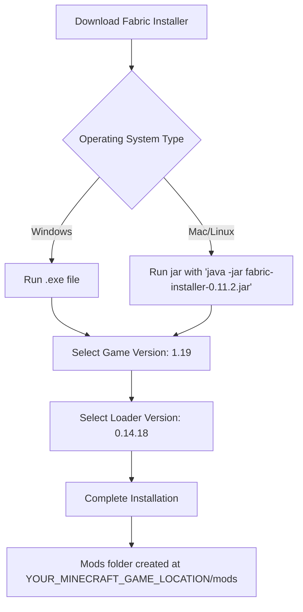
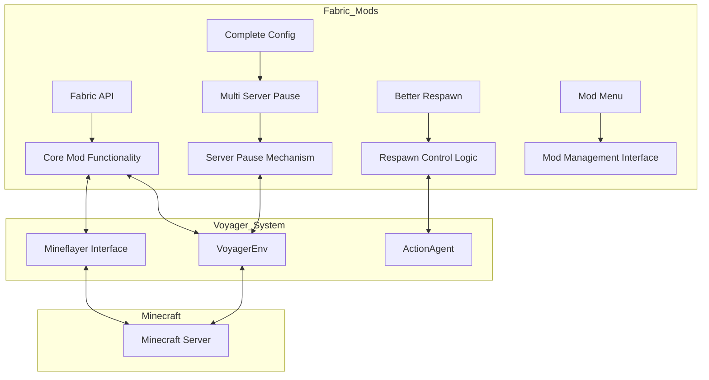
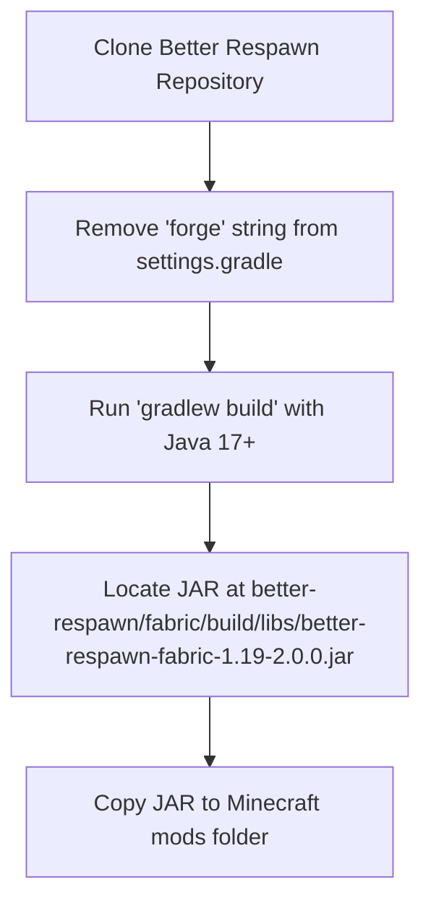
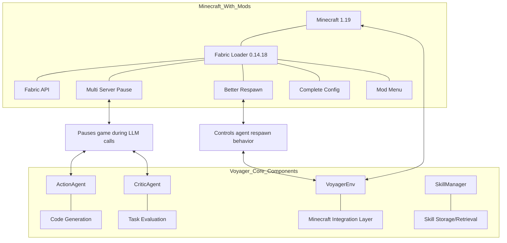

<!-- source: DeepWiki mcp.deepwiki.com · repo MineDojo/Voyager · page 2.2 Fabric Mods Installation · fetched 2026-10-26 -->

# Fabric Mods Installation

<details>
<summary>Relevant source files</summary>

The following files were used as context for generating this wiki page:

- [FAQ.md](FAQ.md)
- [installation/fabric_mods_install.md](installation/fabric_mods_install.md)

</details>


## Purpose and Scope

This document details the installation and configuration of the necessary Fabric mods required for Voyager to function correctly with Minecraft. Voyager depends on several specific mods to enable proper interaction with the Minecraft environment, including server pausing, improved respawn mechanics, and API access. For information about the general Minecraft setup process, see [Minecraft Setup](#2.1).

## Fabric Loader Installation

Voyager requires Fabric Loader version 0.14.18 with Minecraft version 1.19. The installation process varies slightly based on your operating system.

### Installation Process Diagram



Sources: [installation/fabric_mods_install.md:3-4]()

## Required Mods Overview

Voyager requires five specific Fabric mods to function correctly:

| Mod Name | Version | Purpose |
|----------|---------|---------|
| Fabric API | 0.58.0+1.19 | Provides essential API functionality for other mods |
| Mod Menu | 4.0.4 | Allows management of installed mods |
| Complete Config | 2.1.0 | Configuration framework (dependency for Multi Server Pause) |
| Multi Server Pause | 1.19-0.1.1 | Pauses the server while waiting for LLM responses |
| Better Respawn | 1.19-2.0.0 | Improves respawn mechanics for the Voyager agent |

Sources: [installation/fabric_mods_install.md:5-9]()

## Mods Integration with Voyager



Sources: [installation/fabric_mods_install.md:9](), [FAQ.md:38-40]()

## Installation Steps

### Standard Mods Installation

Four of the five mods can be downloaded directly:

1. **Fabric API**: Download from [Modrinth](https://modrinth.com/mod/fabric-api/version/0.58.0+1.19)
2. **Mod Menu**: Download [version 4.0.4](https://cdn.modrinth.com/data/mOgUt4GM/versions/4.0.4/modmenu-4.0.4.jar)
3. **Complete Config**: Download from [CurseForge](https://www.curseforge.com/minecraft/mc-mods/completeconfig/download/3821056)
4. **Multi Server Pause**: Download from [CurseForge](https://www.curseforge.com/minecraft/mc-mods/multiplayer-server-pause-fabric/download/3822586)

Place all downloaded JAR files in the `YOUR_MINECRAFT_GAME_LOCATION/mods` folder.

Sources: [installation/fabric_mods_install.md:5-9]()

### Better Respawn Installation

The Better Respawn mod requires manual compilation:



**Note**: You will need Java Runtime Environment v17+ specifically to build the Better Respawn mod. Some newer JRE versions may cause errors during the build process.

Sources: [installation/fabric_mods_install.md:10-13]()

## Configuration

### Better Respawn Configuration

After installing Better Respawn and launching Minecraft once:

1. Navigate to `YOUR_MINECRAFT_GAME_LOCATION/config/better-respawn`
2. Edit the properties file with the following settings:
   ```
   respawn_block_range=32
   max_respawn_distance=32
   min_respawn_distance=0
   ```

These settings control the agent's respawn behavior, ensuring it respawns within appropriate distances in the game environment.

Sources: [installation/fabric_mods_install.md:14-19]()

### Fabric Version Configuration

When using Voyager with Azure login, you must ensure the correct version is specified:

1. Locate the Fabric version folder at `YOUR_MINECRAFT_GAME_LOCATION/version`
2. Change the `version` parameter in the Azure login configuration to `fabric-loader-0.14.18-1.19`

Sources: [installation/fabric_mods_install.md:20]()

## Verification and Troubleshooting

### Installation Verification

After installation, verify that all mods are correctly installed:

1. Launch Minecraft with the Fabric profile
2. Access the Mod Menu to confirm all five mods are listed and active
3. Check that the Better Respawn configuration file exists with the correct settings

### Common Issues

| Issue | Solution |
|-------|----------|
| Mineflayer subprocess fails to start | Verify Fabric installation and mod placement |
| Missing mod dependencies | Ensure all five mods are installed correctly |
| Better Respawn build fails | Use Java 17 specifically, as newer versions may cause errors |
| Minecraft crashes on launch | Check for mod version compatibility with Minecraft 1.19 |

Sources: [FAQ.md:19-37]()

## Relationship to System Architecture



Sources: [installation/fabric_mods_install.md:3-20]()

This diagram illustrates how the Fabric mods integrate with both Minecraft and the Voyager system components. The Multi Server Pause mod is particularly crucial as it pauses the Minecraft server while Voyager's LLM components generate responses, preventing timeout issues during operation. The Better Respawn mod ensures the agent can resume operation effectively after a death in the game.

---

