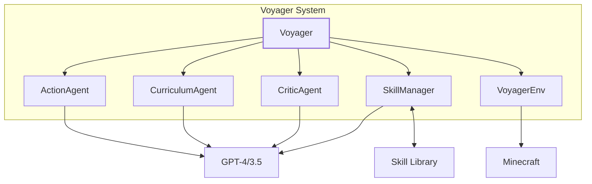
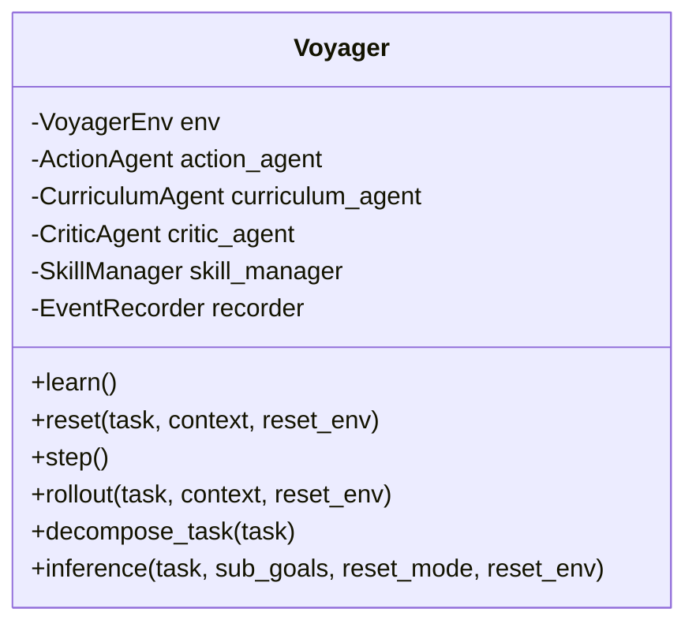
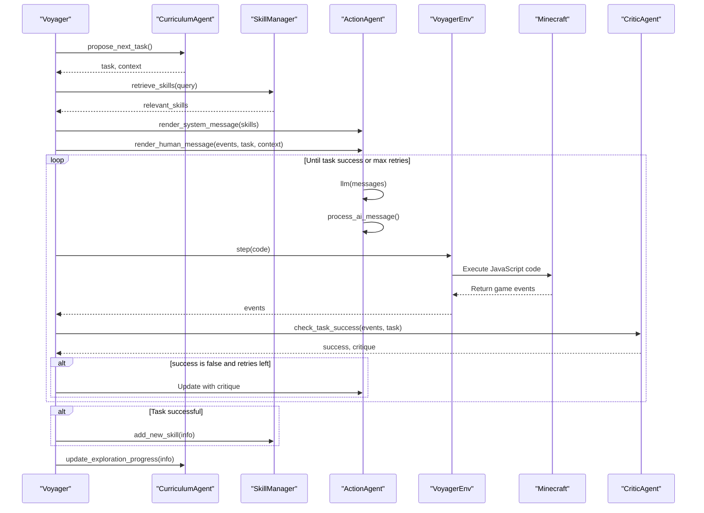
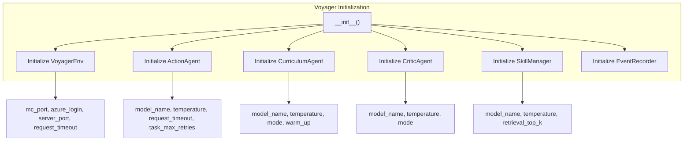
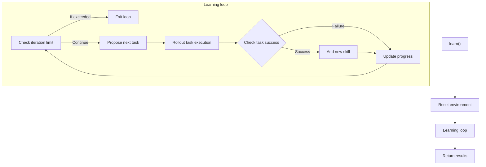
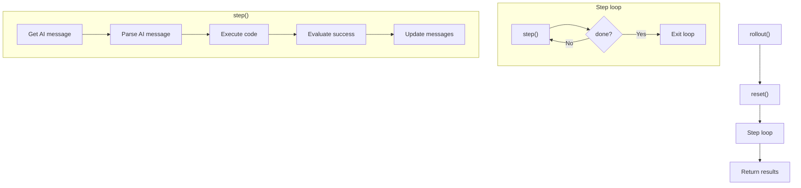
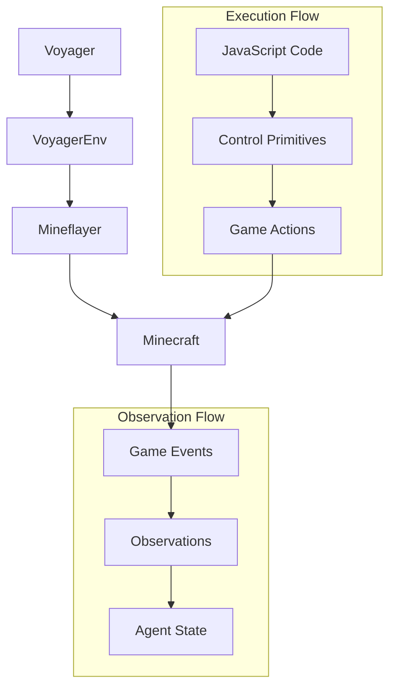

<!-- source: DeepWiki mcp.deepwiki.com · repo MineDojo/Voyager · page 3 Core Architecture · fetched 2026-10-26 -->

# Core Architecture

Relevant source files

The following files were used as context for generating this wiki page:

- [README.md](README.md)
- [voyager/agents/__init__.py](voyager/agents/__init__.py)
- [voyager/voyager.py](voyager/voyager.py)

This page documents the core architecture of Voyager, an LLM-powered embodied lifelong learning agent for Minecraft. It provides a technical overview of the system's main components, their interactions, and the control flow that enables Voyager's learning capabilities. For installation instructions, see [Installation and Setup](#2), and for detailed explanations of individual agent components, see [Agents](#4).

## System Overview

Voyager is built on a multi-agent architecture that enables autonomous exploration, skill acquisition, and task execution in Minecraft. The system is designed around a central orchestrator that coordinates specialized agents, manages communication with the Minecraft environment, and implements a continuous learning process.

**System Components Diagram: Voyager Core Architecture**

Sources: [voyager/voyager.py:17-412](), [README.md:21-37]()

## Key Components and Their Roles

The Voyager system consists of five key components, each with a specific responsibility in the learning and task execution process:

| Component | Role | Implementation |
|-----------|------|----------------|
| **Voyager** | Central orchestrator that coordinates the entire system | [voyager/voyager.py:17-368]() |
| **ActionAgent** | Generates JavaScript code to perform tasks in Minecraft | [voyager/voyager.py:118-127]() |
| **CurriculumAgent** | Proposes new tasks and maintains learning progress | [voyager/voyager.py:128-139]() |
| **CriticAgent** | Evaluates task success and provides feedback | [voyager/voyager.py:140-145]() |
| **SkillManager** | Maintains a library of learned skills for reuse | [voyager/voyager.py:146-153]() |
| **VoyagerEnv** | Interfaces with the Minecraft environment | [voyager/voyager.py:104-109]() |

Sources: [voyager/voyager.py:17-153](), [voyager/agents/__init__.py:1-4]()

## Voyager Class Implementation

The `Voyager` class serves as the central orchestrator of the entire system. It initializes all components, manages their interactions, and implements the main learning loop.

**Class Diagram: Voyager Main Class**

Sources: [voyager/voyager.py:17-102](), [voyager/voyager.py:165-412]()

The Voyager class has several core methods that implement the learning and task execution processes:

- `learn()`: Implements the continuous learning loop where new tasks are proposed and executed
- `reset()`: Prepares the agent for a new task
- `step()`: Executes a single step in the learning process
- `rollout()`: Executes a complete task until success or maximum retries
- `decompose_task()`: Breaks down a complex task into subtasks
- `inference()`: Executes a specific task using learned skills

Sources: [voyager/voyager.py:165-412]()

## Data Flow and Control Loop

Voyager implements a continuous learning loop that involves task proposal, skill retrieval, code generation, execution, evaluation, and skill storage. This learning process is the core of Voyager's ability to autonomously explore and master the Minecraft environment.

**Sequence Diagram: Voyager Learning Process**

Sources: [voyager/voyager.py:295-368](), [voyager/voyager.py:203-285]()

## Initialization and Configuration

The Voyager system requires several configuration parameters during initialization. These parameters control aspects such as model selection, retry limits, and checkpoint management.

**Initialization Flow: Voyager System Setup**

Sources: [voyager/voyager.py:18-154]()

Key configuration parameters include:

- Model names and temperatures for each agent
- Task retry limits
- Environment timeouts and wait ticks
- Checkpoint directory for saving and resuming progress
- Skill library directory for loading pre-learned skills

Sources: [voyager/voyager.py:18-102]()

## Learning Process Implementation

The `learn()` method implements Voyager's continuous learning process. This involves proposing new tasks, executing them, evaluating the results, and storing successful skills for future use.

**Flowchart: Voyager Learning Process**

Sources: [voyager/voyager.py:295-368]()

The learning process continues until the maximum number of iterations is reached. During each iteration, the system:

1. Proposes a new task based on current progress
2. Retrieves relevant skills from the skill library
3. Generates code to execute the task
4. Executes the code in the Minecraft environment
5. Evaluates task success
6. Stores successful skills
7. Updates exploration progress

Sources: [voyager/voyager.py:295-368]()

## Task Execution Process

The `rollout()` and `step()` methods implement the task execution process. This involves resetting the agent with a specific task, executing steps until the task is completed or the maximum number of retries is reached, and returning the results.

**Flowchart: Voyager Task Execution Process**

Sources: [voyager/voyager.py:203-293]()

During each step, the ActionAgent:
1. Receives the current state and task
2. Generates JavaScript code to execute
3. Executes the code in the Minecraft environment
4. Processes the results and updates its state

Sources: [voyager/voyager.py:203-285]()

## Integration with Minecraft

Voyager integrates with Minecraft through the VoyagerEnv component, which provides an interface for executing JavaScript code in the game environment and receiving events and observations.

**Integration Diagram: Voyager-Minecraft Communication**

Sources: [voyager/voyager.py:104-109](), [voyager/voyager.py:214-226]()

## Conclusion

The core architecture of Voyager comprises a central orchestrator (Voyager class) that coordinates multiple specialized agents (ActionAgent, CurriculumAgent, CriticAgent, and SkillManager) to enable autonomous learning and task execution in Minecraft. The system implements a continuous learning loop that involves task proposal, skill retrieval, code generation, execution, evaluation, and skill storage.

This modular architecture allows Voyager to:
1. Continuously explore and learn in the Minecraft environment
2. Develop and store reusable skills
3. Leverage learned skills to solve new tasks
4. Provide a framework for LLM-powered embodied agents in interactive environments

For more detailed information about individual components, refer to the [Agents](#4) page, and for information about the skill system, see the [Skill System](#5) page.

---

