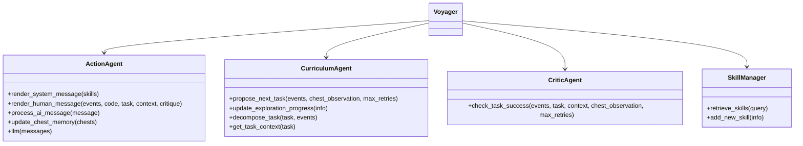
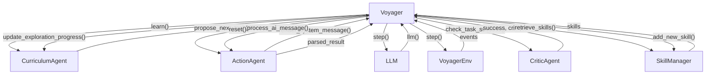
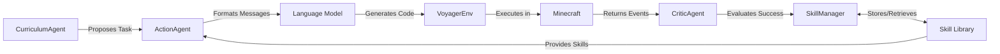

<!-- source: DeepWiki mcp.deepwiki.com · repo MineDojo/Voyager · page 4 Agents · fetched 2026-10-26 -->

# Agents

Relevant source files

The following files were used as context for generating this wiki page:

- [voyager/agents/__init__.py](voyager/agents/__init__.py)
- [voyager/voyager.py](voyager/voyager.py)

The Agents module forms the core of Voyager's intelligent decision-making system. It consists of four specialized agent types that work together to enable autonomous exploration, learning, and execution of tasks in Minecraft. This page describes the agent architecture, the role of each agent type, and how they interact during the learning and execution processes.

For specific details about individual agents, see [Curriculum Agent](#4.1), [Action Agent](#4.2), [Critic Agent](#4.3), and [Skill Manager](#4.4).

## Agent Architecture

Voyager employs a multi-agent architecture where specialized agents handle different aspects of the learning and task execution process. Each agent leverages large language models (LLMs) to perform its specific function.

### Agent Class Structure

Sources: [voyager/voyager.py:118-153](), [voyager/agents/__init__.py:1-4]()

## Agent Types

### CurriculumAgent

The CurriculumAgent determines what tasks Voyager should attempt next. It proposes new tasks based on the agent's current state, exploration progress, and environment observations. It tracks completed and failed tasks, and can decompose complex tasks into simpler sub-goals.

Key responsibilities:
- Propose new tasks tailored to current capabilities
- Track exploration progress
- Decompose complex tasks into subtasks
- Provide contextual information for task execution

### ActionAgent

The ActionAgent converts high-level tasks into executable JavaScript code for the Minecraft environment. It uses a language model to generate code based on the current task, context, and available skills from the skill library.

Key responsibilities:
- Generate executable JavaScript code
- Format messages for the language model
- Process responses from the language model
- Maintain memory of chest contents and inventory

### CriticAgent

The CriticAgent evaluates whether a task has been successfully completed by analyzing the events that occurred during execution. It provides critiques that help improve future attempts.

Key responsibilities:
- Determine if a task was successfully completed
- Provide detailed feedback on failures
- Guide the learning process through evaluation

### SkillManager

The SkillManager maintains a library of reusable skills acquired through successful task completions. It retrieves relevant skills for new tasks and stores new skills when tasks are successfully completed.

Key responsibilities:
- Store successful code solutions as reusable skills
- Retrieve relevant skills for new tasks
- Manage the skill library

Sources: [voyager/voyager.py:52-102]()

## Agent Interaction Flow

The agents interact through the main Voyager class, which coordinates their activities during the learning and execution processes.

Sources: [voyager/voyager.py:164-285](), [voyager/voyager.py:295-368]()

## Learning Pipeline

The complete learning pipeline shows how information flows between agents during task execution:

Sources: [voyager/voyager.py:295-368]()

## Agent Configuration Parameters

Each agent can be configured with specific parameters when initializing the Voyager system. The table below shows the key configuration parameters for each agent:

| Agent | Parameter | Default Value | Description |
|-------|-----------|---------------|-------------|
| ActionAgent | `model_name` | "gpt-4" | LLM used by the agent |
| ActionAgent | `temperature` | 0 | Temperature parameter for LLM |
| ActionAgent | `task_max_retries` | 4 | Maximum attempts per task |
| ActionAgent | `show_chat_log` | True | Display chat logs |
| ActionAgent | `show_execution_error` | True | Display execution errors |
| CurriculumAgent | `model_name` | "gpt-4" | LLM used by the agent |
| CurriculumAgent | `temperature` | 0 | Temperature parameter for LLM |
| CurriculumAgent | `qa_model_name` | "gpt-3.5-turbo" | LLM used for QA |
| CurriculumAgent | `qa_temperature` | 0 | Temperature for QA model |
| CurriculumAgent | `mode` | "auto" | "auto" or "manual" for curriculum |
| CriticAgent | `model_name` | "gpt-4" | LLM used by the agent |
| CriticAgent | `temperature` | 0 | Temperature parameter for LLM |
| CriticAgent | `mode` | "auto" | "auto" or "manual" for critic |
| SkillManager | `model_name` | "gpt-3.5-turbo" | LLM used by the agent |
| SkillManager | `temperature` | 0 | Temperature parameter for LLM |
| SkillManager | `retrieval_top_k` | 5 | Skills to retrieve per task |

Sources: [voyager/voyager.py:17-102]()

## Learning Process

The typical learning process in Voyager follows these steps:

1. The CurriculumAgent proposes a new task based on current progress and environment state
2. The SkillManager retrieves relevant skills from the skill library
3. The ActionAgent generates JavaScript code to accomplish the task
4. The code is executed in the Minecraft environment via VoyagerEnv
5. The CriticAgent evaluates whether the task was successfully completed
6. If successful, the code is stored as a new skill in the skill library
7. The CurriculumAgent updates exploration progress and proposes the next task

This process continues iteratively, allowing Voyager to learn new skills and accomplish increasingly complex tasks over time.

Sources: [voyager/voyager.py:295-368]()

## Task Execution Process

For executing specific tasks (rather than open-ended learning), Voyager uses a similar process but with a predefined task or set of sub-goals:

1. The task is either provided directly or decomposed into sub-goals by the CurriculumAgent
2. Each sub-goal is executed using the same process as in the learning mode
3. The system tracks progress through the sub-goals until the overall task is completed

Sources: [voyager/voyager.py:370-411]()

---

