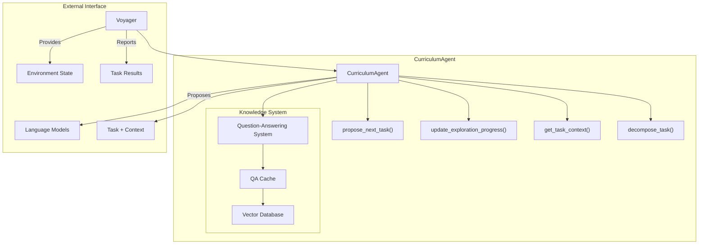
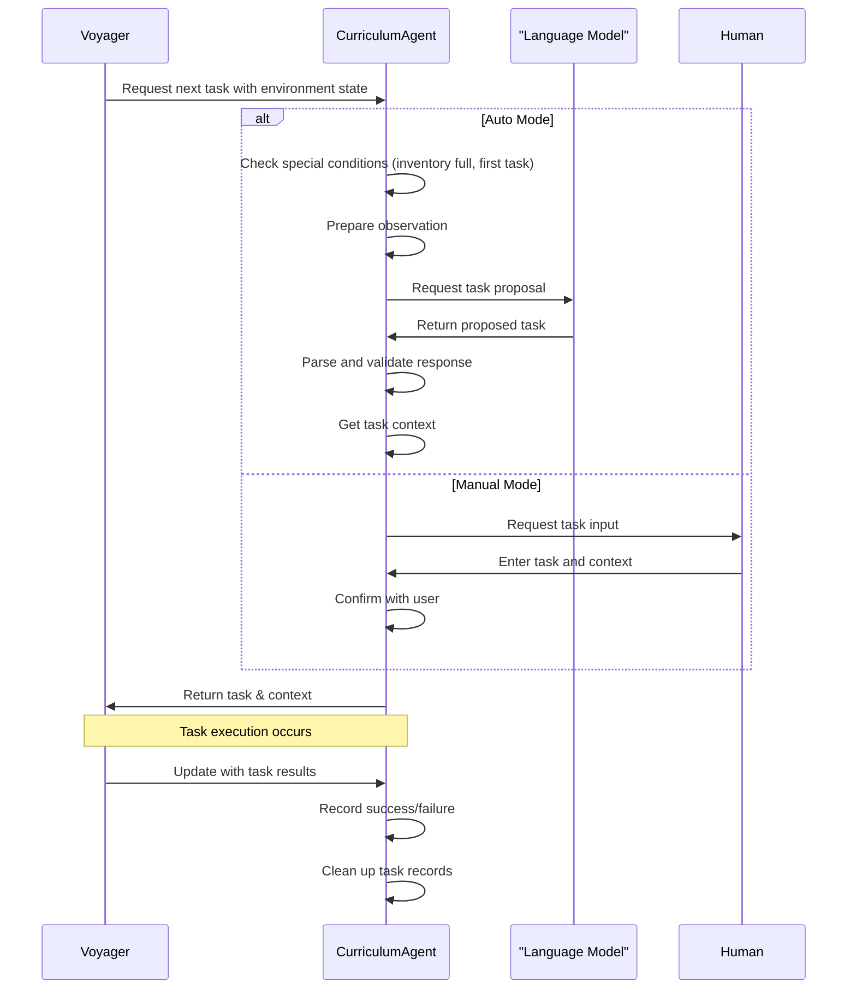
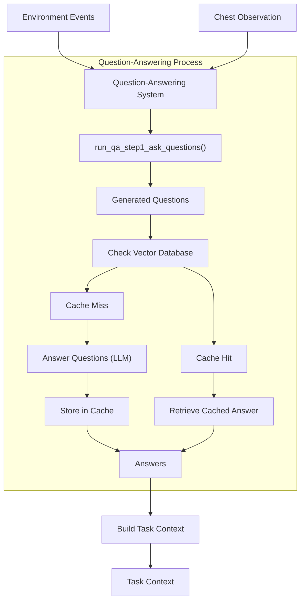
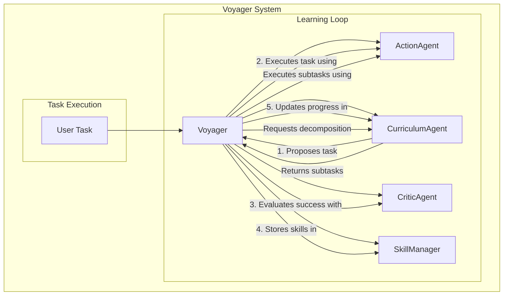

<!-- source: DeepWiki mcp.deepwiki.com · repo MineDojo/Voyager · page 4.1 Curriculum Agent · fetched 2026-10-26 -->

# Curriculum Agent

<details>
<summary>Relevant source files</summary>

The following files were used as context for generating this wiki page:

- [voyager/agents/curriculum.py](voyager/agents/curriculum.py)
- [voyager/voyager.py](voyager/voyager.py)

</details>


The Curriculum Agent is a core component of the Voyager system that manages task proposal and knowledge acquisition. It determines what tasks the agent should tackle next in its learning process, tracks progress through completed and failed tasks, and provides contextual information to assist with task execution. This page documents the architecture, functionality, and implementation of the Curriculum Agent.

For information about other agents in Voyager, see [Agents](#4) and related pages on the [Action Agent](#4.2), [Critic Agent](#4.3), and [Skill Manager](#4.4).

## Architecture and Role

The Curriculum Agent serves as Voyager's task planner and knowledge manager, functioning as an automatic curriculum generator. It proposes increasingly complex tasks based on the agent's current state and previous achievements, enabling progressive skill acquisition in an open-ended environment.



Sources: [voyager/agents/curriculum.py:15-29](), [voyager/voyager.py:319-326]()

## Core Functionality

### Task Proposal System

The Curriculum Agent proposes tasks through one of two modes:

1. **Auto Mode**: Uses LLM reasoning to propose appropriate next tasks based on:
   - Current environment state
   - Agent's inventory and resources
   - Previously completed and failed tasks
   - Knowledge about the Minecraft world

2. **Manual Mode**: Allows a human operator to directly specify tasks and context



Sources: [voyager/agents/curriculum.py:240-327](), [voyager/voyager.py:319-326](), [voyager/voyager.py:356-362]()

### Task Tracking and Progress Management

The Curriculum Agent maintains records of:

- **Completed Tasks**: Successfully executed tasks
- **Failed Tasks**: Tasks that could not be completed after multiple attempts

When tasks are completed or failed, the agent:
1. Updates the appropriate list
2. Deduplicates entries
3. Removes completed tasks from the failed list (if they were previously failed)
4. Persists the updated lists to disk

Sources: [voyager/agents/curriculum.py:329-367]()

### Knowledge Acquisition

The Curriculum Agent employs a question-answering system to gather information about the Minecraft world:

1. **Question Generation**: Generates relevant questions about the current environment
2. **Answer Retrieval**: Either retrieves cached answers or queries the LLM for new information
3. **Context Building**: Constructs contextual information for task execution based on the answers



Sources: [voyager/agents/curriculum.py:384-498]()

## Key Components

### Observation System

The Curriculum Agent processes environment observations, including:

- Biome information
- Time of day
- Nearby blocks and entities
- Agent's health and hunger
- Position and equipment
- Inventory contents
- Previously completed/failed tasks

The agent uses a "warm-up" mechanism to progressively reveal more information to the LLM as the agent completes more tasks, preventing information overload early in the learning process.

Sources: [voyager/agents/curriculum.py:134-238]()

### Question-Answering Cache

To avoid redundant LLM queries, the agent maintains:

- A vector database of previously asked questions
- A cache of question-answer pairs
- Similarity search to identify semantically equivalent questions

This system:
1. Checks if a semantically similar question exists in the cache
2. Returns the cached answer if found
3. Queries the LLM for new questions
4. Stores new questions and answers in the cache for future use

Sources: [voyager/agents/curriculum.py:57-71](), [voyager/agents/curriculum.py:384-415]()

### Task Decomposition

For complex tasks, the Curriculum Agent can break them down into a sequence of simpler subtasks:

1. Receives a high-level task from the user
2. Analyzes the current environment state
3. Decomposes the task into an ordered sequence of smaller tasks
4. Returns the decomposition for sequential execution

Sources: [voyager/agents/curriculum.py:369-382](), [voyager/voyager.py:370-378]()

## Implementation Details

### Initialization Parameters

| Parameter | Type | Description |
|-----------|------|-------------|
| `model_name` | string | Name of the LLM for task proposal (default: "gpt-3.5-turbo") |
| `temperature` | float | Temperature parameter for the main LLM (default: 0) |
| `qa_model_name` | string | Name of the LLM for Q&A (default: "gpt-3.5-turbo") |
| `qa_temperature` | float | Temperature parameter for the Q&A LLM (default: 0) |
| `request_timout` | int | Timeout for LLM requests in seconds (default: 120) |
| `ckpt_dir` | string | Directory for saving agent state |
| `resume` | bool | Whether to resume from saved state |
| `mode` | string | Operating mode: "auto" or "manual" |
| `warm_up` | dict | Configuration for progressive feature reveal |
| `core_inventory_items` | string | Regex pattern for critical inventory items |

Sources: [voyager/agents/curriculum.py:16-29]()

### State Management

The Curriculum Agent persists its state across sessions:

- Completed and failed tasks lists
- QA cache contents and vector database 
- Progress tracking information

When initialized with `resume=True`, the agent loads its previous state from disk, allowing for continuous learning across multiple sessions.

Sources: [voyager/agents/curriculum.py:46-90]()

### Warm-up System Configuration

The warm-up system controls which observations are provided to the LLM based on the number of completed tasks:

```python
default_warmup = {
    "context": 15,        # QA context after 15 tasks
    "biome": 10,          # Biome info after 10 tasks
    "time": 15,           # Time info after 15 tasks
    "nearby_blocks": 0,   # Always show nearby blocks
    "other_blocks": 10,   # Other blocks after 10 tasks
    "nearby_entities": 5, # Nearby entities after 5 tasks
    "health": 15,         # Health info after 15 tasks
    "hunger": 15,         # Hunger info after 15 tasks
    "position": 0,        # Always show position
    "equipment": 0,       # Always show equipment
    "inventory": 0,       # Always show inventory
    "optional_inventory_items": 7, # Show optional items after 7 tasks
    "chests": 0,          # Always show chests
    "completed_tasks": 0, # Always show completed tasks
    "failed_tasks": 0     # Always show failed tasks
}
```

This mechanism helps manage the complexity of information provided to the LLM, gradually increasing as the agent becomes more capable.

Sources: [voyager/agents/curriculum.py:92-109]()

### Special Task Handling

The Curriculum Agent has special handling for certain situations:

1. **First Task**: Always proposes "Mine 1 wood log" as the initial task
2. **Inventory Management**: When inventory is nearly full (≥33/36 slots):
   - Proposes placing a chest if one is in inventory
   - Proposes crafting a chest if none is available
   - Proposes depositing items in an existing chest

This ensures the agent can continue learning without being blocked by practical constraints.

Sources: [voyager/agents/curriculum.py:241-276]()

## Integration with Voyager

The Curriculum Agent is integrated into the Voyager system in two primary ways:

1. **Learning Loop**: In the continuous learning mode, the agent proposes increasingly complex tasks based on the agent's growing capabilities

2. **Task Execution**: For user-specified tasks, the agent decomposes them into manageable subtasks and provides necessary context



Sources: [voyager/voyager.py:295-368](), [voyager/voyager.py:380-412]()

## File Structure

The Curriculum Agent is primarily implemented in:

- `voyager/agents/curriculum.py`: Contains the CurriculumAgent class and all its methods
- `voyager/voyager.py`: Handles integration with the broader Voyager system

The agent stores its state in:

- `{ckpt_dir}/curriculum/completed_tasks.json`: List of completed tasks
- `{ckpt_dir}/curriculum/failed_tasks.json`: List of failed tasks
- `{ckpt_dir}/curriculum/qa_cache.json`: Cache of question-answer pairs
- `{ckpt_dir}/curriculum/vectordb/`: Directory containing the vector database for question similarity

Sources: [voyager/agents/curriculum.py:45-71](), [voyager/agents/curriculum.py:364-367]()

---

